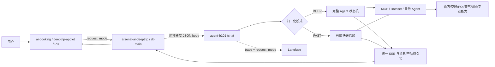
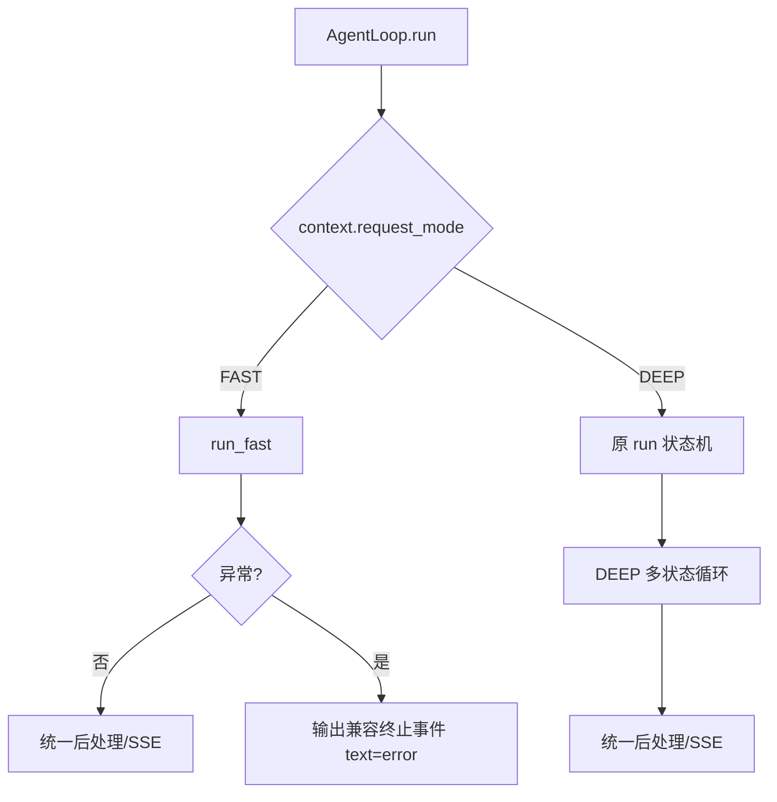
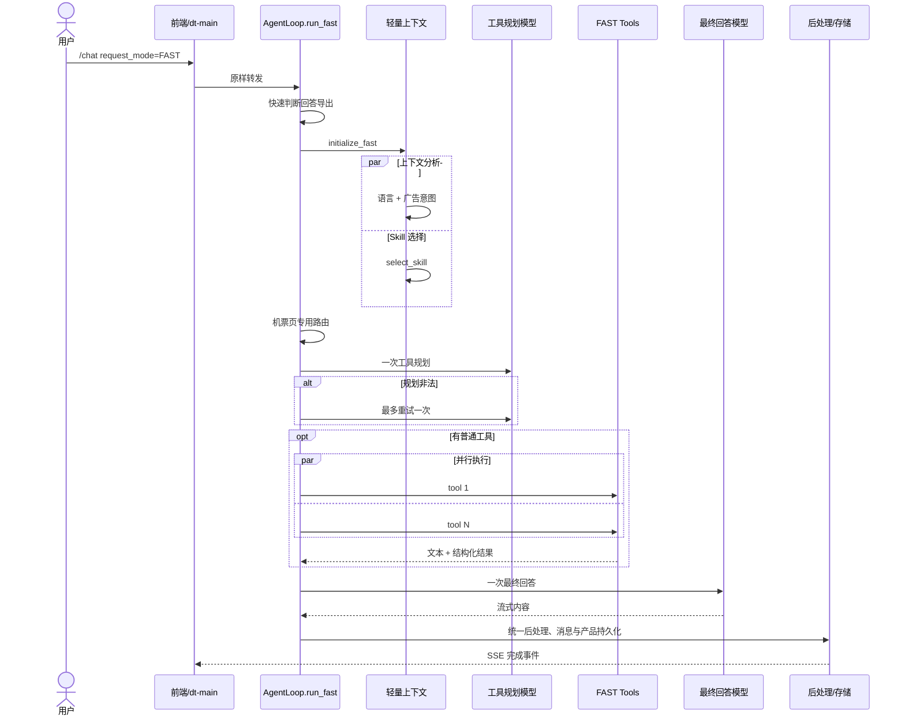

# FAST/DEEP 双执行模式技术实现

- 创建时间：2026-09-08 14:39:24
- 更新时间：2026-09-08 14:39:24
- 作者：徐凯旋
- 邮箱：azouever@gmail.com
- tags：Agent, 执行模式, SSE, 并行调用, Langfuse, 设计文档

[TOC]

## 目录

- [1. 文档范围与结论](#1-文档范围与结论)
- [2. 背景、目标与非目标](#2-背景目标与非目标)
- [3. DeepTrip 多仓链路](#3-deeptrip-多仓链路)
- [4. 请求契约与模式归一化](#4-请求契约与模式归一化)
- [5. 最外层模式分流](#5-最外层模式分流)
- [6. DEEP 模式](#6-deep-模式)
- [7. FAST 有限执行链路](#7-fast-有限执行链路)
  - [7.1 快速前置与轻量上下文](#71-快速前置与轻量上下文)
  - [7.2 工具集合与一次规划](#72-工具集合与一次规划)
  - [7.3 并行工具执行](#73-并行工具执行)
  - [7.4 一次回答与统一后处理](#74-一次回答与统一后处理)
- [8. 特殊业务兼容](#8-特殊业务兼容)
  - [8.1 回答导出](#81-回答导出)
  - [8.2 机票页](#82-机票页)
  - [8.3 客服接管](#83-客服接管)
- [9. dt-main 与前端接入](#9-dt-main-与前端接入)
- [10. SSE、异常与兼容契约](#10-sse异常与兼容契约)
- [11. 性能、幂等、安全与观测](#11-性能幂等安全与观测)
- [12. 测试与验收](#12-测试与验收)
- [13. CURL 联调示例](#13-curl-联调示例)
- [14. 当前状态与待核实项](#14-当前状态与待核实项)
- [15. 代码地图与代表提交](#15-代码地图与代表提交)

---

## 1. 文档范围与结论

本文梳理 2026 年 9 月新增的 `/chat` 双执行模式，覆盖 DeepTrip 前端、dt-main、
`agent-b101`、工具/Dataset 和 Langfuse 链路。

请求新增 `request_mode=FAST|DEEP`：

- `DEEP` 是默认模式，保留完整上下文分析、多状态 Agent 编排、业务 Agent 调度和多轮工具推理。
- `FAST` 是独立的有限执行管线，只做必要上下文、一次工具规划、可选并行工具和一次最终回答。
- 两种模式在入口归一化，在 `AgentLoop.run()` 最外层分流，不把 FAST 条件散落进 DEEP 状态机。
- FAST 继续复用成熟的 SSE、消息落库、后处理、结构化产品持久化，以及导出、机票页、客服接管能力。
- 非法值、空值和非字符串统一回退 `DEEP`，保证旧客户端兼容和高风险请求不会意外进入快速链路。

<mark style="background: #FFB86CA6;">FAST 的核心约束是执行次数有上界，而不是牺牲数据真实性：需要实时信息时仍调用专业工具，工具失败或数据缺失时必须如实说明。</mark>

## 2. 背景、目标与非目标

DEEP 模式适合复杂行程规划、需要连续推理或多个业务 Agent 协作的任务，但对于寒暄、直接
事实问答、单一酒店/交通查询等请求，完整初始化和循环推理会增加首字与总响应时延。

双模式的目标是：

- 给上游提供明确、稳定的时延/深度选择，而不是依赖模型隐式猜测。
- 让 FAST 路径具备有限步骤、有限模型调用和低时延工具集合。
- 保持 `/chat` 请求、SSE 消费、消息持久化和结构化产品卡协议兼容。
- 对回答导出、机票页面上下文和客服接管等已上线业务做显式兼容。
- 在 Langfuse 中能按实际执行模式和 `fast.*` 步骤分析质量与耗时。

非目标：

- FAST 不替代 DEEP 的完整多 Agent 能力。
- 不根据提示词动态扩展 FAST 工具白名单。
- 不允许前端把非法值当作新的实验模式传入。
- 不因为 FAST 而跳过专业数据源并编造实时价格、余票、天气或营业信息。

## 3. DeepTrip 多仓链路



| 仓库/系统 | 职责 | 双模式改造边界 |
| --- | --- | --- |
| `ai-booking`、小程序、PC | 选择或接收业务策略，建立 SSE 连接 | 请求体透传 `request_mode`，复用同一 SSE 消费器 |
| `arsenal-ai-deeptrip` | dt-main 统一入口、鉴权与代理 | 当前代理缓存并原样转发 JSON body，无需理解模式语义 |
| `agent-b101` | 参数校验、模式分流和实际执行 | 实现默认值、FAST 有限链路、DEEP 原链路及统一收尾 |
| MCP/Dataset/专业工具 | 提供实时数据与结构化产品 | FAST 只开放低时延集合；DEEP 按原有业务编排调用 |
| Langfuse | Trace、Span、质量和时延分析 | Trace 名称/metadata 增加模式，FAST 上报细分步骤 |

`dt_robot_main/doc/project/DeepTripOverview_DOC.md` 定义的主链路是“前端 → dt-main/chat-server
→ agent-b101 → MCP/Dataset”。`request_mode` 是这一整条链路的请求级控制字段，但模式语义
只由 B101 解释，dt-main 和前端不应复制 B101 的内部路由规则。

## 4. 请求契约与模式归一化

请求示例：

```json
{
  "sid": "demo-session",
  "q": "苏州周末怎么玩",
  "request_mode": "FAST"
}
```

`HotelChatRequest` 中新增：

```python
request_mode: str = "DEEP"
```

`field_validator(..., mode="before")` 的归一化规则为：

| 输入 | 实际模式 |
| --- | --- |
| 缺失、`null`、数字、数组、对象 | `DEEP` |
| `FAST`、`fast`、前后带空格 | `FAST` |
| `DEEP`、`deep`、前后带空格 | `DEEP` |
| 其他字符串 | `DEEP` |

归一化后的值写入 `AgentCoreContext.request_mode`，下游只消费 `FAST/DEEP` 两个稳定枚举值。
默认 DEEP 是兼容策略也是安全策略：旧调用方不改请求即可保持原行为，拼写错误也不会进入
能力更受限的 FAST 路径。

## 5. 最外层模式分流



分流位于 `DT_agent_loop_v2.py` 的 `run()` 最外层：FAST 执行完立即 return，DEEP 继续原有
状态机。这样可以保证：

- FAST 不会初始化完又误入 DEEP 循环。
- DEEP 主链不需要到处判断 `request_mode`。
- FAST 的异常边界和结束事件可以单独兜底。
- 两种模式仍可以在明确位置复用后处理方法，而不是复制消息落库和 SSE 协议。

## 6. DEEP 模式

DEEP 是现有默认能力，面向高复杂度和不确定任务。它会执行较完整的上下文初始化、意图与
复杂度判断、路由管理、业务 Agent/工具调度、必要的多轮 LLM 推理、状态转换和后处理。

适合 DEEP 的典型场景：

- 多城市、多天、多约束的行程规划。
- 需要先澄清再执行，或者需要多次工具结果互相验证。
- 多业务 Agent 协作，执行路径不能预先限定为“一次规划 + 一次回答”。
- 对回答质量、推理完整度的优先级高于最低响应时延。

DEEP 没有因为新字段改变默认语义；不传 `request_mode` 的历史调用方继续走 DEEP。

## 7. FAST 有限执行链路



### 7.1 快速前置与轻量上下文

`run_fast()` 先处理回答导出候选，再调用 `initialize_fast()`：

- 初始化 Prompt generator、`ItemRecs` 和一层 Loop Context。
- 并行执行语言/广告意图分析与 Skill 选择。
- 语言和广告意图通过一次 `asyncio.gather` 并行。
- 酒店意图使用本地正则填充 `intent_list=["查酒店"]`，避免为横幅再调用完整业务意图模型。
- `rewritten_query` 直接使用当前 query，不执行 DEEP 的完整 query 改写链。
- 主动释放通用知识和导出判断事件，避免共享 Tips/等待逻辑被阻塞。

轻量化不等于无上下文。规划 Prompt 仍包含近期历史、语言、日期/节假日等运行时信息，
用于把“那里”“后天呢”补成可以独立执行的工具参数。

### 7.2 工具集合与一次规划

FAST 固定工具集合：

| 工具 | 用途 | 来源 |
| --- | --- | --- |
| `search_hotel` | 低时延酒店搜索 | FAST 专用酒店工具 |
| `search_transit` | 航班、机票、火车、车次和其他交通 | 统一交通查询工具 |
| `web_search_fast` | 目的地攻略、路线、政策、活动、新闻等公开信息 | FAST 网页搜索工具 |
| `search_hotel_detail_by_id` | 已选酒店详情 | 仅现有工具上下文可用时加入 |
| `get_weather_info` | 实时天气 | 仅现有工具上下文可用时加入 |
| `poi_search` | 景点、餐厅、周边 POI | 仅现有工具上下文可用时加入 |
| `get_train_schedule` | 车次时刻表 | 仅现有工具上下文可用时加入 |

工具规划使用 `deepseek-v4-flash`、`temperature=0`、`enable_thinking=False`，输出严格 JSON：

```json
{
  "need_tool": true,
  "tool_calls": [
    {
      "name": "search_transit",
      "arguments": {
        "tool_query": "查询 2026-09-12 上海到北京的高铁"
      }
    }
  ]
}
```

服务端只保留白名单工具和字典参数。协议非法时最多重试一次；重试仍非法，实时数据意图才
使用由原 query 构造的安全单工具兜底，否则不调工具。这个策略同时限制延迟和错误扩散。

### 7.3 并行工具执行

普通 FAST 工具通过 `asyncio.gather` 并行执行，每个阻塞工具放入工作线程：

1. 调用前发任务卡 running 状态。
2. 工具统一返回“文本结果 + 结构化结果”二元组；旧返回形式也兼容。
3. 文本最多截取 6000 字进入最终模型，防止单个工具撑爆上下文。
4. 结构化结果异步写入 `ItemRecs`，继续供 V2 渲染、Redis 和产品卡使用。
5. 交通/酒店并发结果按稳定 ID 合并去重，避免最后完成的任务覆盖先完成结果。
6. 单工具异常转成当前工具的 error 结果，不直接中断其他并行工具。
7. 无论成功失败，任务卡最终进入 completed，避免前端一直显示运行中。

需要 `search_transit` 时会先准备交通会话存储，回答完成后执行交通预取收尾。

### 7.4 一次回答与统一后处理

工具完成后，FAST 构造最终消息：系统 Prompt、轻量运行时上下文、近期历史、当前问题，
以及已执行工具结果。最终回答同样使用 `deepseek-v4-flash` 并关闭 thinking。

模型被要求只依据工具结果和已知信息回答；数据缺失时明确说明，不能推测价格、库存或政策。
回答流继续进入 `_handle_llm_inference_state()` 和 `_handle_post_processing_state()`，因此保留：

- 与 DEEP 一致的流式正文输出。
- 回答消息持久化和 `ans_msg_id` 生成。
- 广告/语言等既有后处理能力。
- 结构化产品结果到 `ItemRecs`、渲染引擎和历史链路的连接。
- 渠道兼容的结束事件。

## 8. 特殊业务兼容

### 8.1 回答导出

FAST 在完整初始化前执行轻量导出判断：

- 请求显式 `answer_export=true` 时直接命中。
- 只有包含“导出、下载、保存回答/攻略/行程、生成 PDF/Word”等候选词时才调用导出意图判断。
- 命中后短路普通 FAST 链路，复用共享 `_run_answer_export()` 生成导出组件、保存消息、上报 Trace 并输出 SSE。
- 等待提示受 `answer_export_detection_done` 控制，避免先提示“正在思考”又立即切换导出。

### 8.2 机票页

当 `sub_channel` 为 `FLIGHT_PAGE` 或 `ROUND_TRIP_FLIGHT_PAGE`，FAST 在通用工具规划前调用
专用路由，并注入 `pageContext`、机票页信息、近期历史和 travel commend 提示：

- 命中单程/往返机票页 Agent 时，复用机票页 Prompt，由 flash 模型直接生成回答。
- 命中客服 Agent 时，进入与 DEEP 对等的 Agent Dispatch 和后处理。
- 未命中专用 Agent 才继续通用 FAST 工具规划。

这样避免通用规划丢失页面筛选、跳转、创单上下文，也避免把机票页问题错误当成普通网页问答。

### 8.3 客服接管

客服工具只在 `available_agents` 包含 `customer_agent` 且对应
`customer_service_agent` 已注册时开放。规划规则要求：

- 订单、退款、多扣费、会员、发票物流、支付、人工客服和投诉必须交给客服 Agent。
- 客服接管必须是 `tool_calls` 中唯一一项，不能同时执行网页、酒店或交通工具。
- 参数必须包含用户第一人称的 `task_desc` 和受控问题类型。
- 服务端再次校验唯一调用和参数枚举，非法规划进入重试/降级，不直接接管。

接管时复用 DEEP 的流式客服 Agent，保留语言事件和任务卡，并由客服链路结束请求；不会再由
FAST 模型补一段可能冲突的答案。

## 9. dt-main 与前端接入

### 9.1 dt-main

当前 `arsenal-ai-deeptrip` 的 `RequestWrapperFilter` 会读取并缓存请求 body，
`RoutingFilterV3` 对 chat 类请求使用该 JSON body 转发。因此 `request_mode` 可作为未知业务
字段原样到达 B101，dt-main 不需要解析或重写它。

dt-main 需要保证：

- 不维护自己的 FAST/DEEP 默认值，避免两层规则漂移。
- 不因请求体白名单、DTO 重建或日志脱敏误删 `request_mode`。
- 长连接超时、客户端断开和 SSE flush 行为对两种模式一致。
- 日志可记录归一化前的字段是否存在，但不要记录完整敏感请求体。

### 9.2 前端

本机没有 `ai-booking`、`deeptrip-applet`、`chat-server` 的当前工作副本，也没有找到能证明
FAST/DEEP 切换 UI 已完成的源码。因此以下内容是接入要求，不表述为已上线事实：

- 模式可以由显式 UI、渠道实验或业务策略决定，但请求最终只能传 `FAST/DEEP`。
- 未选择模式时省略字段或传 `DEEP`；前端不要依赖后端纠正拼写错误。
- FAST 与 DEEP 复用同一个 `/chat` 和同一个 SSE 消费器。
- 不因 FAST 隐藏导出组件、机票页事件、任务卡、客服语言事件或 finish 事件。
- 埋点同时记录“请求模式”和“实际响应模式”；实际模式以服务端 Trace/响应上下文为准。
- 模式切换应作用于下一次请求，不能在一条已建立的 SSE 连接中途改变模式。
- 如果产品要求自动选 FAST，应由可回滚的配置/实验控制，并保留用户强制 DEEP 的入口。

## 10. SSE、异常与兼容契约

两种模式共用现有 SSE 数据帧格式。FAST 特别保证：

- PC 渠道终止事件为 `type=finish`。
- 其他渠道沿用历史拼写 `type=finsh`。
- FAST 未捕获异常时仍输出对应渠道的终止事件，`text="error"`、`ans_msg_id=""`。
- 客户端断开产生 `asyncio.CancelledError` 时继续抛出，不在断开的连接上尝试写错误帧。
- 客服接管、回答导出和机票页专用路由各自结束后立即 return，避免双重 finish 或重复落库。

前端不能只监听其中一种结束拼写；在协议统一前，应同时处理 `finish/finsh`。也不能用
HTTP 200 代替业务完成判断，因为 SSE 可能在建立连接后才发生工具或模型异常。

## 11. 性能、幂等、安全与观测

### 性能设计

- FAST 只做轻量初始化，不执行 DEEP 全量分析链。
- 语言/广告分析、Skill 选择和多个普通工具尽可能并行。
- 工具规划和最终回答都使用 flash 模型、温度 0、关闭 thinking。
- 规划非法最多重试一次；工具文本单项最多 6000 字进入模型。
- 有限管线消除了无上限 Agent 循环，但总时延仍受最慢专业工具和最终模型影响。

### 幂等与并发

- `request_mode` 是单请求属性，不写成会话级永久模式。
- 并行工具结果按业务 ID 合并，不能用共享列表“最后写入覆盖”。
- 结构化结果异步写 `ItemRecs`，后台任务集合保留引用并在完成后移除。
- 客服接管、导出和专用机票页是互斥短路分支。

### 安全与质量

- 工具名严格白名单，参数必须位于 `arguments` 对象。
- 客服类型为固定枚举，客服接管必须唯一调用。
- 最终 Prompt 要求只依据工具事实，缺失时明确说明。
- 非法/非字符串模式回退 DEEP，不能通过构造新模式绕过完整链路。
- 日志、Trace 和 CURL 示例不写真实 token、Cookie、手机号或订单号。

### Langfuse 观测

`langfuse_util.py` 将模式归一化为 FAST/DEEP：

- Trace 名称追加模式后缀。
- Trace metadata 写入 `request_mode`。
- FAST 记录 `fast.initialize_context`、`fast.flight_page_router`、`fast.tool_plan`、
  `fast.tool_plan.retry`、`fast.tool_call.<name>`、`fast.customer_service_handoff` 等 Span。
- Span metadata 包含耗时、状态、模型名、工具名和错误类型，便于比较 FAST/DEEP 的 P50/P95、
  工具命中率、规划重试率和回答质量。

建议核心看板按渠道和实际模式拆分：首字时延、总时延、成功结束率、工具错误率、规划重试率、
无工具回答率、客服接管率、产品组件 ready 率和用户追问/重试率。

## 12. 测试与验收

### 12.1 参数与分流

- 缺失、空值、非法字符串、非字符串均进入 DEEP。
- 大小写和前后空格正确归一化。
- FAST 进入 `run_fast()` 后不再进入 DEEP 状态机。
- 同一 sid 的相邻请求可以分别选择 FAST 和 DEEP，互不污染。

### 12.2 FAST 主链

- 寒暄无需工具，只执行一次最终回答。
- 酒店、火车、机票、天气、POI、攻略分别规划到允许工具。
- 多个独立工具并行，结果全部进入最终 Prompt。
- 工具异常不影响其他工具；全部失败时答案明确说明数据不可用。
- 规划非法最多重试一次，实时意图只走安全兜底工具。
- 结构化酒店/交通结果仍能生成产品组件并写入历史。

### 12.3 特殊分支

- 显式和自然语言回答导出均短路普通 FAST 回答，且只落一次消息。
- 单程/往返机票页都使用专用上下文，页面筛选和跳转协议不丢失。
- `available_agents` 无客服时不暴露客服工具。
- 有客服时，售后问题唯一接管；客服不得与普通工具并行。
- PC 和非 PC 分别输出 `finish/finsh`，异常也能正确结束。

### 12.4 多仓回归

- 前端 → dt-main → B101 的请求体中 `request_mode` 不丢失。
- 两种模式共用 SSE 消费器，正文、任务卡、产品卡、导出和结束事件正常。
- Langfuse Trace 名称与 metadata 的模式一致，FAST Span 完整。
- 对同一组低复杂度问题比较 FAST/DEEP 的时延、事实正确率和工具结果一致性。

当前仓库已有 `tests/test_request_mode.py` 和
`tests/test_fast_customer_service_handoff.py` 等聚焦测试。本文没有重新运行服务级 E2E，
因此不能把源码存在和单元测试文件存在等同于 QA/生产已验收。

## 13. CURL 联调示例

以下命令只使用占位变量，不保存真实凭据。

### 13.1 本地 FAST

```bash
export B101_LOCAL_BASE_URL="http://localhost:8008"
export TEST_SID="fast_doc_$(date +%Y%m%d%H%M%S)"

curl -N "${B101_LOCAL_BASE_URL}/chat" \
  -H 'Content-Type: application/json' \
  -d "{\"sid\":\"${TEST_SID}\",\"q\":\"查询本周六上海到北京的高铁\",\"request_mode\":\"FAST\"}"
```

### 13.2 本地 DEEP

```bash
curl -N "${B101_LOCAL_BASE_URL}/chat" \
  -H 'Content-Type: application/json' \
  -d "{\"sid\":\"${TEST_SID}_deep\",\"q\":\"规划上海、苏州、杭州七天亲子行程并说明取舍\",\"request_mode\":\"DEEP\"}"
```

### 13.3 非法值回退验证

```bash
curl -N "${B101_LOCAL_BASE_URL}/chat" \
  -H 'Content-Type: application/json' \
  -d "{\"sid\":\"${TEST_SID}_fallback\",\"q\":\"你好\",\"request_mode\":\"QUICK\"}"
```

预期从 Langfuse metadata 或服务端结构化日志确认实际模式为 `DEEP`，不能只凭回答长短判断。

### 13.4 QA 经 dt-main

```bash
export DT_QA_BASE_URL="https://replace-with-qa-dt-main-host"
export DT_AUTH_COOKIE="replace_with_runtime_cookie"

curl -N "${DT_QA_BASE_URL}/chat" \
  -H 'Content-Type: application/json' \
  -H "Cookie: ${DT_AUTH_COOKIE}" \
  -d "{\"sid\":\"${TEST_SID}_qa\",\"q\":\"苏州周末怎么玩\",\"request_mode\":\"FAST\"}"
```

### 13.5 生产灰度只读验证模板

```bash
export DT_PROD_BASE_URL="https://replace-with-prod-dt-main-host"
export DT_PROD_AUTH_COOKIE="replace_with_runtime_cookie"

curl -N "${DT_PROD_BASE_URL}/chat" \
  -H 'Content-Type: application/json' \
  -H "Cookie: ${DT_PROD_AUTH_COOKIE}" \
  -d "{\"sid\":\"approved_gray_sid\",\"q\":\"你好\",\"request_mode\":\"FAST\"}"
```

生产验证只使用获批灰度账号和无敏感数据问题；是否允许直连生产 B101 以环境安全规范为准。

## 14. 当前状态与待核实项

| 项目 | 结论 |
| --- | --- |
| B101 参数与分流 | 已核对当前本地源码：默认/非法回退、上下文传递和最外层 FAST 分流存在 |
| FAST 主链 | 已核对当前本地源码：轻量初始化、一次规划、并行工具、一次回答和统一后处理存在 |
| 特殊能力 | 已核对回答导出、单程/往返机票页、客服接管和异常结束事件 |
| dt-main | 已核对当前本地源码：JSON body 缓存后原样转发；未发现需要解析模式的改造 |
| 前端/chat-server | 本机无当前工作副本，未找到切换 UI 或透传已上线的源码证据 |
| QA/生产 | 本次只做实现梳理，没有部署、压测或环境验收 |

待上线/扩量前核实：

1. 哪些渠道和请求由产品策略选择 FAST，是否有用户可见切换入口。
2. 前端、chat-server 或其他中间层是否存在 DTO 白名单导致 `request_mode` 丢失。
3. FAST 的时延 SLO、回答质量门槛和自动回退 DEEP 策略是否已经产品化。
4. FAST 可用工具及其超时是否有环境配置覆盖，客服 `available_agents` 如何灰度。
5. Langfuse 看板是否同时展示请求模式、实际模式和各 `fast.*` Span。

## 15. 代码地图与代表提交

### 15.1 B101 关键源码

| 路径 | 说明 |
| --- | --- |
| `app/params/__init__.py` | `request_mode` 字段、默认值和 validator |
| `app/routers/context/base_context.py` | 核心上下文模式字段 |
| `app/routers/context/dt_context_init.py` | 从请求参数写入 `AgentCoreContext` |
| `app/routers/agent_loop/DT_agent_loop_v2.py` | 最外层分流、FAST 初始化/规划/执行/回答和特殊分支 |
| `app/routers/agent_loop/tool_schema_adapter.py` | 工具 schema 转换 |
| `app/routers/tools_v2/hotel_search_fast_tool.py` | FAST 酒店搜索 |
| `app/routers/tools_v2/search_transit_tool.py` | FAST 统一交通搜索 |
| `app/routers/tools_v2/baidu_web_search_tool.py` | `web_search_fast` |
| `app/routers/prompt_lego_v2/global_system_prompt.py` | FAST/客服相关 Prompt 约束 |
| `app/utils/langfuse_util.py` | Trace 模式命名、metadata 和 FAST Span |
| `tests/test_request_mode.py` | 模式参数归一化测试 |
| `tests/test_fast_customer_service_handoff.py` | 客服接管和机票页等 FAST 测试 |

### 15.2 dt-main 关键源码

| 路径 | 说明 |
| --- | --- |
| `arsenal-ai-deeptrip-api/.../filter/base/RequestWrapperFilter.java` | 读取并缓存请求 body/headers，建立目标路由 |
| `arsenal-ai-deeptrip-api/.../filter/base/RoutingFilterV3.java` | 使用缓存 JSON body 代理 chat 请求和 SSE 响应 |

### 15.3 代表提交

| 提交 | 主要内容 |
| --- | --- |
| `0d672231` | 新增 FAST chat execution mode、参数、工具、Langfuse 和测试 |
| `269a6f34` | FAST 支持回答导出和节假日上下文 |
| `60c36ccd` | FAST 客服接管及测试 |
| `07a06d12` | 修复 FAST 机票页专用 Agent 路由 |

以上提交用于理解功能演进；当前行为以工作区现有源码为准。

### 15.4 项目资料

- `dt_robot_main/AGENTS.md`
- `dt_robot_main/doc/project/DeepTripOverview_DOC.md`
- `agent-b101/doc/架构梳理/业务相关/agent-b101总入口功能清单_DOC.md`
- `agent-b101/doc/架构梳理/资源相关/对话接口相关_DOC.md`
