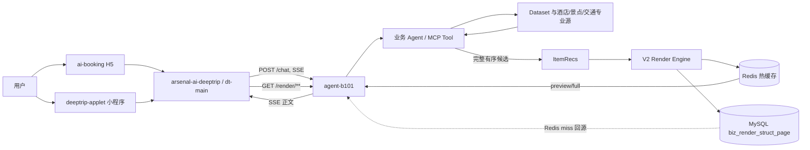
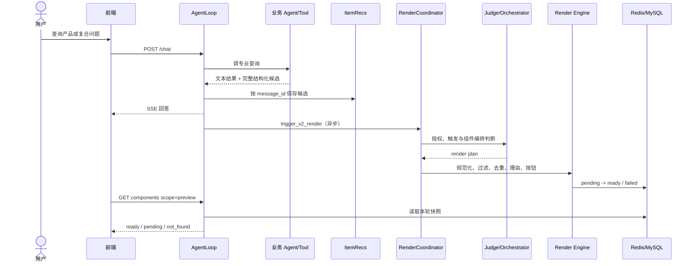
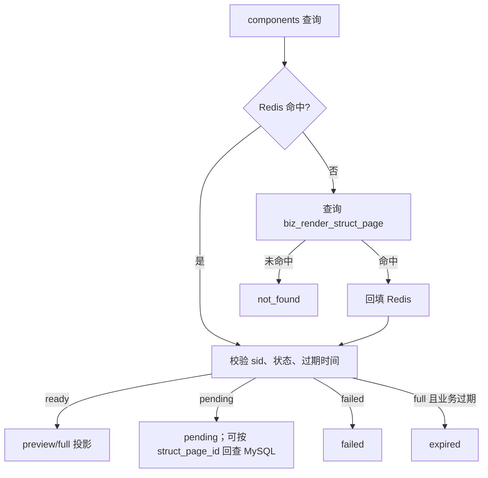

# V2 渲染引擎与产品组件技术实现

- 创建时间：2026-09-08 14:39:24
- 更新时间：2026-09-08 14:39:24
- 作者：徐凯旋
- 邮箱：azouever@gmail.com
- tags：渲染引擎, 产品组件, Redis, MySQL, REST-API, 设计文档

[TOC]

## 目录

- [1. 文档范围与结论](#1-文档范围与结论)
- [2. 背景与目标](#2-背景与目标)
- [3. DeepTrip 多仓架构与职责](#3-deeptrip-多仓架构与职责)
- [4. 核心业务模型](#4-核心业务模型)
  - [4.1 五类产品组件](#41-五类产品组件)
  - [4.2 完整快照与两种投影](#42-完整快照与两种投影)
  - [4.3 内容卡与产品卡边界](#43-内容卡与产品卡边界)
- [5. B101 内部实现](#5-b101-内部实现)
  - [5.1 生成链路](#51-生成链路)
  - [5.2 候选规范化、去重与推荐理由](#52-候选规范化去重与推荐理由)
  - [5.3 缓存与持久化](#53-缓存与持久化)
- [6. 公共组件查询接口](#6-公共组件查询接口)
  - [6.1 请求契约](#61-请求契约)
  - [6.2 响应状态](#62-响应状态)
  - [6.3 分页契约](#63-分页契约)
- [7. 首次对话、完整列表与历史恢复](#7-首次对话完整列表与历史恢复)
- [8. dt-main 改造](#8-dt-main-改造)
- [9. 前端改造](#9-前端改造)
- [10. 幂等、安全、降级与观测](#10-幂等安全降级与观测)
- [11. 测试与验收](#11-测试与验收)
- [12. CURL 联调示例](#12-curl-联调示例)
- [13. 当前状态与待核实项](#13-当前状态与待核实项)
- [14. 代码地图与资料来源](#14-代码地图与资料来源)

---

## 1. 文档范围与结论

本文梳理 2026 年 7～8 月完成的 V2 渲染引擎产品组件能力，覆盖 `agent-b101`、
`arsenal-ai-deeptrip`（dt-main）、`ai-booking` 以及专业产品数据源之间的协作，不只描述
B101 内部代码。

这项能力的核心不是“多渲染几种卡片”，而是把一次 Agent 查询产生的产品结果变成一份
**可复用、可分页、可恢复、可追踪的结构化快照**：

1. 首次问题只查询一次酒店、景点、火车或机票专业源，得到本轮完整有序候选。
2. 聊天首屏通过 `scope=preview` 只投影每类前三条。
3. “查看全部”、继续翻页和恢复历史消息都读取同一快照，不重新查询专业源。
4. 同一问题可以同时生成多个业务列表，前端按组件类型分组展示和分页。
5. B101 统一处理业务授权、字段归一化、同轮/多轮去重、推荐理由、缓存与过期。

<mark style="background: #FFB86CA6;">关键不变量：`preview == full` 对应业务列表的前三条；分页只是对完整快照切片，不能触发新搜索、重新排序或再次去重。</mark>

## 2. 背景与目标

旧链路主要面向路线卡、内容型景点卡和少量固定产品卡，存在以下问题：

- Agent 层过早截断候选，用户只能看到三条，无法自然进入完整推荐列表。
- 不同业务各自维护卡片协议、跳转和“查看更多”，前端交互不统一。
- 点击查看更多时可能再次查询，导致首屏和完整列表的价格、顺序、库存语义不一致。
- 多轮对话容易重复推荐，同一条消息包含多业务时也缺少统一编排。
- 历史消息只能恢复正文或首屏卡片，不能稳定读取当时的完整结果。

本次目标是：

- 支持酒店、景点门票、火车、单程机票、往返机票五类产品卡。
- 首屏轻量预览，完整列表按业务类型分页。
- 固化本轮原始问题、专业源结果顺序和结构化组件，支持历史恢复。
- 多业务复合问题能够同时产出多个列表。
- 基于真实候选事实生成差异化推荐理由，模型失败时有规则兜底。
- 实时价格、库存、余票和营业状态最终仍由专业列表/详情/预订页确认。

## 3. DeepTrip 多仓架构与职责



| 仓库/系统 | 职责 | 本功能中的调整 |
| --- | --- | --- |
| `ai-booking` | H5 对话与产品展示 | SSE 完成后拉 preview；五类原子卡；完整列表抽屉；分页、对比、过期引导 |
| `deeptrip-applet` | 微信小程序入口 | 复用对话/组件契约；实验阶段由 dt-main 注入小程序 AB Header |
| `arsenal-ai-deeptrip` | dt-main，总入口、鉴权、路由和 SSE 代理 | 新增 `/render/**` 统一鉴权代理；保留 `/render` 前缀转发到 B101 |
| `agent-b101` | Agent 编排、工具调用、答案和结构化渲染 | 保存完整候选；判定是否渲染；生成、缓存、持久化并查询组件快照 |
| Dataset/MCP/专业源 | 返回实时业务候选和事实字段 | 每轮首次查询提供完整有序候选；不参与前端分页和历史恢复 |

`dt_robot_main/doc/project/DeepTripOverview_DOC.md` 给出的总体定位是：dt-main 为统一入口，
`agent-b101` 为核心编排，`ai-booking` 和 `deeptrip-applet` 为用户端，Agent 通过 MCP/Dataset
访问专业能力。本功能沿用该边界，没有把产品查询逻辑下沉到前端。

## 4. 核心业务模型

### 4.1 五类产品组件

| 业务 | 组件类型 | 组件数据字段 | 主要稳定标识 |
| --- | --- | --- | --- |
| 景点门票 | `decSightItem` | `sight_data` | 景点名称/资源 ID |
| 酒店 | `decHotelItem` | `hotel_data` | `hotelId` |
| 火车 | `decTrainItem` | `train_data` | `trainNo`，必要时结合日期 |
| 单程机票 | `decFlightItem` | `flight_data` | `flightNo/flightId/oneId` |
| 往返机票 | `decRoundFlightItem` | `flight_data`，结构为 `Trip[][]` | 去程与返程稳定 ID 组合 |

原子卡之外，Engine 确定性生成 `buttonGroup`，其中：

- `open_product_list`：打开本轮同类产品完整列表。
- `open_compare`：进入产品比较。
- `send_query`：明确表示发起新问题，不能用来代替查看完整列表。

### 4.2 完整快照与两种投影

一次渲染先形成完整 `business_components`，再按读取场景投影：

```text
完整候选 -> 完整组件树 -> preview 投影（每类最多 3 条）
                       -> full 投影（按 component_type 分页）
                       -> 历史消息 preview 投影
```

`preview` 负责聊天区稳定、轻量展示；`full` 负责完整列表抽屉。两者引用同一个
`message_id/query_msg_id` 和同一个快照，不是两次检索结果。

### 4.3 内容卡与产品卡边界

`business_types` 是本轮可预订产品组件授权列表，不能因为 Redis 中恰好存在旧产品数据就
自动出产品卡：

| 用户意图 | 允许结果 |
| --- | --- |
| 多日游、路线、攻略 | `destCardGroup(travel_route)` |
| 普通“必去景点”内容推荐 | `destCardGroup(sight)` |
| 明确询问门票、预订、购票 | `decSightItem` |
| 明确查询酒店、火车、机票 | 对应 `dec*Item` |

景点提前决策使用 `TRIGGER / WAIT / SKIP / FALLBACK` 四态：地域完整且产品意图明确时提前
触发；缺地域时等待；单景点非票务详情跳过；不确定场景回退原工具摘要链路。已展示路线或
景点的比较问题仍生成文字答案，但通过独立内容决策抑制重复内容卡。

## 5. B101 内部实现

### 5.1 生成链路



关键步骤如下：

1. 产品工具把结构化结果写入 `ItemRecs`，当前消息字段优先于会话级兼容字段。
2. `RenderCoordinator` 统一处理消息级触发与幂等，避免多个循环分支重复创建页面。
3. `trigger_v2_render()` 汇总用户问题、授权业务、候选摘要和历史渲染结果。
4. Judge 判断本轮是否需要组件；Orchestrator 生成组件计划。
5. 先写 `pending`，再以 fire-and-forget 任务生成组件，成功变为 `ready`，失败变为 `failed`。
6. 对话文本主流程与渲染异步解耦，渲染失败不能让聊天 SSE 失败。

### 5.2 候选规范化、去重与推荐理由

候选处理遵循“真实数据优先、顺序可解释”的原则：

- 酒店和景点过滤无有效价格的卡；明确免费/免票的景点可保留。
- 单程/往返机票和火车统一不同专业源字段，往返只组合完整去返程，不拼接两个独立单程价。
- 同轮按稳定业务键去重。
- 同一 `session_id` 回看最近 8 个可见的已完成结构化页面，过滤已经展示过的产品。
- “换一批”去重后耗尽时，只允许补召回一次同城通用候选，然后再次执行统一去重。
- 酒店和景点维持上游顺序；交通首屏可在满足用户硬约束的候选池内选择覆盖不同高价值标签的前三条，其他候选保持相对顺序。

五类组件的首屏推荐理由由 `deepseek-v4-flash` 在精简真实事实范围内生成，关闭 thinking，
并设置超时；输出还要经过长度、重复、占位词、事实归属等校验。失败时使用规则理由，并以
`pick_reason_source=model|rule_fallback` 标记来源。完整列表第四条以后允许没有理由，前端
隐藏空理由区域即可。

### 5.3 缓存与持久化



- Redis 同时维护 `struct_page_id` 和 `message_id` 索引，默认热缓存 TTL 为 3600 秒。
- MySQL 表 `biz_render_struct_page` 保存完整组件树、状态、会话、消息、Judge 结果、渠道和环境。
- Redis miss 后从 MySQL 读取并回填，因此缓存过期不等于业务结果立即丢失。
- 产品结果业务有效期为 24 小时。`full` 超期返回 `expired`，不恢复旧价格和库存。
- `pending` 缓存可能早于答案消息索引更新，查询接口会按 `struct_page_id` 回查 MySQL，必要时将 ready 结果回填 Redis。

## 6. 公共组件查询接口

### 6.1 请求契约

```http
GET /render/api/components
  ?message_id={query_msg_id}
  &session_id={sid}
  &scope={preview|full}
  &component_type={decType}
  &page={n}
  &page_size={size}
```

| 参数 | 必填 | 默认值 | 规则 |
| --- | --- | --- | --- |
| `message_id` | 是 | 无 | 8～128 位字母、数字、`_`、`-`；使用用户问题的 `query_msg_id` |
| `session_id` | 前端应传 | 空 | 与快照会话不匹配时返回 `not_found` |
| `scope` | 新客户端应传 | `full` | 只支持 `preview/full`；默认 full 仅用于兼容旧客户端 |
| `component_type` | full 分页应传 | 空 | 五类 `dec*Item`；不传保留旧客户端整树 full 行为 |
| `page` | 否 | `1` | 从 1 开始 |
| `page_size` | 否 | `20` | 1～50，只限制单页，不限制快照总数 |

### 6.2 响应状态

接口统一使用业务响应包装，主要状态为：

| 状态 | 含义 | 前端处理 |
| --- | --- | --- |
| `pending` | 异步渲染中 | preview 每 2 秒轮询，最长 60 秒 |
| `ready` | 组件可读 | 按返回顺序渲染 |
| `failed` | 本轮渲染失败 | 保留文本回答，不展示产品组 |
| `not_found` | 无组件、消息不存在或 sid 不匹配 | 保留文本回答，不展示产品组 |
| `expired` | full 业务结果超过有效期 | 关闭旧列表，提示获取最新推荐 |

Preview 示例：

```json
{
  "code": "0",
  "msg": "成功",
  "data": {
    "struct_page_id": "sp_example",
    "status": "ready",
    "scope": "preview",
    "components": [],
    "has_more": true,
    "total_count": 8,
    "product_counts": {
      "decHotelItem": 5,
      "decTrainItem": 3
    }
  }
}
```

### 6.3 分页契约

Full 分页必须传当前抽屉的 `component_type`。响应中的 `components` 只包含该业务当前页，
并返回页码、单页大小、总数和 `has_more`。前端滚动到底部且 `has_more=true` 时请求下一页。

分页失败时保留已加载卡片，重试相同页；禁止清空列表后重新发送聊天问题。即使 Redis miss，
接口也只从 `biz_render_struct_page` 恢复快照，不会调用 Dataset。

## 7. 首次对话、完整列表与历史恢复

### 首次对话

1. 前端发起 `/chat` 并正常消费 SSE。
2. 收到完成事件后，以该轮 `query_msg_id + sid` 请求 `scope=preview`。
3. `pending` 时有限轮询；`ready` 时按连续相同类型分组。
4. 每组只显示前三条，使用 `product_counts[当前类型] > 3` 判断是否展示“查看全部”。

### 查看完整列表

1. `open_product_list` 打开统一全屏抽屉。
2. 首次请求 `scope=full&component_type=...&page=1&page_size=20`。
3. 滚动加载下一页；每一页来自同一快照。
4. 多业务消息通过紧凑分段标签切换业务组；酒店、景点各自比较，火车和机票属于交通可比域。

### 历史恢复

1. 历史接口 `POST /query_chat_history` 返回的 `render_component` 是 preview 投影。
2. 用户点击历史消息的“查看全部”时，仍使用该轮 `query_msg_id + 当前 sid` 查询 full。
3. 24 小时内可从 Redis 或 MySQL 恢复完整快照；超期返回 `expired`。
4. “获取最新推荐”必须生成包含原始需求的自包含新问题，不能只发送“按刚才的再查一次”。

## 8. dt-main 改造

dt-main 实际代码位于 `arsenal-ai-deeptrip`，本功能涉及三个关键点：

1. `RenderRouteController` 注册 `/render/**`，复用 Chat 入口的用户鉴权链。
2. `RequestWrapperFilter.parseTargetUrl()` 对 `render` 特殊处理，将
   `/render/api/components` 原样转为 B101 的 `/render/api/components`，不能误删前缀。
3. `RoutingFilterV3` 识别 render 请求并使用 GET 转发，query string 保留；普通 chat 请求仍使用缓存后的 JSON body POST。

微信小程序实验资料还记录了 `20260812_render_engine_split_wxminiapp`：dt-main 根据实验值
注入对应 Header，B101 只在实验 A 或 QA 强制开关时启用。该信息说明曾采用灰度方式接入，
不代表当前所有渠道都已在生产全量打开。

## 9. 前端改造

`agent-b101` 的前端联调文档明确记录 `ai-booking` 已涉及以下文件。由于本机当前没有
`ai-booking` 工作副本，本文将其作为“联调资料记录的实现”，未重新审阅前端当前分支源码。

| 文件 | 调整 |
| --- | --- |
| `src/api/renderComponent.ts` | 封装 preview/full 组件查询和分页参数 |
| `src/views/chat/composables/useChatGeneration.ts` | SSE 完成后发起 preview 查询 |
| `src/views/chat/components/decProductGroupList.vue` | 五类产品分组、查看全部和状态编排 |
| `src/views/chat/components/productRecommendationDrawer.vue` | 共用完整列表抽屉、加载和重试 |
| `src/views/chat/components/productRecommendation.ts` | preview、过期时间和获取最新推荐问题 |
| `src/views/chat/components/comparePresentation.ts` | 可比域、按钮文案和业务主题色 |
| `src/views/chat/components/compareMessage.ts` | 生成自包含的自然语言比较问题 |
| `src/views/chat/components/compareActionButton.vue` | 对比入口 |
| `src/components/chatContent/dec*Item.vue` | 五类原子产品卡及字段容错 |

前端必须遵守以下边界：

- 不自行调用 Dataset，不自行重新搜索、排序、去重或随机选前三条。
- `open_product_list` 只查询 full，不能转换为 `send_query`。
- 完整抽屉复用聊天区原子卡，避免维护第二套产品字段和跳转逻辑。
- `expired` 后隐藏旧操作，用户明确点击后才发送新的自包含问题。
- 空评分、星级、标签、图片、理由等可选字段应隐藏对应区域，不能用占位文本撑布局。
- 前三条必须与 full 拼接结果的前三条完全一致。

## 10. 幂等、安全、降级与观测

### 幂等与一致性

- 以消息为粒度协调触发，同一轮只创建一个结构化页面。
- 当前消息的 `{message_id}_{type}` 快照优先，避免读取上一轮 `all_{type}` 冒充本轮数据。
- 缓存同时按页面 ID 和消息 ID 建索引；Redis/MySQL 保存相同完整组件树。
- 分页参数只影响返回切片，不改变快照内容。

### 安全

- dt-main `/render/**` 复用用户身份校验。
- B101 用 `session_id` 与快照绑定；不匹配统一返回 `not_found`，不暴露是否存在其他会话数据。
- `message_id`、scope、component type、page 和 page size 都在入口校验。
- 文档和脚本不得写入真实 token、Cookie、手机号或用户标识。

### 降级

- 渲染任务 fire-and-forget，失败不影响 SSE 正文。
- Judge、编排、模型推荐理由失败均有跳过或规则兜底，不伪造产品事实。
- Redis 不可用或 miss 时回源 MySQL；两级都无数据才 `not_found`。
- 业务结果过期时不展示旧价格，要求用户发起新一轮查询。

### 观测

日志至少应按 `session_id + message_id + struct_page_id` 串联，并记录：

- 触发入口、业务授权、Judge 结果、组件类型和数据来源。
- `pending/ready/failed` 状态变化和耗时。
- Redis/MySQL 命中来源、pending 回查和回填结果。
- 候选总量、去重数量、价格/理由过滤数量和分页参数。
- 推荐理由的 `model/rule_fallback` 来源。

## 11. 测试与验收

### 后端契约

- 五类产品都能从真实 `/chat` 进入，并最终查询到 `ready`。
- `preview == concat(full_pages)[:3]`。
- 复合问题按组件类型分别统计、分别分页，不串组。
- 重复查询同一页结果稳定，分页和历史恢复不产生专业源调用。
- sid 错误返回 `not_found`；非法 message、scope、component type 和分页参数被拒绝。
- Redis miss 能从 MySQL 恢复；24 小时后 full 返回 `expired`。

### 数据质量

- 同轮和多轮产品 ID 无重复。
- 酒店/景点价格规则正确，明确免费景点可保留。
- 往返机票是完整去返组合，价格和跳转来自同一专业结果。
- preview 三条推荐理由非空、基于本卡事实且尽量体现差异。
- 多轮比较已有路线/景点时有文字答案但不重复出卡。

### 前端体验

- 375px 左右移动视口不溢出，卡片和按钮不遮挡。
- 多业务标签、横向列表、完整抽屉和业务主题色一致。
- 分页失败保留已加载结果并可重试相同页。
- 历史消息 preview 正常，未过期 full 可打开，过期后正确引导新查询。

迭代测试资料记录了五类真实 `/chat`、分页、历史恢复、错 session 和过期契约回归；其中
火车和单程机票完整快照达到 50 条，并验证了 `[20, 20, 10]` 分页。该结论是当时迭代证据，
不等同于本文写作时重新执行生产验收。

## 12. CURL 联调示例

以下命令不包含真实凭据。直连 B101 适合本地开发；QA/生产应优先经过 dt-main，并按渠道
补齐真实鉴权 Header/Cookie。

### 12.1 本地发起对话

```bash
export B101_LOCAL_BASE_URL="http://localhost:8008"
export TEST_SID="render_doc_$(date +%Y%m%d%H%M%S)"

curl -N "${B101_LOCAL_BASE_URL}/chat" \
  -H 'Content-Type: application/json' \
  -d "{\"sid\":\"${TEST_SID}\",\"q\":\"推荐苏州可以预订门票的景点\",\"request_mode\":\"DEEP\"}"
```

从 SSE/消息对象取得本轮 `query_msg_id` 后查询 preview：

```bash
export QUERY_MSG_ID="replace_with_query_msg_id"

curl --get "${B101_LOCAL_BASE_URL}/render/api/components" \
  --data-urlencode "message_id=${QUERY_MSG_ID}" \
  --data-urlencode "session_id=${TEST_SID}" \
  --data-urlencode 'scope=preview'
```

### 12.2 本地读取 full 第 1 页

```bash
curl --get "${B101_LOCAL_BASE_URL}/render/api/components" \
  --data-urlencode "message_id=${QUERY_MSG_ID}" \
  --data-urlencode "session_id=${TEST_SID}" \
  --data-urlencode 'scope=full' \
  --data-urlencode 'component_type=decSightItem' \
  --data-urlencode 'page=1' \
  --data-urlencode 'page_size=20'
```

### 12.3 QA 经 dt-main 查询

```bash
export DT_QA_BASE_URL="https://replace-with-qa-dt-main-host"
export DT_AUTH_COOKIE="replace_with_runtime_cookie"

curl --get "${DT_QA_BASE_URL}/render/api/components" \
  -H "Cookie: ${DT_AUTH_COOKIE}" \
  --data-urlencode "message_id=${QUERY_MSG_ID}" \
  --data-urlencode "session_id=${TEST_SID}" \
  --data-urlencode 'scope=full' \
  --data-urlencode 'component_type=decSightItem' \
  --data-urlencode 'page=1' \
  --data-urlencode 'page_size=20'
```

### 12.4 生产只读核验模板

```bash
export DT_PROD_BASE_URL="https://replace-with-prod-dt-main-host"
export DT_PROD_AUTH_COOKIE="replace_with_runtime_cookie"

curl --get "${DT_PROD_BASE_URL}/render/api/components" \
  -H "Cookie: ${DT_PROD_AUTH_COOKIE}" \
  --data-urlencode "message_id=${QUERY_MSG_ID}" \
  --data-urlencode "session_id=${TEST_SID}" \
  --data-urlencode 'scope=preview'
```

生产环境只读取已授权测试账号创建的消息，不使用共享用户真实会话做验证。

## 13. 当前状态与待核实项

| 项目 | 结论 |
| --- | --- |
| B101 源码 | 已核对当前本地 `agent-b101`：五类组件、preview/full、分页、缓存/持久化和状态契约存在 |
| dt-main 源码 | 已核对当前本地 `arsenal-ai-deeptrip`：`/render/**` 鉴权代理及前缀保留存在 |
| ai-booking | 迭代联调文档记录了具体改造文件和验收结果；本机无仓库，未复核当前代码 |
| deeptrip-applet | `dt_robot_main` 和迭代资料确认项目及 AB 接入关系；本机无仓库，未复核当前代码 |
| QA/生产状态 | 文档资料记录当时本地集成与 QA 验收通过；本文没有重新部署或执行线上验收 |

待发布前核实：

1. 当前前端生产分支是否已经使用带 `component_type/page/page_size` 的分页协议，而非早期一次性 full 协议。
2. H5、小程序、PC 各渠道的渲染实验开关是否仍存在，当前流量比例是多少。
3. dt-main 外部域名和各渠道鉴权头，以实际环境配置为准。
4. 24 小时业务过期与 Redis TTL 是否在配置中心有环境覆盖。

## 14. 代码地图与资料来源

### 14.1 关键源码

| 仓库 | 路径 | 说明 |
| --- | --- | --- |
| `agent-b101` | `app/routers/render_page.py` | `/render/api/components` 查询、校验、状态和两级读取 |
| `agent-b101` | `app/render_engine/component_projection.py` | preview/full 投影、分页和过期判断 |
| `agent-b101` | `app/render_engine/render_coordinator.py` | 消息级触发、幂等和异步任务协调 |
| `agent-b101` | `app/render_engine/trigger.py` | 候选快照、Judge、pending 和渲染触发 |
| `agent-b101` | `app/render_engine/orchestrator/` | 组件计划和业务类型映射 |
| `agent-b101` | `app/render_engine/cache.py` | Redis 双索引缓存和回填 |
| `agent-b101` | `app/render_engine/storage.py` | `biz_render_struct_page` 持久化 |
| `agent-b101` | `app/render_engine/config.py` | Redis TTL 等配置 |
| `arsenal-ai-deeptrip` | `.../restful/chat/RenderRouteController.java` | dt-main 渲染 API 鉴权入口 |
| `arsenal-ai-deeptrip` | `.../filter/base/RequestWrapperFilter.java` | 保留 `/render` 前缀和目标路由 |
| `arsenal-ai-deeptrip` | `.../filter/base/RoutingFilterV3.java` | GET render 与 POST chat 转发 |

### 14.2 迭代资料

- `agent-b101/doc/需求迭代/20260805_渲染引擎产品组件/README.md`
- `agent-b101/doc/需求迭代/20260805_渲染引擎产品组件/04-技术方案_DOC.md`
- `agent-b101/doc/需求迭代/20260805_渲染引擎产品组件/11-联调文档-前端_DOC.md`
- `agent-b101/doc/需求迭代/20260805_渲染引擎产品组件/13-测试报告_DOC.md`
- `agent-b101/doc/需求迭代/20260805_渲染引擎产品组件/15-移动端统一推荐列表详细设计_DOC.md`
- `dt_robot_main/doc/project/DeepTripOverview_DOC.md`

### 14.3 版本说明

迭代 README 记录的后端交付分支为 `feat-20260817-traffic-search-query`，前端契约基线为
`origin/feat_decComponents@baded81e`。这些标识用于回溯当时交付，不应替代当前发布分支和
环境状态核验。
