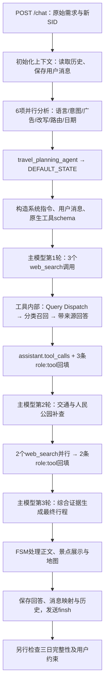

# agent-b101 `/chat` 成都三日游完整生成流程（2026-10-22 真实调用）

> 作者：黄家楷 · 邮箱：jiakai.huang@ly.com
> 代码基线：agent-b101 `8b50b039715c63568242a6c8ec1efebb3f46721b`。本次未改业务代码，以独立工作目录启动最新版后真实调用 `/chat`。
> 本文记录 2026-10-22 的真实调用，参考[旧版流程文档](chat接口内部执行流程详解_基于真实日志_DOC.md)。旧文档保留不变，其中旧模型、7 项分析和固定前置搜索属于历史实现。

先读 [H 节：同一次请求的全流程数据流](#h-按真实时间追踪这份完整行程怎样一步步生成)，再按需查看 G 节主模型原始记录、I 节搜索内部成稿提示词。


- [系统提示词原文：独立文档](chat接口系统提示词_20261022真实调用_DOC.md)
- [工具定义、注册与全部声明](chat接口工具声明与注册机制_DOC.md)

本次逐轮原始记录见文末：

- [第 1 轮：系统提示词、用户提示词与 3 个工具调用](#g1-第-1-轮先查三个景点信息组)
- [第 2 轮：完整输入、首批工具结果与 2 个补查调用](#g2-第-2-轮读工具反馈后补查交通与人民公园)
- [第 3 轮：完整输入、补查结果与原始三日行程回答](#g3-第-3-轮综合五份工具结果生成完整行程)

## A. 相比旧文档，哪些地方变了

| 环节 | 2026-05-11 旧样例 | 2026-10-22 当前实现与本次实测 |
|---|---|---|
| 测试会话 | 复用 `test123`，已有历史影响路由 | 全新 SID，历史为空，显式 `request_mode=DEEP` |
| 模式选择 | 旧样例未区分 | `/chat` 支持 AUTO/FAST/DEEP；本次指定 DEEP，跳过 AUTO 模式判定 |
| 综合分析 | 7 项，含 Query Insight、Query Dispatch | 6 项：语言、意图、广告、改写及组件策略、路由、时间提取；Insight 禁用 |
| 搜索触发 | 推理前固定做搜索分发和 SearchAgent | 前置搜索 `skip_search=True`；主模型通过原生 `web_search` 按需触发 |
| Query Dispatch | 作为前置分析任务 | 在 `SimpleSearchAgent` 内部按每次搜索需求拆分查询 |
| Agent 选择 | `universal_agent` | 本次 `travel_planning_agent`，代码仍进入 DEFAULT_STATE 主循环 |
| 主模型 | 旧旅行分析模型＋旧最终回答模型 | 本次主循环各轮使用 `deepseek-v4.1-flash` |
| 工具循环 | 旧样例未展示完整原生调用循环 | 模型 `tool_calls` → 并行工具 → `role:tool` 回填 → 再调用模型 |
| 完成判定 | 收到结束事件后称完整回答 | 分开核对 HTTP、SSE `finsh`、三天正文和约束；结束事件不保证内容完整 |

## B. 本地环境、请求与证据

服务通过 `uvicorn app.main:app --host 127.0.0.1 --port 8008` 启动，环境为 `DAOKEENV=test`；本地执行 Python，配置中心、ES、Redis及业务接口沿用测试环境依赖，模型仍为真实远程调用。`/healthCheck` 返回 HTTP 200，只证明健康接口可用。

本机使用独立 Python 3.12 环境。安装时遇到 `sxtwl==2.0.7` 源码包缺文件，改用上游完整源码构建同版本 wheel；spaCy 的 NumPy ABI 冲突通过本地固定 `numpy<2` 解决，并补装 `aiohttp`。这些是本机环境调整，没有改仓库 requirements。

本次完整样例的原始请求如下；测试身份为专用 E2E 身份，无真实用户资料：

```json
{
  "sid": "trip_flow_20261022_518b3b1c4505",
  "request_mode": "DEEP",
  "q": "请直接生成成都三日游完整行程，不追问。2位成年人，2026年11月6日至8日，每天09:00开始，21:00前结束，不能提前到9点前。必须包含成都大熊猫繁育研究基地、武侯祠、锦里、宽窄巷子、人民公园；住春熙路附近，不查询酒店及往返成都交通。以地铁和打车为主，节奏适中。核查景点开放预约信息，未知事实明确待确认。最终用一张三天行程表，列日期、上午、午餐、下午、晚餐、市内交通，再列预约注意事项。请务必一次写完三天，正文控制在1200个汉字以内，不输出景点详细介绍和图片。",
  "loc": {
    "coordinates": {
      "lat": 30.657,
      "lng": 104.066,
      "gps_type": "gcj02"
    },
    "address": "成都市"
  }
}
```

复现请求（应使用新的 SID，避免历史影响下一次结果）：

```bash
curl -N --max-time 600 http://127.0.0.1:8008/chat \
  -H 'Content-Type: application/json' -H 'Accept: text/event-stream' \
  -H 'memberId: e2e_trip_flow_20261022' \
  -H 'unionId: e2e_trip_flow_union_20261022' \
  -H 'dt-channel: MAIN_MINI' -H 'platId: 0' -H 'version: 20261022' \
  --data-binary @request.json
```

这里测试的是 b101 `/chat` 的自然语言行程生成；没有调用 Java ONEAI_GRAPH 的 `optimize_route`、`set_route`、`assemble_plan`，不能把两条链路的校验能力混为一谈。

- SID：`trip_flow_20261022_518b3b1c4505`。
- Langfuse trace：`trip_flow_20261022_518b3b1c4505|91f43e3b-fabf-4b32-b483-0e3db75a934a`。
- 测试证据目录：`/Users/tcuser/Documents/ideaproject/dt_robot-ky-robot-adapt/.ui-agent-run/b101-trip-flow-20261022/complete-case/`。
- `request.json`：请求；`events.sse`：原始流；`events.json`：已解析事件；`timed-events.json`：客户端相对时间；`answer.md`：仅最终回答；`tool-results.json`：真实工具入参及返回；`langfuse-trace.json`：远程观测；`result-summary.json`：请求汇总。
- SID 日志在证据根目录的 `sid_logs/20261022_114542_trip_flow_20261022_518b3b1c4505.log`。原始日志和 trace 仅本地留存，不纳入普通 Git；文档只摘业务数据，不复制模型隐藏推理或凭据。

## C. 从请求到答案，每一步的输入输出



### 第 1 步：接收请求并建立上下文

入口为 `app/routers/api.py:478` 的 `chat()`，最终调用 `DT_agent_loop_v2()`。显式 DEEP 不进入 AUTO 模式分类。输入包括原始 `q`、`sid`、定位，以及请求头中的测试身份与渠道。

本次是新会话，没有旧回答可供复用。服务保存用户消息，建立会话和最新消息关联，加载可用历史、配置、位置及技能。输出是主循环上下文，尚未生成三天行程。

### 第 2 步：6 项分析并发完成

`app/routers/llm_functions/analyze_query_comprehensive.py` 的 `base_tasks` 通过 `asyncio.gather(..., return_exceptions=True)` 执行：

| 分析 | 输入 | 本次可核实输出或用途 |
|---|---|---|
| 语言 | 原始 Query | 中文响应语言 |
| 意图 | Query 与历史 | `旅行规划-路线明确` |
| 广告 | Query 与历史 | `非广告意图` |
| 改写＋组件策略 | 原文、位置与历史 | 保留日期、人数、必游点、时间与输出格式要求，给出组件策略 |
| 路由 | 需求、渠道与历史 | `travel_planning_agent` |
| 时间 | Query | `2026-11-06` 至 `2026-11-08` |

Query Insight 已禁用；Query Dispatch 不在这 6 个任务中。`travel_planning_agent` 是路由分类，本次并没有因此直接进入一个独立行程子 Agent，而是在 `DT_agent_loop_v2.py:5391` 附近分派到 DEFAULT_STATE。

### 第 3 步：构造主模型输入，不做固定前置搜索

`_handle_default_state()` 调用 `_fetch_search_rerank_context()`，但后者 `skip_search=True`，返回空搜索上下文。随后 `_build_initial_messages()` 组合系统规则、需求及已知上下文，工具 schema 通过模型 API 的 `tools` 参数传入，`tool_choice=auto`。

本次主模型为 `deepseek-v4.1-flash`。这不表示所有请求永久固定同一模型：技能、渠道和复杂度规则仍可覆盖；这里只记录本次实际值。

### 第 4 步：模型第 1 轮选择 3 个搜索任务

真实入参如下。工具名在模型 API 中为 `web_search`，实现类是 `app/routers/tools_v2/smart_search_tool.py` 的 `smart_search_tool`，参数名为 `query`。

```json
[
  {
    "name": "web_search",
    "arguments": {
      "query": "成都大熊猫繁育研究基地 门票预约 开放时间 2026 入园时间 上午"
    }
  },
  {
    "name": "web_search",
    "arguments": {
      "query": "成都武侯祠博物馆 开放时间 门票价格 预约 锦里古街"
    }
  },
  {
    "name": "web_search",
    "arguments": {
      "query": "成都宽窄巷子 人民公园 开放时间 门票 是否需要预约"
    }
  }
]
```

三项之间无依赖，服务并行执行。这里的搜索词由主模型按用户需求产生，并非 Python 预先固定的三个关键词。

### 第 5 步：搜索工具内部再次拆分查询并召回

真实调用链：

```text
web_search(query)
  -> smart_search_tool.execute()
  -> SimpleSearchAgent.sync_search()
  -> SimpleSearchAgent.search()
  -> QueryDispatcher.dispatch()
  -> 按生成的source/query分类召回、筛选
  -> 生成带参考资料的工具回答 + 结构化候选
```

Query Dispatch 的作用是把一条信息需求拆成适合各来源查询的问题，并选择来源、条数和时效偏好。它不生成最终日程。外层工具注释“不做 query dispatch”仅指包装层；下层 SearchAgent 仍实际执行分发。

| 外层搜索 | 内部分发（日志中的词可能截短） | 实际返回的关键业务证据 |
|---|---|---|
| 熊猫基地 | `web` 门票信息＋`sight` 景区详情 | 同程景区 `resId=7753`；10 月 22 日营业信息 `07:30–18:00`、17:00 停止入园；成人票参考 55 元；11 月 6—8 日余票和开放仍待确认 |
| 武侯祠＋锦里 | `sight` 武侯祠＋`web` 预约政策＋`note` 锦里攻略 | 武侯祠当日营业信息 `09:00–18:00`、17:00 停止入园；资料间价格有差异，需要按票种及适用日期区分；锦里攻略参考 |
| 宽窄巷子＋人民公园 | 两个 `sight` 查询 | 宽窄巷子 `resId=21496`，当日全天开放、免费；人民公园返回同名/近似景区歧义及消歧建议 |

第三项日志 `web=0组, rag=0条` 仍有宽窄巷子景区结果。该计数没有覆盖全部来源，不能据此判定没有搜索结果。本次进一步取得搜索子系统 trace，已确认 T2/T4/T5 分别召回 50/10/50 条 note/poi RAG，筛选后均为 0；不能把最终 rag=0 解释为没有查库。完整查询及筛选计数见 H.4～H.5。

工具并不只返回几个结构化字段：本次默认 `generate_answer=true`，会返回基于检索资料生成的文字回答和参考资料正文，甚至包含工具层生成的三日表。包装层同时传入原始完整需求 `original_query` 与本次 `query`，SearchAgent 的回答模板两者都读取，因此本次多个搜索结果都生成了自己的三日表。外层仍要综合多条工具结果，工具内部的表格不等于最终行程。`answer_reference_detail` 默认 `full`，因此下一轮模型输入会显著增大。

### 第 6 步：工具回填，让模型根据结果补查

`_execute_native_tool_calls()` 先保留本轮 assistant 的原生 `tool_calls`，再按 `tool_call_id` 添加各自 `role:tool` 消息；普通工具通过最多 8 线程并行处理。下一轮模型读取真实返回内容，而不是只看工具完成状态。

本次消息数量从首轮 2 条增加为 6 条：原始 2 条＋assistant 工具调用消息 1 条＋工具结果 3 条。第 2 轮读到人民公园消歧反馈后补查，并补查地铁线路：

```json
[
  {
    "name": "web_search",
    "arguments": {
      "query": "成都地铁3号线 熊猫大道站 春熙路站 高升桥站 武侯祠 线路"
    }
  },
  {
    "name": "web_search",
    "arguments": {
      "query": "成都市人民公园 青羊区 开放时间 鹤鸣茶社 2026"
    }
  }
]
```

人民公园补查明确了“成都市、青羊区”，没有把崇州的罨画池当成市区必游点。两项完成后，消息数继续增为 9 条，再进入第 3 轮主模型。`loop_depth` 统计主模型轮次，不统计搜索词、工具数或 SSE 分片数。

补查返回摘要：

| 补查 | 真实结果摘要 | 给下一轮的作用 |
|---|---|---|
| 地铁线路 | 返回包含 3 号线春熙路—熊猫大道、高升桥相关交通攻略、站点说明的资料；结果正文 4150 字符，结构化候选 8 条 | 支持按片区安排交通；属于资料检索，没有导航耗时核验 |
| 成都市人民公园 | 景区 `resId=828570`，地址为成都市青羊区小南街 8 号，返回免费、24 小时开放，但适用日期为 `2026-03-19`；鹤鸣茶社营业信息来自 2023 年资料；结果正文 3736 字符，结构化候选 4 条 | 消除首轮同名地点歧义，同时保留日期与营业信息待确认 |

首批三个工具的返回正文分别为 6078、5381、2161 字符，结构化候选分别为 8、6、1 条。这些是本次工具输出条数，可能包含重复来源，不代表独立景点数。5 次外层搜索共触发 5 次 Query Dispatch，日志共列出 12 条分类查询，不是 12 次主模型调用。

### 第 7 步：第 3 轮整合为三天行程

输入是原始需求、系统规则、5 次工具返回及其来源；输出为完整三天正文。没有使用一个独立、经 Java 容量优化的结构化行程骨架；这里的景点日序和时间表由主模型综合地理信息、资料与用户要求写出。

最终行程摘录（来自本次最终 `answer`，只去掉展示标签）：

| 日期 | 上午（09:00起） | 午餐 | 下午 | 晚餐 | 市内交通 |
|---|---|---|---|---|---|
| 11月6日（周五） | 09:00出发赴成都大熊猫繁育研究基地，09:40—13:00游园（熊猫上午最活跃） | 基地外简餐，或返程后春熙路 | 步行逛太古里、IFS 与大慈寺（与太古里相邻），节奏放慢 | 春熙路川菜或火锅 | 去程建议打车约30分钟；返程地铁3号线至春熙路站（熊猫大道站可换接驳车，运营待确认）；下午步行 |
| 11月7日（周六） | 09:00地铁3号线直达高升桥站，C口步行约10分钟，09:30—11:30游武侯祠 | 锦里小吃（张飞牛肉、三大炮、钵钵鸡） | 一墙之隔的锦里慢逛，喝茶、看变脸，亮灯后夜景最佳，可留至19:30 | 锦里或返回春熙路 | 3号线春熙路⇄高升桥直达；武侯祠与锦里步行即到 |
| 11月8日（周日） | 09:00地铁2号线2站至人民公园站，人民公园鹤鸣茶社盖碗茶、采耳，约2小时 | 宽窄巷子或奎星楼街 | 步行5—8分钟到宽窄巷子，宽巷子、窄巷子、井巷子慢走；17:00后回春熙路收尾 | 春熙路商圈 | 2号线春熙路⇄人民公园2站；人民公园至宽窄巷子步行；回程可乘4号线宽窄巷子站 |

正文另列熊猫基地、武侯祠的预约说明、资料价格差异与未来日期待确认信息。完整回答保存在证据目录 `answer.md`。

### 第 8 步：FSM 展示、保存与结束

模型正文还经过流式 FSM，景点标签可能被展开为链接、图片或地图；客户端最终收到 `answer` 和结束事件 `finsh`（现有协议拼写）。`has_map` 只说明生成了地图展示信息，不代表每一段地铁/驾车时间经过导航核验。本次没有图片标签，但有景点链接和地图卡片，应区分模型正文与最终展示。

后处理保存对话、回答消息与映射，安排结构化数据写入、发送通知，并保存历史。异步任务是否完成必须看日志或回读结果，不能由 HTTP 200 推断。

本次 `ans_msg_id=84e108f1b28543f59928b0b11471c7c0`，`user_msg_id=362884722ccf42e1b6d6d3334f31f575`。日志显示回答写入 `deeptrip-data-conversation-test` 成功；结构化写入另有成功日志，消息关联写入 `redis_session_hash_{sid}` 及过程 KV。

随后真实调用 `POST /query_one_round_chat_msgs`，传入上述 SID 与回答消息 ID，返回 `code=0`、3 条消息。按 `ans_msg_id` 找到的最终回答为 4936 字符，**逐字等于客户端所有 `answer` 事件拼接结果**。这验证了可回读回答及消息关联；接口可能从缓存读取，不能单凭回读宣称直接完成了 ES 与 Redis 两端全量对账。

本次 `finsh` 为 `has_travel_plan=true`、`has_sight=true`、`has_hotel=false`、`is_trip=false`。这些字段不能代替逐日正文完整性检查。MQ 通知仍出现约 5 秒超时日志，但回答保存及客户端结束事件已完成。

## D. 本次真实时间线与结果核对

| 本地时间（2026-10-22） | 真实执行动作 | 耗时说明 |
|---|---|---|
| 11:45:42.099 | 客户端开始请求 | 新 SID，原始需求见上文 |
| 11:45:45.227 → 11:45:48 左右 | 六项分析并行，随后选择默认状态 | 约 3 秒，另有上下文初始化 |
| 11:45:48.178 → 11:46:00.416 | 主模型第 1 轮，返回 3 个工具调用 | 模型请求 12.237 秒 |
| 11:46:00.423 → 11:46:16.532 | 首批 3 个搜索并行并回填 | 工具流水线 16.105 秒 |
| 11:46:16.543 → 11:47:39.901 | 主模型第 2 轮，读首批结果后补查 2 项 | 模型请求 83.358 秒 |
| 11:47:39.923 → 11:47:55.389 | 地铁与人民公园补查并回填 | 工具流水线 15.467 秒 |
| 11:47:55.407 → 11:48:59.607 | 主模型第 3 轮，生成最终正文 | 模型请求 64.200 秒 |
| 11:48:59.616 → 11:49:09.228 | 后处理、持久化及退出主循环 | 约 9.6 秒，包含通知等待 |
| 11:49:09 左右 | 客户端收到 `finsh`，随后连接结束 | 从发起请求到流结束 207.678 秒 |

这里的 3 轮只统计主循环模型，不包含前置分析、搜索分发、工具内部回答等辅助模型调用。三个主模型请求合计约 159.8 秒，两批工具流水线合计约 31.6 秒；本次耗时主要集中在主模型后两轮，不是简单的 12 秒请求。首个 `answer` 在请求后约 193.977 秒到达，此前的 `thinking`、任务卡等事件不等于最终行程正文。

| 核对项 | 结果 | 依据或边界 |
|---|---|---|
| HTTP 与流结束 | 通过 | HTTP 200，`finsh` 1 次 |
| 三天日期完整 | 通过 | 表格分别有 11 月 6、7、8 日三行，没有在 Day 2 截断 |
| 五个必游点 | 通过 | 五处均出现在实际日程表，非仅摘要提及 |
| 每天 09:00 开始 | 文本通过 | 三日均写 09:00，表内未出现 09:00 前的安排 |
| 每天 21:00 前结束 | 仅部分可核对 | 总说明有要求，但未逐日列出晚餐与回酒店结束时刻 |
| 午餐、下午、晚餐和市内交通 | 通过 | 三日表均有对应内容 |
| 不查酒店与往返成都交通 | 通过 | 本次原生工具均为 `web_search`，没有酒店或大交通产品调用 |
| 不输出图片 | 本次通过 | 未发现图片 Markdown 或 img 标签；仍有景点链接和地图卡片 |
| 回答保存与回读 | 通过 | 4936 字符的回读答案与 SSE 拼接正文逐字一致 |
| 未来日期的开放与余票 | 保留待确认 | 资料存在 10 月 22 日、3 月 19 日以及历史年份的适用日期 |
| 文字口径一致性 | 有问题 | 结尾“随到随逛”弱化了前文锦里预约与临时管控待确认，应保留审慎说明 |
| 路段时间真实性 | 未验证 | 打车约 30 分钟、步行 5—8 分钟等为模型/检索资料估计，没有实时导航证据 |

本地检查归档为 `content-audit.json`；最终流事件计数为 `answer=220`、`plan_task_card=5`、`plan_task_update=5`、`has_map=1`、`sight=1`、`finsh=1`。三天内容完整，但上述口径和执行时刻缺口仍存在。

本次只核对该请求的生成链路与文本约束，不代表实时余票、正式报价、地图路线耗时或生产环境产品验收。11 月出行信息与 10 月 22 日当天接口状态明确分开。

## E. 同轮保留的失败样例：为什么不能只看 finsh

首次新请求 SID 为 `trip_flow_20261022_a41ac37c79eb`，相同日期、人数和五个必游点，但要求更展开的文字安排。该请求 HTTP 200，约 202.902 秒后结束，共 3 轮主模型、8 次工具调用；收到了 `finsh`，最终正文却在 Day 2 上午中途截断，没有 Day 3，且 Day 1 被提前为 08:00，违反 09:00 开始的要求。

SSE 答案与 Langfuse 最后一轮模型原始输出在同一位置结束，说明并非仅客户端漏收。模型请求日志记录 `PROVIDER_STREAM_COMPLETED`；现有证据没有提供可确认根因的 `finish_reason=length` 或输出 token 上限信息，**不能直接断言是达到输出上限**。本轮未改全局模型流实现，也未声称已经修复截断。

本次补跑改为明确的三日表和简洁正文要求，保留原始五个必游点、日期、人数与 09:00 限制。补跑结果与失败样例分开留存；补跑成功不能证明首次截断问题已修复。

## F. 当前实现入口索引

以下行号对应本次记录的代码基线，后续修改可能移动：

| 源码 | 看什么 |
|---|---|
| `app/routers/api.py:478` | `/chat`，AUTO/FAST/DEEP 分流与主循环入口 |
| `app/routers/agent_loop/DT_agent_loop_v2.py:7843` | 接口流、主循环和思考展示流合并 |
| `app/routers/llm_functions/analyze_query_comprehensive.py:85` | 6 项前置分析及结果容错 |
| `app/routers/agent_loop/DT_agent_loop_v2.py:5391` | `travel_planning_agent` 进入默认状态 |
| `app/routers/agent_loop/DT_agent_loop_v2.py:5818` | 前置搜索被跳过 |
| `app/routers/agent_loop/DT_agent_loop_v2.py:6027` | 初始化模型输入及模型选择 |
| `app/routers/agent_loop/DT_agent_loop_v2.py:6190` | 原生 tools＋`tool_choice=auto` 调用模型 |
| `app/routers/agent_loop/DT_agent_loop_v2.py:6654` | 原生工具执行与 assistant/tool 消息回填 |
| `app/routers/tools_v2/smart_search_tool.py:32` | 对模型暴露的 `web_search` 的真实包装实现 |
| `app/routers/subagents/search_agent/search_agent.py:1548` | 搜索工具内部 Query Dispatch 与分类召回 |
| `app/routers/subagents/search_agent/query_dispatch.py:299` | 生成分类查询词、解析及失败兜底 |
| `app/routers/llm.py:490` | 真实异步模型流请求与流解析 |
| `app/routers/agent_loop/DT_agent_loop_v2.py:7218` | 后处理、回答保存及结束事件 |

---

## G. 三轮主模型的实际提示词与输出全文

本节展开本次成功生成三日行程的 **3 轮主循环模型调用**。前置分析、Query Dispatch 和 SearchAgent 内部回答属于辅助模型调用，不计入这里的三轮。本次另外取得的搜索子系统快照见 H 节，五次搜索成稿模型的实际提示词见 I 节。

以下 `messages` 来自本次 Langfuse `main_step.input` 的实际记录，按调用时间排列，不是根据现在的代码重新拼出的示例。第 1、2 轮输出的原生工具调用从下一轮保存的 assistant 消息取得；第 3 轮正文从同次落库日志的 `model_raw_output` 取得，并核对其与对应 trace 输出末尾逐字相同。

系统提示词全文为 11509 字符，用户消息为 234 字符，三轮均相同。系统提示词统一引用[独立文档中的 S1](chat接口系统提示词_20261022真实调用_DOC.md#main-system)，下文各轮保留用户消息全文。这里的“用户提示词”是 `messages` 中 `role=user` 的内容；HTTP 请求中的定位等上下文已由服务端选取后放入系统提示词，不能把 HTTP JSON 整体当成用户消息。

**记录边界：**仅略去模型内部思考字段 `reasoning_content`；系统/用户提示词、工具调用 ID、原始 arguments 字符串、所有 `role=tool` 返回正文以及最终可见回答均保留。工具轮的 assistant.content 实际为 `null`，不把内部思考拼成对用户的回答。本文展示逻辑请求和响应消息，不伪造原始供应商 HTTP/SSE 包装或缺失的 `finish_reason`、usage。

原生工具 schema 通过 API 顶层 `tools` 传递，`tool_choice=auto`，不属于系统提示词或用户提示词。现有 `main_step.input` 快照只保存了 `messages`，因此下文不冒充拥有完整 HTTP 请求体。

| 轮次 | 模型开始时间（北京时间） | 输入消息数 | 本轮输出 | 输入的增量 |
|---|---|---|---|---|
| 1 | 11:45:48 | 2 | 3 个 `web_search` 调用 | system＋user |
| 2 | 11:46:16 | 6 | 2 个 `web_search` 补查 | 第 1 轮 assistant 工具调用＋3 条结果 |
| 3 | 11:47:55 | 9 | 三天行程正文，无工具调用 | 再增加第 2 轮 assistant 工具调用＋2 条结果 |

### G.1 第 1 轮：先查三个景点信息组

- 实际模型：`deepseek-v4.1-flash`。
- Langfuse observation ID：`86aabdeb-0454-4fe8-8600-f4f314727615`。
- UTC 开始时间：`2026-10-22T03:45:48.172Z`（北京时间加 8 小时）。
- `messages` 顺序：`system` → `user`。

#### G.1.1 系统提示词：messages[0].content（引用）

系统提示词全文见 [S1：主模型系统提示词](chat接口系统提示词_20261022真实调用_DOC.md#main-system)。本轮 `messages[0].content` 为该节的完整原文，11509 字符；三轮逐字相同。
#### G.1.2 用户提示词：messages[1].content（全文）

```text
请直接生成成都三日游完整行程，不追问。2位成年人，2026年11月6日至8日，每天09:00开始，21:00前结束，不能提前到9点前。必须包含成都大熊猫繁育研究基地、武侯祠、锦里、宽窄巷子、人民公园；住春熙路附近，不查询酒店及往返成都交通。以地铁和打车为主，节奏适中。核查景点开放预约信息，未知事实明确待确认。最终用一张三天行程表，列日期、上午、午餐、下午、晚餐、市内交通，再列预约注意事项。请务必一次写完三天，正文控制在1200个汉字以内，不输出景点详细介绍和图片。
```
#### G.1.3 历史工具调用和工具结果（按输入顺序）

本轮没有历史 assistant 或 tool 消息。实际输入只有上面的 system 和 user 两条。

#### G.1.4 本轮模型出参

模型本轮没有最终用户正文，输出原生工具调用。以下是服务端保存并回填到下一轮的 assistant 消息，调用 ID 与 arguments 原样保留；内部思考字段未收录。

```json
{
  "role": "assistant",
  "content": null,
  "tool_calls": [
    {
      "id": "call_00_l8cbh4zl2oznp7rvwa059msm",
      "type": "function",
      "function": {
        "name": "web_search",
        "arguments": "{\"query\": \"成都大熊猫繁育研究基地 门票预约 开放时间 2026 入园时间 上午\"}"
      }
    },
    {
      "id": "call_01_hgmge08z1py79e9zytz4apre",
      "type": "function",
      "function": {
        "name": "web_search",
        "arguments": "{\"query\": \"成都武侯祠博物馆 开放时间 门票价格 预约 锦里古街\"}"
      }
    },
    {
      "id": "call_02_q555mv46ff0gvzgyhhwloonl",
      "type": "function",
      "function": {
        "name": "web_search",
        "arguments": "{\"query\": \"成都宽窄巷子 人民公园 开放时间 门票 是否需要预约\"}"
      }
    }
  ]
}
```

本轮原生工具调用共 3 个，执行返回全文见下一轮 G.2.3。

### G.2 第 2 轮：读工具反馈后补查交通与人民公园

- 实际模型：`deepseek-v4.1-flash`。
- Langfuse observation ID：`133123a6-7a8c-4a08-9741-0b54ae26480b`。
- UTC 开始时间：`2026-10-22T03:46:16.540Z`（北京时间加 8 小时）。
- `messages` 顺序：`system` → `user` → `assistant` → `tool` → `tool` → `tool`。

#### G.2.1 系统提示词：messages[0].content（引用）

系统提示词全文见 [S1：主模型系统提示词](chat接口系统提示词_20261022真实调用_DOC.md#main-system)。本轮 `messages[0].content` 为该节的完整原文，11509 字符；三轮逐字相同。
#### G.2.2 用户提示词：messages[1].content（全文）

```text
请直接生成成都三日游完整行程，不追问。2位成年人，2026年11月6日至8日，每天09:00开始，21:00前结束，不能提前到9点前。必须包含成都大熊猫繁育研究基地、武侯祠、锦里、宽窄巷子、人民公园；住春熙路附近，不查询酒店及往返成都交通。以地铁和打车为主，节奏适中。核查景点开放预约信息，未知事实明确待确认。最终用一张三天行程表，列日期、上午、午餐、下午、晚餐、市内交通，再列预约注意事项。请务必一次写完三天，正文控制在1200个汉字以内，不输出景点详细介绍和图片。
```
#### G.2.3 历史工具调用和工具结果（按输入顺序）

**messages[2]：此前一轮的 assistant 原生工具调用**

`content=null`，实际消息还带内部思考字段，此处不收录该字段；以下其他字段原值保留。

```json
{
  "role": "assistant",
  "content": null,
  "tool_calls": [
    {
      "id": "call_00_l8cbh4zl2oznp7rvwa059msm",
      "type": "function",
      "function": {
        "name": "web_search",
        "arguments": "{\"query\": \"成都大熊猫繁育研究基地 门票预约 开放时间 2026 入园时间 上午\"}"
      }
    },
    {
      "id": "call_01_hgmge08z1py79e9zytz4apre",
      "type": "function",
      "function": {
        "name": "web_search",
        "arguments": "{\"query\": \"成都武侯祠博物馆 开放时间 门票价格 预约 锦里古街\"}"
      }
    },
    {
      "id": "call_02_q555mv46ff0gvzgyhhwloonl",
      "type": "function",
      "function": {
        "name": "web_search",
        "arguments": "{\"query\": \"成都宽窄巷子 人民公园 开放时间 门票 是否需要预约\"}"
      }
    }
  ]
}
```

**messages[3]：role=tool，tool_call_id=call_00_l8cbh4zl2oznp7rvwa059msm**

下面是实际回填给模型的完整 content（6078 字符），包含工具生成的回答和参考资料：

```text
# 成都三日游行程（2026年11月6日—8日，2位成年人）

**行前说明**：熊猫基地仅核验到2026-10-22当日营业信息（07:30-18:00，17:00停止入园，成人票55元，全线上实名预约，60周岁及以上老人、6周岁或1.3米以下儿童免预约）[资料1][资料2]。11月6—8日的开放时间、票种与余票**尚未核验**，请出行前通过官方公众号或小程序确认并预约[资料7][资料8]。武侯祠、锦里、宽窄巷子、人民公园的预约要求本次未检索到权威信息，均标注待确认。

| 日期 | 上午 | 午餐 | 下午 | 晚餐 | 市内交通 |
|---|---|---|---|---|---|
| 11月6日（周五） | 09:00出发，地铁前往熊猫基地（成华区熊猫大道1375号），09:30—12:30游览，重点看太阳/月亮产房及熊猫别墅[资料1] | 基地周边或返程途中简餐 | 返回市区，14:30—17:00宽窄巷子漫步 | 宽窄巷子附近川菜 | 地铁3号线转熊猫基地方向公交/打车；市区内地铁+打车 |
| 11月7日（周六） | 09:00出发，地铁前往武侯祠，09:30—11:30参观 | 武侯祠周边川菜 | 12:30—15:00锦里（与武侯祠相邻，步行可达）；15:30—17:30人民公园喝茶、鹤鸣茶社体验 | 人民公园或春熙路附近 | 地铁3号线至高升桥/武侯祠；锦里—人民公园打车约20分钟 |
| 11月8日（周日） | 09:00出发，春熙路周边自由活动或补漏 | 春熙路商圈 | 14:00—17:00春熙路/太古里购物休闲，17:30前返回整理 | 春熙路附近 | 步行+地铁，全天以春熙路为中心 |

**预约注意事项**：
1. 熊猫基地实行全线上实名预约，最大限流8.5万人次/日，须携带预约时填写的本人身份证件核验入园；60周岁及以上老人、6周岁或1.3米以下儿童可免预约[资料2]。成人票参考价55元，学生票27元，可提前14日预订，官方入口为“成都大熊猫繁育研究基地”公众号/小程序[资料7][资料8]。**11月6—8日是否可预约、余票及具体场次待确认**。
2. 武侯祠、锦里、宽窄巷子、人民公园的开放时间与预约政策本次未获取权威信息，**均待确认**，建议出行前查各景区官方渠道。
3. 熊猫基地上午票入园时间参考为07:30—12:00，下午票12:00—17:00，闭园18:00[资料7]；该时间来自非官方整理，**以官方当日公告为准**。
4. 地铁+打车为主，熊猫基地可乘87、198a、198、867路公交至熊猫基地站[资料1]；建议错峰出行，周末人流较大。

## 参考资料
### [资料1] 成都大熊猫繁育研究基地
来源：同程景区业务API
链接：https://www.ly.com/scenery/BookSceneryTicket_7753.html?refid=2000386707&from=&if=&of=sc00006565
内容：
来源：同程景区业务API
【查询时间（不是资料更新时间）】：2026-10-22T03:46:03.316743+00:00
【景区名称】：成都大熊猫繁育研究基地
【同程景区ID】：7753
【城市】：成都
【地址】：成都市成华区熊猫大道1375号
【接口返回营业状态】：开园中，07:30-18:00(17:00停止入园)
【开放时间及适用日期】：2026-10-22 07:30
【关闭时间及适用日期】：2026-10-22 18:00
【接口参考价格（元）】：55.0
【是否免费】：否
【近期动态】：接口本次未提供，不能据此断言没有动态或正常开放
【票种与预订条件】：[{"name": "成人票(可选场次)", "describe": "", "price": 55.0, "ticketId": "2116041", "limitConditions": [{"title": "成人票", "condition": "适用条件:成人"}], "isNeedChangeTxt": "无需换票", "earliestOrderTime": "随买随用", "refundDes": "条件退"}, {"name": "学生票(可选场次)", "describe": "全日制大中小学生(不含成人教育、研究生)7岁(含)-23岁(含)", "price": 27.0, "ticketId": "2116047", "limitConditions": [{"title": "学生票", "condition": "适用条件:全日制大中小学生(不含成人教育、研究生),年龄7岁(含)-23岁(含);仅限全日制本科(不含成人教育)及以下在读学生(本届高考生可用于今年9月1日前购买学生票，出示本届高考准考证和身份证入园)，凭借学生证核实入园"}], "isNeedChangeTxt": "无需换票", "earliestOrderTime": "随买随用", "refundDes": "条件退"}, {"name": "免费预约门票(可选人群)", "describe": "残疾人7岁(含)-59岁(含)", "price": 0.0, "ticketId": "2116964", "limitConditions": [{"title": "残疾人票", "condition": "适用条件:残疾人,年龄7岁(含)-59岁(含);残疾人(1-2级)免本人及陪护1名(需预约)；残疾人(3-4级)仅限本人免费；\n2、残疾人本人须凭中华人民共和国残疾人证及身份证件核验后入园；\n3、陪护凭本人身份证件核验后入园(陪护须和残疾人\n同时入园，否则陪护无法享受优待)。"}, {"title": "退役军人票", "condition": "适用条件:退役军人,年龄18岁(含)-59岁(含);退役军人本人均须凭中华人民共和国相关部门颁发的相关退役役军人证及身份证件核验后刷证入园。"}, {"title": "带团导游票", "condition": "适用条件:导游,年龄18岁(含)-59岁(含);带团导游凭有效相关证件适用。具体要求如下：导游必须带团，入园时须出示本人导游证、身份证件及行程计划单核验后入园。"}, {"title": "其他优待人群票", "condition": "适用条件:其他,年龄7岁(含)-59岁(含);现役军人、军人“三属”(即:烈士遗属、因公牺牲军人遗属、病故军人遗属)、残疾军人(5-10级)、退休军人、成都基干民兵、国家综合性消防救援队伍人员、成都在职教师(7-9月免费)、持熊猫护照、四川工匠证书、“成都特级教师(校长)”荣誉证书、成都市无偿献血优待卡A/B/C卡、无法约“退役军人”票种的退役军人(以上仅限本人);残疾军人(1-4级)本人及1名陪护、持老干部离休荣誉证本人及1名陪护、持离休干部荣誉证本人及1名陪护、天府英才A卡本人及3名亲友、新重庆人才卡A/B/C/D卡及3名亲友，凭本人有效相关证件"}, {"title": "“首来族”台湾游客票", "condition": "适用条件:其他,年龄7岁(含)-59岁(含);凭本人有效相关证件适用。具体要求如下：\"首来族\"台湾游客凭签发次数为01的台湾居民来往大\n陆通行证核验后入园。"}], "isNeedChangeTxt": "无需换票", "earliestOrderTime": "随买随用", "refundDes": "随时退"}, {"name": "儿童票", "describe": "免费票", "price": 0.0, "ticketId": null, "limitConditions": [{"title": "儿童票", "condition": "6周岁(不含)以下或1.3米以下儿童可免预约，凭本人身份证原件入园。"}], "isNeedChangeTxt": null, "earliestOrderTime": null, "refundDes": null}, {"name": "老人票", "describe": "免费票", "price": 0.0, "ticketId": null, "limitConditions": [{"title": "老人票", "condition": "60周岁(含)以上凭老年证或身份证"}], "isNeedChangeTxt": null, "earliestOrderTime": null, "refundDes": null}, {"name": "童车租赁服务(不限人群)", "describe": "", "price": 50.0, "ticketId": "1694829", "limitConditions": [{"title": "不限人群", "condition": "适用条件:不限人群"}], "isNeedChangeTxt": "无需换票", "earliestOrderTime": "随买随用", "refundDes": "随时退"}]
【价格政策说明】：免费，包含在成都大熊猫繁育研究基地门票内
【推荐时长】：1-3小时
【交通】：公交：乘87、198a、198、867 路公交车在熊猫基地站下车。
【主题】：动物园
【介绍】：成都大熊猫繁育研究基地位于四川省成都市成华区熊猫大道1375号，是一处集自然风光与人工景观于一体的熊猫乐园。这里生活着可爱的国宝大熊猫及其伙伴小熊猫，游客可观赏它们吃竹、玩耍、睡觉的萌态。基地内设有太阳产房和月亮产房，秋季可看到新生熊猫宝宝。推荐游览线路涵盖各年龄段熊猫别墅和科普场馆，开放时间为07:30-18:00，建议游玩1-3小时。

### [资料2] 票务服务
来源：成都大熊猫繁育研究基地
链接：https://www.panda.org.cn/cn/service/ticket
内容：
1、全线上实名预约: 景区最大限流人数为8.5万人次/日,所有游客均须线上 实名预约,并携带预约时填写的本人有效身份证件核验后入园 ;60周岁及以上老年人、6周岁或1.3米以下儿童可免预约,凭本人有效身份证件核验后入园。

### [资料7] 成都必去十大景点
来源：本地宝
链接：https://cd.bendibao.com/tour/jingdianbangdan/775.shtml
内容：
成都大熊猫繁育研究基地  门票: 全价票55元,半价票27元  开放时间:上午票入园时间:7:30-12:00;下午票入园时间:12:00-17:00;闭园时间:18:00。 成都市成华区外北熊猫大道1375号 ❤成都大熊猫繁育研究基地❤ ➤熊猫基地国庆机动车预约: 预约时间:每日预约时段分为7:00-10:00、10:00-16:00。 其中:7:00-10:00为提前预约时段,提前3天开放预约通道; 10:00-16:00为实时预约时段,根据当日道路交通实际和停车场实时泊位情况,临时开放预约通道。 预约车辆:9座及以下小型客车 预约入口: 蓉e行 预约步骤:进入后点【全部功能】-【熊猫基地预约通行】 更多详情: 点击查看 成都大熊猫繁育研究基地2026年国庆节假期参观公告 最新消息: 成都大熊猫基地对2026年入读成都高校新生免费入园,亲友半价 预约入口: 成都大熊猫繁育研究基地公众号 ★日常门票信息 门票价格:55元,半价票27元 放票时间:可线上提前14日预订门票 官方预约购票入口: #小程序://成都大熊猫繁育研究基地/VtNWDCREbq3cVcA

### [资料8] 成都大熊猫繁育研究基地门票价格及优惠政策2026
来源：本地宝
链接：https://m.cd.bendibao.com/mip/95973.shtm
内容：
成都大熊猫繁育研究基地门票价格及优惠政策2026 导语成都大熊猫繁育研究基地门票价格成人票为55元,对6周岁(含)以下或1.3米(含)以下的儿童及60周岁(含)以上的老人等人群免票。 一、成都大熊猫繁育研究基地门票价格:成人票为55元,半价票27元 官网预约购票入口:点我进入 二、成都大熊猫繁育研究基地优待政策: 请勿通过任何非官方渠道购票,一人一证一票,非本人无法入园;请勿相信任何收费的“快速入园”说法。 其他免票人群: 门票种类价格及购买人群使用规则入园规则 成人票55元/人 限18岁(不含)-59岁(含)人群仅限本人参观当天按照预订的上下午时间段入园一次。预订成功后凭身份证原件/社保卡/外国人永久居留身份证前往有身份证验票通道刷证入园(护照、台湾居民来往大陆通行证、港澳来往内地相关证件、户口簿或丢失身份证等特殊情况的出示相关照片前往无身份证验票通道,下同)。 学生票27元/人 限本科及以下在读学生,不含成人教育仅限本人参观当天按照预订的上下午时间段入园一次。1、预订成功后6岁(不含)-18岁(含)未成年凭身份证件原件(或户口簿)刷证入园。 2、预订成功后18岁(不含)以上者需出示有效学生证后刷身份证件原件入园。 3、若不符合学生购票条件或证件不全者须现场补差。 老年人免票(无需预约) 限60岁(含)以上人群仅限本人参观当天入园一次。老年人凭本人身份证件原件核验后入园。 儿童 免票(无需预约) 限6周岁(含)或1.3米以下儿童仅限本人参观当天入园一次。出示相关身份证件核实后入园。 限现役军人、退役军人、军人“三属”(即:烈士遗属、因公牺牲军人遗属、病故军人遗属)、残疾军人、退休军人、国家综合性消防救援队伍人员、成都基干民兵、残疾人、带团导游、“首来族”台湾游客、持四川工匠证书、持熊猫护照、持成都特级教师荣誉证书、持“成都市无偿献血优待卡”A、B、C卡、持“蓉城人才绿卡•成都工匠”卡、成都在职教师7-9月免费(以上仅限本人);军残证1-4级的陪护1名、军人老干部离休荣誉证本人及1名陪护、军人离休干部荣誉证本人及1名陪护、残疾证1-2级的陪护1名、天府英才A卡或新重庆人才卡A、B、C、D卡本人及3名亲友仅限本人参观当天按照预订的上下午时间段入园一次。1、所有符合免票政策的游客预订成功后,本人均须凭中华人民共和国相关部门颁发的相关有效免票证件及身份证件原件核验后刷证入园。

检索反馈：搜索完成
- 已检索：成都大熊猫繁育研究基地 开放时间 入园时间
- 已检索：成都大熊猫繁育研究基地 2026年 门票价格 预约方式
景区业务详情以返回字段及适用日期为准；动态未返回不代表没有公告，可预订日期列表不代表票种库存，未验证指定日期余票或成交价。
```

**messages[4]：role=tool，tool_call_id=call_01_hgmge08z1py79e9zytz4apre**

下面是实际回填给模型的完整 content（5381 字符），包含工具生成的回答和参考资料：

```text
# 成都三日游行程（2026年11月6日—8日，2位成年人）

**说明**：武侯祠仅核验到2026-10-22当日09:00-18:00（17:00停止入园）[资料1]，11月6—8日开放时间、票种库存及预约余量均**待确认**；熊猫基地、宽窄巷子、人民公园的开放预约信息本次未检索到，需另行核验。以下行程按常规开放情况编排，出行前请以官方公告为准。

## 三天行程表

| 日期 | 上午（09:00起） | 午餐 | 下午 | 晚餐 | 市内交通 |
|---|---|---|---|---|---|
| 11月6日（周五） | 09:00出发，地铁3号线至熊猫大道站，换乘景区接驳/打车前往**成都大熊猫繁育研究基地**，游览约3.5小时（上午熊猫较活跃） | 基地周边或返回市区简餐 | 打车/地铁返回市区，游**人民公园**（鹤鸣茶社喝茶、逛园），约2小时；随后步行或打车至**宽窄巷子** | 宽窄巷子或魁星楼街一带川菜 | 地铁3号线为主，基地往返打车更省时 |
| 11月7日（周六） | 09:00地铁3号线至高升桥站，步行至**武侯祠**（约2.5小时，建议提前预约） | 武侯祠大街周边川菜 | 出武侯祠即入**锦里**，逛古街、尝小吃，约2—3小时；傍晚可再回锦里看夜景 | 锦里小吃或周边火锅 | 地铁3号线+步行，武侯祠与锦里紧邻 |
| 11月8日（周日） | 09:00春熙路周边慢逛（太古里、IFS），或补访未完成景点 | 春熙路商圈 | 自由活动、采购伴手礼，15:00后机动 | 春熙路商圈 | 步行+地铁2/3号线 |

## 预约注意事项

1. **武侯祠**：实行全网实名预约购票，需通过官网或官方微信公众号预约，门票提前14天预售，每个有效证件每天限约一次[资料3][资料5]。全价票50元/人，半价票25元/人，年票100元/人/年[资料3][资料4][资料5]。60周岁及以上刷身份证入馆，其他免费人群需持证件原件到综合服务窗口换票[资料3]。**注意**：同程接口"价格政策说明"写"门票80元"，与票种及政府、本地宝信息（50元）冲突，应以官方购票页实际成交价为准[资料1][资料3][资料4]。
2. **熊猫基地**：本次未获取其开放时间与预约规则，**待确认**，建议提前在官方渠道预约并核对11月6日场次。
3. **锦里**：与武侯祠一墙之隔，全年全天开放[资料6]，无需门票，可与武侯祠同日安排。
4. **宽窄巷子、人民公园**：本次未核验到预约要求，**待确认**，一般无需预约，出行前查官方公告。
5. 11月6—8日各景点的实际开放时间、余票及成交价均未核验，请以对应日期官方公告或购票页面为准。

## 参考资料
### [资料1] 成都武侯祠博物馆
来源：同程景区业务API
链接：https://www.ly.com/scenery/BookSceneryTicket_1441.html?refid=2000386707&from=&if=&of=sc00006565
内容：
来源：同程景区业务API
【查询时间（不是资料更新时间）】：2026-10-22T03:46:03.714226+00:00
【景区名称】：成都武侯祠博物馆
【同程景区ID】：1441
【城市】：成都
【地址】：成都市武侯祠大街231号
【接口返回营业状态】：开园中，09:00-18:00(17:00停止入园)
【开放时间及适用日期】：2026-10-22 09:00
【关闭时间及适用日期】：2026-10-22 18:00
【接口参考价格（元）】：50.0
【是否免费】：否
【近期动态】：接口本次未提供，不能据此断言没有动态或正常开放
【票种与预订条件】：[{"name": "成人票", "describe": "成人19岁(含)-59岁(含)", "price": 50.0, "ticketId": "2105160", "limitConditions": [{"title": "成人票", "condition": "适用条件:成人,年龄19岁(含)-59岁(含)"}], "isNeedChangeTxt": "无需换票", "earliestOrderTime": "可订明日", "refundDes": "随时退"}, {"name": "大学生票", "describe": "大学生18岁(含)-23岁(含)", "price": 25.0, "ticketId": "2136662", "limitConditions": [{"title": "大学生票", "condition": "适用条件:大学生,年龄18岁(含)-23岁(含);凭有效学生证件"}], "isNeedChangeTxt": "无需换票", "earliestOrderTime": "可订明日", "refundDes": "条件退"}, {"name": "老人票", "describe": "免费票", "price": 0.0, "ticketId": null, "limitConditions": [{"title": "老人票", "condition": "60周岁(含)老年人刷身份证入园"}], "isNeedChangeTxt": null, "earliestOrderTime": null, "refundDes": null}, {"name": "其他免费票", "describe": "免费票", "price": 0.0, "ticketId": null, "limitConditions": [{"title": "未成年票", "condition": "18周岁(不含)以下凭借有效证件，其中14周岁(不含)以下需由监护人陪同入馆(监护人不享受免费)"}], "isNeedChangeTxt": null, "earliestOrderTime": null, "refundDes": null}, {"name": "趣耍巴士-\"茶歇巴士\"巴士票(单人票)(可选场次)", "describe": "", "price": 49.9, "ticketId": "2029412", "limitConditions": [{"title": "单人票", "condition": "适用条件:不限人群"}], "isNeedChangeTxt": "无需换票", "earliestOrderTime": "随买随用", "refundDes": "条件退"}]
【价格政策说明】：门票80元，60岁以上老人免门票。
【推荐时长】：3-4小时
【最佳季节】：十一月中旬，银杏黄了，远山上有雪，半山腰上有雾。
【主题】：历史遗迹
【介绍】：成都武侯祠博物馆位于四川省成都市武侯祠大街231号，是一座以三国文化为主题的君臣合祀祠庙，由刘备、诸葛亮蜀汉君臣合祀祠宇及惠陵组成。祠内分为三国历史遗迹区、锦里民俗区和三国文化体验区三大板块，展示了刘备、诸葛亮等历史人物的塑像及珍贵文物，如著名的“三绝碑”。此外，锦里古街汇聚了成都的民俗风情与美食，是体验巴蜀文化的绝佳去处。

### [资料3] 2026成都武侯祠开放时间及门票
来源：本地宝
链接：https://m.cd.bendibao.com/mip/124412.shtm
内容：
门票价格 成都武侯祠博物馆全价门票50元/人,半价门票25元/人;武侯祠门票+伴手礼成人票55元 成都武侯祠博物馆年票100元/人/年 购票入口:点击进入 预约购票须知 1.成都武侯祠博物馆实行全网实名预约购票,观众需通过成都武侯祠博物馆官方网站或官方微信公众号进行预约。 2.享受优惠票的观众需持符合优惠政策相关的有效证件原件验证入馆,同一证件每个参观日仅能预约一次优惠票,门票限当日一次有效。不能提供符合优惠政策相关有效证件原件的观众不予入馆参观。 3.年满60周岁及以上的中国内地观众刷身份证即可入馆参观,其他免费观众须持符合免费政策相关的有效证件原件前往自助售票厅旁综合服务窗口验证换票入馆,同一证件每个参观日仅能兑换一次免费票,一证一票,限当日一次有效。

### [资料5] 2026成都武侯祠一日游攻略(开放时间+门票预约+游玩路线+交通)
来源：本地宝
链接：https://cd.bendibao.com/tour/2024411/181881.shtm
内容：
门票预约 全价门票50元/人, 半价门票25元/人,年票100元/人/年,武侯祠门票+伴手礼成人票55元 >>>2026成都武侯祠门票免费政策 预约购票入口:点击预约 注意:武侯祠门票建议提前预约,每日门票有限。 成都武侯祠博物馆门票提前14天预售,观众可通过成都武侯祠博物馆官网或官方微信公众号预约购票,并如实填写个人身份信息,若信息不符则无法入馆。 成都武侯祠博物馆实行实名制预约购票,在线支持身份证、户口簿、护照(外籍观众)、港澳台通行证(港澳台观众)等有效证件购票。每个有效证件每天可预约一次,每个账号每天最多实名预约10人。

### [资料4] 成都武侯祠
来源：成都市人民政府
链接：https://www.chengdu.gov.cn/cdsrmzf/c182025/2026-05/20/content_dea05d42e36040f6b22df8ed406f7c6d.shtml
内容：
门票预约:点此预约。 开放时间: 开放时间09:00 -18:00 (17:00停止入馆) 补充说明:夏季延时开放及惠民文化活动开放时间可能会有变动,具体以博物馆官方实时公示信息为准。 门票价格: 全价票50元/人次;半价票25元/人次;年票100元/人/年。

### [资料6] 成都锦里古街游玩攻略-锦里古街门票多少钱/价格表-团购票价预定优惠-景点地址在哪里/图片介绍/参观预约/旅游游览顺序攻略及注意事项/营业时间-【携程攻略】
来源：携程旅行网
链接：https://gs.ctrip.com/html5/you/sight/1581/48862.html
内容：
锦里古街 7.0 热度 4.6 分 16223 条点评 2026中国100夜游必打卡景点 全年全天开放 成都市武侯区武侯祠大街231号附1号 🌙本以为锦里夜景很普通,亮灯后才发现氛围感封神 yoyo吃了咩～ 3072 来成都必逛锦里!紧邻武侯祠,三国古街烟火氛围感拉满 云朵 漫游记 152 成都锦里保姆级攻略|别只凑热闹,夜游才是正确打开方式 呆呆喜乐 917 把成都玩明白:不赶景点的3—4天慢游清单 🐼 YoYo_旅行家 1w 🌟成都亲子3日游|不赶路不费娃!保姆级轻松攻略🐼 小佳爱旅游啊 3.8w 4.6 /5分 餐饮不错 135 景色优美 52 建筑有特色 46 尘尘 3分 不错 “锦里”之名源于三国蜀汉时期的成都“锦官城”。锦里古街是成都武侯祠博物馆的重要组成部分,也是成都市著名的历史文化街区之一。虽为复建,但也有一定的古香古色。商业化氛围较浓,游客众多。个人觉得可以和武侯祠一并游览,若是专门前来打卡倒是大可不必。以上。 9 闻嘉流浪Noel 4分 满意 逛成都锦里的小感受。锦里古街其实和别的地方的古镇大差不差,但是这里的东西确实很多,看得人眼花缭乱,一点都不会觉得无聊。对我这种普通人来说,这里特别适合用来消磨时间。随便吃点东西、慢悠悠逛一逛,一个下午很快就过去了。 四天三夜重庆成都游,想去大熊猫基地,都江堰,武侯祠,宽窄巷子,长江索道,洪崖洞,解放碑,杜甫草堂,太古里时间来得及吗,该怎么规划路线呢 90个回答 成都锦里周边有什么适合带孩子吃的地道小吃? 6个回答 景点详情 锦里古街是成都知名的商业步行街,由一大片清末建筑风格的仿古建筑组成,拥有众多民居、酒吧、餐饮名店,有名的景点武侯祠也在其中。锦里古街与武侯祠一墙之隔,游客一般会在游玩武侯祠后,来此逛一逛,这里洋溢着成都特有的喧嚣和随意。古街里青瓦错落有致,青石板路蜿蜒前行,街道两旁店铺里摆着许多颇具当地特色的物品,如手工的皮包、五颜六色的布灯笼等,还有众多老成都手艺人制作吹糖画、捏面人。此外,这里各色美食也会令你垂涎三尺,有张飞牛肉、豆花、牛肉焦饼、钵钵鸡等,各具风味。 景点附近 美食 景点 购物 The Eucalyptus 4.3 分 16 条点评 ¥ 693 /人 创意菜

检索反馈：部分搜索成功
- 已检索：成都武侯祠博物馆
- 已检索：武侯祠博物馆 开放时间 门票 预约
- 已检索：锦里古街 游玩攻略
- 锦里古街 游玩攻略：该任务未保留可用资料，可能未召回、服务失败或被筛除。 修改建议：核对关键词，尝试名称别名或补充具体主题；可继续使用其他已成功的搜索结果，不要认为信息不存在。
景区业务详情以返回字段及适用日期为准；动态未返回不代表没有公告，可预订日期列表不代表票种库存，未验证指定日期余票或成交价。
```

**messages[5]：role=tool，tool_call_id=call_02_q555mv46ff0gvzgyhhwloonl**

下面是实际回填给模型的完整 content（2161 字符），包含工具生成的回答和参考资料：

```text
# 成都三日游行程（2026年11月6日—8日，2位成年人）

**说明：** 本次仅核验到宽窄巷子2026-10-22当天“全天开放、免费”的业务信息[资料1]，该状态不能外推到11月6—8日；人民公园因同名景区歧义未完成核验。大熊猫基地、武侯祠、锦里、人民公园的开放、预约与票务均**待确认**，请出行前通过官方渠道核实。

## 三天行程表

| 日期 | 上午（09:00起） | 午餐 | 下午 | 晚餐 | 市内交通 |
|---|---|---|---|---|---|
| 11月6日（周五） | 成都大熊猫繁育研究基地（建议早到，游览约3—4小时；开放时间、预约、门票待确认） | 基地周边或返程途中简餐 | 返回市区，宽窄巷子（全天开放、免费[资料1]；11月6日状态待确认），逛宽巷子、窄巷子、井巷子 | 宽窄巷子周边川菜 | 春熙路打车至基地；返程打车或地铁转乘；宽窄巷子可乘地铁4号线宽窄巷子站[资料1] |
| 11月7日（周六） | 武侯祠（开放时间、预约、门票待确认） | 锦里或武侯祠周边 | 锦里（与武侯祠相邻，开放及预约待确认），随后可打车至人民公园 | 人民公园周边或返回春熙路 | 春熙路打车至武侯祠；武侯祠—锦里步行；锦里打车至人民公园 |
| 11月8日（周日） | 人民公园（开放时间、预约待确认；可体验鹤鸣茶社，具体营业待确认） | 人民公园周边 | 宽窄巷子补逛或春熙路、太古里自由活动 | 春熙路周边 | 春熙路步行或打车至人民公园；人民公园至宽窄巷子可步行或地铁2号线人民公园站[资料1] |

## 预约与注意事项

1. **大熊猫基地：** 通常需提前预约，11月6日票务、开放时间、预约入口均待确认，建议提前通过官方渠道购票并确认入园时段。
2. **武侯祠、锦里：** 开放时间、是否需预约、门票价格待确认；锦里与武侯祠相邻，可安排同一半天。
3. **人民公园：** 因同名景区歧义，本次未核验到成都市人民公园（青羊区小南街8号）的开放与预约信息，待确认；建议按“成都市人民公园”全名查询官方公告。
4. **宽窄巷子：** 业务接口显示2026-10-22全天开放、免费[资料1]；11月6—8日是否维持该状态待确认，建议出行前查看官方公告。
5. **交通：** 以地铁和打车为主。宽窄巷子可乘地铁4号线宽窄巷子站或2号线人民公园站[资料1]；春熙路至各景点建议打车或地铁换乘，具体线路以实时导航为准。
6. **时间控制：** 每天09:00开始、21:00前结束，节奏适中；若某景点预约时段受限，可调整同日顺序，但不提前至09:00前。

**待确认清单：** 大熊猫基地、武侯祠、锦里、人民公园在2026年11月6—8日的开放时间、预约要求、票种与价格；宽窄巷子该日期是否仍全天免费开放。以上均需以对应日期官方公告或购票页面为准。

## 参考资料
### [资料1] 成都宽窄巷子
来源：同程景区业务API
链接：https://www.ly.com/scenery/BookSceneryTicket_21496.html?refid=2000386707&from=&if=&of=sc00006565
内容：
来源：同程景区业务API
【查询时间（不是资料更新时间）】：2026-10-22T03:46:02.281711+00:00
【景区名称】：成都宽窄巷子
【同程景区ID】：21496
【城市】：成都
【地址】：成都市青羊区金河路口宽窄巷子
【接口返回营业状态】：全天开放，24小时开放
【开放时间及适用日期】：2026-10-22 00:00
【关闭时间及适用日期】：2026-10-22 23:59
【接口参考价格（元）】：0.0
【是否免费】：是
【近期动态】：接口本次未提供，不能据此断言没有动态或正常开放
【价格政策说明】：免费
【推荐时长】：1-3小时
【最佳季节】：四季皆宜，夜景尤为迷人，适合夜游。
【交通】：【地铁】 乘地铁2号线至人民公园站下车，步行约400米即可到达。 乘地铁4号线至宽窄巷子站下车,步行约300米即可到达。 【公交】 乘62/70/93/163/340路公交车至实业街站/长顺中街站下车,步行约320米即可到达。
【主题】：园林古镇
【介绍】：成都宽窄巷子是成都仅存的清朝古街道，由宽巷子、窄巷子和井巷子三条平行老街及四合院群落组成。宽巷子保留完整老建筑，可品茶尝川菜；窄巷子融合中西风格，主打艺术休闲；井巷子则汇聚特色小吃与民俗文化。游客可喝茶摆龙门阵、体验掏耳朵，或品尝地道小吃，夜晚酒吧更添时尚魅力。交通便利，地铁公交均可到达，全天免费开放。

检索反馈：部分搜索成功
- 已检索：宽窄巷子
- 人民公园：业务接口返回多个同名或近似景区：成都市人民公园（resId=828570，成都市青羊区小南街8号）；罨画池（resId=7758，四川省成都市崇州市崇阳镇大东街54号） 修改建议：补充具体景区全名、区县，或使用上述已返回的同程景区resId消歧后重试。
景区业务详情以返回字段及适用日期为准；动态未返回不代表没有公告，可预订日期列表不代表票种库存，未验证指定日期余票或成交价。
```

#### G.2.4 本轮模型出参

模型本轮没有最终用户正文，输出原生工具调用。以下是服务端保存并回填到下一轮的 assistant 消息，调用 ID 与 arguments 原样保留；内部思考字段未收录。

```json
{
  "role": "assistant",
  "content": null,
  "tool_calls": [
    {
      "id": "call_00_gkzie4zdovsgnm1kq3c1b2lu",
      "type": "function",
      "function": {
        "name": "web_search",
        "arguments": "{\"query\": \"成都地铁3号线 熊猫大道站 春熙路站 高升桥站 武侯祠 线路\"}"
      }
    },
    {
      "id": "call_01_cm47hksi5rcxnhuoekqdyd0o",
      "type": "function",
      "function": {
        "name": "web_search",
        "arguments": "{\"query\": \"成都市人民公园 青羊区 开放时间 鹤鸣茶社 2026\"}"
      }
    }
  ]
}
```

本轮原生工具调用共 2 个，执行返回全文见下一轮 G.3.3。

### G.3 第 3 轮：综合五份工具结果生成完整行程

- 实际模型：`deepseek-v4.1-flash`。
- Langfuse observation ID：`4bbd79a3-8c29-4200-876f-4c2bc1f07132`。
- UTC 开始时间：`2026-10-22T03:47:55.403Z`（北京时间加 8 小时）。
- `messages` 顺序：`system` → `user` → `assistant` → `tool` → `tool` → `tool` → `assistant` → `tool` → `tool`。

#### G.3.1 系统提示词：messages[0].content（引用）

系统提示词全文见 [S1：主模型系统提示词](chat接口系统提示词_20261022真实调用_DOC.md#main-system)。本轮 `messages[0].content` 为该节的完整原文，11509 字符；三轮逐字相同。
#### G.3.2 用户提示词：messages[1].content（全文）

```text
请直接生成成都三日游完整行程，不追问。2位成年人，2026年11月6日至8日，每天09:00开始，21:00前结束，不能提前到9点前。必须包含成都大熊猫繁育研究基地、武侯祠、锦里、宽窄巷子、人民公园；住春熙路附近，不查询酒店及往返成都交通。以地铁和打车为主，节奏适中。核查景点开放预约信息，未知事实明确待确认。最终用一张三天行程表，列日期、上午、午餐、下午、晚餐、市内交通，再列预约注意事项。请务必一次写完三天，正文控制在1200个汉字以内，不输出景点详细介绍和图片。
```
#### G.3.3 历史工具调用和工具结果（按输入顺序）

**messages[2]：此前一轮的 assistant 原生工具调用**

`content=null`，实际消息还带内部思考字段，此处不收录该字段；以下其他字段原值保留。

```json
{
  "role": "assistant",
  "content": null,
  "tool_calls": [
    {
      "id": "call_00_l8cbh4zl2oznp7rvwa059msm",
      "type": "function",
      "function": {
        "name": "web_search",
        "arguments": "{\"query\": \"成都大熊猫繁育研究基地 门票预约 开放时间 2026 入园时间 上午\"}"
      }
    },
    {
      "id": "call_01_hgmge08z1py79e9zytz4apre",
      "type": "function",
      "function": {
        "name": "web_search",
        "arguments": "{\"query\": \"成都武侯祠博物馆 开放时间 门票价格 预约 锦里古街\"}"
      }
    },
    {
      "id": "call_02_q555mv46ff0gvzgyhhwloonl",
      "type": "function",
      "function": {
        "name": "web_search",
        "arguments": "{\"query\": \"成都宽窄巷子 人民公园 开放时间 门票 是否需要预约\"}"
      }
    }
  ]
}
```

**messages[3]：role=tool，tool_call_id=call_00_l8cbh4zl2oznp7rvwa059msm**

下面是实际回填给模型的完整 content（6078 字符），包含工具生成的回答和参考资料：

```text
# 成都三日游行程（2026年11月6日—8日，2位成年人）

**行前说明**：熊猫基地仅核验到2026-10-22当日营业信息（07:30-18:00，17:00停止入园，成人票55元，全线上实名预约，60周岁及以上老人、6周岁或1.3米以下儿童免预约）[资料1][资料2]。11月6—8日的开放时间、票种与余票**尚未核验**，请出行前通过官方公众号或小程序确认并预约[资料7][资料8]。武侯祠、锦里、宽窄巷子、人民公园的预约要求本次未检索到权威信息，均标注待确认。

| 日期 | 上午 | 午餐 | 下午 | 晚餐 | 市内交通 |
|---|---|---|---|---|---|
| 11月6日（周五） | 09:00出发，地铁前往熊猫基地（成华区熊猫大道1375号），09:30—12:30游览，重点看太阳/月亮产房及熊猫别墅[资料1] | 基地周边或返程途中简餐 | 返回市区，14:30—17:00宽窄巷子漫步 | 宽窄巷子附近川菜 | 地铁3号线转熊猫基地方向公交/打车；市区内地铁+打车 |
| 11月7日（周六） | 09:00出发，地铁前往武侯祠，09:30—11:30参观 | 武侯祠周边川菜 | 12:30—15:00锦里（与武侯祠相邻，步行可达）；15:30—17:30人民公园喝茶、鹤鸣茶社体验 | 人民公园或春熙路附近 | 地铁3号线至高升桥/武侯祠；锦里—人民公园打车约20分钟 |
| 11月8日（周日） | 09:00出发，春熙路周边自由活动或补漏 | 春熙路商圈 | 14:00—17:00春熙路/太古里购物休闲，17:30前返回整理 | 春熙路附近 | 步行+地铁，全天以春熙路为中心 |

**预约注意事项**：
1. 熊猫基地实行全线上实名预约，最大限流8.5万人次/日，须携带预约时填写的本人身份证件核验入园；60周岁及以上老人、6周岁或1.3米以下儿童可免预约[资料2]。成人票参考价55元，学生票27元，可提前14日预订，官方入口为“成都大熊猫繁育研究基地”公众号/小程序[资料7][资料8]。**11月6—8日是否可预约、余票及具体场次待确认**。
2. 武侯祠、锦里、宽窄巷子、人民公园的开放时间与预约政策本次未获取权威信息，**均待确认**，建议出行前查各景区官方渠道。
3. 熊猫基地上午票入园时间参考为07:30—12:00，下午票12:00—17:00，闭园18:00[资料7]；该时间来自非官方整理，**以官方当日公告为准**。
4. 地铁+打车为主，熊猫基地可乘87、198a、198、867路公交至熊猫基地站[资料1]；建议错峰出行，周末人流较大。

## 参考资料
### [资料1] 成都大熊猫繁育研究基地
来源：同程景区业务API
链接：https://www.ly.com/scenery/BookSceneryTicket_7753.html?refid=2000386707&from=&if=&of=sc00006565
内容：
来源：同程景区业务API
【查询时间（不是资料更新时间）】：2026-10-22T03:46:03.316743+00:00
【景区名称】：成都大熊猫繁育研究基地
【同程景区ID】：7753
【城市】：成都
【地址】：成都市成华区熊猫大道1375号
【接口返回营业状态】：开园中，07:30-18:00(17:00停止入园)
【开放时间及适用日期】：2026-10-22 07:30
【关闭时间及适用日期】：2026-10-22 18:00
【接口参考价格（元）】：55.0
【是否免费】：否
【近期动态】：接口本次未提供，不能据此断言没有动态或正常开放
【票种与预订条件】：[{"name": "成人票(可选场次)", "describe": "", "price": 55.0, "ticketId": "2116041", "limitConditions": [{"title": "成人票", "condition": "适用条件:成人"}], "isNeedChangeTxt": "无需换票", "earliestOrderTime": "随买随用", "refundDes": "条件退"}, {"name": "学生票(可选场次)", "describe": "全日制大中小学生(不含成人教育、研究生)7岁(含)-23岁(含)", "price": 27.0, "ticketId": "2116047", "limitConditions": [{"title": "学生票", "condition": "适用条件:全日制大中小学生(不含成人教育、研究生),年龄7岁(含)-23岁(含);仅限全日制本科(不含成人教育)及以下在读学生(本届高考生可用于今年9月1日前购买学生票，出示本届高考准考证和身份证入园)，凭借学生证核实入园"}], "isNeedChangeTxt": "无需换票", "earliestOrderTime": "随买随用", "refundDes": "条件退"}, {"name": "免费预约门票(可选人群)", "describe": "残疾人7岁(含)-59岁(含)", "price": 0.0, "ticketId": "2116964", "limitConditions": [{"title": "残疾人票", "condition": "适用条件:残疾人,年龄7岁(含)-59岁(含);残疾人(1-2级)免本人及陪护1名(需预约)；残疾人(3-4级)仅限本人免费；\n2、残疾人本人须凭中华人民共和国残疾人证及身份证件核验后入园；\n3、陪护凭本人身份证件核验后入园(陪护须和残疾人\n同时入园，否则陪护无法享受优待)。"}, {"title": "退役军人票", "condition": "适用条件:退役军人,年龄18岁(含)-59岁(含);退役军人本人均须凭中华人民共和国相关部门颁发的相关退役役军人证及身份证件核验后刷证入园。"}, {"title": "带团导游票", "condition": "适用条件:导游,年龄18岁(含)-59岁(含);带团导游凭有效相关证件适用。具体要求如下：导游必须带团，入园时须出示本人导游证、身份证件及行程计划单核验后入园。"}, {"title": "其他优待人群票", "condition": "适用条件:其他,年龄7岁(含)-59岁(含);现役军人、军人“三属”(即:烈士遗属、因公牺牲军人遗属、病故军人遗属)、残疾军人(5-10级)、退休军人、成都基干民兵、国家综合性消防救援队伍人员、成都在职教师(7-9月免费)、持熊猫护照、四川工匠证书、“成都特级教师(校长)”荣誉证书、成都市无偿献血优待卡A/B/C卡、无法约“退役军人”票种的退役军人(以上仅限本人);残疾军人(1-4级)本人及1名陪护、持老干部离休荣誉证本人及1名陪护、持离休干部荣誉证本人及1名陪护、天府英才A卡本人及3名亲友、新重庆人才卡A/B/C/D卡及3名亲友，凭本人有效相关证件"}, {"title": "“首来族”台湾游客票", "condition": "适用条件:其他,年龄7岁(含)-59岁(含);凭本人有效相关证件适用。具体要求如下：\"首来族\"台湾游客凭签发次数为01的台湾居民来往大\n陆通行证核验后入园。"}], "isNeedChangeTxt": "无需换票", "earliestOrderTime": "随买随用", "refundDes": "随时退"}, {"name": "儿童票", "describe": "免费票", "price": 0.0, "ticketId": null, "limitConditions": [{"title": "儿童票", "condition": "6周岁(不含)以下或1.3米以下儿童可免预约，凭本人身份证原件入园。"}], "isNeedChangeTxt": null, "earliestOrderTime": null, "refundDes": null}, {"name": "老人票", "describe": "免费票", "price": 0.0, "ticketId": null, "limitConditions": [{"title": "老人票", "condition": "60周岁(含)以上凭老年证或身份证"}], "isNeedChangeTxt": null, "earliestOrderTime": null, "refundDes": null}, {"name": "童车租赁服务(不限人群)", "describe": "", "price": 50.0, "ticketId": "1694829", "limitConditions": [{"title": "不限人群", "condition": "适用条件:不限人群"}], "isNeedChangeTxt": "无需换票", "earliestOrderTime": "随买随用", "refundDes": "随时退"}]
【价格政策说明】：免费，包含在成都大熊猫繁育研究基地门票内
【推荐时长】：1-3小时
【交通】：公交：乘87、198a、198、867 路公交车在熊猫基地站下车。
【主题】：动物园
【介绍】：成都大熊猫繁育研究基地位于四川省成都市成华区熊猫大道1375号，是一处集自然风光与人工景观于一体的熊猫乐园。这里生活着可爱的国宝大熊猫及其伙伴小熊猫，游客可观赏它们吃竹、玩耍、睡觉的萌态。基地内设有太阳产房和月亮产房，秋季可看到新生熊猫宝宝。推荐游览线路涵盖各年龄段熊猫别墅和科普场馆，开放时间为07:30-18:00，建议游玩1-3小时。

### [资料2] 票务服务
来源：成都大熊猫繁育研究基地
链接：https://www.panda.org.cn/cn/service/ticket
内容：
1、全线上实名预约: 景区最大限流人数为8.5万人次/日,所有游客均须线上 实名预约,并携带预约时填写的本人有效身份证件核验后入园 ;60周岁及以上老年人、6周岁或1.3米以下儿童可免预约,凭本人有效身份证件核验后入园。

### [资料7] 成都必去十大景点
来源：本地宝
链接：https://cd.bendibao.com/tour/jingdianbangdan/775.shtml
内容：
成都大熊猫繁育研究基地  门票: 全价票55元,半价票27元  开放时间:上午票入园时间:7:30-12:00;下午票入园时间:12:00-17:00;闭园时间:18:00。 成都市成华区外北熊猫大道1375号 ❤成都大熊猫繁育研究基地❤ ➤熊猫基地国庆机动车预约: 预约时间:每日预约时段分为7:00-10:00、10:00-16:00。 其中:7:00-10:00为提前预约时段,提前3天开放预约通道; 10:00-16:00为实时预约时段,根据当日道路交通实际和停车场实时泊位情况,临时开放预约通道。 预约车辆:9座及以下小型客车 预约入口: 蓉e行 预约步骤:进入后点【全部功能】-【熊猫基地预约通行】 更多详情: 点击查看 成都大熊猫繁育研究基地2026年国庆节假期参观公告 最新消息: 成都大熊猫基地对2026年入读成都高校新生免费入园,亲友半价 预约入口: 成都大熊猫繁育研究基地公众号 ★日常门票信息 门票价格:55元,半价票27元 放票时间:可线上提前14日预订门票 官方预约购票入口: #小程序://成都大熊猫繁育研究基地/VtNWDCREbq3cVcA

### [资料8] 成都大熊猫繁育研究基地门票价格及优惠政策2026
来源：本地宝
链接：https://m.cd.bendibao.com/mip/95973.shtm
内容：
成都大熊猫繁育研究基地门票价格及优惠政策2026 导语成都大熊猫繁育研究基地门票价格成人票为55元,对6周岁(含)以下或1.3米(含)以下的儿童及60周岁(含)以上的老人等人群免票。 一、成都大熊猫繁育研究基地门票价格:成人票为55元,半价票27元 官网预约购票入口:点我进入 二、成都大熊猫繁育研究基地优待政策: 请勿通过任何非官方渠道购票,一人一证一票,非本人无法入园;请勿相信任何收费的“快速入园”说法。 其他免票人群: 门票种类价格及购买人群使用规则入园规则 成人票55元/人 限18岁(不含)-59岁(含)人群仅限本人参观当天按照预订的上下午时间段入园一次。预订成功后凭身份证原件/社保卡/外国人永久居留身份证前往有身份证验票通道刷证入园(护照、台湾居民来往大陆通行证、港澳来往内地相关证件、户口簿或丢失身份证等特殊情况的出示相关照片前往无身份证验票通道,下同)。 学生票27元/人 限本科及以下在读学生,不含成人教育仅限本人参观当天按照预订的上下午时间段入园一次。1、预订成功后6岁(不含)-18岁(含)未成年凭身份证件原件(或户口簿)刷证入园。 2、预订成功后18岁(不含)以上者需出示有效学生证后刷身份证件原件入园。 3、若不符合学生购票条件或证件不全者须现场补差。 老年人免票(无需预约) 限60岁(含)以上人群仅限本人参观当天入园一次。老年人凭本人身份证件原件核验后入园。 儿童 免票(无需预约) 限6周岁(含)或1.3米以下儿童仅限本人参观当天入园一次。出示相关身份证件核实后入园。 限现役军人、退役军人、军人“三属”(即:烈士遗属、因公牺牲军人遗属、病故军人遗属)、残疾军人、退休军人、国家综合性消防救援队伍人员、成都基干民兵、残疾人、带团导游、“首来族”台湾游客、持四川工匠证书、持熊猫护照、持成都特级教师荣誉证书、持“成都市无偿献血优待卡”A、B、C卡、持“蓉城人才绿卡•成都工匠”卡、成都在职教师7-9月免费(以上仅限本人);军残证1-4级的陪护1名、军人老干部离休荣誉证本人及1名陪护、军人离休干部荣誉证本人及1名陪护、残疾证1-2级的陪护1名、天府英才A卡或新重庆人才卡A、B、C、D卡本人及3名亲友仅限本人参观当天按照预订的上下午时间段入园一次。1、所有符合免票政策的游客预订成功后,本人均须凭中华人民共和国相关部门颁发的相关有效免票证件及身份证件原件核验后刷证入园。

检索反馈：搜索完成
- 已检索：成都大熊猫繁育研究基地 开放时间 入园时间
- 已检索：成都大熊猫繁育研究基地 2026年 门票价格 预约方式
景区业务详情以返回字段及适用日期为准；动态未返回不代表没有公告，可预订日期列表不代表票种库存，未验证指定日期余票或成交价。
```

**messages[4]：role=tool，tool_call_id=call_01_hgmge08z1py79e9zytz4apre**

下面是实际回填给模型的完整 content（5381 字符），包含工具生成的回答和参考资料：

```text
# 成都三日游行程（2026年11月6日—8日，2位成年人）

**说明**：武侯祠仅核验到2026-10-22当日09:00-18:00（17:00停止入园）[资料1]，11月6—8日开放时间、票种库存及预约余量均**待确认**；熊猫基地、宽窄巷子、人民公园的开放预约信息本次未检索到，需另行核验。以下行程按常规开放情况编排，出行前请以官方公告为准。

## 三天行程表

| 日期 | 上午（09:00起） | 午餐 | 下午 | 晚餐 | 市内交通 |
|---|---|---|---|---|---|
| 11月6日（周五） | 09:00出发，地铁3号线至熊猫大道站，换乘景区接驳/打车前往**成都大熊猫繁育研究基地**，游览约3.5小时（上午熊猫较活跃） | 基地周边或返回市区简餐 | 打车/地铁返回市区，游**人民公园**（鹤鸣茶社喝茶、逛园），约2小时；随后步行或打车至**宽窄巷子** | 宽窄巷子或魁星楼街一带川菜 | 地铁3号线为主，基地往返打车更省时 |
| 11月7日（周六） | 09:00地铁3号线至高升桥站，步行至**武侯祠**（约2.5小时，建议提前预约） | 武侯祠大街周边川菜 | 出武侯祠即入**锦里**，逛古街、尝小吃，约2—3小时；傍晚可再回锦里看夜景 | 锦里小吃或周边火锅 | 地铁3号线+步行，武侯祠与锦里紧邻 |
| 11月8日（周日） | 09:00春熙路周边慢逛（太古里、IFS），或补访未完成景点 | 春熙路商圈 | 自由活动、采购伴手礼，15:00后机动 | 春熙路商圈 | 步行+地铁2/3号线 |

## 预约注意事项

1. **武侯祠**：实行全网实名预约购票，需通过官网或官方微信公众号预约，门票提前14天预售，每个有效证件每天限约一次[资料3][资料5]。全价票50元/人，半价票25元/人，年票100元/人/年[资料3][资料4][资料5]。60周岁及以上刷身份证入馆，其他免费人群需持证件原件到综合服务窗口换票[资料3]。**注意**：同程接口"价格政策说明"写"门票80元"，与票种及政府、本地宝信息（50元）冲突，应以官方购票页实际成交价为准[资料1][资料3][资料4]。
2. **熊猫基地**：本次未获取其开放时间与预约规则，**待确认**，建议提前在官方渠道预约并核对11月6日场次。
3. **锦里**：与武侯祠一墙之隔，全年全天开放[资料6]，无需门票，可与武侯祠同日安排。
4. **宽窄巷子、人民公园**：本次未核验到预约要求，**待确认**，一般无需预约，出行前查官方公告。
5. 11月6—8日各景点的实际开放时间、余票及成交价均未核验，请以对应日期官方公告或购票页面为准。

## 参考资料
### [资料1] 成都武侯祠博物馆
来源：同程景区业务API
链接：https://www.ly.com/scenery/BookSceneryTicket_1441.html?refid=2000386707&from=&if=&of=sc00006565
内容：
来源：同程景区业务API
【查询时间（不是资料更新时间）】：2026-10-22T03:46:03.714226+00:00
【景区名称】：成都武侯祠博物馆
【同程景区ID】：1441
【城市】：成都
【地址】：成都市武侯祠大街231号
【接口返回营业状态】：开园中，09:00-18:00(17:00停止入园)
【开放时间及适用日期】：2026-10-22 09:00
【关闭时间及适用日期】：2026-10-22 18:00
【接口参考价格（元）】：50.0
【是否免费】：否
【近期动态】：接口本次未提供，不能据此断言没有动态或正常开放
【票种与预订条件】：[{"name": "成人票", "describe": "成人19岁(含)-59岁(含)", "price": 50.0, "ticketId": "2105160", "limitConditions": [{"title": "成人票", "condition": "适用条件:成人,年龄19岁(含)-59岁(含)"}], "isNeedChangeTxt": "无需换票", "earliestOrderTime": "可订明日", "refundDes": "随时退"}, {"name": "大学生票", "describe": "大学生18岁(含)-23岁(含)", "price": 25.0, "ticketId": "2136662", "limitConditions": [{"title": "大学生票", "condition": "适用条件:大学生,年龄18岁(含)-23岁(含);凭有效学生证件"}], "isNeedChangeTxt": "无需换票", "earliestOrderTime": "可订明日", "refundDes": "条件退"}, {"name": "老人票", "describe": "免费票", "price": 0.0, "ticketId": null, "limitConditions": [{"title": "老人票", "condition": "60周岁(含)老年人刷身份证入园"}], "isNeedChangeTxt": null, "earliestOrderTime": null, "refundDes": null}, {"name": "其他免费票", "describe": "免费票", "price": 0.0, "ticketId": null, "limitConditions": [{"title": "未成年票", "condition": "18周岁(不含)以下凭借有效证件，其中14周岁(不含)以下需由监护人陪同入馆(监护人不享受免费)"}], "isNeedChangeTxt": null, "earliestOrderTime": null, "refundDes": null}, {"name": "趣耍巴士-\"茶歇巴士\"巴士票(单人票)(可选场次)", "describe": "", "price": 49.9, "ticketId": "2029412", "limitConditions": [{"title": "单人票", "condition": "适用条件:不限人群"}], "isNeedChangeTxt": "无需换票", "earliestOrderTime": "随买随用", "refundDes": "条件退"}]
【价格政策说明】：门票80元，60岁以上老人免门票。
【推荐时长】：3-4小时
【最佳季节】：十一月中旬，银杏黄了，远山上有雪，半山腰上有雾。
【主题】：历史遗迹
【介绍】：成都武侯祠博物馆位于四川省成都市武侯祠大街231号，是一座以三国文化为主题的君臣合祀祠庙，由刘备、诸葛亮蜀汉君臣合祀祠宇及惠陵组成。祠内分为三国历史遗迹区、锦里民俗区和三国文化体验区三大板块，展示了刘备、诸葛亮等历史人物的塑像及珍贵文物，如著名的“三绝碑”。此外，锦里古街汇聚了成都的民俗风情与美食，是体验巴蜀文化的绝佳去处。

### [资料3] 2026成都武侯祠开放时间及门票
来源：本地宝
链接：https://m.cd.bendibao.com/mip/124412.shtm
内容：
门票价格 成都武侯祠博物馆全价门票50元/人,半价门票25元/人;武侯祠门票+伴手礼成人票55元 成都武侯祠博物馆年票100元/人/年 购票入口:点击进入 预约购票须知 1.成都武侯祠博物馆实行全网实名预约购票,观众需通过成都武侯祠博物馆官方网站或官方微信公众号进行预约。 2.享受优惠票的观众需持符合优惠政策相关的有效证件原件验证入馆,同一证件每个参观日仅能预约一次优惠票,门票限当日一次有效。不能提供符合优惠政策相关有效证件原件的观众不予入馆参观。 3.年满60周岁及以上的中国内地观众刷身份证即可入馆参观,其他免费观众须持符合免费政策相关的有效证件原件前往自助售票厅旁综合服务窗口验证换票入馆,同一证件每个参观日仅能兑换一次免费票,一证一票,限当日一次有效。

### [资料5] 2026成都武侯祠一日游攻略(开放时间+门票预约+游玩路线+交通)
来源：本地宝
链接：https://cd.bendibao.com/tour/2024411/181881.shtm
内容：
门票预约 全价门票50元/人, 半价门票25元/人,年票100元/人/年,武侯祠门票+伴手礼成人票55元 >>>2026成都武侯祠门票免费政策 预约购票入口:点击预约 注意:武侯祠门票建议提前预约,每日门票有限。 成都武侯祠博物馆门票提前14天预售,观众可通过成都武侯祠博物馆官网或官方微信公众号预约购票,并如实填写个人身份信息,若信息不符则无法入馆。 成都武侯祠博物馆实行实名制预约购票,在线支持身份证、户口簿、护照(外籍观众)、港澳台通行证(港澳台观众)等有效证件购票。每个有效证件每天可预约一次,每个账号每天最多实名预约10人。

### [资料4] 成都武侯祠
来源：成都市人民政府
链接：https://www.chengdu.gov.cn/cdsrmzf/c182025/2026-05/20/content_dea05d42e36040f6b22df8ed406f7c6d.shtml
内容：
门票预约:点此预约。 开放时间: 开放时间09:00 -18:00 (17:00停止入馆) 补充说明:夏季延时开放及惠民文化活动开放时间可能会有变动,具体以博物馆官方实时公示信息为准。 门票价格: 全价票50元/人次;半价票25元/人次;年票100元/人/年。

### [资料6] 成都锦里古街游玩攻略-锦里古街门票多少钱/价格表-团购票价预定优惠-景点地址在哪里/图片介绍/参观预约/旅游游览顺序攻略及注意事项/营业时间-【携程攻略】
来源：携程旅行网
链接：https://gs.ctrip.com/html5/you/sight/1581/48862.html
内容：
锦里古街 7.0 热度 4.6 分 16223 条点评 2026中国100夜游必打卡景点 全年全天开放 成都市武侯区武侯祠大街231号附1号 🌙本以为锦里夜景很普通,亮灯后才发现氛围感封神 yoyo吃了咩～ 3072 来成都必逛锦里!紧邻武侯祠,三国古街烟火氛围感拉满 云朵 漫游记 152 成都锦里保姆级攻略|别只凑热闹,夜游才是正确打开方式 呆呆喜乐 917 把成都玩明白:不赶景点的3—4天慢游清单 🐼 YoYo_旅行家 1w 🌟成都亲子3日游|不赶路不费娃!保姆级轻松攻略🐼 小佳爱旅游啊 3.8w 4.6 /5分 餐饮不错 135 景色优美 52 建筑有特色 46 尘尘 3分 不错 “锦里”之名源于三国蜀汉时期的成都“锦官城”。锦里古街是成都武侯祠博物馆的重要组成部分,也是成都市著名的历史文化街区之一。虽为复建,但也有一定的古香古色。商业化氛围较浓,游客众多。个人觉得可以和武侯祠一并游览,若是专门前来打卡倒是大可不必。以上。 9 闻嘉流浪Noel 4分 满意 逛成都锦里的小感受。锦里古街其实和别的地方的古镇大差不差,但是这里的东西确实很多,看得人眼花缭乱,一点都不会觉得无聊。对我这种普通人来说,这里特别适合用来消磨时间。随便吃点东西、慢悠悠逛一逛,一个下午很快就过去了。 四天三夜重庆成都游,想去大熊猫基地,都江堰,武侯祠,宽窄巷子,长江索道,洪崖洞,解放碑,杜甫草堂,太古里时间来得及吗,该怎么规划路线呢 90个回答 成都锦里周边有什么适合带孩子吃的地道小吃? 6个回答 景点详情 锦里古街是成都知名的商业步行街,由一大片清末建筑风格的仿古建筑组成,拥有众多民居、酒吧、餐饮名店,有名的景点武侯祠也在其中。锦里古街与武侯祠一墙之隔,游客一般会在游玩武侯祠后,来此逛一逛,这里洋溢着成都特有的喧嚣和随意。古街里青瓦错落有致,青石板路蜿蜒前行,街道两旁店铺里摆着许多颇具当地特色的物品,如手工的皮包、五颜六色的布灯笼等,还有众多老成都手艺人制作吹糖画、捏面人。此外,这里各色美食也会令你垂涎三尺,有张飞牛肉、豆花、牛肉焦饼、钵钵鸡等,各具风味。 景点附近 美食 景点 购物 The Eucalyptus 4.3 分 16 条点评 ¥ 693 /人 创意菜

检索反馈：部分搜索成功
- 已检索：成都武侯祠博物馆
- 已检索：武侯祠博物馆 开放时间 门票 预约
- 已检索：锦里古街 游玩攻略
- 锦里古街 游玩攻略：该任务未保留可用资料，可能未召回、服务失败或被筛除。 修改建议：核对关键词，尝试名称别名或补充具体主题；可继续使用其他已成功的搜索结果，不要认为信息不存在。
景区业务详情以返回字段及适用日期为准；动态未返回不代表没有公告，可预订日期列表不代表票种库存，未验证指定日期余票或成交价。
```

**messages[5]：role=tool，tool_call_id=call_02_q555mv46ff0gvzgyhhwloonl**

下面是实际回填给模型的完整 content（2161 字符），包含工具生成的回答和参考资料：

```text
# 成都三日游行程（2026年11月6日—8日，2位成年人）

**说明：** 本次仅核验到宽窄巷子2026-10-22当天“全天开放、免费”的业务信息[资料1]，该状态不能外推到11月6—8日；人民公园因同名景区歧义未完成核验。大熊猫基地、武侯祠、锦里、人民公园的开放、预约与票务均**待确认**，请出行前通过官方渠道核实。

## 三天行程表

| 日期 | 上午（09:00起） | 午餐 | 下午 | 晚餐 | 市内交通 |
|---|---|---|---|---|---|
| 11月6日（周五） | 成都大熊猫繁育研究基地（建议早到，游览约3—4小时；开放时间、预约、门票待确认） | 基地周边或返程途中简餐 | 返回市区，宽窄巷子（全天开放、免费[资料1]；11月6日状态待确认），逛宽巷子、窄巷子、井巷子 | 宽窄巷子周边川菜 | 春熙路打车至基地；返程打车或地铁转乘；宽窄巷子可乘地铁4号线宽窄巷子站[资料1] |
| 11月7日（周六） | 武侯祠（开放时间、预约、门票待确认） | 锦里或武侯祠周边 | 锦里（与武侯祠相邻，开放及预约待确认），随后可打车至人民公园 | 人民公园周边或返回春熙路 | 春熙路打车至武侯祠；武侯祠—锦里步行；锦里打车至人民公园 |
| 11月8日（周日） | 人民公园（开放时间、预约待确认；可体验鹤鸣茶社，具体营业待确认） | 人民公园周边 | 宽窄巷子补逛或春熙路、太古里自由活动 | 春熙路周边 | 春熙路步行或打车至人民公园；人民公园至宽窄巷子可步行或地铁2号线人民公园站[资料1] |

## 预约与注意事项

1. **大熊猫基地：** 通常需提前预约，11月6日票务、开放时间、预约入口均待确认，建议提前通过官方渠道购票并确认入园时段。
2. **武侯祠、锦里：** 开放时间、是否需预约、门票价格待确认；锦里与武侯祠相邻，可安排同一半天。
3. **人民公园：** 因同名景区歧义，本次未核验到成都市人民公园（青羊区小南街8号）的开放与预约信息，待确认；建议按“成都市人民公园”全名查询官方公告。
4. **宽窄巷子：** 业务接口显示2026-10-22全天开放、免费[资料1]；11月6—8日是否维持该状态待确认，建议出行前查看官方公告。
5. **交通：** 以地铁和打车为主。宽窄巷子可乘地铁4号线宽窄巷子站或2号线人民公园站[资料1]；春熙路至各景点建议打车或地铁换乘，具体线路以实时导航为准。
6. **时间控制：** 每天09:00开始、21:00前结束，节奏适中；若某景点预约时段受限，可调整同日顺序，但不提前至09:00前。

**待确认清单：** 大熊猫基地、武侯祠、锦里、人民公园在2026年11月6—8日的开放时间、预约要求、票种与价格；宽窄巷子该日期是否仍全天免费开放。以上均需以对应日期官方公告或购票页面为准。

## 参考资料
### [资料1] 成都宽窄巷子
来源：同程景区业务API
链接：https://www.ly.com/scenery/BookSceneryTicket_21496.html?refid=2000386707&from=&if=&of=sc00006565
内容：
来源：同程景区业务API
【查询时间（不是资料更新时间）】：2026-10-22T03:46:02.281711+00:00
【景区名称】：成都宽窄巷子
【同程景区ID】：21496
【城市】：成都
【地址】：成都市青羊区金河路口宽窄巷子
【接口返回营业状态】：全天开放，24小时开放
【开放时间及适用日期】：2026-10-22 00:00
【关闭时间及适用日期】：2026-10-22 23:59
【接口参考价格（元）】：0.0
【是否免费】：是
【近期动态】：接口本次未提供，不能据此断言没有动态或正常开放
【价格政策说明】：免费
【推荐时长】：1-3小时
【最佳季节】：四季皆宜，夜景尤为迷人，适合夜游。
【交通】：【地铁】 乘地铁2号线至人民公园站下车，步行约400米即可到达。 乘地铁4号线至宽窄巷子站下车,步行约300米即可到达。 【公交】 乘62/70/93/163/340路公交车至实业街站/长顺中街站下车,步行约320米即可到达。
【主题】：园林古镇
【介绍】：成都宽窄巷子是成都仅存的清朝古街道，由宽巷子、窄巷子和井巷子三条平行老街及四合院群落组成。宽巷子保留完整老建筑，可品茶尝川菜；窄巷子融合中西风格，主打艺术休闲；井巷子则汇聚特色小吃与民俗文化。游客可喝茶摆龙门阵、体验掏耳朵，或品尝地道小吃，夜晚酒吧更添时尚魅力。交通便利，地铁公交均可到达，全天免费开放。

检索反馈：部分搜索成功
- 已检索：宽窄巷子
- 人民公园：业务接口返回多个同名或近似景区：成都市人民公园（resId=828570，成都市青羊区小南街8号）；罨画池（resId=7758，四川省成都市崇州市崇阳镇大东街54号） 修改建议：补充具体景区全名、区县，或使用上述已返回的同程景区resId消歧后重试。
景区业务详情以返回字段及适用日期为准；动态未返回不代表没有公告，可预订日期列表不代表票种库存，未验证指定日期余票或成交价。
```

**messages[6]：此前一轮的 assistant 原生工具调用**

`content=null`，实际消息还带内部思考字段，此处不收录该字段；以下其他字段原值保留。

```json
{
  "role": "assistant",
  "content": null,
  "tool_calls": [
    {
      "id": "call_00_gkzie4zdovsgnm1kq3c1b2lu",
      "type": "function",
      "function": {
        "name": "web_search",
        "arguments": "{\"query\": \"成都地铁3号线 熊猫大道站 春熙路站 高升桥站 武侯祠 线路\"}"
      }
    },
    {
      "id": "call_01_cm47hksi5rcxnhuoekqdyd0o",
      "type": "function",
      "function": {
        "name": "web_search",
        "arguments": "{\"query\": \"成都市人民公园 青羊区 开放时间 鹤鸣茶社 2026\"}"
      }
    }
  ]
}
```

**messages[7]：role=tool，tool_call_id=call_00_gkzie4zdovsgnm1kq3c1b2lu**

下面是实际回填给模型的完整 content（4150 字符），包含工具生成的回答和参考资料：

```text
## 成都三日游行程表（2026年11月6日—8日，2位成年人）

| 日期 | 上午 | 午餐 | 下午 | 晚餐 | 市内交通 |
|---|---|---|---|---|---|
| 11月6日（周五） | 09:00出发，地铁3号线至熊猫大道站，换景区直通车或打车至成都大熊猫繁育研究基地，游览约4小时 | 基地周边或返程途中简餐 | 返回市区，地铁3号线至春熙路站，逛春熙路、太古里，顺访大慈寺 | 春熙路商圈 | 地铁3号线为主，熊猫大道站出站可换景区直通车，也可打车 |
| 11月7日（周六） | 09:00出发，地铁3号线至高升桥站，步行至武侯祠游览 | 武侯祠、锦里周边 | 步行至锦里古街，继续游览 | 锦里或返回春熙路 | 地铁3号线春熙路—高升桥直达，C口出站步行约10分钟 |
| 11月8日（周日） | 09:00出发，地铁2号线至人民公园站，游人民公园；随后步行或打车至宽窄巷子 | 宽窄巷子或奎星楼街 | 继续游宽窄巷子，之后返回春熙路取行李、收尾 | 春熙路 | 春熙路乘2号线至人民公园站，D口出站步行约5—8分钟到宽窄巷子东广场；宽窄巷子返春熙路可地铁或打车 |

**预约注意事项**

1. 成都大熊猫繁育研究基地、武侯祠均建议提前通过官方渠道实名预约门票，具体放票时间、是否分时段入园、11月6日当天是否有特殊限流，均**待确认**；武侯祠门票价格资料显示为50元，但最新票价及优惠政策**待确认**[资料4]。
2. 锦里、宽窄巷子、人民公园、春熙路一般为开放式街区或公园，是否需预约、是否有临时管控，**待确认**。
3. 熊猫基地从熊猫大道站出站后可换景区直通车，约10分钟直达南门，也可打车；直通车运营时间与票价**待确认**[资料5][资料6]。
4. 地铁3号线可直达熊猫大道站、春熙路站、高升桥站；武侯祠、锦里均在高升桥站附近，C口出站步行约10分钟[资料1][资料3][资料7][资料8]。宽窄巷子可从春熙路站乘2号线至人民公园站后步行前往[资料7]。
5. 11月为成都常规旅游季，建议出行前再次核对各景点官方公众号或小程序，确认开放时间、预约入口和闭馆日；以上未明确的信息均**待确认**。

## 参考资料
### [资料4] 四川旅游 成都三天两晚游最佳攻略超详细攻略,必看
来源：网易
链接：https://www.163.com/dy/article/KUHM5RIT0556BI48.html
内容：
第一天的行程是武侯祠和锦里,这两个地方挨着,从春熙路坐地铁3号线到高升桥站步行即可。武侯祠门票50元,建议租个讲解器,听三国故事更生动。锦里就在旁边,小吃摊很多,但价格偏贵,我尝了三大炮和糖油果子,味道中规中矩。

### [资料5] 成都4天亲子游终极攻略:住带早餐酒店,玩转熊猫基地与市区,高性价比预订指南
来源：搜狐网
链接：https://www.sohu.com/a/961710813_122396634
内容：
住宿建议:锁定“熊猫大道”与“春熙路”之间的黄金区域 根据您“靠近熊猫基地和市区景点”且“带早餐”的需求,我们强烈推荐将住宿锁定在地铁3号线沿线,尤其是“动物园站”至“前锋路站”这一段。这个区域是平衡您所有需求的“最优解”: 去熊猫基地超方便:乘坐地铁3号线,往“成都医学院”方向,3-4站即可到达“熊猫大道”站(A口出),出站即有景区直通车,10分钟直达熊猫基地南门。早上可以多睡半小时,对孩子和父母都是福音。 抵达市区核心快:同样乘坐3号线,往“双流西站”方向,4-5站即可直达“春熙路”、“太古里”商圈,去武侯祠、锦里(高升桥站)、宽窄巷子(需在“市二医院站”换乘4号线)也非常便捷。

### [资料6] 大学生3人成都4天游终极攻略:青旅+春熙路+熊猫基地学生票,一篇搞定!
来源：搜狐网
链接：https://www.sohu.com/a/975480035_122396634
内容：
交通:地铁3号线到“熊猫大道”站,出站换乘景区直通车(约2元)直达门口,比打车划算。 下午:基地游览约需4-5小时。出来后,可乘坐景区直通车或地铁前往武侯祠(感受三国文化),隔壁就是。锦里2号线直达犀浦(可换乘去都江堰)、天府广场、人民公园;3号线直达熊猫大道(去熊猫基地)、高升桥(武侯祠锦里)。

### [资料1] 成都地铁3号线、10号线、8号线、30号线
来源：知乎
链接：https://zhuanlan.zhihu.com/p/2020803749015234529
内容：
赤松子 我是赤松子,喜欢旅游,诗词。 这四条路线从成都东北、东部经主城五区向西南的 双流区 、新津区,经过成都双流机场,10号线连接3号线向西南延申,30号线连接8号线和10号线,基于这种走向共性,放在一起介绍。 :开通于2016年,东起 成都医学院站 ,西至 双流西站 ,线路全长50千米,共计37座车站。 新都区 :成都医学院站(新都区新都街道)、 石油大学 站(新都区新都街道)、钟楼站(新都区新都街道)、马超西路站(新都区新都街道)、团结新区站(新都区新都街道)、锦水河站(新都区 三河街道 )、三河场站(新都区三河街道)、金华寺东路站(新都区三河街道) 主城区:植物园站(金牛区天回镇街道)、军区总医院站(成华区 青龙街道 )、熊猫大道站(熊猫基地南站)(成华区青龙街道)、动物园站(成华区青龙街道)、昭觉寺南路站(成华区青龙街道)、驷马桥站(换乘7号线,成华区双水碾街道)、李家沱站(成华区府青路街道)、前锋路站(换乘6号线,成华区府青路街道)、红星桥站(换乘17号线,成华区猛追湾街道)、市二医院站(换乘4号线,锦江区书院街街道)、春熙路站(换乘2号线,锦江区春熙路街道)、新南门站(换乘13号线,锦江区督院街街道)、磨子桥站(武侯区望江路街道)、 省体育馆 站(换乘1号线,武侯区跳伞塔街道)、衣冠庙站(武侯区 浆洗街街道 )、高升桥站(换乘5/10号线,武侯区红牌楼街道)、 红牌楼站 (武侯区红牌楼街道)、 太平园站 (换乘7/10号线,武侯区红牌楼街道)、川藏立交站(武侯区簇锦街道)、 武侯立交站 (武侯区簇锦街道)、武青南路站(换乘9号线,武侯区簇锦街道)、双凤桥站(武侯区金花桥街道) 双流区:龙桥路站(换乘19号线,双流区东升街道)、 航都大街站 (双流区东升街道)、迎春桥站(双流区东升街道)、东升站(双流区东升街道)、 双流广场 站(双流区东升街道)、三里坝站(双流区东升街道)、双流西站(换乘10号线,接高铁双流西站,双流区 黄水镇 /东升街道交界) 成都轨道交通10号线 :连接3号线,算是3号线向西南方向延申,一期开通于2017年,二期开通于2019年,三期开通于2025年,东起 武侯祠站 ,西至新平站,线路全长41.54千米,共计19座车站。 主城区:武侯祠站( 武侯区 浆洗街街道)、高升桥站(武侯区红牌楼街道,换乘3/5号线)、红牌楼站(武侯区红牌楼街道,换乘3号线)、太平园站(武侯区红牌楼街道,换乘3/7号线)、 簇锦站 (武侯区簇锦街道)、 华兴 站(武侯区华兴街道,换乘9号线)、

### [资料3] 本地人熬夜整理,成都地铁沿线景点及路线!
来源：抖音-记录美好生活
链接：https://www.douyin.com/note/7579970510772624104
内容：
红石公园(红石公园站) 麓客岛(麓湖站) 兴隆湖(兴隆湖站) ... 犀浦夜市(犀浦站) 天府艺术公园(迎宾大道站) 百花潭公园(通惠门站) 人民公园(人民公园站) 大慈寺(春熙路站) 望平街(东门大桥站) 塔子山公园(塔子山公园站) 白鹭湾湿地公园(成都行政学院站) ... 🔴3号线沿线景点 成都植物园(植物园站) 熊猫基地(熊猫大道站) 成都动物园(动物园站) 昭觉寺(昭觉寺南路站) 武侯祠(高升桥站) 锦里古街(高升桥站) 棠湖公园(双流广场站) ... 杜甫草堂(草堂北路站) 浣花溪公园(草堂北路站) 宽窄巷子(宽窄巷子站) 奎星楼街(宽窄巷子站) 青龙湖湿地公园(成都大学站) 明蜀王陵博物馆(明蜀王陵站) 成都永陵博物馆(抚琴站) 抚琴夜市(抚琴站) 青羊宫(青羊宫站) 武侯祠(高升桥站) 锦里古街(高升桥站)

### [资料7] 成都地铁游终极攻略:本地人教你如何“钻地”玩转各大景点,又快又省心!
来源：搜狐网
链接：https://travel.sohu.com/a/968914134_122162232
内容：
都市潮流与古韵交融线 景点组合:春熙路/太古里 → 宽窄巷子 → 锦里/武侯祠 春熙路/太古里(IFS爬墙熊猫):地铁2号线、3号线至春熙路站,C/D口出站即融入潮流中心。 前往宽窄巷子:从春熙路站乘2号线(往犀浦方向),坐4站至人民公园站,D口出站步行约5-8分钟即到宽窄巷子东广场。这是最快路线,比打车更稳定。 前往锦里/武侯祠:从宽窄巷子附近,可步行至2号线“通惠门站”或4号线“宽窄巷子站”,乘坐至高升桥站(3号线/5号线),C口出站步行约10分钟到达武侯祠及锦里。更推荐从“宽窄巷子站”乘4号线(往万盛方向)至中医大省医院站,换乘5号线(回龙方向)至高升桥站,全程约20分钟。

### [资料8] 不想出远门?成都地铁沿线必玩景点攻略来了!
来源：澎湃新闻网
链接：https://m.thepaper.cn/newsDetail_forward_13126625
内容：
成都大熊猫繁育 研究基地 地铁:3号线熊猫大道站 图据:成都大熊猫繁育研究基地 大熊猫打滚真的萌萌哒吗?来实地看一下你就知道啦~在成都大熊猫繁育研究基地里,可爱的大熊猫“滚滚”可是萌坏了无数游客。每见它一秒,心都会化了。 成都武侯祠博物馆 地铁:3号线、5号线高升桥站 图据:武侯发布 成都南一环武侯祠大街上留存着中国唯一的君臣合祀祠庙——成都武侯祠博物馆。据《三国志》的记载,刘备于公元223年病故白帝城之后,灵柩运回成都,下葬于此。
```

**messages[8]：role=tool，tool_call_id=call_01_cm47hksi5rcxnhuoekqdyd0o**

下面是实际回填给模型的完整 content（3736 字符），包含工具生成的回答和参考资料：

```text
# 成都三日游行程（2026年11月6日—8日，2位成年人）

**说明**：本次仅核验到人民公园的景区业务信息；大熊猫繁育研究基地、武侯祠、锦里、宽窄巷子的开放与预约信息本次未取得权威核验结果，相关安排为常规建议，出行前须以官方渠道确认。

## 三天行程表

| 日期 | 上午（09:00起） | 午餐 | 下午 | 晚餐 | 市内交通 |
|---|---|---|---|---|---|
| 11月6日（周五） | 09:00 成都大熊猫繁育研究基地（建议早到，熊猫上午较活跃；开放时间与预约待确认） | 基地周边或返回市区简餐 | 返回市区休整；宽窄巷子漫步、喝茶拍照 | 宽窄巷子周边川菜 | 打车前往基地；返程地铁3号线或打车；宽窄巷子地铁4号线宽窄巷子站 |
| 11月7日（周六） | 09:00 武侯祠（开放与预约待确认） | 锦里小吃或武侯祠周边 | 锦里古街游览；随后人民公园，鹤鸣茶社喝盖碗茶 | 春熙路/太古里商圈 | 地铁3号线至高升桥站步行至武侯祠；武侯祠—锦里步行；锦里打车或地铁2号线至人民公园站 |
| 11月8日（周日） | 09:00 人民公园（全天开放，免费）[资料1]；园内鹤鸣茶社体验 | 人民公园附近或春熙路 | 春熙路、太古里自由活动、购物 | 春熙路商圈 | 地铁2号线人民公园站，步行约273米[资料1]；春熙路步行或地铁2/3号线 |

## 预约与注意事项

1. **人民公园**：同程景区业务接口显示为全天开放、24小时开放，免费，适用日期为2026-03-19[资料1]。该日期非本次出行日期，11月6—8日是否维持24小时开放未核验，建议出行前查看官方公告。地铁2号线人民公园站步行约273米可达[资料1]。
2. **鹤鸣茶社**：位于人民公园内，营业时间资料显示为07:00—22:00，但该信息标注为2023年[资料2][资料4]，非2026年11月实时信息，具体营业时间与是否需要预约待确认。
3. **大熊猫繁育研究基地**：本次未取得该景区权威开放及预约信息。该基地通常需提前预约、限流，建议尽早通过官方渠道核实11月6日票务与入园时段。
4. **武侯祠**：本次未取得权威核验信息，开放时间、是否需预约待确认，建议通过官方渠道核实后再安排。
5. **锦里、宽窄巷子**：本次未取得权威核验信息，一般为开放式街区，具体开放与限流安排待确认。
6. 三天均09:00开始、21:00前结束，符合要求；建议提前购票、错峰出行，周末人流较大。

## 参考资料
### [资料1] 成都市人民公园
来源：同程景区业务API
链接：https://www.ly.com/scenery/BookSceneryTicket_828570.html?refid=2000386707&from=&if=&of=sc00006565
内容：
来源：同程景区业务API
【查询时间（不是资料更新时间）】：2026-10-22T03:47:43.384894+00:00
【景区名称】：成都市人民公园
【同程景区ID】：828570
【城市】：成都
【地址】：成都市青羊区小南街8号
【接口返回营业状态】：全天开放，24小时开放
【开放时间及适用日期】：2026-03-19 00:00
【关闭时间及适用日期】：2026-03-19 23:59
【接口参考价格（元）】：0.0
【是否免费】：是
【近期动态】：接口本次未提供，不能据此断言没有动态或正常开放
【价格政策说明】：免费
【推荐时长】：1-3小时
【交通】：地铁： 乘坐地铁2号线至人民公园地铁站，步行约273米即可到达 公交： 乘坐53/70/93/340/锦江公园环线(内环)公交车至人民公园公交站，步行约219米即可到达
【主题】：游山玩水
【介绍】：成都市人民公园位于四川省成都市青羊区小南街8号，是一座集文化、休闲、娱乐于一体的百年园林。园内有金水溪、盆景园等自然景观，以及鹤鸣茶社等特色场所，保留着传统的竹椅盖碗茶文化。这里古树名木众多，环境清幽，是体验成都慢生活的绝佳去处。

### [资料2] 鹤鸣茶社
来源：百度百科
链接：https://baike.baidu.com/item/鹤鸣茶社/14249785
内容：
鹤鸣茶社始建于1923年,由大邑龚姓商人创立,是成都市现存历史最悠久的茶馆之一。茶社位于人民公园内,名称源于创始人梦境中的白鹤意象,并取自《诗经》“鹤鸣于九皋,声闻于天”,现存砖混结构二层仿木建筑、三段廊子及露天茶座,占地面积约1100平方米,最多可容纳3000人,建筑完整保留中式古典风格。延续盖碗茶传统服务,配套采耳、茶艺表演等特色项目,创新推出冬季围炉煮茶、夏季围炉煮冰茶、六宫格茶点等新体验,引入钟水饺等成都老字号小吃。2012年被列为成都市首批历史建筑保护单位。茶社初期以亭式厅堂经营,1940年转由熊绰云经营,经书法家王家桢题匾扩建后座位增至500余个。曾见证民国时期教师求职、文人雅集等历史场景,朱自清、陈寅恪、马识途等学者曾在此活动。1952年旧横额损毁,1988年王家桢重题现用“鹤鸣”横额。2011年开放夜茶服务,2019年投入800万元进行场地改造。2023年举办百年庆典晚会,通过《鹤鸣·梦》主题演出展现百年历程。其经营主体“成都市人民公园服务部鹤鸣茶社”注册于2009年,2021年已注销。 地理位置:青羊区祠堂街9号(人民公园内) 成立时间:1923年 营业时间:07:00-22:00(2023年) 交通方式:地铁2号线人民公园站B口 特色服务:盖碗茶、采耳、川剧表演

### [资料4] 鹤鸣茶社
来源：百度百科
链接：https://baike.baidu.com/item/鹤鸣茶社/14249785
内容：
鹤鸣茶社始建于1923年,由大邑龚姓商人创立,是成都市现存历史最悠久的茶馆之一。茶社位于人民公园内,名称源于创始人梦境中的白鹤意象,并取自《诗经》“鹤鸣于九皋,声闻于天”,现存砖混结构二层仿木建筑、三段廊子及露天茶座,占地面积约1100平方米,最多可容纳3000人,建筑完整保留中式古典风格。延续盖碗茶传统服务,配套采耳、茶艺表演等特色项目,创新推出冬季围炉煮茶、夏季围炉煮冰茶、六宫格茶点等新体验,引入钟水饺等成都老字号小吃。2012年被列为成都市首批历史建筑保护单位。茶社初期以亭式厅堂经营,1940年转由熊绰云经营,经书法家王家桢题匾扩建后座位增至500余个。曾见证民国时期教师求职、文人雅集等历史场景,朱自清、陈寅恪、马识途等学者曾在此活动。1952年旧横额损毁,1988年王家桢重题现用“鹤鸣”横额。2011年开放夜茶服务,2019年投入800万元进行场地改造。2023年举办百年庆典晚会,通过《鹤鸣·梦》主题演出展现百年历程。其经营主体“成都市人民公园服务部鹤鸣茶社”注册于2009年,2021年已注销。 地理位置:青羊区祠堂街9号(人民公园内) 成立时间:1923年 营业时间:07:00-22:00(2023年) 交通方式:地铁2号线人民公园站B口 特色服务:盖碗茶、采耳、川剧表演 历史地位:成都市首批历史建筑(2012年) 历史沿革 1923年,大邑商人龚氏在少城公园(今人民公园)创办鹤鸣茶社,初期以亭式厅堂经营,得名自创始人梦境中的白鹤意象。1940年茶社转由熊绰云经营,经书法家王家桢题匾扩建,座位增至500余个,成为文人聚会场所。1944年,历史学家陈寅恪在此留下失明前的最后视觉记忆。 1988年王家桢重题“鹤鸣”横额,茶社在改革开放后恢复传统经营模式。2009年注册'成都市人民公园服务部鹤鸣茶社',2021年已注销。2023年举办百年庆典晚会,通过《鹤鸣·梦》主题演出展现百年历程。 2025年12月14日,鹤鸣茶社在成华区龙湖·三千集购物中心开业首家公园外门店,新店复刻了1940年由书法家王家桢题写、1988年重修时重题的“鹤鸣”匾额。 建筑与空间 茶社占地约1100平方米,主体建筑为砖混结构二层仿木楼阁,保留民国时期雕花门窗、青砖铺地等元素。露天区域设竹制靠椅与矮茶几,晴日可摆放千余座位。现存楹联“四大皆空坐片刻不分你我,两头是路吃一盏各走东西”,诠释茶馆文化内涵。 文化传承 传统技艺:保留“茶博士”单手执铜壶冲泡技艺,可同时持20余套茶碗操作。老虎灶烧水工艺于2010年代恢复。 文化活动:2025年12月,鹤鸣茶社在成华区龙湖·三千集购物

检索反馈：部分搜索成功
- 已检索：成都市人民公园
- 已检索：成都人民公园 鹤鸣茶社 开放时间 2026
- 已检索：成都人民公园 鹤鸣茶社 攻略
- 成都人民公园 鹤鸣茶社 攻略：该任务未保留可用资料，可能未召回、服务失败或被筛除。 修改建议：核对关键词，尝试名称别名或补充具体主题；可继续使用其他已成功的搜索结果，不要认为信息不存在。
景区业务详情以返回字段及适用日期为准；动态未返回不代表没有公告，可预订日期列表不代表票种库存，未验证指定日期余票或成交价。
```

#### G.3.4 本轮模型出参

本轮无 `tool_calls`，模型生成的原始回答如下。此处是加工前正文，保留 `<sight>`、`<map_card>` 标签；它与客户端最终 4936 字符的回答不同，后者经过景点链接、地图等展示加工。

```text
**成都三日游（2026年11月6—8日，2人，每天09:00开始、21:00前结束）**

成都这几个必去点其实都压在地铁两条线上：3号线一头是熊猫基地、中间是春熙路、另一头是武侯祠和锦里；2号线把春熙路与人民公园、宽窄巷子连起来。所以按"一天一片区"排，不来回穿城。

| 日期 | 上午（09:00起） | 午餐 | 下午 | 晚餐 | 市内交通 |
|---|---|---|---|---|---|
| 11月6日（周五） | 09:00出发赴<sight city="成都">成都大熊猫繁育研究基地</sight>，09:40—13:00游园（熊猫上午最活跃） | 基地外简餐，或返程后春熙路 | 步行逛太古里、IFS 与<sight city="成都">大慈寺</sight>（与太古里相邻），节奏放慢 | 春熙路川菜或火锅 | 去程建议打车约30分钟；返程地铁3号线至春熙路站（熊猫大道站可换接驳车，运营待确认）；下午步行 |
| 11月7日（周六） | 09:00地铁3号线直达高升桥站，C口步行约10分钟，09:30—11:30游<sight city="成都">武侯祠</sight> | 锦里小吃（张飞牛肉、三大炮、钵钵鸡） | 一墙之隔的<sight city="成都">锦里</sight>慢逛，喝茶、看变脸，亮灯后夜景最佳，可留至19:30 | 锦里或返回春熙路 | 3号线春熙路⇄高升桥直达；武侯祠与锦里步行即到 |
| 11月8日（周日） | 09:00地铁2号线2站至人民公园站，<sight city="成都">人民公园</sight>鹤鸣茶社盖碗茶、采耳，约2小时 | 宽窄巷子或奎星楼街 | 步行5—8分钟到<sight city="成都">宽窄巷子</sight>，宽巷子、窄巷子、井巷子慢走；17:00后回春熙路收尾 | 春熙路商圈 | 2号线春熙路⇄人民公园2站；人民公园至宽窄巷子步行；回程可乘4号线宽窄巷子站 |

<map_card map-type="region+route+point">展示三天行程中熊猫基地、春熙路、武侯祠锦里、人民公园宽窄巷子各片区的分布与每天的游玩路线</map_card>

**预约注意事项**

1. **熊猫基地**：全线上实名预约，日限流8.5万人次；**必须约"上午票"**——上午票入园时段7:30—12:00，下午票12:00起，18:00闭园。成人票55元、学生票27元，60周岁及以上、6周岁或1.3米以下免预约。一般可提前14天在官方公众号/小程序购票，一人一证一票、刷身份证原件入园。[以上为10月22日核验值，**11月6日场次与余票待确认**]
2. **武侯祠**：全网实名预约，官网或公众号购票，提前14天预售；全价50元、半价25元，开放09:00—18:00（17:00停止入园）。**11月7日实际开放与余票待确认**。（另有页面标价80元，与官方50元不符，以购票页成交价为准）
3. **锦里、宽窄巷子**：均为开放式街区。宽窄巷子接口显示全天免费开放，**11月6—8日是否维持待确认**；锦里未查到权威预约信息，**待确认**。
4. **人民公园**：接口显示免费、24小时开放，但适用日期为2026-03-19，**11月8日状态待确认**；园内鹤鸣茶社资料为07:00—22:00（2023年信息），**待确认**。
5. 基地上午场人流高峰在9:00—10:30，建议提前预约并准点入园；需门票的两处（基地、武侯祠）建议提前1—2周锁定。
6. 7日下午若觉得锦里太宽裕，可加游杜甫草堂（4号线草堂北路站，需另购票，**开放与预约待确认**），或晚上去九眼桥、玉林吃火锅。

一句话：这三天真正要"抢"的只有两张票——熊猫基地的**上午场**和武侯祠；锦里、宽窄巷子、人民公园都是开放式街区，随到随逛。
```

原始正文 1620 字符；本次日志的 `raw_answer` 与 `model_raw_output` 逐字一致，且为对应 Langfuse 输出的完整末尾部分。客户端展示正文另见本地证据 `answer.md`。

## H. 按真实时间，追踪这份完整行程怎样一步步生成

本节把前面分散的模型快照、搜索子系统 trace、HTTP 调用日志、展示转换和回读结果连起来。**全部对应同一 SID `trip_flow_20261022_518b3b1c4505`，没有另造案例或重新查询后冒充历史结果。** 本地时间均为 2026-10-22、北京时间；Langfuse 的 `Z` 时间需加 8 小时。并发工具分支按批次展开，不表示前一分支完成才执行后一分支。

阅读顺序：H.1 看总体数据变化，H.2～H.6 看首批搜索，H.7 看第二轮补查，H.8～H.10 看如何生成并展示最终答案，H.11 看仍缺哪些证据。G 节保留三轮主模型输入输出全文；I 节补搜索内部五次成稿模型的实际提示词。

### H.1 先看这次请求实际经历了什么

| 顺序与时间 | 进入的数据 | 本步实际输出 | 下一步怎样使用 |
|---|---|---|---|
| 11:45:42.099，接收请求 | B 节完整 Query、新 SID、成都定位 | 新会话上下文；2 成人、11 月 6—8 日、五个必游点、09:00 起/21:00 前、不查酒店与大交通 | 六项分析和主模型读取原文 |
| 11:45:45～48，六项分析 | 原文与上下文 | 中文、`旅行规划-路线明确`、`非广告意图`、改写/组件策略、`travel_planning_agent`、日期范围 | 进入 DEFAULT_STATE；没有固定前置搜索 |
| 11:45:48.178～11:46:00.416，主模型第 1 轮 | 2 条 messages：system、user | T1 熊猫、T2 武侯祠/锦里、T3 宽窄/人民，3 个 `web_search` | 三个搜索分支并发启动 |
| 11:46:00.423～11:46:16.532，首批搜索 | 三个局部 query，同时携带完整原始需求 | T1/T2/T3 分别返回 6078/5381/2161 字符；含来源、各自三日表、人民公园歧义反馈 | 追加 1 条 assistant 工具调用记录和 3 条 role:tool，messages 由 2 变 6 |
| 11:46:16.543～11:47:39.901，主模型第 2 轮 | 上述 6 条 messages | T4 地铁连接、T5 成都市人民公园/青羊区/鹤鸣茶社，2 个补查 | 并发进行两项定向搜索 |
| 11:47:39.923～11:47:55.389，第二批搜索 | 两个补查 query、同一完整原始需求 | T4/T5 分别返回 4150/3736 字符；人民公园这次只匹配一个景区 | 追加 1 条 assistant 和 2 条 role:tool，messages 由 6 变 9 |
| 11:47:55.407～11:48:59.607，主模型第 3 轮 | 9 条 messages，包含五份工具回答 | 无新 tool_calls；1620 字符的完整三天表和注意事项，带 6 个 sight 标签及地图标签 | 流式交给展示 FSM；不是 Java 计算路线骨架 |
| 11:48:53.040～11:48:55.266，展示与第 3 轮生成重叠 | 逐个到达的 6 个 sight 标签 | 再调用 6 次景区 API，补景区 ID/链接；地图标签变成地图入口 | 改写客户端展示，不追加第 4 轮主模型输入 |
| 11:48:59.616～11:49:09.228，保存与结束 | 模型正文、展示正文、结构化记录 | 回答写入日志、220 个 answer 事件拼成 4936 字符、1 个 finsh；总耗时 207.678 秒 | 客户端拿到完整表格；不等于已核验真实交通与余票 |
| 11:51:47 左右，独立回读 | SID 和回答消息 ID | `code=0`，3 条消息中找到对应回答，4936 字符与 SSE 逐字一致 | 证明本次回答可回读，不代替数据库逐库对账 |

这里必须分清调用层级：**3 轮主模型、5 次原生搜索工具、7 次百度网页请求、5 次规划阶段景区请求、6 次展示阶段景区请求。** 搜索内部另有分发、筛选、经验匹配和 5 次回答生成模型；“3 轮主模型”绝不是全部模型调用总数。

### H.2 第一轮模型怎样把原文变成三个工具调用

第 1 轮输入的系统提示词为 11509 字符，全文见[系统提示词文档 S1](chat接口系统提示词_20261022真实调用_DOC.md#main-system)；用户提示词为 234 字符，全文见 G.1.2。模型返回的局部 query 和原生 ID 如下。T1～T5 仅为本文追踪编号，不是程序新建字段。

**T1：熊猫基地的开放与预约**。模型发起调用的实际参数：

```json
{
  "id": "call_00_l8cbh4zl2oznp7rvwa059msm",
  "type": "function",
  "function": {
    "name": "web_search",
    "arguments": {
      "query": "成都大熊猫繁育研究基地 门票预约 开放时间 2026 入园时间 上午"
    }
  }
}
```

对应本地工具执行 ID：`d8d360ae-c5ea-495b-bfd1-5c9ba3ab3ba8`。

**T2：武侯祠业务信息与锦里攻略**。模型发起调用的实际参数：

```json
{
  "id": "call_01_hgmge08z1py79e9zytz4apre",
  "type": "function",
  "function": {
    "name": "web_search",
    "arguments": {
      "query": "成都武侯祠博物馆 开放时间 门票价格 预约 锦里古街"
    }
  }
}
```

对应本地工具执行 ID：`4cb8b5e3-a2a3-4dad-8919-8fe5e3f45def`。

**T3：宽窄巷子和人民公园**。模型发起调用的实际参数：

```json
{
  "id": "call_02_q555mv46ff0gvzgyhhwloonl",
  "type": "function",
  "function": {
    "name": "web_search",
    "arguments": {
      "query": "成都宽窄巷子 人民公园 开放时间 门票 是否需要预约"
    }
  }
}
```

对应本地工具执行 ID：`593f3e9e-19a6-4a66-b6d1-e2552842b735`。

模型只给 `query`，并未自己给出 `web/note/sight` 分发词。`smart_search_tool.execute()` 再把局部 query 与原始完整需求传给 `SimpleSearchAgent.sync_search()`：`generate_answer=True`、`answer_reference_detail="full"`、`enable_tips=True`。完整需求、上下文位置和意图来自包装层。这里是 Python 内部调用，不是对外 HTTP 接口。

### H.3 首批搜索内部：每个 Query Dispatch 到底输出了什么

以下是搜索子系统 `query_dispatch` observation 的业务字段投影，保留原字段名和值；不包含模型隐藏推理，也不伪装成模型 HTTP 响应原包。它负责决定“去哪个数据源搜什么”，尚未确定哪天去哪。

**T1**，observation `5484262d-49b8-4cf6-b34b-b3a4c95f3ee5`：

```json
{
  "queries": [
    {
      "query": "成都大熊猫繁育研究基地 2026年 门票价格 预约方式",
      "source": "web",
      "count": 10,
      "freshness": "noLimit"
    },
    {
      "query": "成都大熊猫繁育研究基地 开放时间 入园时间",
      "source": "sight",
      "count": 1,
      "city": "成都"
    }
  ],
  "result_count": 10,
  "preference": [
    "relevance",
    "authority"
  ],
  "is_overseas": false,
  "query_dispatch_model": "qwen3.7-flash"
}
```

**T2**，observation `5dc2eb8f-c1e3-46d9-aa48-bdf1f81638c4`：

```json
{
  "queries": [
    {
      "query": "成都武侯祠博物馆",
      "source": "sight",
      "count": 1,
      "city": "成都"
    },
    {
      "query": "武侯祠博物馆 开放时间 门票 预约",
      "source": "web",
      "count": 10,
      "freshness": "noLimit"
    },
    {
      "query": "锦里古街 游玩攻略",
      "source": "note",
      "count": 10
    }
  ],
  "result_count": 15,
  "preference": [
    "relevance",
    "authority"
  ],
  "is_overseas": false,
  "query_dispatch_model": "deepseek-v4-flash"
}
```

**T3**，observation `edf128e4-7d1b-4a84-8ad6-be6850649c4a`：

```json
{
  "queries": [
    {
      "query": "宽窄巷子",
      "source": "sight",
      "count": 1,
      "city": "成都",
      "status": "ready"
    },
    {
      "query": "人民公园",
      "source": "sight",
      "count": 1,
      "city": "成都",
      "status": "ready"
    }
  ],
  "result_count": 5,
  "preference": [
    "authority",
    "timeliness"
  ],
  "is_overseas": false,
  "query_dispatch_model": "qwen3.6-35b-a3b"
}
```

T1 为 2 个分类 query，T2 为 3 个，T3 为 2 个。**`note` 不只查游记库；本基线会同时生成同词的 Web 和 RAG 任务。`poi` 也会展开为 Web＋POI RAG。** 因此“分类 query 数”“HTTP 次数”“最终资料条数”是三种计数，不能混用。`result_count` 是分发的预算字段，不是响应条数保证。

下面先交代两批都共用的接口结构；首批实际执行 W1～W3/S1～S4，第二批 W4～W7/S5。两批之间有主模型第 2 轮，详见 H.7。

### H.4 实际搜索接口：请求怎么发，结果是什么

#### H.4.1 百度网页搜索：7 次实际 query 与对应结果

接口为 `POST https://oneai.17usoft.com/openapi/v1/internet/search/baidu/ai-search/web-search`。日志保存了 query、调用时间、request_id、耗时和解析后结果；**没有保存这 7 次原始 HTTP 请求/响应 body 的完整快照**。下列请求 body 根据当次 query、时效日志及 `web_search_tool.py` 的确定性构造还原；返回按 trace 中标准化字段展示，不能当百度原始 JSON。

每次 body 共同包含 `messages=[{"content":实际query,"role":"user"}]`、`search_source="baidu_search_v2"`、`resource_type_filter=[{"type":"web","top_k":10}]`。除 W6 的一年时效外，本次其余请求没有时间范围过滤。

**W1，2026-10-22 11:46:02.218**，所属 T1：

```json
{
  "messages": [
    {
      "content": "成都大熊猫繁育研究基地 2026年 门票价格 预约方式",
      "role": "user"
    }
  ],
  "search_source": "baidu_search_v2",
  "resource_type_filter": [
    {
      "type": "web",
      "top_k": 10
    }
  ]
}
```

返回证据：`request_id=49aaa885-99cd-49e7-a3a2-b3566d055c23`，`status=success`，耗时 `1023.5ms`，标准化结果 `10` 条。下列仅列第一条的真实字段用于说明结构，不代表只返回一条：

```json
{
  "query": "成都大熊猫繁育研究基地 2026年 门票价格 预约方式",
  "sub_type": "general",
  "engine": "baidu",
  "title": "票务服务 ",
  "url": "https://www.panda.org.cn/cn/service/ticket"
}
```

**W2，2026-10-22 11:46:03.351**，所属 T2：

```json
{
  "messages": [
    {
      "content": "武侯祠博物馆 开放时间 门票 预约",
      "role": "user"
    }
  ],
  "search_source": "baidu_search_v2",
  "resource_type_filter": [
    {
      "type": "web",
      "top_k": 10
    }
  ]
}
```

返回证据：`request_id=4637b13a-d535-44e8-a562-2a547cc3ad47`，`status=success`，耗时 `1208.11ms`，标准化结果 `10` 条。下列仅列第一条的真实字段用于说明结构，不代表只返回一条：

```json
{
  "query": "武侯祠博物馆 开放时间 门票 预约",
  "sub_type": "general",
  "engine": "baidu",
  "title": "成都武侯祠博物馆",
  "url": "https://www.wuhouci.net.cn/index.html"
}
```

**W3，2026-10-22 11:46:03.352**，所属 T2：

```json
{
  "messages": [
    {
      "content": "锦里古街 游玩攻略",
      "role": "user"
    }
  ],
  "search_source": "baidu_search_v2",
  "resource_type_filter": [
    {
      "type": "web",
      "top_k": 10
    }
  ]
}
```

返回证据：`request_id=d759d337-6d70-454b-b53f-0dd468a8248d`，`status=success`，耗时 `1218.2ms`，标准化结果 `10` 条。下列仅列第一条的真实字段用于说明结构，不代表只返回一条：

```json
{
  "query": "锦里古街 游玩攻略",
  "sub_type": "general",
  "engine": "baidu",
  "title": "成都避暑3天亲子",
  "url": "https://k.sina.com.cn/article_7879849928_1d5acf7c806808r274.html"
}
```

**W4，2026-10-22 11:47:41.373**，所属 T4：

```json
{
  "messages": [
    {
      "content": "成都地铁3号线 熊猫大道站 春熙路站 高升桥站 武侯祠 线路走向 站点顺序",
      "role": "user"
    }
  ],
  "search_source": "baidu_search_v2",
  "resource_type_filter": [
    {
      "type": "web",
      "top_k": 10
    }
  ]
}
```

返回证据：`request_id=b6519067-6a50-4f50-aae7-e92a12402cad`，`status=success`，耗时 `1001.63ms`，标准化结果 `10` 条。下列仅列第一条的真实字段用于说明结构，不代表只返回一条：

```json
{
  "query": "成都地铁3号线 熊猫大道站 春熙路站 高升桥站 武侯祠 线路走向 站点顺序",
  "sub_type": "general",
  "engine": "baidu",
  "title": "成都地铁3号线",
  "url": "https://baike.baidu.com/item/成都地铁3号线/9853262"
}
```

**W5，2026-10-22 11:47:41.374**，所属 T4：

```json
{
  "messages": [
    {
      "content": "成都地铁3号线 熊猫大道 春熙路 高升桥 武侯祠 换乘 周边景点",
      "role": "user"
    }
  ],
  "search_source": "baidu_search_v2",
  "resource_type_filter": [
    {
      "type": "web",
      "top_k": 10
    }
  ]
}
```

返回证据：`request_id=ad98d26a-3a49-4195-94f0-db6217feb160`，`status=success`，耗时 `1041ms`，标准化结果 `10` 条。下列仅列第一条的真实字段用于说明结构，不代表只返回一条：

```json
{
  "query": "成都地铁3号线 熊猫大道 春熙路 高升桥 武侯祠 换乘 周边景点",
  "sub_type": "general",
  "engine": "baidu",
  "title": "成都地铁3号线附近有什么好玩的景点",
  "url": "https://www.66law.cn/laws/1273925.aspx"
}
```

**W6，2026-10-22 11:47:43.129**，所属 T5：

```json
{
  "messages": [
    {
      "content": "成都人民公园 鹤鸣茶社 开放时间 2026",
      "role": "user"
    }
  ],
  "search_source": "baidu_search_v2",
  "resource_type_filter": [
    {
      "type": "web",
      "top_k": 10
    }
  ],
  "search_filter": {
    "range": {
      "page_time": {
        "gte": "2025-10-21",
        "lte": "2026-10-22"
      }
    }
  }
}
```

返回证据：`request_id=8d3b7c9c-33e4-49b6-a00b-dbee075cb6ee`，`status=success`，耗时 `1264.75ms`，标准化结果 `10` 条。下列仅列第一条的真实字段用于说明结构，不代表只返回一条：

```json
{
  "query": "成都人民公园 鹤鸣茶社 开放时间 2026",
  "sub_type": "general",
  "engine": "baidu",
  "title": "夜茶营业的茶楼 ",
  "url": "https://k.sina.cn/article_7879996102_1d5af32c606801e4t4.html"
}
```

**W7，2026-10-22 11:47:43.130**，所属 T5：

```json
{
  "messages": [
    {
      "content": "成都人民公园 鹤鸣茶社 攻略",
      "role": "user"
    }
  ],
  "search_source": "baidu_search_v2",
  "resource_type_filter": [
    {
      "type": "web",
      "top_k": 10
    }
  ]
}
```

返回证据：`request_id=94c706a3-1fca-469f-ae8f-7d4740368a46`，`status=success`，耗时 `638.18ms`，标准化结果 `10` 条。下列仅列第一条的真实字段用于说明结构，不代表只返回一条：

```json
{
  "query": "成都人民公园 鹤鸣茶社 攻略",
  "sub_type": "general",
  "engine": "baidu",
  "title": "慢游青羊,在茶与街巷间感受成都烟火诗意",
  "url": "https://baijiahao.baidu.com/s?id=1879195109355444113&wfr=spider&for=pc"
}
```

标准化字段 `title/content/url` 来自百度响应 `data.references[]` 的对应信息（正文读取 content/snippet）；引擎、query 等由适配层补上。网页是检索资料，不代表对应事实已经核验。哪几条实际进入工具回答，要继续看筛选结果。

#### H.4.2 规划阶段景区接口：5 次任务、4 条可用业务详情

接口为 `POST http://ctripscenery.t.17usoft.com/poi_search`。本次没有传 `poi_id`；body 按当次 task 的 `query/city` 和源码还原为 `poi_name/area`。返回 JSON 均是**搜索适配层实际记录的任务反馈或业务字段投影**，不是原始 HTTP 响应根对象。以下 S1～S5 按调用发起时间列出；S1、S2 同毫秒并发。

**S1，11:46:01.949，宽窄巷子**；搜索 observation `1cd0fb19-c4c9-471d-b625-03df7ed097d4`：

```json
{
  "poi_name": "宽窄巷子",
  "area": "成都"
}
```

```json
{
  "task_id": "task_1",
  "request_id": "3586a05764fa91d8ed18e3616915b674",
  "duration_ms": 333.13,
  "raw_count": 1,
  "candidate_matches": [
    {
      "resId": "21496",
      "name": "成都宽窄巷子",
      "city": "成都",
      "address": "成都市青羊区金河路口宽窄巷子"
    }
  ],
  "feedback": {
    "task_id": "task_1",
    "source": "sight",
    "query": "宽窄巷子",
    "status": "success",
    "reason_code": "success",
    "reason": "已返回同程景区业务详情。",
    "suggestion": "优先采用业务字段及mi5中适用日期的信息；未返回的动态、指定日期库存或票价仍未核验。",
    "missing_fields": []
  },
  "business_fields": {
    "resId": "21496",
    "title": "成都宽窄巷子",
    "address": "成都市青羊区金河路口宽窄巷子",
    "businessStatus": "全天开放，24小时开放",
    "openTime": "2026-10-22 00:00",
    "closeTime": "2026-10-22 23:59",
    "price": "0.0",
    "canBookDays": []
  }
}
```

**S2，11:46:01.949，人民公园**；搜索 observation `1cd0fb19-c4c9-471d-b625-03df7ed097d4`：

```json
{
  "poi_name": "人民公园",
  "area": "成都"
}
```

```json
{
  "task_id": "task_2",
  "request_id": "380e82322bef82d5c03ff44549e06ad7",
  "duration_ms": 329.29,
  "raw_count": 2,
  "candidate_matches": [
    {
      "resId": "828570",
      "name": "成都市人民公园",
      "city": "成都",
      "address": "成都市青羊区小南街8号"
    },
    {
      "resId": "7758",
      "name": "罨画池",
      "city": "成都",
      "address": "四川省成都市崇州市崇阳镇大东街54号"
    }
  ],
  "feedback": {
    "task_id": "task_2",
    "source": "sight",
    "query": "人民公园",
    "status": "needs_clarification",
    "reason_code": "ambiguous_sight",
    "reason": "业务接口返回多个同名或近似景区：成都市人民公园（resId=828570，成都市青羊区小南街8号）；罨画池（resId=7758，四川省成都市崇州市崇阳镇大东街54号）",
    "suggestion": "补充具体景区全名、区县，或使用上述已返回的同程景区resId消歧后重试。",
    "missing_fields": [
      "query"
    ]
  }
}
```

**S3，11:46:02.219，成都大熊猫繁育研究基地 开放时间 入园时间**；搜索 observation `fb69d5da-8ef5-43c4-83e8-6a0108813d20`：

```json
{
  "poi_name": "成都大熊猫繁育研究基地 开放时间 入园时间",
  "area": "成都"
}
```

```json
{
  "task_id": "task_2",
  "request_id": "5d95319ae5dace47b5356f507425b04d",
  "duration_ms": 1097.01,
  "raw_count": 1,
  "candidate_matches": [
    {
      "resId": "7753",
      "name": "成都大熊猫繁育研究基地",
      "city": "成都",
      "address": "成都市成华区熊猫大道1375号"
    }
  ],
  "feedback": {
    "task_id": "task_2",
    "source": "sight",
    "query": "成都大熊猫繁育研究基地 开放时间 入园时间",
    "status": "success",
    "reason_code": "success",
    "reason": "已返回同程景区业务详情。",
    "suggestion": "优先采用业务字段及mi5中适用日期的信息；未返回的动态、指定日期库存或票价仍未核验。",
    "missing_fields": []
  },
  "business_fields": {
    "resId": "7753",
    "title": "成都大熊猫繁育研究基地",
    "address": "成都市成华区熊猫大道1375号",
    "businessStatus": "开园中，07:30-18:00(17:00停止入园)",
    "openTime": "2026-10-22 07:30",
    "closeTime": "2026-10-22 18:00",
    "price": "55.0",
    "canBookDays": []
  }
}
```

**S4，11:46:03.353，成都武侯祠博物馆**；搜索 observation `1b3b0d65-3638-415c-b644-39fc61557094`：

```json
{
  "poi_name": "成都武侯祠博物馆",
  "area": "成都"
}
```

```json
{
  "task_id": "task_1",
  "request_id": "3dd152ddee9d3a33ef9d846f873e6566",
  "duration_ms": 361.41,
  "raw_count": 1,
  "candidate_matches": [
    {
      "resId": "1441",
      "name": "成都武侯祠博物馆",
      "city": "成都",
      "address": "成都市武侯祠大街231号"
    }
  ],
  "feedback": {
    "task_id": "task_1",
    "source": "sight",
    "query": "成都武侯祠博物馆",
    "status": "success",
    "reason_code": "success",
    "reason": "已返回同程景区业务详情。",
    "suggestion": "优先采用业务字段及mi5中适用日期的信息；未返回的动态、指定日期库存或票价仍未核验。",
    "missing_fields": []
  },
  "business_fields": {
    "resId": "1441",
    "title": "成都武侯祠博物馆",
    "address": "成都市武侯祠大街231号",
    "businessStatus": "开园中，09:00-18:00(17:00停止入园)",
    "openTime": "2026-10-22 09:00",
    "closeTime": "2026-10-22 18:00",
    "price": "50.0",
    "canBookDays": []
  }
}
```

**S5，11:47:43.130，成都市人民公园**；搜索 observation `3654cd7c-7952-459b-b240-b8b86326aa62`：

```json
{
  "poi_name": "成都市人民公园",
  "area": "成都"
}
```

```json
{
  "task_id": "task_1",
  "request_id": "3e9979ee5d5f60076f93c341688aa6b5",
  "duration_ms": 254.3,
  "raw_count": 1,
  "candidate_matches": [
    {
      "resId": "828570",
      "name": "成都市人民公园",
      "city": "成都",
      "address": "成都市青羊区小南街8号"
    }
  ],
  "feedback": {
    "task_id": "task_1",
    "source": "sight",
    "query": "成都市人民公园",
    "status": "success",
    "reason_code": "success",
    "reason": "已返回同程景区业务详情。",
    "suggestion": "优先采用业务字段及mi5中适用日期的信息；未返回的动态、指定日期库存或票价仍未核验。",
    "missing_fields": []
  },
  "business_fields": {
    "resId": "828570",
    "title": "成都市人民公园",
    "address": "成都市青羊区小南街8号",
    "businessStatus": "全天开放，24小时开放",
    "openTime": "2026-03-19 00:00",
    "closeTime": "2026-03-19 23:59",
    "price": "0.0",
    "canBookDays": []
  }
}
```

S2 返回“成都市人民公园”与“罨画池”两个近似候选，适配器输出 `needs_clarification/ambiguous_sight`，未把它计作可用景区详情。主模型下一轮实际改成全名＋青羊区补查，S5 才只返回 `828570`。这就是本次第二次查询人民公园的可观察原因。

字段来源：`poi_id → resId`、`poi_name → name/title`、`open_time/close_time → openTime/closeTime`、`is_free → isFree`；票种、mi5、scenic_report 等附加信息转为参考资料正文。**接口查询发生在 10 月 22 日，不会把人民公园响应的 3 月 19 日适用时间改成 11 月 8 日。** `canBookDays=[]` 也不能解读为可订或售罄。

#### H.4.3 RAG 和经验库：确实查到了，但没有留下给主模型

RAG 流程为 query → OneAI embedding → Milvus `collection.search()` → 标准化候选 → 筛选。Milvus 使用 Python SDK，不是额外的 `/poi_search` HTTP 调用。

| 来源任务 | 实际 query | 集合/向量字段（源码） | 本次召回条数 | 最终保留 |
|---|---|---|---|---|
| T2/note | 锦里古街 游玩攻略 | `dt_rag_notes_set_v2` / `vector` | 50 | 0 |
| T4/poi | 成都地铁3号线 熊猫大道 春熙路 高升桥 武侯祠 换乘 周边景点 | `dt_rag_poi_set_v1` / `emb` | 10 | 0 |
| T5/note | 成都人民公园 鹤鸣茶社 攻略 | `dt_rag_notes_set_v2` / `vector` | 50 | 0 |

embedding 接口为 `POST https://oneai.17usoft.com/v1/embeddings`，本次模型为 `gte-qwen2-7b-instruct`；SDK 传 `model`、`input`、`encoding_format="float"`。`input` 可能含该集合的 embedding 模板，不应把原始 query 冒充完整编码请求快照。接口返回向量再传 SDK 的 `data=[query_vector]`、`anns_field`、`param={"metric_type":"COSINE","params":{"ef":600}}`、`limit`、`output_fields`。本次 note 实际每组召回 50、poi 召回 10；不把向量本身塞进业务文档。

真实召回样例字段（仅投影标题、类型、相似度，不复制游客原文或第三方访问参数）：

```json
{
  "observationId": "32365763-c60f-4003-bfa7-40ba48365a46",
  "returnedCount": 50,
  "firstItem": {
    "query": "锦里古街 游玩攻略",
    "sub_type": "note",
    "title": "来成都必访“西蜀第一街”，晨昏皆宜，美食购物美景一网打尽！",
    "score": 0.6293675899505615
  }
}
```

```json
{
  "observationId": "9c407a0a-6749-4a04-aec8-e9cea0c46099",
  "returnedCount": 10,
  "firstItem": {
    "query": "成都地铁3号线 熊猫大道 春熙路 高升桥 武侯祠 换乘 周边景点",
    "sub_type": "poi",
    "title": "成都武侯祠博物馆",
    "score": 0.5273482203483582
  }
}
```

```json
{
  "observationId": "60c29bf8-4f86-435a-990f-e1eaf167a8ed",
  "returnedCount": 50,
  "firstItem": {
    "query": "成都人民公园 鹤鸣茶社 攻略",
    "sub_type": "note",
    "title": "来成都必去喝的早茶🍵去感受成都的慢生活吧",
    "score": 0.710595965385437
  }
}
```

另外 `enable_tips=True` 生成了 7 条经验召回 query，分四批查询 `dt_rag_tips_v1` / `query_vector`，每条 top_k=10；批次合并后的候选与最终匹配如下。这是独立的经验库链路，不计入上表 110 条 note/poi 候选。

```json
{
  "tool": "T1",
  "queries": [
    "成都大熊猫繁育研究基地2026年上午入园需要几点前到？",
    "成都大熊猫繁育研究基地门票怎么预约，上午去的话开放时间是几点？"
  ],
  "candidate_count": 5,
  "matched_count": 0
}
```

```json
{
  "tool": "T2",
  "queries": [
    "成都武侯祠博物馆几点开门需要预约吗",
    "成都武侯祠门票多少钱",
    "锦里古街和武侯祠是一起买票还是分开"
  ],
  "candidate_count": 5,
  "matched_count": 0
}
```

```json
{
  "tool": "T4",
  "queries": [
    "成都地铁3号线从熊猫大道站坐去春熙路站和武侯祠高升桥站怎么坐？"
  ],
  "candidate_count": 3,
  "matched_count": 0
}
```

```json
{
  "tool": "T5",
  "queries": [
    "成都人民公园鹤鸣茶社2026年开放时间和门票怎么买？"
  ],
  "candidate_count": 5,
  "matched_count": 0
}
```

四次 `tips_match_llm.output.matched_count` 实际都为 0。因此“知识库没用上”的准确意思是**召回后未保留**，并非没有查库。trace 没给每条被丢弃资料单独的判定理由，不能把 110 条全部归因为过期或错误。

### H.5 筛选如何改变资料，工具又怎样生成自己的三日表

下面“景区”只数消歧成功、可交给回答模块的详情；“固定库”是 `inner_knowledge`，与 note/poi RAG 和 tips 分开。表中是五个 rerank observation 的 input/output 计数，T4/T5 属第二批。

| 工具 | 筛选前 Web/RAG/景区/固定库 | 筛选后 Web/RAG/景区/固定库 | 工具结果字符数 | 结构化保留项数 |
|---|---|---|---|---|

| T1 | 10/0/1/6 | 7/0/1/0 | 6078 | 8 |

| T2 | 20/50/1/6 | 5/0/1/0 | 5381 | 6 |

| T3 | 0/0/1/6 | 0/0/1/0 | 2161 | 1 |

| T4 | 20/10/0/6 | 8/0/0/0 | 4150 | 8 |

| T5 | 20/50/1/6 | 3/0/1/0 | 3736 | 4 |

五份结果共保留 23 条 Web 和 4 条景区业务详情（27 项，为分工具计数，不是全局去重数）；note/poi RAG 保留 0、固定库保留 0、tips 匹配 0。T1 的 Web 输入 10、保留 7，而 `filtered_web_count` 记录 2，现有计数口径没有逐条闭合；这里如实保留 10→7，不自行补写“过滤了 3 条”的原因。

实际留下哪些网页，下面按工具列出 title，供与 G 节参考资料对应。留下不表示正文一定引用了该条；回答模块只给实际引用的编号追加资料正文。

**T1**：票务服务；成都大熊猫繁育研究基地；成都大熊猫繁育研究基地；成都大熊猫繁育研究基地；成都大熊猫繁育研究基地；成都必去十大景点；成都大熊猫繁育研究基地门票价格及优惠政策2026。

**T2**：成都武侯祠游玩攻略-武侯祠门票多少钱/价格表-团购票价预定优惠-景点地址在哪里/图片介绍/参观预约/旅游游览顺序攻略及注意事项/营业时间-【携程攻略】；2026成都武侯祠开放时间及门票；成都武侯祠；2026成都武侯祠一日游攻略(开放时间+门票预约+游玩路线+交通)；成都锦里古街游玩攻略-锦里古街门票多少钱/价格表-团购票价预定优惠-景点地址在哪里/图片介绍/参观预约/旅游游览顺序攻略及注意事项/营业时间-【携程攻略】。

**T3**：无 Web，使用宽窄巷子景区详情及人民公园消歧反馈。

**T4**：成都地铁3号线、10号线、8号线、30号线；成都地铁3号线附近有什么好玩的景点；本地人熬夜整理,成都地铁沿线景点及路线!；四川旅游 成都三天两晚游最佳攻略超详细攻略,必看；成都4天亲子游终极攻略:住带早餐酒店,玩转熊猫基地与市区,高性价比预订指南；大学生3人成都4天游终极攻略:青旅+春熙路+熊猫基地学生票,一篇搞定!；成都地铁游终极攻略:本地人教你如何“钻地”玩转各大景点,又快又省心!；不想出远门?成都地铁沿线必玩景点攻略来了!。

**T5**：鹤鸣茶社；成都人民公园；鹤鸣茶社。

有一个不能忽略的现象：T2 的 `filtered_web_results` 中出现了武侯祠官网 `https://www.wuhouci.net.cn/index.html`，原始片段含 50 元全价票与 09:00—18:00。现有结果不能支持“所有权威来源必然保留”的结论；这是搜索筛选输出的真实现状，本次仅记录，没有修改筛选代码。

筛选后不是直接把 27 条原始记录丢给主模型。搜索内部每个工具再调用一次 `search_answer_llm`，本次均为 `deepseek-v4.1-flash`：

| 工具 | 实际 system/user 字符数 | 生成的回答字符数 | 回答 observation ID |
|---|---|---|---|

| T1 | 888/8508 | 6078 | `bb74b7d7-39d1-41ef-94f7-ac86d7ce27ed` |

| T2 | 888/6113 | 5381 | `851fd924-64d3-494c-a2a3-b48bc2cc372b` |

| T3 | 888/2380 | 2161 | `b5b3a540-ae45-47de-88ef-6646afb475f8` |

| T4 | 380/5121 | 4150 | `f1b3a331-bd8e-4b7b-86a9-28fded6cfaa4` |

| T5 | 888/4899 | 3736 | `469c47bc-01e3-4d28-86dd-1387645edee9` |

这五份 `search_answer_llm.output` 与 `tool-results.json` 的五份工具正文已逐字核对一致。它的 user 提示词同时含“当前时间、用户原始问题、本次局部 query、各来源检索词、筛选偏好、筛选后参考资料”；system 要求基于资料给完整回答并标 `[资料N]`。实际用户输入全文见 I 节，系统提示词由 I 节链接到独立文档，输出全文已包含在 G.2/G.3 的 role:tool 消息中。

**所以工具回答本身就出现了三天表。** 这是包装层带入完整用户需求＋`generate_answer=True` 的结果；它不是主模型已选定的全局骨架，五份表的日序也并不一致。搜索子系统 observation 有的记录于阶段完成后，不把其 `startTime` 一律当作底层 HTTP 发起时间。

### H.6 首批三个结果怎样回填到第二轮

T3 在 11:46:11.089 完成，T1 在 11:46:14.659 完成，T2 在 11:46:16.497 完成；实际回填发生在 11:46:16.522～.526。返回快慢与 messages 内顺序是两回事。第二轮收到以下六条：

| messages 下标 | role | 实际内容及对应 ID |
|---|---|---|
| 0 | system | 与第 1 轮相同的 11509 字符系统提示词 |
| 1 | user | 同一份 234 字符用户提示词 |
| 2 | assistant | 第 1 轮模型的 3 个 tool_calls，见 H.2/G.1 |
| 3 | tool | T1，`tool_call_id=call_00_l8cbh4zl2oznp7rvwa059msm`，6078 字符 |
| 4 | tool | T2，`tool_call_id=call_01_hgmge08z1py79e9zytz4apre`，5381 字符 |
| 5 | tool | T3，`tool_call_id=call_02_q555mv46ff0gvzgyhhwloonl`，2161 字符，含人民公园歧义反馈 |

第二轮读到的新增工具正文合计 **13620 字符**。主模型看得见原始需求、前次调用以及这些回答；没有获得搜索子系统全部 110 条被过滤 RAG 原文。

### H.7 第二轮怎样提出两项补查，再把 messages 增至九条

第 2 轮从 11:46:16.543 执行到 11:47:39.901。输出没有最终行程，仍是两个原生工具调用。T5 中“成都市人民公园 青羊区”的限定与上一轮消歧建议一致；T4 则查询景点与春熙路的地铁连接。这里只陈述输入输出对应关系，不展开模型隐藏推理。

**T4：地铁连接与片区安排**，本地执行 ID `7d17217c-7b3a-4e34-8dd9-5af8b7c3442b`：

```json
{
  "id": "call_00_gkzie4zdovsgnm1kq3c1b2lu",
  "type": "function",
  "function": {
    "name": "web_search",
    "arguments": {
      "query": "成都地铁3号线 熊猫大道站 春熙路站 高升桥站 武侯祠 线路"
    }
  }
}
```

内部 Query Dispatch 实际业务输出，observation `a42e5c6f-40fb-4c61-8564-cf1120ea00e5`：

```json
{
  "queries": [
    {
      "query": "成都地铁3号线 熊猫大道站 春熙路站 高升桥站 武侯祠 线路走向 站点顺序",
      "source": "web",
      "count": 10,
      "freshness": "noLimit"
    },
    {
      "query": "成都地铁3号线 熊猫大道 春熙路 高升桥 武侯祠 换乘 周边景点",
      "source": "poi",
      "count": 10
    }
  ],
  "result_count": 10,
  "preference": [
    "relevance"
  ],
  "is_overseas": false,
  "query_dispatch_model": "qwen3.6-35b-a3b"
}
```

**T5：人民公园消歧与鹤鸣茶社**，本地执行 ID `28bf93f7-a0ee-47a5-b79c-32a329982d71`：

```json
{
  "id": "call_01_cm47hksi5rcxnhuoekqdyd0o",
  "type": "function",
  "function": {
    "name": "web_search",
    "arguments": {
      "query": "成都市人民公园 青羊区 开放时间 鹤鸣茶社 2026"
    }
  }
}
```

内部 Query Dispatch 实际业务输出，observation `ce42d492-32a1-4a25-aca1-07f50d40d2a4`：

```json
{
  "queries": [
    {
      "query": "成都市人民公园",
      "source": "sight",
      "count": 1,
      "city": "成都",
      "status": "ready",
      "reason": "查询景区开放时间"
    },
    {
      "query": "成都人民公园 鹤鸣茶社 开放时间 2026",
      "source": "web",
      "status": "ready",
      "reason": "查询鹤鸣茶社信息",
      "count": 10,
      "freshness": "oneYear"
    },
    {
      "query": "成都人民公园 鹤鸣茶社 攻略",
      "source": "note",
      "status": "ready",
      "reason": "获取茶社体验信息",
      "count": 10
    }
  ],
  "result_count": 10,
  "preference": [
    "relevance",
    "authority"
  ],
  "is_overseas": false,
  "query_dispatch_model": "deepseek-v4-flash"
}
```

T4 的 `poi` 实际展开为 W5 网页＋10 条 POI RAG；T5 的 `note` 展开为 W7 网页＋50 条游记 RAG。连同另外两个 Web 和 S5，详见 H.4。T4 筛选后留 8 个网页，T5 留 3 个网页＋1 条景区详情；RAG 与 tips 均未留用。

T4 在 11:47:52.698 完成，T5 在 11:47:55.344 完成，11:47:55.386 回填。第 3 轮 messages[0..5] 不变，追加：

| messages 下标 | role | 实际内容 |
|---|---|---|
| 6 | assistant | 第 2 轮的 T4、T5 两个 tool_calls |
| 7 | tool | T4，`tool_call_id=call_00_gkzie4zdovsgnm1kq3c1b2lu`，4150 字符 |
| 8 | tool | T5，`tool_call_id=call_01_cm47hksi5rcxnhuoekqdyd0o`，3736 字符 |

新增工具正文 **7886 字符**，五份累计 **21506 字符**。这才是主模型最终成稿时看到的搜索回答体量，系统提示词与原文另计。完整九条输入见 G.3。

### H.8 最后三天安排怎样从中间答案变化而来

第 3 轮模型输入已有五份完整工具回答。它最终输出一张三日表，而非再调用 `set_route/assemble_plan`。从可见文本能比较中间表与最终表的变化：

| 阶段 | 11 月 6 日 | 11 月 7 日 | 11 月 8 日 |
|---|---|---|---|
| T1 熊猫搜索内部生成的表 | 熊猫基地 → 宽窄巷子 | 武侯祠 → 锦里 → 人民公园 | 春熙路/太古里自由活动 |
| T4 地铁补查内部生成的表 | 熊猫基地 → 春熙路/太古里/大慈寺 | 武侯祠 → 锦里 | 人民公园 → 宽窄巷子 |
| 主模型第 3 轮最终表 | 09:00 出发，09:40—13:00 熊猫基地；下午太古里/IFS/大慈寺 | 09:00 出发，09:30—11:30 武侯祠；下午锦里，可留至 19:30 | 09:00 人民公园/鹤鸣茶社约 2 小时；下午宽窄巷子，17:00 后回春熙路 |

最终片区日序与 T4 表一致，且重写了时刻、交通和注意事项。**这能证明文本的一致性与变化，不能证明模型内部一定“选中了 T4”，也不能证明做过道路矩阵最优解计算。** 这个 b101 案例没有服务端 `outline.days/stays` 对象，没有 Java 联合优化骨架；中间和最终骨架都是可见文字表格。

关键业务值怎样传入最终回答，也能逐项追溯：

| 最终正文的内容 | 输入证据 | 证据能支持到哪里 |
|---|---|---|
| 熊猫基地成人票 55 元、07:30—18:00、17:00 停止入园 | T1/S3 的景区字段＋网页；工具正文见 G.2 | 10 月 22 日业务信息，11 月 6 日场次/余票待确认 |
| 武侯祠 50 元、09:00—18:00，另有 80 元冲突 | T2/S4 的票价、营业字段和资料中的价格叙述 | 最终确实保留价格冲突说明，不能当作已报价 |
| 宽窄巷子免费全天 | T3/S1 的 21496 景区字段 | 10 月 22 日适用信息，未来开放状态仍待确认 |
| 人民公园免费/24 小时、适用日 3 月 19 日 | T5/S5 的 828570 字段 | 最终确实保留适用日期，没有被当作 11 月 8 日实时状态 |
| 鹤鸣茶社 07:00—22:00、2023 年资料 | T5 的网页参考资料 | 最终标待确认，不能因搜索 query 写了 2026 就称 2026 已核验 |
| 太古里/大慈寺的首日下午组合，最终另加 IFS | T4 工具表已有春熙路/太古里/大慈寺；最终表新增 IFS | 可观察到模型补充了商圈内容；未见独立 IFS 查询，大慈寺景区 API 到展示阶段才调用 |
| 打车约 30 分钟、步行 5—8 分钟 | 工具/模型文字建议 | 未见导航接口响应，不作为真实道路时间验证结果 |

最终原始回答全文在 G.3.4，1620 字符；其中三天表、预约说明、6 个 `<sight>` 和 1 个 `<map_card>` 都由主模型生成。本次没有隐藏的第四轮主模型重新校验这些时刻。

### H.9 为什么成稿时又调用六次景区接口

这六次发生在第 3 轮输出过程中：FSM 遇到 `<sight city="成都">名称</sight>`，调用 `app/routers/tools_v2/sight_search_tool.py:65` 的展示工具，将景点名补成业务链接。接口仍为 `POST http://ctripscenery.t.17usoft.com/poi_search`，和 H.4 的规划阶段是两个用途。

请求体仍按实际标签与展示工具代码还原；下面列的是 `structured_recorder` 保存的**规范化展示字段**。时间区间来自本地调用与记录日志。它们不会回填进主模型第三轮的九条输入消息。

**D1，11:48:53.040 → 11:48:53.561，成都大熊猫繁育研究基地**：

请求：
```json
{
  "poi_name": "成都大熊猫繁育研究基地",
  "area": "成都"
}
```

记录到的展示字段：
```json
{
  "resId": "7753",
  "name": "成都大熊猫繁育研究基地",
  "city": "成都",
  "district": "成华区",
  "address": "成都市成华区熊猫大道1375号",
  "businessStatus": "开园中，07:30-18:00(17:00停止入园)",
  "openTime": "2026-10-22 07:30",
  "closeTime": "2026-10-22 18:00",
  "price": "55.0",
  "isFree": false,
  "redirectPcUrl": "https://www.ly.com/scenery/BookSceneryTicket_7753.html?refid=2000386707&from=&if=&of=sc00006565"
}
```

**D2，11:48:53.566 → 11:48:53.936，大慈寺**：

请求：
```json
{
  "poi_name": "大慈寺",
  "area": "成都"
}
```

记录到的展示字段：
```json
{
  "resId": "664481",
  "name": "大慈寺",
  "city": "成都",
  "district": "",
  "address": "成都市锦江区大慈寺路23号",
  "businessStatus": "开园中，08:00-17:00(17:00停止入园)",
  "openTime": "2026-09-28 08:00",
  "closeTime": "2026-09-28 17:00",
  "price": "0.0",
  "isFree": true,
  "redirectPcUrl": "https://www.ly.com/scenery/BookSceneryTicket_664481.html?refid=2000386707&from=&if=&of=sc00006565"
}
```

**D3，11:48:54.062 → 11:48:54.417，武侯祠**：

请求：
```json
{
  "poi_name": "武侯祠",
  "area": "成都"
}
```

记录到的展示字段：
```json
{
  "resId": "1441",
  "name": "成都武侯祠博物馆",
  "city": "成都",
  "district": "武侯",
  "address": "成都市武侯祠大街231号",
  "businessStatus": "开园中，09:00-18:00(17:00停止入园)",
  "openTime": "2026-10-22 09:00",
  "closeTime": "2026-10-22 18:00",
  "price": "50.0",
  "isFree": false,
  "redirectPcUrl": "https://www.ly.com/scenery/BookSceneryTicket_1441.html?refid=2000386707&from=&if=&of=sc00006565"
}
```

**D4，11:48:54.421 → 11:48:54.784，锦里**：

请求：
```json
{
  "poi_name": "锦里",
  "area": "成都"
}
```

记录到的展示字段：
```json
{
  "resId": "665024",
  "name": "锦里古街",
  "city": "成都",
  "district": "武侯区",
  "address": "成都市武侯区武侯祠大街231号",
  "businessStatus": "全天开放，24小时开放",
  "openTime": "2026-10-22 00:00",
  "closeTime": "2026-10-22 23:59",
  "price": "0.0",
  "isFree": true,
  "redirectPcUrl": "https://www.ly.com/scenery/BookSceneryTicket_665024.html?refid=2000386707&from=&if=&of=sc00006565"
}
```

**D5，11:48:54.840 → 11:48:55.143，人民公园**：

请求：
```json
{
  "poi_name": "人民公园",
  "area": "成都"
}
```

记录到的展示字段：
```json
{
  "resId": "828570",
  "name": "成都市人民公园",
  "city": "成都",
  "district": "武侯区",
  "address": "成都市青羊区小南街8号",
  "businessStatus": "全天开放，24小时开放",
  "openTime": "2026-03-19 00:00",
  "closeTime": "2026-03-19 23:59",
  "price": "0.0",
  "isFree": true,
  "redirectPcUrl": "https://www.ly.com/scenery/BookSceneryTicket_828570.html?refid=2000386707&from=&if=&of=sc00006565"
}
```

**D6，11:48:55.173 → 11:48:55.266，宽窄巷子**：

请求：
```json
{
  "poi_name": "宽窄巷子",
  "area": "成都"
}
```

记录到的展示字段：
```json
{
  "resId": "21496",
  "name": "成都宽窄巷子",
  "city": "成都",
  "district": "青羊区",
  "address": "成都市青羊区金河路口宽窄巷子",
  "businessStatus": "全天开放，24小时开放",
  "openTime": "2026-10-22 00:00",
  "closeTime": "2026-10-22 23:59",
  "price": "0.0",
  "isFree": true,
  "redirectPcUrl": "https://www.ly.com/scenery/BookSceneryTicket_21496.html?refid=2000386707&from=&if=&of=sc00006565"
}
```

这解释了两个现象。第一，熊猫、武侯祠、人民公园、宽窄巷子在搜索后又查了一遍，是展示链接补全；锦里和大慈寺则在本次展示阶段才有直接景区 API 响应。第二，锦里 D4 虽返回当日免费全天，模型正文仍写预约信息待确认，因为 D4 没有反向进入模型输入，更不能覆盖未来日期。

D5 还暴露一个真实字段冲突：人民公园 `district="武侯区"`，但 `address="成都市青羊区小南街8号"`。上文保留接口记录原值，不能为了让文档整齐把它改成青羊区；本次未修复上游数据。

地图则来自原文标签：

```text
<map_card map-type="region+route+point">展示三天行程中熊猫基地、春熙路、武侯祠锦里、人民公园宽窄巷子各片区的分布与每天的游玩路线</map_card>
```

展示结果包含地图入口 `map_id=a6f6e24e050048d984bcfddf575ef65a`。本次没有点击入口，也没有取得导航路段响应，不能将 `has_map=1` 解释为地铁/打车时长已经过地图验证。

### H.10 从模型的 1620 字符到用户收到的 4936 字符

模型原始 `raw_answer` 与 `model_raw_output` 为相同的 1620 字符；展示层展开景点链接与地图标签后，客户端 220 个 `answer` 事件拼接为 4936 字符。去掉展示标签后的本地检查文本为 1375 字符；这些是不同口径，均非 token 数，“1200 个汉字以内”不能仅靠总字符数直接判断。

11:49:00.487 有回答保存日志，11:49:02.105 有结构化写入日志；MQ 通知约 5 秒超时仍发生。客户端最终收到 `finsh` 后结束，不能因为有通知超时就说整份回答丢失，也不能因为回答可回读就说 MQ 成功。

独立回读使用 `POST http://127.0.0.1:8008/query_one_round_chat_msgs`，以本次 SID 和 `ans_msg_id=84e108f1b28543f59928b0b11471c7c0` 定位回答。`readback.json` 的 `code=0`，3 条消息内对应正文与 `events.sse` 所有 answer 拼接逐字一致，均为 4936 字符。它验证的是本次消息关联与可回读结果，不代替 ES/Redis 全量对账。

### H.11 还缺哪些证据，哪些问题这次没有修复

| 项目 | 这次已有的证据 | 仍不能得出的结论 |
|---|---|---|
| 工具真实 HTTP 原包 | 当次 query、task、request_id、耗时、规范化结果及确定性请求源码 | 不能把规范化字段称为完整原始响应；后续如要逐字 HTTP 对账需在适配层加脱敏快照 |
| 三日表生成 | 三轮 messages/output、五份搜索成稿、最终原文与展示回读 | 不展开隐藏推理；不声称代码确定性选择了哪份中间表 |
| 搜索筛选 | 110 条 RAG 召回后 0 保留、具体 Web 保留/过滤结果 | 不能笼统声称全被过滤资料都不可靠；T2 官网被过滤、T1 计数差额仍需独立排查 |
| 导航与 21:00 截止 | 文字交通建议、每日 09:00 开始、完整三天表 | 无真实有向路段耗时；缺逐日晚餐/回酒店截止时刻，不能认定已严格排程 |
| 未来开放和余票 | 接口带适用日期，最终多数项目标待确认 | 无 11 月 6—8 日库存与可执行确认，不能验收为可预订产品 |
| 最终措辞 | “随到随逛”确实出现在最终原文末尾 | 与前文待确认口径存在冲突，本轮未修改业务回答规则 |
| 失败样例 | 同轮首次样例在 Day2 截断，补跑完整案例另存 | 本文完整案例不代表截断问题已经修复 |

本次只补全真实数据链路文档，没有为补证重新调用历史接口，没有改 b101 业务代码。

#### H.11.1 复核这些数据去哪里看

| 证据 | 本地文件/入口 | 本次用途 |
|---|---|---|
| 主循环 trace，20 个 observations | `complete-case/langfuse-trace.json` | 三轮 main_step、模型输出、主工具调用 |
| 搜索子系统 trace，50 个 observations | `complete-case/search-langfuse-trace-private.json` | 同一 trace ID、独立搜索观测项目，分发/召回/筛选/成稿 |
| 5 份实际工具正文 | `complete-case/tool-results.json` | 参数、全文、与搜索成稿输出逐字核对 |
| 7 次 Web 发起时间 | `complete-case/web-request-sequence.json` | query 与 SID 日志行号 |
| 6 次展示景区字段 | `complete-case/render-sight-data.json` | 标签到链接的数据变换与 SID 日志行号 |
| 原始 SID 日志 | `sid_logs/20261022_114542_trip_flow_20261022_518b3b1c4505.log` | HTTP 发起、结果、落库与结束时间 |
| SSE/回读 | `complete-case/events.sse`、`readback.json` | 4936 字符逐字核对 |

上述本地文件都位于 B 节给出的证据根目录，不纳入普通 Git；文件名含 private 的内容包含内部快照，不应整份公开。源码入口还包括：`search_agent.py:1585` 分类展开、`:2446` RAG 数量、`:3336` tips 召回；`tools/web_search_tool.py:1057` 百度 body；`tools/sight_search_tool.py:27` 景区请求；`tools/rag_search_tool.py:219` 向量召回及 `:283` embedding；`app/utils/scenery_utils.py:56` 景区业务字段转换。

## I. 搜索工具内部五次成稿模型的实际提示词

这五次都是 H.5 的 `search_answer_llm`，不是 G 节三轮主循环。以下按 T1～T5 保留实际 `input` 中的 user 全文；system 统一引用独立系统提示词文档，折叠以便先阅读主线。其模型输出已经逐字存在于 G.2/G.3 对应 `role:tool` 中，不再次复制五份输出；H.5 记录了 observation ID 与字符数，可直接核对。

这里只展示模型可见提示词与最终回答，不展示隐藏推理、鉴权头、密钥、向量或未采用的游客原文。

### I.1 T1：熊猫基地的开放与预约

模型 `deepseek-v4.1-flash`；observation `bb74b7d7-39d1-41ef-94f7-ac86d7ce27ed`；system/user/output 字符数 `888/8508/6078`。输出见 G.2.3 的对应 role:tool（G.3.3 也保留）。

<details>
<summary>展开系统提示词引用与实际 user 全文</summary>

**system**（引用）：[S2：含景区业务规则的搜索成稿系统提示词](chat接口系统提示词_20261022真实调用_DOC.md#search-sight-system)，888 字符；本轮使用该节完整原文。

**user**（全文）：

```text
## 当前时间
当前时间是2026-10-22 11:46 Thursday ，日期的基本信息参考：
今天是2026-10-22周四，那么明天是2026-10-23，后天是2026-10-24。这周五是2026-10-23，这周六是2026-10-24，这周日是2026-10-25。


## 用户原始问题（如有）
请直接生成成都三日游完整行程，不追问。2位成年人，2026年11月6日至8日，每天09:00开始，21:00前结束，不能提前到9点前。必须包含成都大熊猫繁育研究基地、武侯祠、锦里、宽窄巷子、人民公园；住春熙路附近，不查询酒店及往返成都交通。以地铁和打车为主，节奏适中。核查景点开放预约信息，未知事实明确待确认。最终用一张三天行程表，列日期、上午、午餐、下午、晚餐、市内交通，再列预约注意事项。请务必一次写完三天，正文控制在1200个汉字以内，不输出景点详细介绍和图片。

## 本次调用 SearchAgent 使用的 query
成都大熊猫繁育研究基地 门票预约 开放时间 2026 入园时间 上午

## 为各信息源生成或传入的检索 query
[
  {
    "query": "成都大熊猫繁育研究基地 2026年 门票价格 预约方式",
    "search_type": "web",
    "sub_type": "general",
    "reason": "",
    "count": 10,
    "freshness": "noLimit"
  },
  {
    "query": "成都大熊猫繁育研究基地 开放时间 入园时间",
    "source": "sight",
    "count": 1,
    "city": "成都",
    "task_id": "task_2",
    "search_type": "sight",
    "sub_type": "authoritative"
  }
]

## 本次筛选偏好
["relevance", "authority"]

## 筛选后的参考资料
[资料1]
类型：sight/authoritative
对应检索词：成都大熊猫繁育研究基地 开放时间 入园时间
标题：成都大熊猫繁育研究基地
内容：来源：同程景区业务API
【查询时间（不是资料更新时间）】：2026-10-22T03:46:03.316743+00:00
【景区名称】：成都大熊猫繁育研究基地
【同程景区ID】：7753
【城市】：成都
【地址】：成都市成华区熊猫大道1375号
【接口返回营业状态】：开园中，07:30-18:00(17:00停止入园)
【开放时间及适用日期】：2026-10-22 07:30
【关闭时间及适用日期】：2026-10-22 18:00
【接口参考价格（元）】：55.0
【是否免费】：否
【近期动态】：接口本次未提供，不能据此断言没有动态或正常开放
【票种与预订条件】：[{"name": "成人票(可选场次)", "describe": "", "price": 55.0, "ticketId": "2116041", "limitConditions": [{"title": "成人票", "condition": "适用条件:成人"}], "isNeedChangeTxt": "无需换票", "earliestOrderTime": "随买随用", "refundDes": "条件退"}, {"name": "学生票(可选场次)", "describe": "全日制大中小学生(不含成人教育、研究生)7岁(含)-23岁(含)", "price": 27.0, "ticketId": "2116047", "limitConditions": [{"title": "学生票", "condition": "适用条件:全日制大中小学生(不含成人教育、研究生),年龄7岁(含)-23岁(含);仅限全日制本科(不含成人教育)及以下在读学生(本届高考生可用于今年9月1日前购买学生票，出示本届高考准考证和身份证入园)，凭借学生证核实入园"}], "isNeedChangeTxt": "无需换票", "earliestOrderTime": "随买随用", "refundDes": "条件退"}, {"name": "免费预约门票(可选人群)", "describe": "残疾人7岁(含)-59岁(含)", "price": 0.0, "ticketId": "2116964", "limitConditions": [{"title": "残疾人票", "condition": "适用条件:残疾人,年龄7岁(含)-59岁(含);残疾人(1-2级)免本人及陪护1名(需预约)；残疾人(3-4级)仅限本人免费；\n2、残疾人本人须凭中华人民共和国残疾人证及身份证件核验后入园；\n3、陪护凭本人身份证件核验后入园(陪护须和残疾人\n同时入园，否则陪护无法享受优待)。"}, {"title": "退役军人票", "condition": "适用条件:退役军人,年龄18岁(含)-59岁(含);退役军人本人均须凭中华人民共和国相关部门颁发的相关退役役军人证及身份证件核验后刷证入园。"}, {"title": "带团导游票", "condition": "适用条件:导游,年龄18岁(含)-59岁(含);带团导游凭有效相关证件适用。具体要求如下：导游必须带团，入园时须出示本人导游证、身份证件及行程计划单核验后入园。"}, {"title": "其他优待人群票", "condition": "适用条件:其他,年龄7岁(含)-59岁(含);现役军人、军人“三属”(即:烈士遗属、因公牺牲军人遗属、病故军人遗属)、残疾军人(5-10级)、退休军人、成都基干民兵、国家综合性消防救援队伍人员、成都在职教师(7-9月免费)、持熊猫护照、四川工匠证书、“成都特级教师(校长)”荣誉证书、成都市无偿献血优待卡A/B/C卡、无法约“退役军人”票种的退役军人(以上仅限本人);残疾军人(1-4级)本人及1名陪护、持老干部离休荣誉证本人及1名陪护、持离休干部荣誉证本人及1名陪护、天府英才A卡本人及3名亲友、新重庆人才卡A/B/C/D卡及3名亲友，凭本人有效相关证件"}, {"title": "“首来族”台湾游客票", "condition": "适用条件:其他,年龄7岁(含)-59岁(含);凭本人有效相关证件适用。具体要求如下：\"首来族\"台湾游客凭签发次数为01的台湾居民来往大\n陆通行证核验后入园。"}], "isNeedChangeTxt": "无需换票", "earliestOrderTime": "随买随用", "refundDes": "随时退"}, {"name": "儿童票", "describe": "免费票", "price": 0.0, "ticketId": null, "limitConditions": [{"title": "儿童票", "condition": "6周岁(不含)以下或1.3米以下儿童可免预约，凭本人身份证原件入园。"}], "isNeedChangeTxt": null, "earliestOrderTime": null, "refundDes": null}, {"name": "老人票", "describe": "免费票", "price": 0.0, "ticketId": null, "limitConditions": [{"title": "老人票", "condition": "60周岁(含)以上凭老年证或身份证"}], "isNeedChangeTxt": null, "earliestOrderTime": null, "refundDes": null}, {"name": "童车租赁服务(不限人群)", "describe": "", "price": 50.0, "ticketId": "1694829", "limitConditions": [{"title": "不限人群", "condition": "适用条件:不限人群"}], "isNeedChangeTxt": "无需换票", "earliestOrderTime": "随买随用", "refundDes": "随时退"}]
【价格政策说明】：免费，包含在成都大熊猫繁育研究基地门票内
【推荐时长】：1-3小时
【交通】：公交：乘87、198a、198、867 路公交车在熊猫基地站下车。
【主题】：动物园
【介绍】：成都大熊猫繁育研究基地位于四川省成都市成华区熊猫大道1375号，是一处集自然风光与人工景观于一体的熊猫乐园。这里生活着可爱的国宝大熊猫及其伙伴小熊猫，游客可观赏它们吃竹、玩耍、睡觉的萌态。基地内设有太阳产房和月亮产房，秋季可看到新生熊猫宝宝。推荐游览线路涵盖各年龄段熊猫别墅和科普场馆，开放时间为07:30-18:00，建议游玩1-3小时。
来源：同程景区业务API
地址：成都市成华区熊猫大道1375号
链接：https://www.ly.com/scenery/BookSceneryTicket_7753.html?refid=2000386707&from=&if=&of=sc00006565

[资料2]
类型：web/general
对应检索词：成都大熊猫繁育研究基地 2026年 门票价格 预约方式
标题：票务服务
内容：1、全线上实名预约: 景区最大限流人数为8.5万人次/日,所有游客均须线上 实名预约,并携带预约时填写的本人有效身份证件核验后入园 ;60周岁及以上老年人、6周岁或1.3米以下儿童可免预约,凭本人有效身份证件核验后入园。
来源：成都大熊猫繁育研究基地
日期：2026-10-20 22:15:59
链接：https://www.panda.org.cn/cn/service/ticket

[资料3]
类型：web/general
对应检索词：成都大熊猫繁育研究基地 2026年 门票价格 预约方式
标题：成都大熊猫繁育研究基地
内容： 4 a 9.4  热度 4.6 分 112085 条点评  2026全球100必打卡景点  开园中 07:30-12:00开放(17:00停止售票,17:00停止入园);12:00-18:00开放 优待政策|实用攻略  成都市成华区外北熊猫大道1375号 地图·周边 达人实拍 成都熊猫基地保姆攻略|早起看花花,不走冤枉路避坑指南 老伍no.1 yoyo去环游世界  2701 成都熊猫基地亲身实测|分清南门西门,拒绝无效排队 清清亲子旅行  1398 🐼成都熊猫基地别再瞎逛,半天高效路线真的太省腿 聚贤阁九 6196 来成都别睡懒觉!1262 查看更多 查看全部 1325 648 遛娃好去处 388 顺势而为z 5分 超棒 成都大熊貓繁育基地內環境优美,有多个大熊貓場館,能很好的近距离觀看大熊貓,還有熊貓産房,通過園區內的科普欄,可以学到很熊貓相関知識,值得一去. 伊达尔戈伍云召 4分 ( 554 ) 查看全部
来源：携程旅行网
日期：2026-08-21 00:00:00
链接：https://gs.ctrip.com/html5/you/sight/Santai1944/4229.html

[资料4]
类型：web/general
对应检索词：成都大熊猫繁育研究基地 2026年 门票价格 预约方式
标题：成都大熊猫繁育研究基地
内容：成都大熊猫繁育研究基地 4 a 9.4  热度 4.6 分 107585 条点评  2026全球100必打卡景点  今日已闭园 明天07:30-12:00开放(17:00停止售票,17:00停止入园);12:00-18:00开放 优待政策|实用攻略 地图·周边 达人实拍 685 遛娃好去处 388 顺势而为z 5分 超棒 成都大熊貓繁育基地內環境优美,有多个大熊貓場館,能很好的近距离觀看大熊貓,還有熊貓産房,通過園區內的科普欄,可以学到很熊貓相関知識,值得一去. 匿名用户 去了心心念的熊猫繁殖基地,近距离看到了可爱呆萌的国宝.因为有导游带着,一点不费力,导游讲解清楚,把为什么要建基地,基地日常运营,熊猫的习性,以及相关地理,历史知识都涵盖了.非常有意义的一次探索. 5 + 查看更多
来源：携程旅行网
日期：2026-07-27 23:01:58
链接：https://gs.ctrip.com/html5/you/sight/zhenghe2679/4229.html

[资料5]
类型：web/general
对应检索词：成都大熊猫繁育研究基地 2026年 门票价格 预约方式
标题：成都大熊猫繁育研究基地
内容： 4 a 9.4  热度 4.6 分 107410 条点评  2026全球100必打卡景点  今天07:30-12:00开放(17:00停止售票,17:00停止入园);12:00-18:00开放 优待政策|实用攻略 成都市成华区外北熊猫大道1375号 地图·周边 达人实拍 刚从成都熊猫基地归来,劝你来成都一定要打卡这里 小伊旅行  1009 成都必打卡!看国宝零套路全指南 翟翟爱旅行  743 旺季避坑干货!熊猫基地线上预约技巧,地铁公交省钱出行方案 麦子❤️旅行  536 熊猫基地一日游路线‼️不费脚攻略 糯米小糍粑r  6077 本地人私藏!查看更多 查看全部 686 遛娃好去处 388 顺势而为z 5分 超棒 成都大熊貓繁育基地內環境优美,有多个大熊貓場館,能很好的近距离觀看大熊貓,還有熊貓産房,通過園區內的科普欄,可以学到很熊貓相関知識,值得一去. 匿名用户 去了心心念的熊猫繁殖基地,近距离看到了可爱呆萌的国宝.因为有导游带着,一点不费力,导游讲解清楚,把为什么要建基地,基地日常运营,熊猫的习性,以及相关地理,历史知识都涵盖了.非常有意义的一次探索. 5 + 查看更多
来源：携程旅行网
日期：2026-07-25 07:30:00
链接：https://gs.ctrip.com/html5/you/sight/anyi2378/4229.html

[资料6]
类型：web/general
对应检索词：成都大熊猫繁育研究基地 2026年 门票价格 预约方式
标题：成都大熊猫繁育研究基地
内容：成都大熊猫繁育研究基地 4 a 9.4  热度 4.6 分 107233 条点评  2026全球100必打卡景点  开园中 07:30-12:00开放(17:00停止售票,17:00停止入园);12:00-18:00开放 优待政策|实用攻略  成都市成华区外北熊猫大道1375号 地图·周边 达人实拍 糯米小糍粑r 4879 🌟成都亲子3日游|不赶路不绕路攻略🐼 小枫叶668🍁 25.6w 附路线⚠ 山水丽景  607 查看更多 ( 107229 ) 查看全部 683 遛娃好去处 388 顺势而为z 5分 超棒 成都大熊貓繁育基地內環境优美,有多个大熊貓場館,能很好的近距离觀看大熊貓,還有熊貓産房,通過園區內的科普欄,可以学到很熊貓相関知識,值得一去. 🚲小电驴登儿🚓 分 成都市成华区外北熊猫大道1375号
来源：携程旅行网
日期：2026-07-21 17:31:27
链接：https://gs.ctrip.com/html5/you/sight/luoyuan2663/4229.html

[资料7]
类型：web/general
对应检索词：成都大熊猫繁育研究基地 2026年 门票价格 预约方式
标题：成都必去十大景点
内容：成都大熊猫繁育研究基地  门票: 全价票55元,半价票27元  开放时间:上午票入园时间:7:30-12:00;下午票入园时间:12:00-17:00;闭园时间:18:00。 成都市成华区外北熊猫大道1375号 ❤成都大熊猫繁育研究基地❤ ➤熊猫基地国庆机动车预约: 预约时间:每日预约时段分为7:00-10:00、10:00-16:00。 其中:7:00-10:00为提前预约时段,提前3天开放预约通道; 10:00-16:00为实时预约时段,根据当日道路交通实际和停车场实时泊位情况,临时开放预约通道。 预约车辆:9座及以下小型客车 预约入口: 蓉e行 预约步骤:进入后点【全部功能】-【熊猫基地预约通行】 更多详情: 点击查看 成都大熊猫繁育研究基地2026年国庆节假期参观公告 最新消息: 成都大熊猫基地对2026年入读成都高校新生免费入园,亲友半价 预约入口: 成都大熊猫繁育研究基地公众号 ★日常门票信息 门票价格:55元,半价票27元 放票时间:可线上提前14日预订门票 官方预约购票入口: #小程序://成都大熊猫繁育研究基地/VtNWDCREbq3cVcA
来源：本地宝
日期：2026-09-30 00:00:00
链接：https://cd.bendibao.com/tour/jingdianbangdan/775.shtml

[资料8]
类型：web/general
对应检索词：成都大熊猫繁育研究基地 2026年 门票价格 预约方式
标题：成都大熊猫繁育研究基地门票价格及优惠政策2026
内容：成都大熊猫繁育研究基地门票价格及优惠政策2026 导语成都大熊猫繁育研究基地门票价格成人票为55元,对6周岁(含)以下或1.3米(含)以下的儿童及60周岁(含)以上的老人等人群免票。 一、成都大熊猫繁育研究基地门票价格:成人票为55元,半价票27元 官网预约购票入口:点我进入 二、成都大熊猫繁育研究基地优待政策: 请勿通过任何非官方渠道购票,一人一证一票,非本人无法入园;请勿相信任何收费的“快速入园”说法。 其他免票人群: 门票种类价格及购买人群使用规则入园规则 成人票55元/人 限18岁(不含)-59岁(含)人群仅限本人参观当天按照预订的上下午时间段入园一次。预订成功后凭身份证原件/社保卡/外国人永久居留身份证前往有身份证验票通道刷证入园(护照、台湾居民来往大陆通行证、港澳来往内地相关证件、户口簿或丢失身份证等特殊情况的出示相关照片前往无身份证验票通道,下同)。 学生票27元/人 限本科及以下在读学生,不含成人教育仅限本人参观当天按照预订的上下午时间段入园一次。1、预订成功后6岁(不含)-18岁(含)未成年凭身份证件原件(或户口簿)刷证入园。 2、预订成功后18岁(不含)以上者需出示有效学生证后刷身份证件原件入园。 3、若不符合学生购票条件或证件不全者须现场补差。 老年人免票(无需预约) 限60岁(含)以上人群仅限本人参观当天入园一次。老年人凭本人身份证件原件核验后入园。 儿童 免票(无需预约) 限6周岁(含)或1.3米以下儿童仅限本人参观当天入园一次。出示相关身份证件核实后入园。 限现役军人、退役军人、军人“三属”(即:烈士遗属、因公牺牲军人遗属、病故军人遗属)、残疾军人、退休军人、国家综合性消防救援队伍人员、成都基干民兵、残疾人、带团导游、“首来族”台湾游客、持四川工匠证书、持熊猫护照、持成都特级教师荣誉证书、持“成都市无偿献血优待卡”A、B、C卡、持“蓉城人才绿卡•成都工匠”卡、成都在职教师7-9月免费(以上仅限本人);军残证1-4级的陪护1名、军人老干部离休荣誉证本人及1名陪护、军人离休干部荣誉证本人及1名陪护、残疾证1-2级的陪护1名、天府英才A卡或新重庆人才卡A、B、C、D卡本人及3名亲友仅限本人参观当天按照预订的上下午时间段入园一次。1、所有符合免票政策的游客预订成功后,本人均须凭中华人民共和国相关部门颁发的相关有效免票证件及身份证件原件核验后刷证入园。
来源：本地宝
日期：2026-08-14 11:00:00
链接：https://m.cd.bendibao.com/mip/95973.shtm

请基于以上信息直接给出完整回答。

以下是执行状态，不是地点证据。说明已完成和未完成的部分及具体修改建议；不得把未验证条件说成已满足，不得编造缺失位置：
检索反馈：搜索完成
- 已检索：成都大熊猫繁育研究基地 开放时间 入园时间
- 已检索：成都大熊猫繁育研究基地 2026年 门票价格 预约方式
景区业务详情以返回字段及适用日期为准；动态未返回不代表没有公告，可预订日期列表不代表票种库存，未验证指定日期余票或成交价。
```

</details>

### I.2 T2：武侯祠业务信息与锦里攻略

模型 `deepseek-v4.1-flash`；observation `851fd924-64d3-494c-a2a3-b48bc2cc372b`；system/user/output 字符数 `888/6113/5381`。输出见 G.2.3 的对应 role:tool（G.3.3 也保留）。

<details>
<summary>展开系统提示词引用与实际 user 全文</summary>

**system**（引用）：[S2：含景区业务规则的搜索成稿系统提示词](chat接口系统提示词_20261022真实调用_DOC.md#search-sight-system)，888 字符；本轮使用该节完整原文。

**user**（全文）：

```text
## 当前时间
当前时间是2026-10-22 11:46 Thursday ，日期的基本信息参考：
今天是2026-10-22周四，那么明天是2026-10-23，后天是2026-10-24。这周五是2026-10-23，这周六是2026-10-24，这周日是2026-10-25。


## 用户原始问题（如有）
请直接生成成都三日游完整行程，不追问。2位成年人，2026年11月6日至8日，每天09:00开始，21:00前结束，不能提前到9点前。必须包含成都大熊猫繁育研究基地、武侯祠、锦里、宽窄巷子、人民公园；住春熙路附近，不查询酒店及往返成都交通。以地铁和打车为主，节奏适中。核查景点开放预约信息，未知事实明确待确认。最终用一张三天行程表，列日期、上午、午餐、下午、晚餐、市内交通，再列预约注意事项。请务必一次写完三天，正文控制在1200个汉字以内，不输出景点详细介绍和图片。

## 本次调用 SearchAgent 使用的 query
成都武侯祠博物馆 开放时间 门票价格 预约 锦里古街

## 为各信息源生成或传入的检索 query
[
  {
    "query": "锦里古街 游玩攻略",
    "search_type": "rag",
    "sub_type": "note",
    "reason": "",
    "count": 10
  },
  {
    "query": "武侯祠博物馆 开放时间 门票 预约",
    "search_type": "web",
    "sub_type": "general",
    "reason": "",
    "count": 10,
    "freshness": "noLimit"
  },
  {
    "query": "锦里古街 游玩攻略",
    "search_type": "web",
    "sub_type": "general",
    "reason": "",
    "count": 10
  },
  {
    "query": "成都武侯祠博物馆",
    "source": "sight",
    "count": 1,
    "city": "成都",
    "task_id": "task_1",
    "search_type": "sight",
    "sub_type": "authoritative"
  }
]

## 本次筛选偏好
["relevance", "authority"]

## 筛选后的参考资料
[资料1]
类型：sight/authoritative
对应检索词：成都武侯祠博物馆
标题：成都武侯祠博物馆
内容：来源：同程景区业务API
【查询时间（不是资料更新时间）】：2026-10-22T03:46:03.714226+00:00
【景区名称】：成都武侯祠博物馆
【同程景区ID】：1441
【城市】：成都
【地址】：成都市武侯祠大街231号
【接口返回营业状态】：开园中，09:00-18:00(17:00停止入园)
【开放时间及适用日期】：2026-10-22 09:00
【关闭时间及适用日期】：2026-10-22 18:00
【接口参考价格（元）】：50.0
【是否免费】：否
【近期动态】：接口本次未提供，不能据此断言没有动态或正常开放
【票种与预订条件】：[{"name": "成人票", "describe": "成人19岁(含)-59岁(含)", "price": 50.0, "ticketId": "2105160", "limitConditions": [{"title": "成人票", "condition": "适用条件:成人,年龄19岁(含)-59岁(含)"}], "isNeedChangeTxt": "无需换票", "earliestOrderTime": "可订明日", "refundDes": "随时退"}, {"name": "大学生票", "describe": "大学生18岁(含)-23岁(含)", "price": 25.0, "ticketId": "2136662", "limitConditions": [{"title": "大学生票", "condition": "适用条件:大学生,年龄18岁(含)-23岁(含);凭有效学生证件"}], "isNeedChangeTxt": "无需换票", "earliestOrderTime": "可订明日", "refundDes": "条件退"}, {"name": "老人票", "describe": "免费票", "price": 0.0, "ticketId": null, "limitConditions": [{"title": "老人票", "condition": "60周岁(含)老年人刷身份证入园"}], "isNeedChangeTxt": null, "earliestOrderTime": null, "refundDes": null}, {"name": "其他免费票", "describe": "免费票", "price": 0.0, "ticketId": null, "limitConditions": [{"title": "未成年票", "condition": "18周岁(不含)以下凭借有效证件，其中14周岁(不含)以下需由监护人陪同入馆(监护人不享受免费)"}], "isNeedChangeTxt": null, "earliestOrderTime": null, "refundDes": null}, {"name": "趣耍巴士-\"茶歇巴士\"巴士票(单人票)(可选场次)", "describe": "", "price": 49.9, "ticketId": "2029412", "limitConditions": [{"title": "单人票", "condition": "适用条件:不限人群"}], "isNeedChangeTxt": "无需换票", "earliestOrderTime": "随买随用", "refundDes": "条件退"}]
【价格政策说明】：门票80元，60岁以上老人免门票。
【推荐时长】：3-4小时
【最佳季节】：十一月中旬，银杏黄了，远山上有雪，半山腰上有雾。
【主题】：历史遗迹
【介绍】：成都武侯祠博物馆位于四川省成都市武侯祠大街231号，是一座以三国文化为主题的君臣合祀祠庙，由刘备、诸葛亮蜀汉君臣合祀祠宇及惠陵组成。祠内分为三国历史遗迹区、锦里民俗区和三国文化体验区三大板块，展示了刘备、诸葛亮等历史人物的塑像及珍贵文物，如著名的“三绝碑”。此外，锦里古街汇聚了成都的民俗风情与美食，是体验巴蜀文化的绝佳去处。
来源：同程景区业务API
地址：成都市武侯祠大街231号
链接：https://www.ly.com/scenery/BookSceneryTicket_1441.html?refid=2000386707&from=&if=&of=sc00006565

[资料2]
类型：web/general
对应检索词：武侯祠博物馆 开放时间 门票 预约
标题：成都武侯祠游玩攻略-武侯祠门票多少钱/价格表-团购票价预定优惠-景点地址在哪里/图片介绍/参观预约/旅游游览顺序攻略及注意事项/营业时间-【携程攻略】
内容：8.7 热度 4.6 分 29452 条点评 2026亚洲100必打卡景点 明天09:00-18:00开放(17:00停止入园) 成都武侯祠保姆级攻略!门票预约 + 拍照机位 + 游玩路线全它肇始于蜀汉昭烈帝章武元年(221年)刘备惠陵修建时,在修建惠陵的同时也修建了汉昭烈庙。 景点 购物 Trail Days Cafe & Museum 4.9 分 7 条点评 ¥ 80 /人 咖啡店
来源：携程旅行网
日期：2026-10-20 00:00:00
链接：https://gs.ctrip.com/html5/you/sight/yixian528/4227.html

[资料3]
类型：web/general
对应检索词：武侯祠博物馆 开放时间 门票 预约
标题：2026成都武侯祠开放时间及门票
内容：门票价格 成都武侯祠博物馆全价门票50元/人,半价门票25元/人;武侯祠门票+伴手礼成人票55元 成都武侯祠博物馆年票100元/人/年 购票入口:点击进入 预约购票须知 1.成都武侯祠博物馆实行全网实名预约购票,观众需通过成都武侯祠博物馆官方网站或官方微信公众号进行预约。 2.享受优惠票的观众需持符合优惠政策相关的有效证件原件验证入馆,同一证件每个参观日仅能预约一次优惠票,门票限当日一次有效。不能提供符合优惠政策相关有效证件原件的观众不予入馆参观。 3.年满60周岁及以上的中国内地观众刷身份证即可入馆参观,其他免费观众须持符合免费政策相关的有效证件原件前往自助售票厅旁综合服务窗口验证换票入馆,同一证件每个参观日仅能兑换一次免费票,一证一票,限当日一次有效。
来源：本地宝
日期：2026-08-14 11:28:00
链接：https://m.cd.bendibao.com/mip/124412.shtm

[资料4]
类型：web/general
对应检索词：武侯祠博物馆 开放时间 门票 预约
标题：成都武侯祠
内容：门票预约:点此预约。 开放时间: 开放时间09:00 -18:00 (17:00停止入馆) 补充说明:夏季延时开放及惠民文化活动开放时间可能会有变动,具体以博物馆官方实时公示信息为准。 门票价格: 全价票50元/人次;半价票25元/人次;年票100元/人/年。
来源：成都市人民政府
日期：2026-04-29 10:21:11
链接：https://www.chengdu.gov.cn/cdsrmzf/c182025/2026-05/20/content_dea05d42e36040f6b22df8ed406f7c6d.shtml

[资料5]
类型：web/general
对应检索词：武侯祠博物馆 开放时间 门票 预约
标题：2026成都武侯祠一日游攻略(开放时间+门票预约+游玩路线+交通)
内容：门票预约 全价门票50元/人, 半价门票25元/人,年票100元/人/年,武侯祠门票+伴手礼成人票55元 >>>2026成都武侯祠门票免费政策 预约购票入口:点击预约 注意:武侯祠门票建议提前预约,每日门票有限。 成都武侯祠博物馆门票提前14天预售,观众可通过成都武侯祠博物馆官网或官方微信公众号预约购票,并如实填写个人身份信息,若信息不符则无法入馆。 成都武侯祠博物馆实行实名制预约购票,在线支持身份证、户口簿、护照(外籍观众)、港澳台通行证(港澳台观众)等有效证件购票。每个有效证件每天可预约一次,每个账号每天最多实名预约10人。
来源：本地宝
日期：2026-08-13 16:09:00
链接：https://cd.bendibao.com/tour/2024411/181881.shtm

[资料6]
类型：web/general
对应检索词：锦里古街 游玩攻略
标题：成都锦里古街游玩攻略-锦里古街门票多少钱/价格表-团购票价预定优惠-景点地址在哪里/图片介绍/参观预约/旅游游览顺序攻略及注意事项/营业时间-【携程攻略】
内容：锦里古街 7.0 热度 4.6 分 16223 条点评 2026中国100夜游必打卡景点 全年全天开放 成都市武侯区武侯祠大街231号附1号 🌙本以为锦里夜景很普通,亮灯后才发现氛围感封神 yoyo吃了咩～ 3072 来成都必逛锦里!紧邻武侯祠,三国古街烟火氛围感拉满 云朵 漫游记 152 成都锦里保姆级攻略|别只凑热闹,夜游才是正确打开方式 呆呆喜乐 917 把成都玩明白:不赶景点的3—4天慢游清单 🐼 YoYo_旅行家 1w 🌟成都亲子3日游|不赶路不费娃!保姆级轻松攻略🐼 小佳爱旅游啊 3.8w 4.6 /5分 餐饮不错 135 景色优美 52 建筑有特色 46 尘尘 3分 不错 “锦里”之名源于三国蜀汉时期的成都“锦官城”。锦里古街是成都武侯祠博物馆的重要组成部分,也是成都市著名的历史文化街区之一。虽为复建,但也有一定的古香古色。商业化氛围较浓,游客众多。个人觉得可以和武侯祠一并游览,若是专门前来打卡倒是大可不必。以上。 9 闻嘉流浪Noel 4分 满意 逛成都锦里的小感受。锦里古街其实和别的地方的古镇大差不差,但是这里的东西确实很多,看得人眼花缭乱,一点都不会觉得无聊。对我这种普通人来说,这里特别适合用来消磨时间。随便吃点东西、慢悠悠逛一逛,一个下午很快就过去了。 四天三夜重庆成都游,想去大熊猫基地,都江堰,武侯祠,宽窄巷子,长江索道,洪崖洞,解放碑,杜甫草堂,太古里时间来得及吗,该怎么规划路线呢 90个回答 成都锦里周边有什么适合带孩子吃的地道小吃? 6个回答 景点详情 锦里古街是成都知名的商业步行街,由一大片清末建筑风格的仿古建筑组成,拥有众多民居、酒吧、餐饮名店,有名的景点武侯祠也在其中。锦里古街与武侯祠一墙之隔,游客一般会在游玩武侯祠后,来此逛一逛,这里洋溢着成都特有的喧嚣和随意。古街里青瓦错落有致,青石板路蜿蜒前行,街道两旁店铺里摆着许多颇具当地特色的物品,如手工的皮包、五颜六色的布灯笼等,还有众多老成都手艺人制作吹糖画、捏面人。此外,这里各色美食也会令你垂涎三尺,有张飞牛肉、豆花、牛肉焦饼、钵钵鸡等,各具风味。 景点附近 美食 景点 购物 The Eucalyptus 4.3 分 16 条点评 ¥ 693 /人 创意菜
来源：携程旅行网
日期：2026-10-10 00:00:00
链接：https://gs.ctrip.com/html5/you/sight/1581/48862.html

请基于以上信息直接给出完整回答。

以下是执行状态，不是地点证据。说明已完成和未完成的部分及具体修改建议；不得把未验证条件说成已满足，不得编造缺失位置：
检索反馈：部分搜索成功
- 已检索：成都武侯祠博物馆
- 已检索：武侯祠博物馆 开放时间 门票 预约
- 已检索：锦里古街 游玩攻略
- 锦里古街 游玩攻略：该任务未保留可用资料，可能未召回、服务失败或被筛除。 修改建议：核对关键词，尝试名称别名或补充具体主题；可继续使用其他已成功的搜索结果，不要认为信息不存在。
景区业务详情以返回字段及适用日期为准；动态未返回不代表没有公告，可预订日期列表不代表票种库存，未验证指定日期余票或成交价。
```

</details>

### I.3 T3：宽窄巷子和人民公园

模型 `deepseek-v4.1-flash`；observation `b5b3a540-ae45-47de-88ef-6646afb475f8`；system/user/output 字符数 `888/2380/2161`。输出见 G.2.3 的对应 role:tool（G.3.3 也保留）。

<details>
<summary>展开系统提示词引用与实际 user 全文</summary>

**system**（引用）：[S2：含景区业务规则的搜索成稿系统提示词](chat接口系统提示词_20261022真实调用_DOC.md#search-sight-system)，888 字符；本轮使用该节完整原文。

**user**（全文）：

```text
## 当前时间
当前时间是2026-10-22 11:46 Thursday ，日期的基本信息参考：
今天是2026-10-22周四，那么明天是2026-10-23，后天是2026-10-24。这周五是2026-10-23，这周六是2026-10-24，这周日是2026-10-25。


## 用户原始问题（如有）
请直接生成成都三日游完整行程，不追问。2位成年人，2026年11月6日至8日，每天09:00开始，21:00前结束，不能提前到9点前。必须包含成都大熊猫繁育研究基地、武侯祠、锦里、宽窄巷子、人民公园；住春熙路附近，不查询酒店及往返成都交通。以地铁和打车为主，节奏适中。核查景点开放预约信息，未知事实明确待确认。最终用一张三天行程表，列日期、上午、午餐、下午、晚餐、市内交通，再列预约注意事项。请务必一次写完三天，正文控制在1200个汉字以内，不输出景点详细介绍和图片。

## 本次调用 SearchAgent 使用的 query
成都宽窄巷子 人民公园 开放时间 门票 是否需要预约

## 为各信息源生成或传入的检索 query
[
  {
    "query": "宽窄巷子",
    "source": "sight",
    "count": 1,
    "city": "成都",
    "status": "ready",
    "task_id": "task_1",
    "search_type": "sight",
    "sub_type": "authoritative"
  },
  {
    "query": "人民公园",
    "source": "sight",
    "count": 1,
    "city": "成都",
    "status": "ready",
    "task_id": "task_2",
    "search_type": "sight",
    "sub_type": "authoritative"
  },
  {
    "task_id": "task_2",
    "source": "sight",
    "query": "人民公园",
    "status": "needs_clarification",
    "reason_code": "ambiguous_sight",
    "reason": "业务接口返回多个同名或近似景区：成都市人民公园（resId=828570，成都市青羊区小南街8号）；罨画池（resId=7758，四川省成都市崇州市崇阳镇大东街54号）",
    "suggestion": "补充具体景区全名、区县，或使用上述已返回的同程景区resId消歧后重试。",
    "missing_fields": [
      "query"
    ],
    "search_type": "sight"
  }
]

## 本次筛选偏好
["authority", "timeliness"]

## 筛选后的参考资料
[资料1]
类型：sight/authoritative
对应检索词：宽窄巷子
标题：成都宽窄巷子
内容：来源：同程景区业务API
【查询时间（不是资料更新时间）】：2026-10-22T03:46:02.281711+00:00
【景区名称】：成都宽窄巷子
【同程景区ID】：21496
【城市】：成都
【地址】：成都市青羊区金河路口宽窄巷子
【接口返回营业状态】：全天开放，24小时开放
【开放时间及适用日期】：2026-10-22 00:00
【关闭时间及适用日期】：2026-10-22 23:59
【接口参考价格（元）】：0.0
【是否免费】：是
【近期动态】：接口本次未提供，不能据此断言没有动态或正常开放
【价格政策说明】：免费
【推荐时长】：1-3小时
【最佳季节】：四季皆宜，夜景尤为迷人，适合夜游。
【交通】：【地铁】 乘地铁2号线至人民公园站下车，步行约400米即可到达。 乘地铁4号线至宽窄巷子站下车,步行约300米即可到达。 【公交】 乘62/70/93/163/340路公交车至实业街站/长顺中街站下车,步行约320米即可到达。
【主题】：园林古镇
【介绍】：成都宽窄巷子是成都仅存的清朝古街道，由宽巷子、窄巷子和井巷子三条平行老街及四合院群落组成。宽巷子保留完整老建筑，可品茶尝川菜；窄巷子融合中西风格，主打艺术休闲；井巷子则汇聚特色小吃与民俗文化。游客可喝茶摆龙门阵、体验掏耳朵，或品尝地道小吃，夜晚酒吧更添时尚魅力。交通便利，地铁公交均可到达，全天免费开放。
来源：同程景区业务API
地址：成都市青羊区金河路口宽窄巷子
链接：https://www.ly.com/scenery/BookSceneryTicket_21496.html?refid=2000386707&from=&if=&of=sc00006565

请基于以上信息直接给出完整回答。

以下是执行状态，不是地点证据。说明已完成和未完成的部分及具体修改建议；不得把未验证条件说成已满足，不得编造缺失位置：
检索反馈：部分搜索成功
- 已检索：宽窄巷子
- 人民公园：业务接口返回多个同名或近似景区：成都市人民公园（resId=828570，成都市青羊区小南街8号）；罨画池（resId=7758，四川省成都市崇州市崇阳镇大东街54号） 修改建议：补充具体景区全名、区县，或使用上述已返回的同程景区resId消歧后重试。
景区业务详情以返回字段及适用日期为准；动态未返回不代表没有公告，可预订日期列表不代表票种库存，未验证指定日期余票或成交价。
```

</details>

### I.4 T4：地铁连接与片区安排

模型 `deepseek-v4.1-flash`；observation `f1b3a331-bd8e-4b7b-86a9-28fded6cfaa4`；system/user/output 字符数 `380/5121/4150`。输出见 G.3.3 的对应 role:tool。

<details>
<summary>展开系统提示词引用与实际 user 全文</summary>

**system**（引用）：[S3：搜索成稿通用系统提示词](chat接口系统提示词_20261022真实调用_DOC.md#search-basic-system)，380 字符；本轮使用该节完整原文。

**user**（全文）：

```text
## 当前时间
当前时间是2026-10-22 11:47 Thursday ，日期的基本信息参考：
今天是2026-10-22周四，那么明天是2026-10-23，后天是2026-10-24。这周五是2026-10-23，这周六是2026-10-24，这周日是2026-10-25。


## 用户原始问题（如有）
请直接生成成都三日游完整行程，不追问。2位成年人，2026年11月6日至8日，每天09:00开始，21:00前结束，不能提前到9点前。必须包含成都大熊猫繁育研究基地、武侯祠、锦里、宽窄巷子、人民公园；住春熙路附近，不查询酒店及往返成都交通。以地铁和打车为主，节奏适中。核查景点开放预约信息，未知事实明确待确认。最终用一张三天行程表，列日期、上午、午餐、下午、晚餐、市内交通，再列预约注意事项。请务必一次写完三天，正文控制在1200个汉字以内，不输出景点详细介绍和图片。

## 本次调用 SearchAgent 使用的 query
成都地铁3号线 熊猫大道站 春熙路站 高升桥站 武侯祠 线路

## 为各信息源生成或传入的检索 query
[
  {
    "query": "成都地铁3号线 熊猫大道 春熙路 高升桥 武侯祠 换乘 周边景点",
    "search_type": "rag",
    "sub_type": "poi",
    "reason": "",
    "count": 10
  },
  {
    "query": "成都地铁3号线 熊猫大道站 春熙路站 高升桥站 武侯祠 线路走向 站点顺序",
    "search_type": "web",
    "sub_type": "general",
    "reason": "",
    "count": 10,
    "freshness": "noLimit"
  },
  {
    "query": "成都地铁3号线 熊猫大道 春熙路 高升桥 武侯祠 换乘 周边景点",
    "search_type": "web",
    "sub_type": "general",
    "reason": "",
    "count": 10
  }
]

## 本次筛选偏好
["relevance"]

## 筛选后的参考资料
[资料1]
类型：web/general
对应检索词：成都地铁3号线 熊猫大道站 春熙路站 高升桥站 武侯祠 线路走向 站点顺序
标题：成都地铁3号线、10号线、8号线、30号线
内容：赤松子 我是赤松子,喜欢旅游,诗词。 这四条路线从成都东北、东部经主城五区向西南的 双流区 、新津区,经过成都双流机场,10号线连接3号线向西南延申,30号线连接8号线和10号线,基于这种走向共性,放在一起介绍。 :开通于2016年,东起 成都医学院站 ,西至 双流西站 ,线路全长50千米,共计37座车站。 新都区 :成都医学院站(新都区新都街道)、 石油大学 站(新都区新都街道)、钟楼站(新都区新都街道)、马超西路站(新都区新都街道)、团结新区站(新都区新都街道)、锦水河站(新都区 三河街道 )、三河场站(新都区三河街道)、金华寺东路站(新都区三河街道) 主城区:植物园站(金牛区天回镇街道)、军区总医院站(成华区 青龙街道 )、熊猫大道站(熊猫基地南站)(成华区青龙街道)、动物园站(成华区青龙街道)、昭觉寺南路站(成华区青龙街道)、驷马桥站(换乘7号线,成华区双水碾街道)、李家沱站(成华区府青路街道)、前锋路站(换乘6号线,成华区府青路街道)、红星桥站(换乘17号线,成华区猛追湾街道)、市二医院站(换乘4号线,锦江区书院街街道)、春熙路站(换乘2号线,锦江区春熙路街道)、新南门站(换乘13号线,锦江区督院街街道)、磨子桥站(武侯区望江路街道)、 省体育馆 站(换乘1号线,武侯区跳伞塔街道)、衣冠庙站(武侯区 浆洗街街道 )、高升桥站(换乘5/10号线,武侯区红牌楼街道)、 红牌楼站 (武侯区红牌楼街道)、 太平园站 (换乘7/10号线,武侯区红牌楼街道)、川藏立交站(武侯区簇锦街道)、 武侯立交站 (武侯区簇锦街道)、武青南路站(换乘9号线,武侯区簇锦街道)、双凤桥站(武侯区金花桥街道) 双流区:龙桥路站(换乘19号线,双流区东升街道)、 航都大街站 (双流区东升街道)、迎春桥站(双流区东升街道)、东升站(双流区东升街道)、 双流广场 站(双流区东升街道)、三里坝站(双流区东升街道)、双流西站(换乘10号线,接高铁双流西站,双流区 黄水镇 /东升街道交界) 成都轨道交通10号线 :连接3号线,算是3号线向西南方向延申,一期开通于2017年,二期开通于2019年,三期开通于2025年,东起 武侯祠站 ,西至新平站,线路全长41.54千米,共计19座车站。 主城区:武侯祠站( 武侯区 浆洗街街道)、高升桥站(武侯区红牌楼街道,换乘3/5号线)、红牌楼站(武侯区红牌楼街道,换乘3号线)、太平园站(武侯区红牌楼街道,换乘3/7号线)、 簇锦站 (武侯区簇锦街道)、 华兴 站(武侯区华兴街道,换乘9号线)、
来源：知乎
日期：2026-04-26 21:21:00
链接：https://zhuanlan.zhihu.com/p/2020803749015234529

[资料2]
类型：web/general
对应检索词：成都地铁3号线 熊猫大道 春熙路 高升桥 武侯祠 换乘 周边景点
标题：成都地铁3号线附近有什么好玩的景点
内容：2、武侯祠(3号线 高升桥站) 武侯祠位于成都市武侯区武侯祠大街,是中国唯一的君臣合祀祠庙和最负盛名的诸葛亮、刘备及蜀汉英雄纪念地,也是世界影响最大的三国遗迹博物馆,体现了儒家文化与兵家文化高度结合的主题思想,是海内外公认的三国圣地。 3、大熊猫繁育研究基地(3号线 熊猫大道站) 成都大熊猫繁育研究基地是世界自然遗产,位于成都市北郊斧头山,占地106公顷,距市区10公里,现已成为国内开展大熊猫等珍稀濒危野生动物移地保护的主要基地之一。
来源：华律网
日期：2020-03-30 17:44:05
链接：https://www.66law.cn/laws/1273925.aspx

[资料3]
类型：web/general
对应检索词：成都地铁3号线 熊猫大道 春熙路 高升桥 武侯祠 换乘 周边景点
标题：本地人熬夜整理,成都地铁沿线景点及路线!
内容：红石公园(红石公园站) 麓客岛(麓湖站) 兴隆湖(兴隆湖站) ... 犀浦夜市(犀浦站) 天府艺术公园(迎宾大道站) 百花潭公园(通惠门站) 人民公园(人民公园站) 大慈寺(春熙路站) 望平街(东门大桥站) 塔子山公园(塔子山公园站) 白鹭湾湿地公园(成都行政学院站) ... 🔴3号线沿线景点 成都植物园(植物园站) 熊猫基地(熊猫大道站) 成都动物园(动物园站) 昭觉寺(昭觉寺南路站) 武侯祠(高升桥站) 锦里古街(高升桥站) 棠湖公园(双流广场站) ... 杜甫草堂(草堂北路站) 浣花溪公园(草堂北路站) 宽窄巷子(宽窄巷子站) 奎星楼街(宽窄巷子站) 青龙湖湿地公园(成都大学站) 明蜀王陵博物馆(明蜀王陵站) 成都永陵博物馆(抚琴站) 抚琴夜市(抚琴站) 青羊宫(青羊宫站) 武侯祠(高升桥站) 锦里古街(高升桥站)
来源：抖音-记录美好生活
日期：2025-12-04 19:56:00
链接：https://www.douyin.com/note/7579970510772624104

[资料4]
类型：web/general
对应检索词：成都地铁3号线 熊猫大道 春熙路 高升桥 武侯祠 换乘 周边景点
标题：四川旅游 成都三天两晚游最佳攻略超详细攻略,必看
内容：第一天的行程是武侯祠和锦里,这两个地方挨着,从春熙路坐地铁3号线到高升桥站步行即可。武侯祠门票50元,建议租个讲解器,听三国故事更生动。锦里就在旁边,小吃摊很多,但价格偏贵,我尝了三大炮和糖油果子,味道中规中矩。
来源：网易
日期：2026-06-03 23:31:49
链接：https://www.163.com/dy/article/KUHM5RIT0556BI48.html

[资料5]
类型：web/general
对应检索词：成都地铁3号线 熊猫大道 春熙路 高升桥 武侯祠 换乘 周边景点
标题：成都4天亲子游终极攻略:住带早餐酒店,玩转熊猫基地与市区,高性价比预订指南
内容：住宿建议:锁定“熊猫大道”与“春熙路”之间的黄金区域 根据您“靠近熊猫基地和市区景点”且“带早餐”的需求,我们强烈推荐将住宿锁定在地铁3号线沿线,尤其是“动物园站”至“前锋路站”这一段。这个区域是平衡您所有需求的“最优解”: 去熊猫基地超方便:乘坐地铁3号线,往“成都医学院”方向,3-4站即可到达“熊猫大道”站(A口出),出站即有景区直通车,10分钟直达熊猫基地南门。早上可以多睡半小时,对孩子和父母都是福音。 抵达市区核心快:同样乘坐3号线,往“双流西站”方向,4-5站即可直达“春熙路”、“太古里”商圈,去武侯祠、锦里(高升桥站)、宽窄巷子(需在“市二医院站”换乘4号线)也非常便捷。
来源：搜狐网
日期：2025-12-05 09:08:00
链接：https://www.sohu.com/a/961710813_122396634

[资料6]
类型：web/general
对应检索词：成都地铁3号线 熊猫大道 春熙路 高升桥 武侯祠 换乘 周边景点
标题：大学生3人成都4天游终极攻略:青旅+春熙路+熊猫基地学生票,一篇搞定!
内容：交通:地铁3号线到“熊猫大道”站,出站换乘景区直通车(约2元)直达门口,比打车划算。 下午:基地游览约需4-5小时。出来后,可乘坐景区直通车或地铁前往武侯祠(感受三国文化),隔壁就是。锦里2号线直达犀浦(可换乘去都江堰)、天府广场、人民公园;3号线直达熊猫大道(去熊猫基地)、高升桥(武侯祠锦里)。
来源：搜狐网
日期：2026-01-13 11:30:00
链接：https://www.sohu.com/a/975480035_122396634

[资料7]
类型：web/general
对应检索词：成都地铁3号线 熊猫大道 春熙路 高升桥 武侯祠 换乘 周边景点
标题：成都地铁游终极攻略:本地人教你如何“钻地”玩转各大景点,又快又省心!
内容：都市潮流与古韵交融线 景点组合:春熙路/太古里 → 宽窄巷子 → 锦里/武侯祠 春熙路/太古里(IFS爬墙熊猫):地铁2号线、3号线至春熙路站,C/D口出站即融入潮流中心。 前往宽窄巷子:从春熙路站乘2号线(往犀浦方向),坐4站至人民公园站,D口出站步行约5-8分钟即到宽窄巷子东广场。这是最快路线,比打车更稳定。 前往锦里/武侯祠:从宽窄巷子附近,可步行至2号线“通惠门站”或4号线“宽窄巷子站”,乘坐至高升桥站(3号线/5号线),C口出站步行约10分钟到达武侯祠及锦里。更推荐从“宽窄巷子站”乘4号线(往万盛方向)至中医大省医院站,换乘5号线(回龙方向)至高升桥站,全程约20分钟。
来源：搜狐网
日期：2025-12-24 17:27:00
链接：https://travel.sohu.com/a/968914134_122162232

[资料8]
类型：web/general
对应检索词：成都地铁3号线 熊猫大道 春熙路 高升桥 武侯祠 换乘 周边景点
标题：不想出远门?成都地铁沿线必玩景点攻略来了!
内容：成都大熊猫繁育 研究基地 地铁:3号线熊猫大道站 图据:成都大熊猫繁育研究基地 大熊猫打滚真的萌萌哒吗?来实地看一下你就知道啦~在成都大熊猫繁育研究基地里,可爱的大熊猫“滚滚”可是萌坏了无数游客。每见它一秒,心都会化了。 成都武侯祠博物馆 地铁:3号线、5号线高升桥站 图据:武侯发布 成都南一环武侯祠大街上留存着中国唯一的君臣合祀祠庙——成都武侯祠博物馆。据《三国志》的记载,刘备于公元223年病故白帝城之后,灵柩运回成都,下葬于此。
来源：澎湃新闻网
日期：2021-06-13 09:06:39
链接：https://m.thepaper.cn/newsDetail_forward_13126625

请基于以上信息直接给出完整回答。
```

</details>

### I.5 T5：人民公园消歧与鹤鸣茶社

模型 `deepseek-v4.1-flash`；observation `469c47bc-01e3-4d28-86dd-1387645edee9`；system/user/output 字符数 `888/4899/3736`。输出见 G.3.3 的对应 role:tool。

<details>
<summary>展开系统提示词引用与实际 user 全文</summary>

**system**（引用）：[S2：含景区业务规则的搜索成稿系统提示词](chat接口系统提示词_20261022真实调用_DOC.md#search-sight-system)，888 字符；本轮使用该节完整原文。

**user**（全文）：

```text
## 当前时间
当前时间是2026-10-22 11:47 Thursday ，日期的基本信息参考：
今天是2026-10-22周四，那么明天是2026-10-23，后天是2026-10-24。这周五是2026-10-23，这周六是2026-10-24，这周日是2026-10-25。


## 用户原始问题（如有）
请直接生成成都三日游完整行程，不追问。2位成年人，2026年11月6日至8日，每天09:00开始，21:00前结束，不能提前到9点前。必须包含成都大熊猫繁育研究基地、武侯祠、锦里、宽窄巷子、人民公园；住春熙路附近，不查询酒店及往返成都交通。以地铁和打车为主，节奏适中。核查景点开放预约信息，未知事实明确待确认。最终用一张三天行程表，列日期、上午、午餐、下午、晚餐、市内交通，再列预约注意事项。请务必一次写完三天，正文控制在1200个汉字以内，不输出景点详细介绍和图片。

## 本次调用 SearchAgent 使用的 query
成都市人民公园 青羊区 开放时间 鹤鸣茶社 2026

## 为各信息源生成或传入的检索 query
[
  {
    "query": "成都人民公园 鹤鸣茶社 攻略",
    "search_type": "rag",
    "sub_type": "note",
    "reason": "",
    "count": 10
  },
  {
    "query": "成都人民公园 鹤鸣茶社 开放时间 2026",
    "search_type": "web",
    "sub_type": "general",
    "reason": "",
    "count": 10,
    "freshness": "oneYear"
  },
  {
    "query": "成都人民公园 鹤鸣茶社 攻略",
    "search_type": "web",
    "sub_type": "general",
    "reason": "",
    "count": 10
  },
  {
    "query": "成都市人民公园",
    "source": "sight",
    "count": 1,
    "city": "成都",
    "status": "ready",
    "reason": "查询景区开放时间",
    "task_id": "task_1",
    "search_type": "sight",
    "sub_type": "authoritative"
  }
]

## 本次筛选偏好
["relevance", "authority"]

## 筛选后的参考资料
[资料1]
类型：sight/authoritative
对应检索词：成都市人民公园
标题：成都市人民公园
内容：来源：同程景区业务API
【查询时间（不是资料更新时间）】：2026-10-22T03:47:43.384894+00:00
【景区名称】：成都市人民公园
【同程景区ID】：828570
【城市】：成都
【地址】：成都市青羊区小南街8号
【接口返回营业状态】：全天开放，24小时开放
【开放时间及适用日期】：2026-03-19 00:00
【关闭时间及适用日期】：2026-03-19 23:59
【接口参考价格（元）】：0.0
【是否免费】：是
【近期动态】：接口本次未提供，不能据此断言没有动态或正常开放
【价格政策说明】：免费
【推荐时长】：1-3小时
【交通】：地铁： 乘坐地铁2号线至人民公园地铁站，步行约273米即可到达 公交： 乘坐53/70/93/340/锦江公园环线(内环)公交车至人民公园公交站，步行约219米即可到达
【主题】：游山玩水
【介绍】：成都市人民公园位于四川省成都市青羊区小南街8号，是一座集文化、休闲、娱乐于一体的百年园林。园内有金水溪、盆景园等自然景观，以及鹤鸣茶社等特色场所，保留着传统的竹椅盖碗茶文化。这里古树名木众多，环境清幽，是体验成都慢生活的绝佳去处。
来源：同程景区业务API
地址：成都市青羊区小南街8号
链接：https://www.ly.com/scenery/BookSceneryTicket_828570.html?refid=2000386707&from=&if=&of=sc00006565

[资料2]
类型：web/general
对应检索词：成都人民公园 鹤鸣茶社 开放时间 2026
标题：鹤鸣茶社
内容：鹤鸣茶社始建于1923年,由大邑龚姓商人创立,是成都市现存历史最悠久的茶馆之一。茶社位于人民公园内,名称源于创始人梦境中的白鹤意象,并取自《诗经》“鹤鸣于九皋,声闻于天”,现存砖混结构二层仿木建筑、三段廊子及露天茶座,占地面积约1100平方米,最多可容纳3000人,建筑完整保留中式古典风格。延续盖碗茶传统服务,配套采耳、茶艺表演等特色项目,创新推出冬季围炉煮茶、夏季围炉煮冰茶、六宫格茶点等新体验,引入钟水饺等成都老字号小吃。2012年被列为成都市首批历史建筑保护单位。茶社初期以亭式厅堂经营,1940年转由熊绰云经营,经书法家王家桢题匾扩建后座位增至500余个。曾见证民国时期教师求职、文人雅集等历史场景,朱自清、陈寅恪、马识途等学者曾在此活动。1952年旧横额损毁,1988年王家桢重题现用“鹤鸣”横额。2011年开放夜茶服务,2019年投入800万元进行场地改造。2023年举办百年庆典晚会,通过《鹤鸣·梦》主题演出展现百年历程。其经营主体“成都市人民公园服务部鹤鸣茶社”注册于2009年,2021年已注销。 地理位置:青羊区祠堂街9号(人民公园内) 成立时间:1923年 营业时间:07:00-22:00(2023年) 交通方式:地铁2号线人民公园站B口 特色服务:盖碗茶、采耳、川剧表演
来源：百度百科
日期：2026-09-10 12:19:20
链接：https://baike.baidu.com/item/鹤鸣茶社/14249785

[资料3]
类型：web/general
对应检索词：成都人民公园 鹤鸣茶社 开放时间 2026
标题：成都人民公园
内容：成都人民公园位于成都市区祠堂街少城路,始建于1911年,原名少城公园,由驻防成都的将军玉昆与四川省劝业道道台周善培主持修建,占地112639平方米。公园内有金水溪、金鱼岛、盆景园等景点,建有辛亥秋保路死事纪念碑(全国重点文物保护单位)、川军抗日阵亡将士纪念碑(刘开渠创作)等历史遗迹。 成都人民公园是一个集园林、文化、文物保护、爱国主义教育、休闲娱乐于一体的综合性公园。园内现存全国重点文物保护单位1处、市级文物保护单位4处,设有四川保路运动史事陈列馆,保留有鹤鸣茶社等百年老字号茶馆。 作为国家AAAA级旅游景区,公园每年举办秋季菊花展(如2019年第57届)和消夏荷花展。 中文名:成都人民公园 外文名:Chengdu People's Park 地理位置:成都市青羊区少城路12号 开放时间:冬季6:30-22:00,夏季6:00-22:30 景点级别:AAAA级 门票价格:免费 占地面积:112639 m² 著名景点:金鱼岛、金水溪、人工湖 所属国家:中国 所属城市:四川省成都市 建议游玩时长:1-2小时 公园历史 公园创建 成都市人民公园原名少城公园,始建于1911年。驻防成都的将军玉昆为解决满蒙八旗官兵及其家眷的困境,与四川省劝业道道台周善培商量,打算在祠堂街修建公园,开放满城,只允许八旗子弟在公园内做生意谋生,并收取公园门票,让人进来游玩。与此同时,还将祠堂街关帝庙后面的水田、荒地、正蓝旗前厅、马厩、仓房等附近旗人居住的永顺、永清、永济三条胡同拆房迁户的空地,用半年时间栽花种树,修建迎禧楼、观稼楼、松韵楼、湖心亭等,面积50余亩。
来源：百度百科
日期：2016-09-17 21:05:12
链接：https://baike.baidu.com/item/成都人民公园/9530914

[资料4]
类型：web/general
对应检索词：成都人民公园 鹤鸣茶社 攻略
标题：鹤鸣茶社
内容：鹤鸣茶社始建于1923年,由大邑龚姓商人创立,是成都市现存历史最悠久的茶馆之一。茶社位于人民公园内,名称源于创始人梦境中的白鹤意象,并取自《诗经》“鹤鸣于九皋,声闻于天”,现存砖混结构二层仿木建筑、三段廊子及露天茶座,占地面积约1100平方米,最多可容纳3000人,建筑完整保留中式古典风格。延续盖碗茶传统服务,配套采耳、茶艺表演等特色项目,创新推出冬季围炉煮茶、夏季围炉煮冰茶、六宫格茶点等新体验,引入钟水饺等成都老字号小吃。2012年被列为成都市首批历史建筑保护单位。茶社初期以亭式厅堂经营,1940年转由熊绰云经营,经书法家王家桢题匾扩建后座位增至500余个。曾见证民国时期教师求职、文人雅集等历史场景,朱自清、陈寅恪、马识途等学者曾在此活动。1952年旧横额损毁,1988年王家桢重题现用“鹤鸣”横额。2011年开放夜茶服务,2019年投入800万元进行场地改造。2023年举办百年庆典晚会,通过《鹤鸣·梦》主题演出展现百年历程。其经营主体“成都市人民公园服务部鹤鸣茶社”注册于2009年,2021年已注销。 地理位置:青羊区祠堂街9号(人民公园内) 成立时间:1923年 营业时间:07:00-22:00(2023年) 交通方式:地铁2号线人民公园站B口 特色服务:盖碗茶、采耳、川剧表演 历史地位:成都市首批历史建筑(2012年) 历史沿革 1923年,大邑商人龚氏在少城公园(今人民公园)创办鹤鸣茶社,初期以亭式厅堂经营,得名自创始人梦境中的白鹤意象。1940年茶社转由熊绰云经营,经书法家王家桢题匾扩建,座位增至500余个,成为文人聚会场所。1944年,历史学家陈寅恪在此留下失明前的最后视觉记忆。 1988年王家桢重题“鹤鸣”横额,茶社在改革开放后恢复传统经营模式。2009年注册'成都市人民公园服务部鹤鸣茶社',2021年已注销。2023年举办百年庆典晚会,通过《鹤鸣·梦》主题演出展现百年历程。 2025年12月14日,鹤鸣茶社在成华区龙湖·三千集购物中心开业首家公园外门店,新店复刻了1940年由书法家王家桢题写、1988年重修时重题的“鹤鸣”匾额。 建筑与空间 茶社占地约1100平方米,主体建筑为砖混结构二层仿木楼阁,保留民国时期雕花门窗、青砖铺地等元素。露天区域设竹制靠椅与矮茶几,晴日可摆放千余座位。现存楹联“四大皆空坐片刻不分你我,两头是路吃一盏各走东西”,诠释茶馆文化内涵。 文化传承 传统技艺:保留“茶博士”单手执铜壶冲泡技艺,可同时持20余套茶碗操作。老虎灶烧水工艺于2010年代恢复。 文化活动:2025年12月,鹤鸣茶社在成华区龙湖·三千集购物
来源：百度百科
日期：2026-09-10 12:19:20
链接：https://baike.baidu.com/item/鹤鸣茶社/14249785

请基于以上信息直接给出完整回答。

以下是执行状态，不是地点证据。说明已完成和未完成的部分及具体修改建议；不得把未验证条件说成已满足，不得编造缺失位置：
检索反馈：部分搜索成功
- 已检索：成都市人民公园
- 已检索：成都人民公园 鹤鸣茶社 开放时间 2026
- 已检索：成都人民公园 鹤鸣茶社 攻略
- 成都人民公园 鹤鸣茶社 攻略：该任务未保留可用资料，可能未召回、服务失败或被筛除。 修改建议：核对关键词，尝试名称别名或补充具体主题；可继续使用其他已成功的搜索结果，不要认为信息不存在。
景区业务详情以返回字段及适用日期为准；动态未返回不代表没有公告，可预订日期列表不代表票种库存，未验证指定日期余票或成交价。
```

</details>
