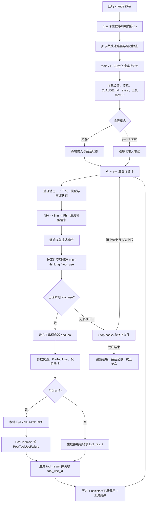

# Claude Code 2.1.307 实现流程分析

分析日期：2026-10-22（北京时间）。对象：官方 npm `latest` 当时指向的 **2.1.307**，macOS Apple Silicon 发行包。`stable` 当时是 2.1.306；本次按“最新包”选择 latest。

结论：这个版本的 Claude Code 是 **Bun 原生可执行文件 + 内嵌 JavaScript/字节码与资源 + 本地 Agent 编排 + 远端模型 API**。npm 主包负责分发，不承载完整核心逻辑。已从发行二进制提取实际打包脚本，核对启动、上下文、模型请求、流式解码、工具调度、权限与下一轮请求的实现。本文描述静态代码可确认的路径，未运行真实模型会话。

## 1. 下载对象与产物

官方入口：<https://github.com/anthropics/claude-code>。该仓库提供文档、插件与发行入口，本次核心分析对象是 npm 实际发布包，而不是把仓库 README 当实现源码。

| 内容 | 本地位置 | 用途 |
|---|---|---|
| npm 主包 | [claude-code-2.1.307.tgz](/Users/tcuser/Downloads/claude-code-rea-20261022/claude-code-2.1.307.tgz) | 安装脚本、占位入口、工具类型契约 |
| macOS arm64 原生包 | [claude-code-darwin-arm64-2.1.307.tgz](/Users/tcuser/Downloads/claude-code-rea-20261022/claude-code-darwin-arm64-2.1.307.tgz) | 当前 Mac 对应的实际 CLI |
| 原生执行文件 | `native/package/claude` | 274,428,784 字节，Mach-O arm64 |
| 原始提取内容 | `recovered/` | 2,776 个模块和资源，56,488,326 字节；其中 2,524 个内容以 `// @bun @bytecode` 开头 |
| 格式化阅读副本 | `readable/` | 便于用行号阅读；原始字节仍在 recovered |
| 模型调用函数切片 | `focus/` | 原文函数体，用于聚焦 REA 分析；切片不含外层依赖，不能独立运行 |
| 可重现提取脚本 | [scripts/extract-bun.py](/Users/tcuser/Downloads/claude-code-rea-20261022/scripts/extract-bun.py) | 从 Mach-O section 和本版本 Bun 模块表提取，不执行目标 |
| 原始位置映射 | [evidence/extraction-manifest.json](/Users/tcuser/Downloads/claude-code-rea-20261022/evidence/extraction-manifest.json) | 每个文件的 binary offset、长度、SHA-256、模块表项 |
| REA 证据 | [evidence/rea-evidence-bundle.json](/Users/tcuser/Downloads/claude-code-rea-20261022/evidence/rea-evidence-bundle.json) | 保留静态图、分析参数、限制和 unknown |

两个 tgz 均重新计算 SHA-512，与 npm 元数据的 `dist.integrity` 一致。这里验证的是下载字节与 registry 公布摘要一致，未额外验证 npm 签名或 Apple 代码签名。

原生 tgz SHA-256：`e6d59f0de94c571d1430cf30124534cf85766cabbd10a362594803d9ea5cf113`。

原生执行文件 SHA-256：`5b113a7752119470f1da419cb0e608af3361cae25b614216b13022093958fb2a`。

入口脚本内嵌构建信息：版本 `2.1.307`，构建时间 `2026-10-21T19:40:02Z`，Git SHA `b208bbbc9ae5dc87a1a0a7f964be47e27a0543ab`。这来自发行物字符串，不代表该 Git 提交的完整源码公开可用。

## 2. 总体执行流程

下图是核对函数体后整理的正常路径。特定权限模式、功能开关、账号与 transport 会改变分支，不是每次运行都会经过全部框。



这里最关键的关系是：**模型返回结构化工具调用，客户端负责校验、授权与执行，再把工具结果交回模型。** 执行工具和后续规划是多轮协作，不是只发一次问题然后显示一段文本。

## 3. 安装与启动

### 3.1 npm 安装阶段

`wrapper/package/package.json` 将 `claude` 指向 `bin/claude.exe`，postinstall 执行 `node install.cjs`。该脚本检测 OS/CPU、Linux musl 和 macOS Rosetta，选出同版本平台 optionalDependency，通过 `require.resolve` 定位原生程序，硬链接优先、复制兜底，放入 bin。

正常安装后命令直接执行原生文件。`cli-wrapper.cjs` 是备用 Node 启动器，通过 `spawnSync` 转发参数、环境、终端与退出码。详细行号见 [安装与工具契约分析.md](安装与工具契约分析.md)。

### 3.2 内嵌程序入口

Mach-O `__BUN/__bun` section 从文件偏移 `92,913,664` 开始，长度 `180,706,429`。模块表入口索引为 **7**，路径 `/$bunfs/root/cli`，提取后保存为 `recovered/cli.js`。

`cli.js` 的 `jt()` 先处理版本号、cwd 不存在、特殊子命令等快速路径，最后动态导入 `chunk-x77a7prk.js` 的 `main`。例如 `--version` 会直接返回版本，不会走完整对话初始化。常规启动继续进入参数解析、设置与会话初始化；详见 [启动与上下文分析.md](启动与上下文分析.md)。

“原生程序”不等于核心业务全部编译成不可读机器码：本发行物保留了 Bun 加载的打包 JS。提取内容保留混淆函数名和真实代码，并不是还原出的原始 TypeScript 工程。

## 4. 对话循环：真正的 Agent 在哪里

主要文件：[readable/chunk-hkcbd84t.js](/Users/tcuser/Downloads/claude-code-rea-20261022/readable/chunk-hkcbd84t.js)。

| 位置 | 实现事实 |
|---|---|
| `kL`，6619 行 | 查询的外层异步生成器；准备工具，进入 `pu`，结束时收尾与发出生命周期事件 |
| `Zm`，6658 行 | 可选 observer 包装，迭代内部生成器；不是另一个独立模型循环 |
| `pu`，6734 行 | 接收 `messages/systemPrompt/userContext/systemContext/canUseTool/maxTurns`；建立可更新状态 `Q` |
| `vd`，5988 行 | 默认依赖把 `callModel` 绑定 `NHt`，`autocompact` 绑定 `exr`；允许注入替代依赖 |
| 7063 行附近 | 调用 `P.autocompact`，处理压缩成功、熔断与失败状态 |
| 7925 行附近 | 调用 `Yi = P.callModel`，传消息、systemPrompt、tools、signal、模型和权限上下文等 |
| 8732 行附近 | 从 assistant content 中筛选 `tool_use`，设 `needsFollowUp` 并调用 `streamingToolExecutor.addTool` |
| 9648 行附近 | drain 工具剩余结果，并更新工具使用上下文 |
| 10087 行附近 | 将 `H + oe + ot` 写回 `Q.messages`，转入 `next_turn` |
| 10113 行 | `while` 驱动下一轮；内部返回 `next_round` 时继续，否则返回终止状态 |

最简化的等价逻辑如下。**这是解释用伪代码，不是原始代码全文。**

```text
state.messages = 历史消息 + 用户本轮输入
repeat:
    整理上下文与模型，必要时压缩
    response = 流式调用模型(messages, system, tools)
    持续显示文本；完整工具调用块可进入本地调度队列
    results = 等待本轮已排队工具完成
    if 有后续工具且未中止、未达限制:
        messages += assistant工具调用 + tool_result
        continue
    检查Stop hook是否要求继续
    返回 completed / max_turns / aborted / api_error 等终止状态
```

重要实现细节：工具在流式响应过程中即可排队，不必简单地等整条响应结束后才统一开始。调度器区分 concurrency-safe 工具与需要互斥的工具；发生重试/丢弃时也有 abort 与已运行工具追踪，避免把失败流当作完整成功结果。

## 5. 模型请求怎么构造，流怎么消费

实际模型实现集中在 [readable/chunk-wvsyb4fb.js](/Users/tcuser/Downloads/claude-code-rea-20261022/readable/chunk-wvsyb4fb.js)。这是多个模块共用的大块，不应因为文件名无语义就当成无关依赖。

调用链：`pu -> P.callModel -> NHt -> Zhn -> Fhn`。`NHt` 包含外层包装与 fallback 事件处理；`Zhn` 对工具搜索拒绝路径作恢复；`Fhn` 负责大量请求准备、发送、流解码与错误分支。

| 位置 | 行为 |
|---|---|
| `NHt`，117902 行 | 接收 messages/systemPrompt/thinkingConfig/tools/signal/options，进入模型调用包装 |
| `Zhn`，118675 行 | 调用 `Fhn`；工具搜索拒绝异常触发专门重建请求路径 |
| `Fhn`，118711 行 | 模型可用性、工具 schema、消息整理、上下文与请求选项 |
| 120538 行附近 | 构造请求对象：`model/messages/system/tools/tool_choice/max_tokens/thinking/metadata/output_config` 等 |
| 122291 行附近 | `Jl.beta.messages.create({...fh, stream:true}, {signal, headers}).withResponse()` |
| 122776 行附近 | 消费异步 stream，通过 heartbeat/watchdog 包装处理停滞与取消 |
| 122947 行附近 | `content_block_start` 按 index 建立块；工具 input 从空字符串开始 |
| 123058 行附近 | `input_json_delta` 累加 partial_json；`text_delta` 累加 text；thinking/signature 分别处理 |
| 123122 行附近 | `content_block_stop` 经内容转换生成内部 assistant 消息并 yield 给上层 |
| `Rhr`，117986 行 | 非流式兜底，实际 `.create({...Me, stream:false})`，包含超时、响应校验与错误回传 |

因此屏幕上的逐字输出和可执行工具并非同一种事件。工具 JSON 参数需要组装和转换后，才作为结构化 `tool_use` 进入本地 pipeline；不能把半截 `partial_json` 当作已经授权的命令。

存在 first-party、Bedrock、Vertex、gateway 等 provider 路由和不同 feature gate。客户端代码证明这些分支存在，不能证明某账号都可使用，也不能看到远端模型服务内部如何推理或调度。

## 6. 工具与权限：谁真正执行命令

主要链路已从函数体核实：`c8sx241e` 的工具包装 -> `wvsyb4fb.Iz -> X3r -> o9r`。

正常单工具路径：

1. 按工具名/别名查找定义；不存在的工具形成错误结果。
2. 用 schema 解析模型输入，并做工具自身 `validateInput`。
3. 执行 PreToolUse hook；hook 可影响输入、权限结果或停止后续处理。
4. 进入 `canUseTool`/权限裁决；根据模式、规则与调用方可能允许、拒绝、询问或转交。
5. 权限返回若更新了输入，需要再次校验 schema。
6. 允许后才执行工具 `call`。Bash 对应本地进程，MCP 对应已连接服务器的 RPC。
7. 成功进入 PostToolUse；失败进入 PostToolUseFailure；结果统一关联 `tool_use_id` 回到循环。

并不是“PreToolUse 是绝对第一步”，因为 schema 与工具校验在此前已有执行；也不是“模型说要执行，客户端就直接执行”。

完整函数、Bash 与 MCP 证据见 [工具与权限实现分析.md](工具与权限实现分析.md)。工具的类型声明见 `wrapper/package/sdk-tools.d.ts`，声明字段只能证明契约，本文实现结论另有真实函数体支持。

## 7. 上下文压缩、退出和恢复

详细实现已单独展开：[上下文压缩算法详解](上下文压缩算法详解.md)，附真实函数切片、提示词、阈值公式、数字推演、失败恢复和预计算校验。

这套机制包含模型生成摘要与客户端分组/保留/裁剪。默认 reactive 路径按 assistant message id 分组，先总结前缀、保留尾部；摘要请求过长时根据 tokenGap 扩大原文保留区，最后才可能有损删头。重建顺序为边界、摘要、可选替换、保留原文、恢复附件与 Hook 结果。旧 full compact 路径没有相同的固定尾部保留规则。

触发也不是统一的“80%”：例如假设实际及配置窗口均为 200k、输出预留 20k，预计算阈值为 144k、主动阈值为 167k、阻断为 177k；预计算受开关控制，纯 auto 窗口常转实际请求过长后的响应式恢复。以上是静态算法推演，不是账号当前参数测量。

退出也有多种原因：正常完成、API 错误、工具中止、权限导致的错误结果、maxTurns、工具延期、hook 阻止继续等。`pu` 的 `Fi` 在 Stop hook 阻止结束时可追加 blockingErrors 并继续，但受轮数与连续阻止次数限制。会话存储与 resume 还有多个后端/开关分支，详见启动与上下文报告；不能概括成唯一 JSONL 路径。

## 8. 用一个修改代码的问题串起来

假设用户问“检查一个文件并修复问题”，静态正常路径可以解释为：

```text
用户输入
 -> 本地组织系统指令、项目上下文、工具定义和历史
 -> 远端模型返回 Read/Bash 等 tool_use
 -> 本地 schema + validateInput + PreToolUse + 权限
 -> 获准后读取文件/执行命令
 -> 生成同一 tool_use_id 的 tool_result
 -> 下一轮模型据此返回 Edit/Write 等调用
 -> 再经过完整工具权限链执行并回传
 -> 模型输出最终答复
 -> Stop hooks / 终止状态 / 会话持久化
```

这只是用于解释上述已确认代码路径的例子，不是本次实际执行记录。本次没有读取用户 Claude 凭据，没有发起收费模型请求，也没有让发行程序修改项目。

## 9. REA 证据与分析边界

本次实际调用了 REA 的 JavaScript 应用静态分析，并导出 Evidence。人工阅读函数体与可重现二进制提取补足其不能自动解析的动态关系。

| 分析范围 | 保留的 parent Evidence ID | 覆盖说明 |
|---|---|---|
| npm 安装脚本 | `ev_946c10e7878e681d7a89719961a7314e402b2fcbe49f2a16d24ad3030aba4b46` | 两个 JS 文件；安装/备用入口 |
| 实际提取脚本中的入口、循环和工具包装 | `ev_c7489c916cc3723884bee6111f4d504b582a2dbf1797e2bbb93d72877b3be936` | 明确选择4个文件；108,885 AST 节点，无解析失败；其他文件不在此次自动语义分析范围 |
| 精确模型函数切片 | `ev_82176b63c867d7183008472a978140796f4f7c846e241614faa5d3ad707b6aa2` | 5个函数体，36,023 AST 节点；外部绑定不在切片中 |

**限制必须与结论一起保留：** REA 静态图为 partial，存在 dynamic-call、ambiguous-target、未选模块以及 unknown 保留上限；一次无匹配 trace 不能证明代码不存在。切片是分析派生物，不代表完整独立模块。格式化副本不是原始作者源码；所有原始提取文件都可根据 manifest 回查二进制位置。

已经看到：发行客户端的实际 JS 编排、调用和状态更新。未完成/不可由本包证明：Bun/JavaScriptCore 全量机器码反编译、远端闭源服务内部实现、模型权重与训练流程、真实登录后的功能开关、真实工具执行和会话端到端行为。没有把静态可达性描述成运行记录。

## 10. 如何继续读代码

先读 `readable/cli.js`，然后按上述表定位 `chunk-hkcbd84t.js` 的 `kL/pu`；网络看 `chunk-wvsyb4fb.js` 的 `NHt/Fhn`；工具看 `Iz/o9r`。配合启动、安装、工具权限及上下文压缩专项报告阅读，不必从 5MB 共用块第一行开始逐行读。

`recovered/` 是原始发行物提取内容，`readable/` 只是格式化阅读副本。若需要验证某段代码来自哪里，查 `extraction-manifest.json` 的 `content_file_offset/bytes/sha256`；模型切片还可查 `focus-manifest.json` 的精确函数偏移。
