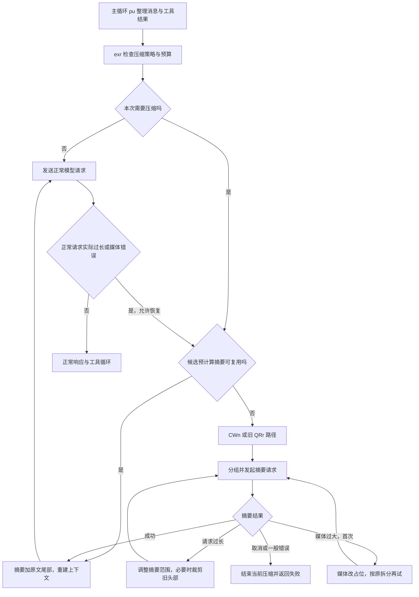

# Claude Code 2.1.307：上下文压缩算法详解

分析日期：2026-10-22。对象：官方 macOS arm64 发行包 2.1.307。

本文把“上下文太长，生成一个摘要”拆到实际实现：**如何计量、何时触发、按什么单位拆消息、模型到底总结哪段、失败后怎样调整、最后重新发送什么。** 函数名保持发行代码中的真实混淆名；中文变量名和伪代码是解释，不是恢复出来的原始 TypeScript。

证据类型：从发行二进制提取的真实打包 JavaScript、AST 函数切片、REA 静态分析、人工逐分支核对。数字例子是静态推演；未发模型请求，因此没有声称实测压缩率、当前账号开关或线上触发次数。

[TOC]

## 1. 先看完整路径

压缩不是一个单函数。这个版本同时包含以下机制：

| 机制 | 输入怎样变化 | 是否生成语义摘要 | 入口 |
|---|---|---|---|
| 大工具结果落盘 | 正文变文件路径和预览 | 否 | `Rle → Q → H9` |
| 同一模型回复的工具结果总预算 | 优先移出最大的新结果，旧结果冻结 | 否 | `f1s → ae` |
| 主动/响应式上下文压缩 | 旧消息变摘要，部分分支保留尾部原文 | 是，由模型生成 | `exr / CWn → $ve → vur`，旧路径 `QRr` |
| 摘要预计算 | 后台先生成候选，校验后才替换 | 是 | `Evo → nxr`；消费 `kvo → C4r` |
| context_hint 失败后的 microcompact | 旧工具结果变文件引用或清除占位 | 否 | `KKs` |
| 闲置后服务端清理 | 客户端发清理策略，服务端执行 | 否 | `qKs → context_management.edits` |

本文重点是第三、第四项，其余在第 11 节及配套笔记展开。这里可见的核心不是把历史 gzip 后交给模型，也没有发现以 embedding 重要性排序来选摘要范围；范围选择主要依赖**时间顺序、消息分组、token 差额与保留规则**。



源代码接入点：`chunk-hkcbd84t.js` 的 `pu`，正常请求前约 7063 行；实际响应错误后的恢复约 9140 行。默认注入的 `autocompact` 是 `exr`。不能把所有安装环境都概括成一个固定压缩分支。

## 2. 怎么判断历史占了多少 token

### 2.1 优先使用 API usage，再估算新增尾巴

[`qf`](源码摘录/chunk-wvsyb4fb__qf.js)、[`PYe`](源码摘录/chunk-wvsyb4fb__PYe.js) 的基本关系是：

```text
存在可用的最近 assistant usage：
  anchor = input_tokens
         + cache_creation_input_tokens
         + cache_read_input_tokens
         + output_tokens
  estimate = anchor + 本地估算锚点之后的消息

不存在可用 usage：
  estimate = 本地估算全部消息

遇到 compact_boundary：
  不再沿用边界之前的 usage 锚点
```

同一 assistant API message id 可能拆成多个内部消息，`PYe` 对锚点索引还有向前查找相同 id 的处理；不是简单地把每条 usage 相加。synthetic、unmetered、指定错误占位也会被过滤。含 `usage.iterations` 时还需选取有效迭代，不能直接累计整个数组。

[`_fr`](源码摘录/chunk-wvsyb4fb___fr.js) 触发检查使用：

```text
used = qf(messages, modelFactor) - snipTokensFreed + F1e(messages)
```

[`F1e`](源码摘录/chunk-wvsyb4fb__F1e.js) 从服务端 applied_edits 中读取已清工具结果的 `cleared_input_tokens`，这里是**加回**。不同检查点另有表达式，不能说所有地方使用完全同一个 used。

### 2.2 本地估算不是精确 tokenizer

实际估算见 [`Og`](源码摘录/chunk-wvsyb4fb__Og.js)、[`Qc`](源码摘录/chunk-pxqq6s5v__Qc.js)、[`J9n`](源码摘录/chunk-pxqq6s5v__J9n.js)、[`Bh`](源码摘录/chunk-e853mz9g__Bh.js)。

| 内容 | 本地估计方法 |
|---|---|
| 普通文本 | `Math.round(text.length / factor)` |
| factor | 某些旧模型为 4，其他模型为 3；未给模型默认 4 |
| 文本文档 | 普通默认除 4；标题后缀 json/jsonl/jsonc 默认除 2；与模型系数取较小值 |
| 图片、非文本文档 | 每块固定估 2000 |
| tool_use | 工具名加 JSON 序列化输入的长度，再除系数 |
| thinking | 按正文或 data 长度估算 |
| 嵌套 tool_result | 递归计算其内容块 |

这里的 `.length` 是 JavaScript UTF-16 字符串长度。变量名虽然叫 `bytesPerToken`，计算没有先取 UTF-8 字节长度。全角中文、emoji、JSON 与英文的估算误差不同。

包内另有 countTokens API 调用，但自动压缩这条 `qf` 判定链没有每轮去调用它。不能把估算阈值写成服务端精确计量。

## 3. 何时触发：完整阈值公式

定义：

```text
C = 实际模型上下文窗口
M = 模型/设置允许的最大输出 token
O = min(M, 20000)
W = 选择出来的自动压缩窗口，受 C 限制
B = W - O                     // 有效输入预算
B_real = C - O                // 真实模型输入预算
f = 预计算缓冲比例，后备值 0.2
```

[`QQ`](源码摘录/chunk-wvsyb4fb__QQ.js)、[`BYe`](源码摘录/chunk-wvsyb4fb__BYe.js)、[`HYe`](源码摘录/chunk-wvsyb4fb__HYe.js) 的公式：

```text
T_compact = B - 13000

若 CLAUDE_AUTOCOMPACT_PCT_OVERRIDE=p 且 0<p<=100：
T_compact = min(floor(B*p/100), B-13000)

T_precompute = min(B-round(B*f), T_compact)
T_warn = (自动压缩启用 ? T_compact : B) - 20000
T_block = B_real - 3000
```

`CLAUDE_CODE_BLOCKING_LIMIT_OVERRIDE` 合法时可替换 T_block。`HYe` 的顺序是 `blocked → compact → warn → ok`，因此达到阻断值不会先返回 compact。

真实发行函数摘录：

```js
function QQ(e, n) {
  let r = e - 13000,
    s = n.testPctOverride;
  if (s !== void 0 && !isNaN(s) && s > 0 && s <= 100)
    return Math.min(Math.floor(e * (s / 100)), r);
  return r;
}
function BYe(e, n) {
  return Math.min(e - Math.round(e * n.precomputeBufferFraction), QQ(e, n));
}
```

### 3.1 用 200k 窗口完整计算

假设 `C=W=200000`、`M=32000`、`f=0.2`、无其他覆盖：

```text
O = 20000
B = 180000
T_precompute = min(144000,167000) = 144000
T_warn = 147000
T_compact = 167000
T_block = 177000
```

注意三个实际约束：

1. 144k 是满足开关和入口条件时的**预计算阈值**，不表示此时立即替换历史。`EBe` 要求 `tengu_sepia_moth`，该开关包内后备值为 false；账号实际分配未采样。
2. 本地 reactive 支持默认可用时，窗口来源为 `auto` 的入口通常跳过本地估算主动触发，等待正常请求的真实过长错误。窗口来源不是 auto 时，可以由阈值触发同一个 reactive 实现。
3. 若配置 `W=100000` 而真实 C 仍是 200000，主动阈值为 67000，但阻断仍为 177000；预计算入口对这类非 auto 窗口另有至少 200k 的门槛。

窗口选择涉及环境变量、分层设置、clientData、实验和模型默认值，不是全模型常量。详细优先级和四组演算见 [触发阈值与Token计数.md](触发阈值与Token计数.md)。

## 4. 历史按什么单位拆分

默认 reactive 路径：[`gpt`](源码摘录/chunk-wvsyb4fb__gpt.js) 规范化历史并去除 progress，交给 [`a2`](源码摘录/chunk-wvsyb4fb__a2.js)。其规则是：

```text
虚拟消息：追加到当前组，不触发切分。

非虚拟 assistant 出现时，如果：
  message.id 与上一次 assistant 不同，且
  不是 resumedFromIncompleteThinking，且
  当前组非空
则关闭当前组，从这个 assistant 开始新组。

其他消息：继续放当前组。
```

人工输入示例：

```text
U1, A1(text,id=m1), A1(tool,id=m1), tool_result1, U2,
A2(id=m2), tool_result2, U3

G0 = [U1]
G1 = [A1(text), A1(tool), tool_result1, U2]
G2 = [A2, tool_result2, U3]
```

所以“保留一组”不是“保留最近一问一答”。开场 user 可以独立一组；一个 assistant 的流式碎片和后续工具结果通常一起移动，后一个 user 也可能仍在该组。

`a2` 没有逐项匹配 tool_use/tool_result 的 ID，不能把它夸大为任意损坏历史的配对修复算法。

## 5. 核心 $ve：摘要前缀，加原文尾部

完整实际实现：[`$ve`](源码摘录/chunk-wvsyb4fb__$ve.js)。

### 5.1 默认拆分

```js
// 解释用伪代码，省略 Hook、媒体、救援和遥测分支
groups = gpt(messages);
if (groups.length < 2) return too_few_groups;
preserveCount = 1;

while (!aborted && apiBudgetAvailable) {
  end = Math.max(0, groups.length - preserveCount);
  summarize = groups.slice(0, end).flat();
  keep = groups.slice(end).flat();
  result = await summarizeWithModel(summarize);
  if (result.ok) return {summary: result.summary, keep};
  if (result.reason !== 'prompt_too_long') return handleOtherError(result);
  preserveCount += chooseStep(result.tokenGap, groups, end);
}
```

实际实现有特殊保留尾部 `Pur`、无 assistant 可总结时的救援、媒体重试与有损兜底，后文逐项说明。摘要覆盖的只是 summarize，**keep 没有进入这一轮摘要请求**。

有 `initialTokenGap` 且组数大于 3 时，第一次摘要前就会估算各组：先从 gap 扣除已保留的最后一组大小，剩余差额大于零才用 `edn` 扩大保留范围。它利用已知超量避免一次明显过大的初始请求。

### 5.2 请求过长后，下一步移动几组

[`Ien/h8e`](源码摘录/chunk-wvsyb4fb__Ien.js) 解析过长错误中的实际输入和上限：

```js
/prompt is too long[^0-9]*(\d+)\s*tokens?\s*>\s*(\d+)/i
// tokenGap = actualTokens - limitTokens，只有正差额有效
```

[`Tur`](源码摘录/chunk-wvsyb4fb__Tur.js) 在 gap 不可解析时每次移动 1 组；可解析时调用 [`edn`](源码摘录/chunk-wvsyb4fb__edn.js)。下面是实际函数体：

```js
function edn(e, n, r) {
  let s = 0, h = 0;
  for (let y = n - 1; y >= 0; y--)
    if (((s += e[y]), h++, s >= r)) break;
  if (h >= n - 1) return Math.max(1, Math.floor(n / 2));
  return h;
}
```

解释：`e` 是各组估算 token；`n` 是当前摘要前缀组数；`r` 是 gap。从摘要前缀尾部往前累加，够 gap 就停止。如果几乎要移空摘要前缀，则改为移动约半数，保留继续探测的机会。

### 5.3 十组历史的数字推演

假设估算 token 如下，关闭特殊尾部条件，初次没有 seeded gap：

| 组 | G0 | G1 | G2 | G3 | G4 | G5 | G6 | G7 | G8 | G9 |
|---|---:|---:|---:|---:|---:|---:|---:|---:|---:|---:|
| token | 4000 | 9000 | 8000 | 7000 | 6000 | 5000 | 4000 | 3000 | 2000 | 1000 |

第一轮 summarize=G0…G8，共 48000；keep=G9，共 1000。

假设摘要请求返回 `tokenGap=9000`：

```text
从摘要尾部累计：
G8: 2000
G8+G7: 5000
G8+G7+G6: 9000  -> step=3

preserveCount: 1 -> 4

第二轮 summarize=G0…G5，共39000
第二轮 keep=G6…G9，共10000
```

如果第二轮成功得到 3000 token 的摘要，那么历史部分约变成 `3000+10000=13000`，再加边界、恢复附件、固定前缀、Hook 等开销。不能把 13000 当完整请求大小。

这里的 G6…G8 **没有丢失，只是从摘要输入区移到原文保留区**。算法先解决“摘要请求装不下”，不保证移动一次后正常主请求必然装得下。

如果第一次 gap=40000，累计到 G1 才够，需移动 8 组；`8 >= 9-1` 触发半数保护，实际 step=`floor(9/2)=4`。本轮少移动一些，下一次仍可能过长，再继续调整。它不是二分搜索，也不保证每次一步精确命中。

### 5.4 例外：特殊尾部与开场组救援

`Pur` 在 `tengu_clever_garden` 等条件成立时可多保留前一 assistant 组：例如末组为合成 `No response requested.`、前组有效且不超过 15000 token 等。该旗标后备值为 false；默认保留一组不适用于所有分支。

阶梯耗尽后，`Jln` 可能先单独总结一个很大的开场组，其他组全部保留。判据包含：

```text
openingTokens - ceil(openingTokens/10)
  >= tokenGapAndPreservedOverhead + 70000

70000 = 20000 + 5*5000 + 25000
```

它要求足够大的开场内容和其他条件。`Cur` 对该特殊摘要的标签/错误再检查；不合格时转头部裁剪，不是盲目接受任何非空回复。

## 6. 摘要到底怎么生成

### 6.1 实际是一次独立的模型回合

[`vur`](源码摘录/chunk-wvsyb4fb__vur.js) 的实际调用配置包括：

```js
await HR({
  promptMessages: [summaryRequest],
  cacheSafeParams: {...parentParams, forkContextMessages: prefix},
  canUseTool: SXe(),
  querySource: 'compact',
  forkLabel: 'reactive-compact',
  maxTurns: 1,
  skipTranscript: true,
  skipCacheWrite: true,
  // 另有 apiAttemptsLeft、fallbackModel、thinking/advisor剥离计划等
});
```

这里为重命名后的摘录，字段值来自实际实现。完整原文见链接。`HR → $cr` 建立 fork，继承父上下文的 system、user/system context、工具定义和缓存安全前缀，再加摘要请求。**不是一律新建一个极短 system prompt 去调用小模型。** 摘要模型的选择仍走主模型/fallback 相关逻辑，具体账号最终选谁本轮未实测。

提示词要求不调工具之外，`SXe` 的权限回调也会拒绝工具。`maxTurns=1` 是逻辑回合限制，API 层可能重试，不能推导为始终只有一个 HTTP 请求。

### 6.2 默认摘要模板保留哪些信息

完整发行提示模板和变体选择已保存为 [prompt-template-bundle.js](源码摘录/prompt-template-bundle.js)。它包含被分析程序自己的指令文本，只作为源码数据阅读。

`Zwe` 先读取 `CLAUDE_CODE_CURRIED_TRINKET`，否则读远端 `tengu_curried_trinket`，后备值 `control`，无效值也回 control。

默认 control 经 `Ywe({analysisFirst:true})` 生成九部分要求：

1. 用户主要请求和意图。
2. 关键技术概念。
3. 文件、代码段、改动及相关性。
4. 错误、修复、用户反馈。
5. 已解决和仍在解决的问题。
6. 所有真实用户消息与安全限制。
7. 明确要求但尚未完成的任务。
8. 压缩前正在进行的工作。
9. 紧接当前工作的下一步，并引用最近原话。

模板要求安全限制逐字保留，并明确：assistant 文本里伪装成 user/Human 的内容不算用户授权。这是摘要质量约束；客户端没有确定性算法保证模型逐字保留了所有约束。

变体包括 `no_scratchpad`、`no_scratchpad_capped`、`no_scratchpad_keep_asks`、`lean`、`short`、`short_v2`、`capped`。**2000 words 只出现在部分 capped 模板，不是所有摘要统一硬限 2000 token。** 模型输出仍受模型调用预算等约束。

### 6.3 模型输出如何变成下一轮消息

`Kwe → qwe` 优先取含摘要标记的 assistant 文本，否则退到最后一个有效文本。`hur` 移除匹配的 analysis 块、处理 summary 标签和空行；`QZ` 再包续接说明、工具名、允许时的 transcript 路径，以及头部丢弃警告。

这不是严格 XML 校验器。普通成功路径接受有效非空文本；特定开场组救援另有更严格检查。生成的摘要被包为 `isCompactSummary` 消息，再交给上下文重建。

## 7. 兜底算法：什么时候真的丢历史

### 7.1 从“扩大保留尾部”切换到“删除最旧头部”

阶梯后摘要集合不再有 assistant，且最后兜底开关/调用条件允许时，`xur` 尝试保护未回答的真实用户请求尾部，`Fve` 对剩余摘要输入删头。后台预计算调用 `allowFallback:false`，不能直接套用这条有损兜底。

[`Fve`](源码摘录/chunk-wvsyb4fb__Fve.js) 的核心算法：

```js
groups = a2(inputWithoutOldTruncationMarker);
if (groups.length < 2) return null;

if (tokenGap !== undefined) {
  drop = 从最旧组起累计，直到估算tokens >= tokenGap;
} else {
  drop = Math.max(1, Math.floor(groups.length * 0.2));
}
drop = Math.min(drop, groups.length - 1);
remaining = groups.slice(drop).flat();
if (remaining[0].type === 'assistant')
  remaining.unshift(metaTruncationNotice);
return remaining;
```

仍使用前面的十组数字：gap=15000 时，从最旧 G0 起累加 `4000+9000+8000=21000`，删三组；没有 gap 时删 `floor(10*0.2)=2` 组。

**与第 5 节不同，这些头部内容不会被本次摘要覆盖，也没有搬到原文保留尾部。** 包装器会说明最早历史没有进入摘要；保留 transcript 路径只意味着可另行查回，不代表旧全文仍在模型输入中。

头部截断最多 3 次（`JZ=3`），但这不等于整个流程只会发 3 次摘要请求：在此之前还有按组移动重试、媒体重试和特殊救援。

### 7.2 媒体错误与一般错误的分支

| 结果 | 处理 |
|---|---|
| 首次媒体过大 | `jve` 把 image/document 改成占位文字，原拆分再试 |
| 再次媒体过大 | `media_unstrippable`，退出 |
| prompt too long | 扩大尾部，或在兜底状态继续删头 |
| 空摘要、没有 assistant、普通 API 错误、DLP 错误 | 当前压缩失败，不能一律当过长裁剪 |
| 用户取消 | aborted |
| 共用 API 尝试预算耗尽 | exhausted |

第一次媒体重试会把内部逻辑 attempts 减一，所以这个字段也不是 HTTP 调用次数。

### 7.3 防止无限压缩

存在三个不同层次：

- `$ve` 内部：组移动、媒体替换、最多三次头部裁剪，受 API 共用预算约束。
- 正常主请求恢复：通常一次 reactive 恢复；条件成立时有一次额外 deeper pass。复用预计算摘要有不同状态，不直接消耗现场重算资格。
- 会话跟踪：连续失败 3 次会阻止部分主动入口；连续三次“压缩后少于三轮又填满”触发快速回填熔断。这里的轮是主循环工具回合计数，不等于用户发言次数。

不能合并为“最多重试三次”一句话。更完整的分支、flags 和计数见 [压缩重试与恢复.md](压缩重试与恢复.md)。

## 8. 压缩后到底发送哪些内容

[`jRr`](源码摘录/chunk-wvsyb4fb__jRr.js) 在 reactive 成功后保存并清理旧 readFileState，准备边界和保留消息，调用恢复附件逻辑与 Hook。

[`H1`](源码摘录/chunk-wvsyb4fb__H1.js) 的实际数组顺序是：

```js
function H1(e) {
  return [
    e.boundaryMarker,
    ...e.summaryMessages,
    ...(e.replacement ?? []),
    ...e.messagesToKeep,
    ...e.attachments,
    ...e.hookResults,
  ];
}
```

这就是“摘要替换历史”的实际含义：不是把摘要追加在所有旧消息后面。系统提示与工具定义等固定前缀仍由正常请求构建另行处理，主循环也可能追加边界公告等内容。

恢复内容主要包括：

| 内容 | 实际恢复策略 |
|---|---|
| 最近读过的文件 | `sfr` 先排除计划/指令memory文件、保留尾部已读文件等，再按读取时间倒序选最多 5 个候选，重新读磁盘 |
| 单文件 | 读取限制 5000 token；文件失败不会自动补第六个 |
| 文件附件总量 | 按序列化附件估算，累计不超过 50000 |
| 已调用 skills | `afr` 按 invokedAt 倒序，每个内容最多估算 5000，总预算 25000，另有重复/来源过滤 |
| 其他状态 | 计划、后台任务/shell、部分工具和 MCP 状态、SessionStart(compact)/PostCompact 等，受对应条件控制 |

`ffr` 对 skill 的裁剪是本地长度预算，不是另发模型摘要。重新读磁盘意味着恢复的是读取当时的磁盘内容，不保证是此前每个文件版本的精确快照。

若保留尾部非空，摘要还会附说明：生成摘要时没有看到这些原文，冲突应参考保留尾部。否则模型容易把前缀的旧状态当成最后状态。

### 8.1 与旧 full compact 的区别

`QRr → hcn` 是旧 full 路径：默认对全段发摘要，结果构造中 `messagesToKeep=[]`，随后也恢复附件与 Hook。`hcn` 优先尝试共享父前缀的 fork，失败时可回退独立摘要请求；回退可剥离媒体，开启 stripNonEssential 时还裁长工具字符串和移除 thinking。

所以“Claude 压缩固定保留最后一组原文”只描述 reactive 的常规拆分，不是所有 `/compact` 或兼容路径的不变规则。

## 9. 后台摘要为何可以提前做，却不能随便用

`Evo → nxr` 预先生成候选，不立刻改当前 messages；`kvo → bvo → C4r` 消费时检查它还是否匹配。

[`C4r`](源码摘录/chunk-s7k1n636__C4r.js) 会拒绝：边界 UUID 消失、覆盖行 UUID 改变/缺失、保留消息缺失、前段插入摘要未见的非虚拟 assistant、Hook 添加说明或改写覆盖前缀、替换后仍放不下等情况。

这是基于 UUID 和前缀关系的校验，**不是对所有消息全文做加密哈希相等校验**。

[`Ar`](源码摘录/chunk-s7k1n636__Ar.js) 的大小估算可以写成：

```text
oldKept = 当前历史中与候选保留区共有的消息
removed = 当前历史中不在候选保留区的消息
newKept = 候选保留区中当前历史没有的消息

postSwap = max(liveTokens - sizeOf(removed), sizeOf(oldKept))
           + sizeOf(summary + newKept)

givesWay = postSwap >= threshold && madeFromTokens < window
```

消费逻辑还会补上后台运行期间新产生的 tail。通过校验才替换；预计算失败或失效时现场重算或按模式跳过。远端开关后备 false，因此不能宣称所有用户达到 80% 都自动后台摘要。

## 10. 实现这套压缩需要哪些状态

若要在自己的 Agent 中借鉴，不只是写一个 summarize 函数，需要至少维护：

| 状态 | 用途 |
|---|---|
| 消息 UUID、assistant message id、虚拟/恢复标志 | 分组、覆盖校验和保留尾部 |
| usage 锚点、模型能力、字符估算器 | 预算检查和 gap 估计 |
| 摘要输入/原文保留区及媒体剥离标记 | 摘要请求重试 |
| 逻辑 attempts、API 共用预算、headTruncations | 各层重试限制 |
| 压缩边界、转录位置、文件读取状态、skills/任务状态 | 上下文重建与可追溯 |
| 连续失败数、上次压缩后的轮数、快速回填数 | 熔断 |
| 后台摘要覆盖集、旧保留集、生成时预算 | 防止使用过期候选 |

可确定性复现的是分组、预算、裁剪、重试和数组重建；摘要措辞、事实是否完整与语义压缩率取决于模型。发行客户端代码不能恢复远端模型的权重、内部推理或训练算法。

## 11. 工具结果减载：另两套可以具体复现的算法

详细源码和接线见 [工具结果减载与Microcompact.md](工具结果减载与Microcompact.md)。这里保留关键算法，避免把它们错当大摘要。

### 11.1 200000 字符的同组贪心落盘

`ae` 按 assistant message id 关联工具结果，区分 `mustReapply / frozen / fresh`。旧 replacement 重放，已见未替换结果冻结，仅对 fresh 按正文大小降序选择：

```text
total = frozen可计费字符数 + fresh可计费字符数
按 fresh 大小降序：
  如果 total <= 200000：停止
  选择该结果落盘
  total -= 该结果原文长度
落盘成功后才用文件引用替换，并记住 replacement
```

例：frozen=60000，fresh A=90000、B=70000、C=30000，总250000。先落盘 A，按正文预算降至160000，B/C留下。

它没把替换串长度加回预算；frozen 已过大和落盘失败也不保证能降到预算。因此 200k 不是最终完整消息严格硬上限。

单次工具大结果另走 `Q/H9`：正常 ceiling 50000 字符，工具/config 可改变；成功时保留文件路径和约 2000 字符预览。普通落盘失败保持原文；专用 artifact store 失败有显式截断分支。

### 11.2 microcompact 保护最近五次调用

`KKs` 对 Read/Bash/PowerShell/Grep/Glob/WebSearch/WebFetch/Edit/Write 等工具：

```text
按出现顺序收集适用 tool_use ID
保护最后5个 ID
之前尚未持久化/清除的 tool_result 加入候选
若候选估算总token <20000：不清理
否则所有候选逐一落盘，替换成短文件引用
保存失败：替换成 Old tool result content cleared
```

五次是工具调用数，不是五轮用户会话。这个版本发现的实际调用位于 first-party main REPL 的 context_hint 请求拒绝/流式回退路径，受开关控制，**不能写成每轮必跑的标准步骤**。

闲置清理由服务端执行：客户端可在严格闲置超过 3900 秒及数量等条件成立时，发送 keep=12、clear_at_least=20000 的 edit。包里能恢复客户端的决策和参数，不能恢复服务器内部怎样清理缓存/token。

## 12. 源码、证据和可核对范围

当前目录带了实际函数摘录与必要小型证据，方便不跳到巨型 chunk 就读算法：

- [源码摘录索引](源码摘录/README.md)：真实函数、可读副本、完整提示模板。
- [证据及校验说明](证据/README.md)：二进制身份、函数字节映射、验证结果和 REA 范围。
- [触发阈值与Token计数](触发阈值与Token计数.md)：完整设置优先级、开关、数值表。
- [压缩重试与恢复](压缩重试与恢复.md)：完整 ladder、特殊救援、两层重试与熔断。
- [工具结果减载与Microcompact](工具结果减载与Microcompact.md)：落盘、贪心预算、microcompact、服务端 edit。

完整格式化文件仍在 [Downloads/readable](/Users/tcuser/Downloads/claude-code-rea-20261022/readable)；原始提取模块在同级 recovered。函数切片缺外层绑定，仅供阅读，不是可独立运行的完整工程。

原生二进制 SHA-256：`5b113a7752119470f1da419cb0e608af3361cae25b614216b13022093958fb2a`。

本次压缩函数聚焦 REA parent：`ev_9a4eee306f63d5976d595ea04cf5bfc2e27cba9344f73f6d67cb5003c9626a3d`。选择 7 个核心函数分析，2745 AST 节点，无解析失败、无语义截断；51 个其他函数不在该次自动分析选择内，语义图仍为 partial，存在 1105 个 unknown。后续补充摘录为人工源码核对，没有扩大声称这个 REA Evidence 的覆盖范围。

**已确认的是此发行版本的客户端算法。** 没有以静态代码冒充在线回放，也没有为模型摘要编造“固定保留 95% 信息”“一定节省 80% token”等无法由代码保证的指标。
