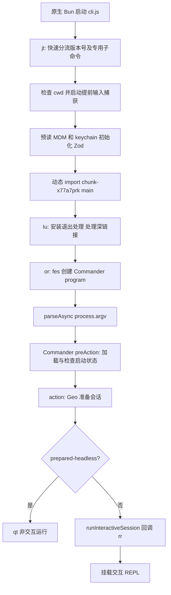

# Claude Code 2.1.307：启动、上下文与会话实现

本报告基于从 darwin-arm64 原生程序 `__bun` 段提取的实际发货 JavaScript，属于运行时实现的静态源码分析；不再仅依赖 `.d.ts`。未执行目标程序，未读取本机真实账号、密钥或聊天记录。

## 证据定位约定

- 原始模块：`recovered/`；每项二进制偏移、字节数、SHA256 见 `evidence/extraction-manifest.json`。
- 为便于复核生成了格式化副本，不更改逻辑：早期模块在 `analysis-formatted/`，其余在 `readable/`。下文行号均指明对应目录。
- 混淆函数名只在该文件内有意义，例如不同文件里的 `s()` 不是同一函数。
- 这是压缩发货 JavaScript 的恢复，不是 Anthropic 内部原始 TypeScript 仓库，也不是 Bun 原生运行时 C++/Zig 的反编译。

## 1. 启动和参数解析的真实调用链

主链路为：



具体证据：

| 实现位置 | 可直接确认的操作 |
|---|---|
| `analysis-formatted/cli.js:103-169` 的 `jt()` | 读取 argv、单独处理 `--version/-v/-V`；输出内置版本 2.1.307 和构建 commit；检查当前目录失效后写启动失败结果并退出 |
| `analysis-formatted/cli.js:1030-1064` | 对非专用子命令提前捕获输入，动态导入 `startMdmRawRead` 和 `startKeychainPrefetch`，调用 `configureZodForStartup()`，动态导入 `main` 并 await 执行 |
| `analysis-formatted/chunk-x77a7prk.js:1336-1390` 的 `Iu()` | 注册 exit 恢复终端处理；处理 URI/deep link；调用 `or()` |
| `analysis-formatted/chunk-x77a7prk.js:1391-1438` 的 `or()` | 将交互、onboarding、安全对话等 UI 能力作为回调传给 `fes()`；由 program.parseAsync(process.argv) 驱动命令 |
| `readable/chunk-wrcjnkne.js:1481-1515` 的 `fes()` | `new KKe().configureHelp(...).enablePositionalOptions()`，安装异步 `preAction`；可见原生分发程序内仍在用 Commander 风格的 JS 参数解析 |
| `readable/chunk-wrcjnkne.js:2253-2277` 的 action | `KPo()` 得到解析结果；调用 `Geo()`；如果结果是 exited 就返回、prepared-headless 就进入 qt，否则调用 runInteractiveSession |
| `readable/chunk-78hwm8r1.js:4577` 的 `Geo()` | 实际启动会话准备函数；处理 cwd/输入/权限/模型/命令/代理/MCP/onboarding 等，不只是参数声明 |

参数定义也是执行代码，例如 `readable/chunk-wrcjnkne.js:1743` 的 print、`:1920` 的 mcp-config、`:2018-2029` 的 continue/resume/fork、`:2159` 的 settings、`:2205` 的 strict-mcp-config、`:2221` 的 setting-sources。

用户会话存在两条不同入口：交互 REPL 与 print/headless，不应把终端 UI 的循环等同于整个 CLI 的唯一执行方式。

## 2. 配置加载：目录、显式参数和校验

### 2.1 配置目录和各层路径

`analysis-formatted/chunk-rat1daph.js:84-103`：`s()` 取 `process.env.CLAUDE_CONFIG_DIR`；`He` 的 memoized 计算是 `(s() ?? join(homedir(), '.claude')).normalize('NFC')`；`Gp()` 在 diskless 模式可以返回 null。因此不能无条件承诺所有会话都读取本地 `~/.claude`。

`readable/chunk-0dyc4n3v.js:12558-12585` 的 `pV()/UC()` 真实生成路径：

| source | 路径/入口 |
|---|---|
| userSettings | 用户配置目录下 `settings.json`，cowork 分支可能换为 `cowork_settings.json` |
| projectSettings | 项目配置目录下 `.claude/settings.json` |
| localSettings | 项目配置目录下 `.claude/settings.local.json` |
| policySettings | `aE()` 管理配置入口，默认 managed-settings.json |
| flagSettings | 启动参数已解析并登记的 flagPath |

配置层序列见 `readable/chunk-y5y3ag3w.js:190` 的 `xs = ['userSettings','projectSettings','localSettings','flagSettings','policySettings']`。这是处理层次顺序证据；具体每个字段并非简单“最后一层覆盖”，因为策略合并、限制交集、来源过滤另有专门代码，不能用这行推断所有权限字段的覆盖规则。

### 2.2 显式 settings 并不是直接 require JSON

`readable/chunk-t6060b2y.js` 的 `m1o()`（文件末尾对应 eagerLoadSettings 导出）先处理 `--settings`、`--managed-settings`、`--setting-sources` 和 fast-mode：

- `Wpi()` 判断传参是 JSON 字符串还是文件路径；JSON 内容会生成临时 JSON 路径并登记内容；文件要进行路径解析和大小限制。
- `Gpi()` 处理 managed-settings JSON，要求 object，错误打 warning 并标记。
- `I1r()` 应用 `--setting-sources`；restricted 分支将用户/项目/本地来源清空。
- `nG()` 缓存已解析文件（`readable/chunk-0dyc4n3v.js:12083-12089`）。
- `$C()` 读文件，`VE()` 解析 JSON 并进行 schema safeParse，产生 settings/errors/loadState（同文件 `:12290-12370`）。

因此加载配置包含路径与内容校验、来源标记、缓存和错误聚合，后续功能读取的不是未经验证的原始对象。

## 3. CLAUDE.md、rules 和自动记忆如何进入上下文

真实调用链是：`_qo()` 构建用户上下文 -> `nw()` 做单次加载缓存 -> `iqo()` 搜索并装配文件 -> `SW()/y2e()/g2e()` 解析单文件 -> `BGe()` 序列化 -> 输出 claudeMd 等上下文 blocks。

对应实现都在 `readable/chunk-wvsyb4fb.js`：

1. `nw():61719-61732` 以当前会话 root 和加载模式缓存 Promise；缓存对象中保留 settled 结果。
2. `iqo():61783-62048` 根据已启用 settings sources、diskless、managed 目录是否可信、项目工作目录等条件确定候选文件。它建立从祖先到当前目录的遍历列表；候选包括 `CLAUDE.md`、`.claude/CLAUDE.md`、`CLAUDE.local.md`、`.claude/rules`。
3. 同函数依次装配 managed、用户配置目录的 CLAUDE.md/rules、项目祖先链/本地文件、额外目录以及 AutoMem。加载不是无条件读取全磁盘，存在 held/withheld 与受限目录检查。
4. `y2e():61309-61359` 通过 storage backend 或文件系统读取，拒绝特殊/超限文件，错误按类型归类。
5. `g2e():61227-61255` 解析可条件匹配的 paths、处理 HTML 注释、解析 @include，把原始内容变成带 path/type/content/globs 的记录。
6. `Zzo():61360-61402` 在 Markdown tokens 中找 @path，跳过代码块和行内代码；路径以所在文件为基准解析，`@...#...` 的片段被截去。
7. `SW():61476-61508` 递归展开 include、去重、处理符号链接/外部目录限制。`Oxr = 5`（`:61403`）和 `kVt()` 的 `s >= Oxr` 共同提供递归深度上限；不能理解为无限递归导入。
8. `Ime():61510` 起处理 rules 目录，支持条件规则等路径控制。
9. `_qo():62507-62580` 调 `nw()` 取文件，筛选并调用 `BGe()` 得到 claudeMd 文本；实际生成包含 `claudeMd`、`currentDate` 以及可选 userEmail/attachedProject 的 blocks。这里是“文件内容进入会话上下文”的直接实现证据，不是仅找到字符串。

特别边界：`AGENTS.md` 在这部分 `oqo():61702` 只作为存在性探测并记入 telemetry；不能因 `G2t` 或文件名字符串出现在此模块，就断言任意 AGENTS.md 都按 CLAUDE.md 规则自动全文注入。其他代码路径是否额外加载需另查。

## 4. Skills 如何发现、解析、注册和在调用时展开

真实实现位于 `readable/chunk-wvsyb4fb.js`：

| 函数及行号 | 实现内容 |
|---|---|
| `Yp():96923` | 入口加载并过滤可用命令/skills，返回运行时 command 对象 |
| `vOe()/CMr():139188-139280` | 加载 managed/user/project/synced/显式目录等 skills；根据来源开关、diskless/reduced mode、host catalog 等分支决定扫描范围；结果按文件身份去重 |
| `IL():138888-139033` | 列目录，遍历各 skill 子目录，拼 `SKILL.md`；检测普通文件、读取大小上限；解析失败只记录错误并跳过；对 `/mnt/` 空读有250ms后一次重试 |
| `IIr():138468-138515` | 调 `na()` 解析 YAML frontmatter 和正文，intern 正文、计算 Bun.hash、记录来源和 baseDir，然后调用 Krn |
| `Krn():138516-138674` | 创建 `type:'prompt'` 命令对象，包含 name、description、allowedTools、disallowedTools、model、context、agent、background、paths、hooks、skillRoot 等运行字段 |
| `Krn().getPromptForCommand():138635-138673` | 真正调用 skill 时读取或拿到正文、前置 Base directory、替换参数、展开 `${CLAUDE_SKILL_DIR}` / `${CLAUDE_PROJECT_DIR}` / `${CLAUDE_SESSION_ID}` / `${CLAUDE_EFFORT}`，按分支执行 Lve，然后返回 text 内容块 |

这说明 skill 不是单纯把一个目录加到提示词：存在发现目录 -> 解析元数据 -> 注册可调用命令 -> 执行时展开正文的过程。allowed-tools 等声明被单独转换成运行字段；实际是否允许调用仍由工具权限层裁决，skill 注册不等于可以绕过权限。

启动的直接关联：`readable/chunk-78hwm8r1.js:5695-5716` 调 `Yp(cwd,storage)` 提前加载命令，再将命令 Promise 传入 `Ci()`，同时加载工具和 Agent definitions。

## 5. MCP 启动：先合并配置，再等待批准并连成工具

入口 `readable/chunk-78hwm8r1.js:5044-5060` 等待 `r1()` 的 MCP policy 条件；`:5389-5402` 启动 `dC()` 配置 Promise。严格 MCP、reduced 或 remote 模式会跳过自动发现分支。

配置解析和合并在 `readable/chunk-wvsyb4fb.js`：

- `Yf()/Vst():168314-168399`：project 从项目目录向祖先搜 `.mcp.json`，按祖先到子目录读取并 Object.assign；user 从用户配置对象 mcpServers 获取；local 从当前项目配置获取；managed/enterprise 有各自来源。
- `gDt():168644` 起：同步读文件并限制大小（`soe = 2097152`），判断普通文件，产生可定位到文件的配置错误；并非直接 eval 配置。
- `dC():168431-168590`：合并企业、managed、user、project、local、插件与显式动态配置；对项目服务检查 approved/pending/rejected，排重、过滤 reserved names 和 policy 不允许的服务器，返回 servers 及错误/告警集合。
- `readable/chunk-78hwm8r1.js:6056` 取最终配置；`:6123-6135` 对非 headless 分支使用 Promise 进行服务连接，并去重合并 MCP tools 和 commands。
- `analysis-formatted/chunk-x77a7prk.js:1967-1972`：如果 onboarding 刚改变项目 trust 状态且没有 strict-mcp-config，会重新等待 MCP policy 再加载 dC，说明首次批准后配置会重新计算。

这里已追到“连接后返回 clients/tools/commands”的调用点；stdio/SSE/HTTP transport 的逐分支握手、OAuth刷新和每次请求编码，不在本片段声称已全部恢复。

## 6. 会话持久化：JSONL 主记录 + 子代理分流 + 可替换存储后端

### 6.1 路径可直接从代码还原

`readable/chunk-ekkmddbw.js:21-80`：

```text
configHome = CLAUDE_CONFIG_DIR ?? ~/.claude
projectsRoot = configHome/projects
projectDir = projectsRoot / Uk(projectPath)
mainTranscript = projectDir / <sessionId>.jsonl
subagentTranscript = projectDir / <sessionId>/subagents/agent-<agentId>.jsonl
```

`yf()` 返回 projectsRoot，`zS()` 缓存项目目录，`C0e()` 选当前项目，`a8()` 允许显式 session path 覆盖，`ep()` 生成主记录，`gg()` 生成子代理记录路径。

`readable/chunk-dwdnh68v.js:641-653,695-696`：`Uk()` 默认将目录中所有非 ASCII 字母数字替换成 `-`；长于200字符时截取并加 hash 后缀。特定受控环境可以用 `Uwn()` 的项目目录名覆盖。因此“路径hash目录”不是普遍准确表述，普通路径首先是字符替换。

### 6.2 真正写入链路

公共记录写入对象 `rAt`（`readable/chunk-wvsyb4fb.js:18852`）包含以下执行函数：

1. `insertMessageChain():20127-20207`：为消息写入 parentUuid/logicalParentUuid、isSidechain、agentId、promptId、版本、gitBranch等；首次有 user/assistant/system 消息时才 materialize 会话文件；逐条调 appendEntry。
2. `appendEntry():20342-20450`：先检查 shouldSkipPersistence，处理迁移缓冲、当前/历史会话路径，再按消息类型分为 always、route-by-agent、dedup-transcript；子代理使用独立记录，普通消息按uuid去重。
3. `drainWriteQueue()/drainQueuesOnce():19162-19235`：串行排空写队列，序列化并按chunk合并；成功写入后 resolve；记录失败 health/fence，避免混用其他存储来源。
4. `appendToFile():19141-19155` 调 `kce()`。
5. `kce():20931-20990`：有 storageV5 且能映射逻辑 key时，走 backend.append；普通本地分支调用 `fs/promises.appendFile`，目录不存在则 mkdir recursive 后重试。文件 mode 384 即0600，父目录448即0700。

因此并非把整个内存会话在退出时统一覆写：可以看到消息链按记录追加、排队批写、去重和子代理路由。还存在 compaction/relocation、meta记录、远程镜像等额外逻辑。

### 6.3 恢复入口和开关

`analysis-formatted/chunk-x77a7prk.js:2565` 起存在 resume 分支；`:3531-3614` 显式处理 `.jsonl` 路径恢复，读不出时输出错误；`:2438` 前后将命令、工具、system prompt 等交互状态传入 REPL。`readable/chunk-78hwm8r1.js:5431-5434` 对 `--no-session-persistence` 做 print 模式限制并调用禁存储开关。

本地 transcript 与远端上传不是一回事：`rAt.persistToRemote()` 位于 `readable/chunk-wvsyb4fb.js:20517` 起，存在独立开关、过滤和远端writer；不能从“本地保存JSONL”推出“全部内容必定上传”，也不能从一次网络调用推出本地无记录。

## 7. 结论和仍未验证的点

已找到并逐段核对启动、Commander解析、配置读取与校验、CLAUDE.md/rules/include发现、Skill注册及展开、MCP配置合并和连接调用点、JSONL消息写入与恢复入口。它们都来自实际发货模块的函数体。

仍未做真实登录和模型调用，也未运行目标；不能声称所有feature gate分支对当前账户开放，或静态存在的某项实验功能本机已启用。线上服务器如何处理请求、服务端模型内部实现和Bun底层原生实现，不属于这些客户端模块所能完整证明的内容。
