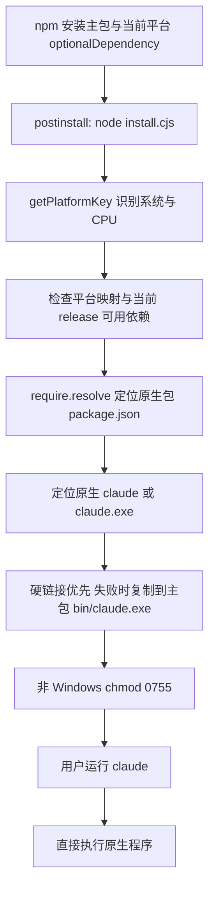

# Claude Code 2.1.307：安装入口与工具契约静态分析

分析对象：`wrapper/package` 中原始 npm 包；未执行该包的安装脚本或 CLI。上游 REA 包静态分析证据：`ev_946c10e7878e681d7a89719961a7314e402b2fcbe49f2a16d24ad3030aba4b46`。

## 1. 可以直接确认的启动实现

`package.json:2-12` 声明包名 `@anthropic-ai/claude-code`、版本 `2.1.307`、Node >=22，并将 `claude` 命令指向 `bin/claude.exe`，postinstall 是 `node install.cjs`。`package.json:22-37` 声明没有普通 dependencies，有八个平台的同版本 optionalDependencies，并携带安装/备用启动脚本和 `sdk-tools.d.ts`。

这意味着本版 npm 主包首先是**原生程序分发包装器**；从这些文件无法把核心 Agent 实现归结成一个公开 JS `cli.js`。

正常安装链路：



逐段源码依据：

| 阶段 | 依据 | 已确认行为 |
|---|---|---|
| 平台表 | `install.cjs:38-67` | macOS arm64/x64，Linux arm64/x64 与 musl，Windows arm64/x64；另有 Android 映射 |
| 实际发布平台 | `package.json:23-31` | 八个可选依赖中没有 Android 包；有映射不等于本版本实际提供 |
| Linux libc 检测 | `install.cjs:69-81` | Node `process.report.getReport()` 缺少 `glibcVersionRuntime` 时判断为 musl；不调用 ldd |
| CPU 与 Rosetta | `install.cjs:83-103` | Android 转 linux-CPU-android；macOS x64 Node 通过 `sysctl.proc_translated` 检测 Rosetta，是 Rosetta 时选择 arm64 |
| 依赖验证 | `install.cjs:165-194` | 区分“系统不支持”和“本 release 未提供平台包” |
| 原生文件定位 | `install.cjs:196-229` | 用 `require.resolve(info.pkg + '/package.json')` 找包目录，拼接平台二进制文件名；缺包打印修复提示 |
| 写入执行入口 | `install.cjs:105-145,232-245` | 先 hardlink；已有目标则删除后尝试 hardlink/复制；跨设备或权限问题直接复制；非 Windows 赋执行权限 |
| stub 保护 | `install.cjs:113-132` | 删除已有小 stub 前读取备份；重链和复制均失败时尝试恢复 stub |
| 失败策略 | `install.cjs:35,152-163` | 本包 `FAIL_ON_MISSING_NATIVE` 展开为 false，因此缺少可选依赖不因该开关令安装失败；真正放置文件失败仍设置退出码1 |

`bin/claude.exe:1-11` 在压缩包中还是一个文本占位文件，负责说明 postinstall 没运行或 optionalDependency 没下载，并退出1。后缀 `.exe` 本身不证明这里是 PE；安装成功后才被原生二进制替换。`install.cjs:232-235` 明确解释：固定 `.exe` 路径用于让 npm 在 Windows 生成直接执行的 cmd-shim，Unix 忽略后缀。

正常启动不需要驻留 Node 是包装脚本所描述并由直接 bin 路径支持的结论（`install.cjs:4-6`）；不能从这里推断原生程序内部绝不嵌入 JavaScript 引擎。

## 2. postinstall 未运行时的备用链路

`cli-wrapper.cjs:4-7` 说明该文件供 `--ignore-scripts` 等情况手动运行，正常安装不用它。

```text
node cli-wrapper.cjs [arguments]
  -> getBinaryPath()
  -> 同样的平台/CPU/libc 与 release 依赖检查
  -> require.resolve(platformPackage/package.json)
  -> spawnSync(nativeBinary, process.argv.slice(2))
  -> 继承终端 stdin/stdout/stderr 和环境
  -> 添加 CLAUDE_CODE_INSTALLED_VIA_NPM_WRAPPER=1
  -> 返回子进程退出码；信号终止转换成 128 + signum
```

依据：`cli-wrapper.cjs:50-81,83-129,131-154`。这条备用链路会保留 Node 父进程；它本身不实现模型调用、工具调度或会话逻辑。

## 3. 工具输入输出：这是契约，不能当作运行时函数

`sdk-tools.d.ts:1-5` 明确说明由 `json-schema-to-typescript` 从 JSON Schema 自动生成。这是 TypeScript 类型声明，不含执行函数体，也不能证明所有声明工具在每个账号、发布渠道、环境里均启用。以下区分“声明承诺的字段/语义”与“已观察的运行行为”。

| 工具族 | 输入契约 | 输出契约与可见设计 |
|---|---|---|
| Agent | `sdk-tools.d.ts:772-813`：必填 `description,prompt`；可选 `subagent_type,model,effort,run_in_background,name,isolation` | `:102-207`：三种状态 `completed`、`async_launched`、`remote_launched`；同步完成携带文本内容、token usage、工具次数、时长和可选 worktree；异步有 `agentId,outputFile`，远程有 `taskId,sessionUrl,outputFile` |
| Bash | `:814-847`：必填 `command`；可选 timeout、description、后台运行和 sandbox override | `:3282-3387`：stdout/stderr/interrupted，后台任务 ID、超时转后台提示、完整输出持久化路径，以及可选 git 操作结构字段 |
| FileRead | `:882-903`：绝对 file_path，offset/limit、PDF pages、allow_large | `:208-367`：text/image/notebook/pdf/parts/file_unchanged 多态结果；文本有行范围与截断标记，图片有 base64/MIME/原始和显示尺寸，PDF可按页输出图像，未变化文件可去重 |
| FileWrite | `:904-913`：绝对 file_path 与 content | `:3467-3514`：create/update、实际内容、structuredPatch、originalFile、可选 gitDiff、userModified、staged |
| FileEdit | `:864-881`：file_path/old_string/new_string 与 replace_all | `:3415-3466`：替换前后文本、原始文件、结构化 diff、可选 gitDiff 和 staged |
| Glob/Grep | `:914-985`：glob path；regex path/glob/output_mode/上下文/offset/head_limit/multiline 等 | 声明注释把 grep 字段映射到 rg 选项，支持 content/files_with_matches/count 三种模式；这不是已反编译的搜索执行函数 |
| MCP tool | `:1008-1010`：`[k:string]:unknown`，允许任意服务器工具参数 | `:419-427`：字符串、带 type 的内容块数组或对象；契约本身不限定具体服务器协议实现 |
| MCP resource | `:996-1001,1033-1052`：可选 server 过滤；读取指定 server+uri | `:368-389,3613-3659`：资源列表带 URI/name/MIME/server；读取返回 contents 文本或已保存二进制路径，资源目录返回直接子项 |
| MCP refresh | `:1002-1007`：可选 server | `:390-415`：refreshed/error/not_connected，返回工具数量与增删项；注释说只重查现有连接，失败保留上一工具集，不主动拨号 |

### 几个值得进一步追踪的实现线索

1. **子代理运行隔离**：AgentInput 的 `isolation` 声明了临时 worktree 和 remote；model/effort 的注释明确 fork 继承父代理。证明的是当前契约及其说明，不足以还原具体 fork 内存复制或后台调度实现。
2. **读文件状态跟踪**：FileReadOutput `file_unchanged` 与 `source: seeded`（`:355-366`）说明声明设计考虑对 CLAUDE.md/嵌套 memory 的启动注入去重；BashOutput `staleReadFileStateHint`（`:3348-3350`）提供命令改文件后文件状态过期提示。实际 mtime 判定/缓存表代码需要从原生载荷进一步确认。
3. **写入不一定已落盘**：FileEditOutput/FileWriteOutput 的 `staged` 注释明确可能仅保留修改等待机器所有者审核、文件尚未变化（`:3462-3465,3510-3513`）。因此界面显示差异或工具有 output 不能单独等同于写入完成。
4. **大输出管理**：BashOutput 声明持久化全量输出路径与大小（`:3340-3346`）；Read 的 token cap 截断标记（`:232-235`）支持分页消费。阈值与最终提示拼接逻辑尚未从本文件恢复。
5. **工具表比普通编辑器更广**：顶层 union（`:11-101`）还包含 Plan、Task、Workflow、Cron、ScheduleWakeup、Monitor、Artifact、PushNotification、Worktree 等。它们的存在不能被描述为用户已获全部功能。

## 4. 本片段分析边界

- 可直接读到并核对的是安装脚本、备用启动脚本、占位符与工具声明文件。
- 未运行下载的目标程序，未触发真实登录、模型请求或文件工具操作。
- 原生程序内部的主 Agent 循环、权限裁决、网络请求、MCP transport、上下文压缩等，不能仅由这些 `.d.ts` 或包装脚本推定为已证实实现。需要另一阶段原生/嵌入脚本静态分析与受控运行证据支持。

