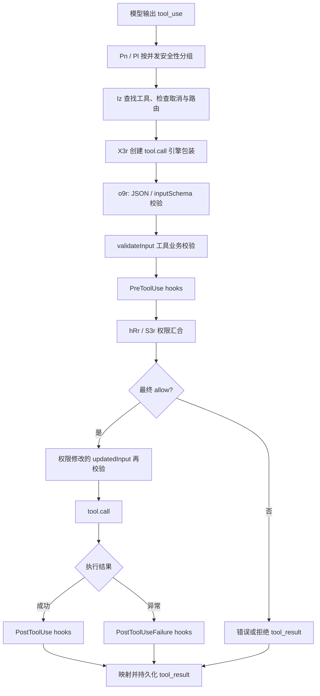

# Claude Code 2.1.307：工具执行、权限、Bash 和 MCP

本报告基于官方 darwin-arm64 二进制中恢复出的 JavaScript，属于静态调用链分析。`readable/` 只是对 `recovered/` 做 Prettier 格式化，符号名保留发布产物中的短名；原始文件偏移、长度和哈希见 `evidence/extraction-manifest.json`。没有执行目标 CLI，没有访问用户凭据或发送模型请求。

## 1. 总体链路与实际执行顺序

发布代码直接证明：模型产生 `tool_use` 后，CLI 查找本地工具对象，由客户端做输入校验、Hook、权限裁决和实际执行，再生成 `tool_result`。它不是把 shell 字符串直接发给服务器执行。



以上图表达普通本地执行路径。远程工具 host 的路由分支可以在 `Iz` 中转交给 `hosts.runToolUse`；声明为 detached 的结果会跳过普通成功后 Hook 路径，直接返回结果，因此不能表述成所有调用无条件执行 PostToolUse。

| 实际调用关系 | 证据文件与起始行 |
| --- | --- |
| `Pn` 调度 `Pl`、串行 `Ol` / 并发 `Il` | `readable/chunk-c8sx241e.js:1660` |
| `Ol` / `Il` 调用导入的 `Iz` | 同文件 `1714`、`1734`；导入 `Iz` 在 `301` |
| `Iz` 找到工具后调用 `X3r` | `readable/chunk-wvsyb4fb.js:171203`、`171472` |
| `X3r` 的执行器调用 `o9r`，挂入引擎 `tool.call` | 同文件 `171502`、`171541`、`171575` |
| `o9r` 调 `eIn` 做解析和 schema 校验 | 同文件 `171737`；`eIn` 定义 `166322` |
| `o9r` 调 `fRr`，后者调用 `validateInput` 闭包 | 同文件 `171901`、`171902`；`fRr` 定义 `166338` |
| `o9r` 调 `yRr`，后者调 `D1e` 执行 PreToolUse | 同文件 `171995`、`170196`、`170221` |
| `o9r` 调 `hRr`，后者调 `S3r` 汇合 Hook / 权限 | 同文件 `172158`、`170013`、`170026` |
| 权限允许之后，校验权限处理器改写的参数 | 同文件 `172390` |
| `e.call(...)` 被包装成 `Ri`，实际等待 `Ri` / `nDn` | 同文件 `172558`、`172588` |
| 正常成功调用 `mRr`，异常调用 `gRr` | 同文件 `172934`、`173150` |
| `mRr` / `gRr` 分别调用 `Y1n` / `QSo` | 同文件 `169806`、`169926` |

一个容易理解错的细节：**初始 validateInput 在 PreToolUse 之前**。Hook 改写参数时，`yRr` 还会调用 `aze(... validate: H)` 校验改写值（`170255`），之后权限处理器修改的 `updatedInput` 还会重新过 inputSchema。不是只校验模型最初给出的参数。

## 2. 权限不是一次简单布尔判断

最终裁决使用 `allow`、`deny`、`ask` 等结果。`S3r` 在无 Hook 明确裁决时直接调用传入的 `canUseTool`；Hook 返回 allow/ask 时，仍会先跑 `fT` 与必要的服务器 runner 检查。`fT` 中可见 deny 规则、ask 规则、工具自身 `checkPermissions`、需要人交互的工具、MCP effectiveMaxPermission、plan 模式写操作约束等检查。

具体结论如下：

- Hook 的 allow 不能直接覆盖明确 deny 规则。`S3r` 对 `fT` 返回 deny 的路径优先拒绝（`chunk-wvsyb4fb.js:170063`）。
- 要求完整权限管道、auto 模式分类器裁决或 `requireCanUseTool` 的场景，Hook allow 仍进入 `canUseTool`（`170096`、`170111`）。
- `o9r` 只有 `Ao.behavior === "allow"` 才能进入实际执行，未解决的 ask 也会形成拒绝/错误结果，不会默认为允许（`172290`）。
- 权限处理器返回不符合 schema 的 `updatedInput` 会拒绝执行并报告配置问题（`172390`）。
- Hook 可在特定 print 模式、单工具调用情况下 defer；交互模式或同一批多个工具不会使用这一挂起机制（`172028`）。
- SDK 的权限询问可以通过控制通道发送 `subtype: "can_use_tool"`，带 `tool_name`、输入、权限建议、拒绝原因与规则来源等字段（`readable/chunk-dprsk40m.js:552`）。这是 SDK / host 的协议分支，不能据此断言普通终端每次都走此通道。

权限通用规则顺序的直接实现：`chunk-wvsyb4fb.js:131540`（`fT`）与 `131740`（`ukn`）。模式相关放行后仍有条件约束，具体行为取决于当前配置与特性开关；本报告没有把某个发布版本的静态开关分支当作用户当前会话的实际策略。

## 3. 多个工具怎样并发

`Pl` 逐个查找工具并 `inputSchema.safeParse`，成功后调用 `tool.isConcurrencySafe(parsedInput)`。解析失败或该方法抛错时按不安全处理。**相邻的**安全调用合并为一组，非安全调用按顺序执行，保留安全组之间的执行边界（`chunk-c8sx241e.js:1693`）。

安全组通过 `Il -> Jtn` 合并多个 async generator；`Jtn` 用 `Promise.race` 收集首先到达的事件，并补入后续任务（`chunk-wvsyb4fb.js:106522`）。默认上限是 **10**，可由 `CLAUDE_CODE_MAX_TOOL_USE_CONCURRENCY` 覆盖（`chunk-c8sx241e.js:1657`）。串行工具产生的 context layers 会及时更新后续执行上下文；并行安全组的 context layers 在组后汇合。

具体工具：

- Bash 的 `isConcurrencySafe(input)` 取决于 `isReadOnly(input)`，不是所有 Bash 都并行（`chunk-wvsyb4fb.js:210266`）。
- MCP 的并发安全来自适配层 `mayOverlap` 或服务器工具声明 `annotations.readOnlyHint`（`chunk-6sne03tk.js:5829`）。`readOnlyHint` 在这里确实参与调度，但声明本身不等于底层行为已经被本次分析实测验证。

## 4. Bash 实际怎样运行

Bash 工具对象在 `chunk-wvsyb4fb.js:210245` 附近定义，含输入输出 schema、校验、权限匹配、是否只读、执行和结果映射等方法。

实际调用链：

```text
Bash.create(...).call(input, context)  210517
  -> iws(...)                        210614
     -> Sme(command, signal, bash)   210996
        -> shell provider buildExecCommand 136653
        -> optional wrapWithSandbox        136895
        -> child_process.spawn             136993
        -> jue(child, signal, timeout, output) 137029
  -> collect output / exit code / background task / sandbox violations
  -> mapToolResultToToolResultBlockParam    210388
```

`Sme` 选择 shell provider，生成带工作目录和输出处理的命令，计算环境变量，必要时把命令包装在 sandbox 内，再调用导入自 `child_process` 的 `sEr`（导入 `132160`）。spawn 参数明确包含 `cwd`、`env`、stdio、detached 与 windowsHide；不是抽象工具名字符串而已。

`iws` 负责超时上限、显式后台执行、自动转后台、进度和中断；Bash call 收集 stdout、退出码、sandbox 状态并映射为模型可读结果。远程调用要求强 sandbox 而本地不可用时会拒绝，命令不会运行（`210558`、`136800`）。sandbox 的每个平台底层实现没有在此报告逐一反编译，不能据此给出全部平台沙箱的安全保证。

## 5. MCP 怎样成为模型能调用的工具

`chunk-6sne03tk.js` 的 `Od` 适配器把 MCP tools/list 返回的工具描述变成 CLI 内部工具对象，包含工具名、description、输入 JSON schema、mcpInfo、权限和执行方法（`5749`）。内部工具和 MCP 工具随后进入同一套 `Iz -> o9r` 权限执行管道。

```text
MCP tools/list 工具定义
  -> Od 适配为内部 Tool               5749
     name / schema / annotations / permissions / call
  -> ge.call                         6136
     -> po 获取或恢复连接            6194
     -> Bd 处理调用/重试/授权重试      6196 / 7815
        -> go                        8185
           -> gt.callTool({name, arguments, _meta}, options) 8368
  -> MCP content / structuredContent / meta
  -> 工具输出映射与 PostToolUse
  -> tool_result 回到会话
```

`go` 的 callTool 参数带 abort signal、timeout 和 onprogress 回调，回调生成 MCP 进度消息；还可根据协议能力使用 MCP Tasks，再获取任务结果。`Bd` 与工具调用外层有恢复和重试分支，不是每个错误无条件无限重发。服务端返回的内容由本地适配器规范化后，才成为模型上下文中的结果。

本分析止于 MCP SDK 的 `callTool` 调用边界，MCP 服务本身的业务实现和远端模型推理不在该 CLI 包内。没有运行 MCP 服务器或进行真实权限交互，因此这里证明的是发布代码中的静态机制，不是某一具体会话的运行轨迹。
