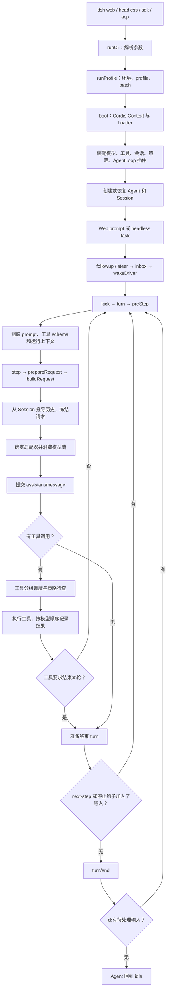
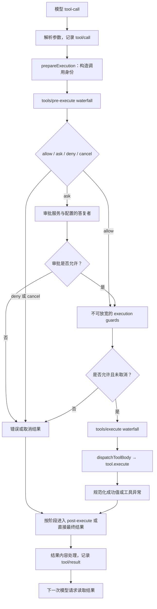

# DeepSeek Harness 源码主流程分析

- 作者：徐凯旋
- 分析日期：2026-10-22
- 版本：`0.2.1-rc.2`
- 提交：`687f282e8625c6b8d11ff58211a90524be2e4317`
- 源码目录：`/Users/tcuser/Documents/ideaproject/deepseek-harness`
- 分析方式：静态阅读实现和相关官方设计文档，未执行构建、测试或真实 API 调用。

[TOC]

## 1. 先看主流程

这个项目中，应用启动和任务执行是两条相连的链路。`dsh` 将配置装配为可运行的插件树；任务到来后，`ReactLoopAgent` 才开始驱动模型与工具。创建一个 Agent 不等于已经调用模型。



图中省略了异常、取消及 `max-tokens` 分支，详见第 9 节。停止钩子只在满足源码条件时执行，不是每一个退出路径都经过该钩子。

## 2. 仓库地图与核心概念

| 目录 | 主要职责 |
|---|---|
| `apps/cli` | `dsh` 命令入口、参数、profile 启动 |
| `packages/boot` | profile、bundle、patch、插件包解析、Loader 启动 |
| `packages/bundle` | 组合各产品入口所需的插件，例如 base、web-app、headless |
| `packages/core/agent` | Agent 接口、注册表和创建工厂接口 |
| `packages/core/agent-loop` | 默认 `ReactLoopAgent` 驱动、inbox、工具调度 |
| `packages/core/system-prompt` | prompt 分段、变量、运行上下文和工具 schema 装配 |
| `packages/core/tools` | 工具注册、作用域、策略流水线、结果规范化 |
| `packages/core/session` | 事件日志及模型可见历史推导 |
| `packages/llm` | 通用模型运行时、DeepSeek 等适配器、重试插件 |
| `packages/api/session-controller` | Web/远程会话的创建、输入、取消及跟随流 |
| `packages/session/session-persistence-jsonl` | 会话文件、写入句柄、恢复与持久化路由 |
| `packages/shell`、`packages/subprocess`、`packages/sandbox` | 命令能力、进程执行与进程约束 |
| `vendor` | 仓库内固定版本的 Cordis 等依赖源码 |

几个概念不能混用：

| 概念 | 在此实现中的含义 |
|---|---|
| Harness | 将模型、工具、状态、策略及使用入口组织起来的运行框架 |
| Cordis Context，即 `ctx` | 插件读取服务、注册事件和管理作用域的上下文，例如 `ctx.llm`、`ctx.tools` |
| Profile | 一种启动组合，声明按顺序加载哪些 bundle，并持有自身 patch |
| Bundle | 可分发的插件配置和代码组合 |
| Agent | 一个活跃执行对象，有 inbox、状态、取消信号及绑定的 Session |
| Session | 带事件顺序的会话日志，可推导模型历史，不等于 WebSocket 连接 |
| Turn | 一轮工作，从 `turn/start` 到 `turn/end`；可能包含零个或多个 step |
| Step | 一次逻辑模型请求及随后工具执行；模型失败重试可产生多个 attempt |
| Attempt | step 内一次模型尝试；失败不必重复接纳用户输入 |

## 3. 启动：从 dsh 命令到插件树

### 3.1 入口在哪里

`apps/cli/package.json` 中的 `bin.dsh` 指向构建产物 `lib/bin.js`，对应源文件是 `apps/cli/src/bin.ts`。

编号调用链：

1. `bin.ts:76` 的 `if (import.meta.main)` 调用 `runCli()`，这是该源码模块直接作为程序入口时的执行起点。
2. `runCli():26` 调用 `parseDshArgs(process.argv.slice(2), ...)`。
3. `invocation.mode === 'profile'` 时，动态导入并 `await runProfile(...)`；插件管理和配置导出是其他分支，不进入正常任务链。
4. `runProfile():271` 先根据启动环境快照安装代理支持，然后调用 `composeProfile():224` 准备 profile、运行时包解析和命令行 overlays。
5. `runProfile():323` 调用共享 `boot()`，在配置树挂载前提供 `profileContext`、环境快照、插件包解析能力和命令行服务。
6. `boot():1200` 创建 Cordis `Context`，安装 Loader，执行宿主准备回调，挂载 root include，再等待 Loader 稳定并审计启动结果。
7. 配置中的 service/plugin 被挂载后，模型、工具、会话存储和默认 Agent 工厂才可供产品入口使用。

源码定位：[CLI runCli][S01]、[runProfile][S02]、[boot][S03]。

### 3.2 配置按什么顺序生效

`readProfilePatches():74` 的顺序是：

```text
profile 声明的有序 bundle patches
  -> profile 自身 cordis.patch.yml
  -> Harness home 下 cordis.patch.yml
  -> 按命令行顺序传入的 --patch
  -> 满足条件时追加 telemetry 环境覆盖
```

这些是 Loader 条目补丁，不是随意对 JSON 做递归合并。按官方架构，按 id 命中条目的 patch 会替换该条目的整个 config；插入操作则添加新条目，因此不能假设某个 config 的省略字段必定继承旧值。

`packages/bundle/base/cordis.patch.yml` 能看到实际插件行：`llm-retry`、`session-persistence-jsonl`、sandbox、approval、tools、system-prompt、agent-loop 和 DeepSeek provider 等。`sdk-minimal` 是独立显式组合，不能把 base 的所有默认能力套用到它。

源码定位：[patch 顺序][S04]、[默认插件组合][S05]。

### 3.3 为什么叫 everything-is-a-plugin

`AgentLoop` 本身也是一个 Cordis service。其构造函数通过 `ctx.agents.setFactory(this)` 注册默认创建工厂；消费者调用 `ctx.agents.create()`，不需要直接实例化或依赖 `ReactLoopAgent`。

这使得替换模型、工具实现、持久化后端，甚至替换整个 Agent 驱动，都能通过能力接口和插件配置完成。这里的“可替换”有服务接口、事件语义和生命周期要求，不代表任意替换都天然兼容。

## 4. 创建 Agent，以及输入从哪里进入

### 4.1 创建链路

```text
ctx.agents.create(options)
  -> AgentRegistry.create()                    core/agent/src/index.ts:393
  -> 已注册工厂的 createAgent(ownerCtx, ...)   core/agent-loop/src/index.ts:750
  -> 准备 Session，取得可选持久化写句柄
  -> setupAndPublish()                        同文件:790
  -> prepare() 内 new ReactLoopAgent(...)      同文件:604
  -> 调用 setup，提交 setup 结果，补写尚未存储的事件
  -> publish()                                同文件:650
  -> Session / Agent 入注册表，发送创建通知
  -> 返回 { agent, dispose }
```

`ReactLoopAgent` 构造函数创建 scope、inbox、运行上下文投影和 system prompt 投影，并将初始 phase 设置为 `idle`。**真正唤醒模型工作的是后面的输入方法，而不是构造函数。** 创建、setup、发布失败时有回滚与资源清理逻辑。

源码定位：[公共创建入口][S06]、[工厂创建][S07]、[Agent 初始化][S08]。

### 4.2 Web 输入链路

1. 会话服务的 `@Remote('prompt')` 方法校验非空内容和时区，构造输入来源，调用 `this.commands.prompt(request, source)`。
2. `SessionCommandController.prompt():319` 解析活跃 Agent，按 `requestId` 检查重复接纳；处理图片模型能力、附件接纳和上传凭据绑定。
3. `request.mode === 'steer'` 时调用 `agent.steer(message)`，否则调用 `agent.followup(message)`。
4. 返回 `{ accepted: true }` 表示输入已被接纳，**不表示模型已经生成完成**。
5. 结果增量由单独的 `follow()` 跟随链路读取，不能把输入 RPC 的返回值当作最终回答。

源码定位：[远程 prompt][S09]、[输入接纳与分发][S10]。底层 Gateway 将普通远程调用和逻辑流分开，外部模型的 SSE 与 Web 客户端的会话跟随流也不是同一个数据流。

### 4.3 headless 输入链路

`packages/bundle/headless/src/index.ts` 的 `apply():411` 启动 `run():311`。准备或恢复 Agent 后，`:375` 调用 `agent.followup(createUserMessage(...task...))`。

随后等待 `agent.whenIdle()`；如果有子 Agent，还要等待子任务并重新检查父 Agent 的状态和日志序号，避免子任务结算后又唤醒父 Agent却提前退出。最后 `sessions.flush()`、汇总本轮输出、根据终止原因设置退出码。

因此 Web 和 headless 的输入适配不同，后面的模型与工具循环相同。源码定位：[headless 执行][S11]。

### 4.4 followup、steer、inject 的区别

`ReactLoopAgent.send():154` 将消息写入 inbox；方法语义由 target 和 wakeup 两个参数决定。

| 方法 | 写入位置 | 是否唤醒 | 用途 |
|---|---|---|---|
| `followup()` | `next-turn` | 是 | 排入后续一轮工作 |
| `steer()` | `next-step` | 是 | 在下一步纳入新输入，引导正在进行的工作 |
| `inject()` | `next-step` | 否 | 补充上下文，等待其他唤醒消息带动处理 |

`steer` 不会自动打断当前正在返回的模型流。对已取消 activity 发送的唤醒消息会被归为后续 turn；maintenance 或终止中的驱动可能记录待唤醒标记，在收敛后再启动，避免两个驱动同时工作。

## 5. 主循环：kick、turn、step

### 5.1 从输入到驱动

以下调用都在 `packages/core/agent-loop/src/agent.ts`：

```text
followup():163 / steer():167
  -> send():154
  -> inbox.splice(...)
  -> wakeDriver():214
  -> agents.withInitiator(this, () => this.kick())
  -> kick():252
  -> while (await this.turn()) {}
```

`wakeDriver()` 在 idle 状态下为本次活动建立 `AbortController`，将 phase 切到 running，然后启动驱动。`withInitiator` 使后续工具调用可识别发起工作的 Agent。已有正常驱动时不另开一条循环，由原驱动继续领取待处理输入。

### 5.2 turn 做什么

`turn():298` 是本轮调度器：

1. 写 `turn/start`。
2. 首次 `preStep('next-turn', ...)` 领取下一步上下文及一条排队输入；后续 step 只领取 `next-step`。
3. `preStep():267` 调用 `systemPrompt.assemble()`，再经过 `agent/pre-step` waterfall，允许插件重写或拒绝输入。
4. 拒绝时本轮 blocked；初次接纳结果为空时可结束本轮而不消耗模型调用。
5. 接纳后写 `step/start`，调用 `step(decision)`。
6. `finally` 写 `step/end`；失败时先尝试补齐缺失工具结果。
7. 有结束原因且没有 next-step 输入时，执行 `agent/turn-stopping`；插件仍可在这里追加输入。
8. 重新检查 next-step，决定继续 step 还是退出；最终写 `turn/end`。
9. inbox 仍有待处理工作则返回 `true`，让 `kick()` 开下一轮，否则结束驱动。

`turnEnds === null` 表示仍欠一次模型请求，例如执行工具后需要让模型阅读结果；它不表示失败。`max-tokens` 原因有粘性，后续正常 step 不会把该轮原因改成普通 completed。

### 5.3 step 做什么

`step():400` 内部还有一个 attempt 循环，核心顺序如下：

```text
renderPrompt(assembly)
  -> prepareRequest(turn, step, signal)
  -> 刷新运行上下文，协调 system/message
  -> 首次 attempt 接纳 user/message
  -> buildRequest(...)
  -> preparedCall.stream(request)
  -> for await (const chunk of stream)
  -> 结算 assistant/message 或 assistant/attempt
  -> 处理工具调用或返回结束原因
```

模型终止失败可经过 `agent/request-error` 得到 retry 决策，从而在同一 step 内再次尝试。重试不重新执行 `preStep`，也不把用户消息重复追加一遍。

**继续或结束的实际判断：**

| step 结果 | 后续行为 |
|---|---|
| `finish.kind === 'max-tokens'` | 返回 max-tokens 原因，本次不继续派发工具 |
| 回答没有 `tool-call` | 返回 completed；turn 还会考虑新增输入和停止钩子 |
| 有工具调用，未要求结束 turn | 执行工具后返回 `null`，进入下一个 step |
| 工具结果设置 `concludesTurn` | 返回 completed；仍需经过 turn 层判断 |
| 取消或无法恢复的异常 | 进入异常收敛及 turn/end，不当作正常完成 |

源码定位：[输入与唤醒][S12]、[turn][S13]、[step][S14]。

## 6. Prompt 和模型历史如何形成

### 6.1 assemble 不只是拼一个字符串

`SystemPrompt.assemble():614` 收集全局和 Agent scope 链上的变量、prompt sections、runtime contexts 及 tool providers。近作用域可覆盖同名远作用域贡献，sections 按确定顺序排列，工具参数 schema 会复制后进入装配结果。

Prompt、运行时上下文和工具 schema 是相关但不同的输入。运行上下文可作为用户上下文消息进入日志，不能把所有内容都视为一个固定 system prompt。

### 6.2 先确定模型能力，再提交输入

`prepareRequest():564` 先跑 `agent/request`，允许插件选择 provider/model 和请求控制，再调用 `ctx.llm.prepareCall()` 绑定实际适配器及其能力。此时尚未把本 step 新接纳的 system/user 消息提交到模型历史；这两个异步阶段取消时，不应留下只接纳了一半的输入。

接着 `SystemPromptProjection.project()` 根据能力决定：在允许历史内更新且请求系列连续的路由上追加 prompt 更新，或在需要时重写系统节点；空 prompt 会清掉仍生效的旧系统内容。不能简单理解为“每次都把 system prompt 插到 messages 最前面”。

### 6.3 buildRequest 的真正数据来源

`buildRequest():616` 做四件事：

1. 形成标准化请求头，按 initial、resume、change 或 series 条件记录 `request/header`。
2. provider/model、context window 等发生变化时记录 `request/context`；工具名增减时记录对应 developer message。
3. 调用 `session.deriveMessages()`，从当前有效 surface 节点推导模型历史。
4. 冻结请求头、消息及请求数组，带入 `toolHistory()`、可见工具、sessionId 和仍可取消的 signal。

发往通用模型运行时的请求含 `messages` 和 `tools`；此处没有单独的 `system` 字段。provider 适配器稍后负责把通用历史映射为其 wire 协议。`deriveMessages()` 会排除只用于日志的生命周期事件，压缩或替换后的历史以 surface 为准，不是全量原始日志直接发给模型。

源码定位：[prompt 装配][S15]、[请求准备与构造][S16]、[历史推导][S17]。

## 7. 模型调用：真正发 HTTP 请求在哪里

调用链如下：

```text
ReactLoopAgent.prepareRequest()
  -> LlmRuntime.prepareCall()                 llm/llm/src/index.ts:956
  -> 选中 provider 的 adapter.prepareCall()
  -> 返回绑定 registration 和配置的一次性 preparedCall

ReactLoopAgent.step()
  -> preparedCall.stream(request)
  -> LlmRuntime.streamWithRegistration():1170
  -> llm/stream waterfall
  -> adapterStream()                         同文件:1064
  -> DeepSeekAdapter.generate()              llm-deepseek/src/adapter.ts:65
  -> DeepSeekAdapter.request():91
  -> serialize(...)
  -> fetch(.../messages)                     同文件:138
  -> parseSse(response.body)
  -> translate(...)
  -> Harness StreamChunk
```

`prepareCall()` 会解析能力及默认值，必要时可能访问 provider 元信息；它并不等同于已经发出生成请求。返回的 prepared call 只能 dispatch 一次，并检查实际请求配置与准备时一致，防止准备与执行间换了模型或适配器。

`DeepSeekAdapter` 的 `generate()` 是异步生成器。**创建 AsyncIterable 不等于消费它**：主循环 `for await` 拉取流时，生成器才推进到具体请求和读取。模型选择阶段的连接/元信息准备与生成请求应分别理解。

当前固定提交的 DeepSeek provider 采用 Messages 协议：`messagesApiRoot()` 将 base URL 规范到 `/v1` 根，再请求 `/messages`，Accept 为 `text/event-stream`。不要套用其他版本或其他项目的 `/chat/completions` 调用链。

请求前还会处理图片/文件、鉴权和 API 扩展；流读取有 idle watchdog 和取消信号。`serialize.ts` 将 Harness 的 `tool-call` 映射成 Messages 的 `tool_use`，`translate.ts` 将 SSE 事件转换回文本、reasoning、工具参数增量、usage 和 finish。底层 wire 结构不直接渗入 Agent 循环。

源码定位：[通用 prepareCall][S18]、[通用流入口][S19]、[DeepSeek 生成请求][S20]、[序列化][S21]、[流转换][S22]。

## 8. 工具执行：从模型意图到真实副作用

### 8.1 调度不等于简单 Promise.all

模型完成一条 assistant message 后，`step()` 从 content 中筛出 `tool-call` 并调用 `executeToolCalls()`。工具不是看到一段普通文字就执行，也不是每到一个参数增量就立刻执行。

`tool-calls.ts:60` 将参数字符串解析为调用对象，然后根据工具的 `executionMode()` 分组：exclusive 工具作为顺序屏障，parallel 工具进入有上限的滚动池。默认并行上限为 10，可通过 `maxParallelToolCalls` 配置。

前置策略与结果提交保持有序，主要是工具 dispatch/body 并发；即使后面的工具先完成，工具结果与附加上下文仍按模型调用顺序提交。每次提交后会重新判断尚未启动调用的模式，因此插件或工具注册变化可影响后续调度。

源码定位：[工具调度][S23]。

### 8.2 工具流水线



关键入口在 `core/tools/src/index.ts`：

| 方法 | 作用 |
|---|---|
| `prepareExecution():1501` | pre-execute、ask/deny/cancel、执行 guards、取消检查 |
| `dispatchScheduledExecution():1609` | 包裹 `tools/execute`，规范化 dispatch 结果 |
| `dispatchToolBody():1572` | 解析当前可执行工具，调用 `tool.execute(exec.arguments, exec)` |
| `finalizeScheduledExecution():1649` | post-execute 及后续结果处理 |
| `postExecute():1789` | 策略接受、屏蔽或替换结果的处理 |

参数及返回值也需要校验：`defineTool` 在 `schema.ts` 中校验参数，成功结果经工具输出 schema 校验；主循环中的 JSON.parse 只负责解析，不保证业务参数已经合法。

这里的 `waterfall` 是中间件调用形式。监听器调用 `next()` 才委托后续监听器或默认实现，也可以直接返回决策截断链路；`serial` 则依次等待监听器，不使用同样的 next 形式。理解这点才能看懂为什么审批插件可以阻止工具真正执行。

源码定位：[工具前置阶段][S24]、[工具主体与包装][S25]、[工具 schema][S26]。

### 8.3 以 Bash 为例继续向下追踪

```text
注册的 Bash 工具 execute()
  -> ctx.shellEnv.collect(exec)
  -> ctx.shell.resolve(request)
  -> ctx.shell.execute(spec)
  -> 配置装配的 shell provider
  -> 本地实现经 ctx.subprocess.spawn(...)
  -> 真实子进程与输出采集
```

模型面对的是工具定义；工具消费 shell 能力，具体本地执行和 sandbox 包装由 provider 及配置决定。不能认为所有 Bash 调用都直接执行无约束的本机命令，也不能仅因函数名是 bash-local 就推断它自己包含全部审批逻辑。

源码定位：[Bash 工具][S27]、[本地 Bash provider][S28]。

## 9. 日志、流式显示、重试和取消

### 9.1 Session 是模型上下文的事实来源

`Session.append():798` 对事件和 surface metadata 做 JSON 快照与校验，分配 seq/time，冻结后提交。后续 `deriveMessages()` 从有效 surface 推导模型消息；事件留存与模型可见是不同维度。

| 事件或信号 | 意义 |
|---|---|
| `turn/start`、`step/start`、`step/end`、`turn/end` | 生命周期事实，不作为普通对话全部发送给模型 |
| `system/message`、`user/message`、`assistant/message` | 被接纳的模型可见消息，由 surface 和投影决定实际历史 |
| `tool/call`、`tool/result` | 工具执行事实及配对结果 |
| `assistant/attempt` | 已结算的失败、重试或无完整回答尝试，不新增正常模型历史 |
| `agent/assistant-stream` | 进程内实时 start/chunk/end 通知 |

主循环用 `AssistantStreamAttempt` 收集增量，再把紧凑流与完整内容结算为 assistant message 或 attempt。UI 实时增量不意味着每个 chunk 都已单独持久化；在结算前进程硬退出，不能保证该次增量流已经进入持久日志。

JSONL 存储通过 `storage.ts:549` 监听 `session/event` 将事件加入 writer，`:554` 的 `session/flush` 负责 drain 和 flush，`:562` 处理会话释放。**内存 append 成功不等于同步刷盘完成**。只有挂载持久化后端才有对应文件落盘；无后端时仍可运行内存会话。

恢复时由 AgentLoop 取得写句柄、读入历史并补齐崩溃中断的 turn 边界。格式迁移及文件代际选择属于持久化后端，不能等同于重新执行历史工具。源码定位：[事件追加][S29]、[JSONL 路由与 flush][S30]。

### 9.2 模型重试由插件控制

`LlmRuntime` 会将适配器的部分失败规范化为 terminal finish，step 看到 error/aborted 后结算 attempt，再触发 `agent/request-error`。`llm-retry` 插件依据 provider 的 retry policy、可重试错误、次数与退避延迟返回 `{ kind: 'retry' }`。没有 retry 决策时抛出 `LlmError`，结束本轮。

这不是“任何异常都无限重试”：普通 policy 有次数与错误条件；`always` 模式另有行为。中间件或工具流水线异常也不等同于适配器失败，不应照搬模型重试路径。源码定位：[重试插件][S31]。

### 9.3 取消与工具结果补齐

`cancel()` 默认清空 inbox 并 abort 当前 activity；传 `keepInbox` 可保留排队输入。流中断时，如果已有可保留内容，会提交 `interrupted: true` 的 assistant message，确保以后模型能看到用户已看到的前缀；没有内容时可只结算 attempt。

工具方面，取消会停止启动新调用，但等待已启动调用结算，并为未派发工具写 `ABORTED_BEFORE_DISPATCH` 结果。step 异常恢复还区分：

- 已有 `tool/call` 但没有提交结果：`TOOL_OUTCOME_UNKNOWN`，表示实际副作用可能发生，不能盲目重做。
- 尚未记录执行开始：`TOOL_NOT_STARTED`。
- 已经提交的工具结果：保留，不重写。

这些结果让后续请求保留配对工具历史，并向模型说明不确定性。副作用是否发生仍需检查真实外部状态，不能把“取消了请求”理解为“回滚了外部操作”。

默认 AgentLoop 没有内置固定 turn 总步数预算；并行上限、单次 token 限制都不是本轮总预算。限制长任务需要在既有生命周期扩展点增加策略。官方还明确记录根上下文关闭时最终 turn/end 的持久化限制，因此不能把 Agent teardown 完成当作所有收尾日志已刷盘的无条件保证。

## 10. 一个具体任务如何跑完

假设 headless 输入：“读取 package.json，告诉我启动命令。”以下是解释主链路的示例，不是本次真实运行记录；模型具体选哪个工具及调用次数由回答决定。

1. `dsh headless "..."` 进入 CLI profile 分支，加载 base 与 headless 组合。
2. headless runner 创建或恢复 Agent，调用 `followup()`。
3. `wakeDriver → kick → turn → preStep` 接纳输入、组装可见工具和上下文。
4. `step → prepareRequest → buildRequest` 形成第一份不可变请求。
5. 主循环消费模型流；模型输出读取文件的工具调用。
6. assistant message 结算，工具执行经过 pre/execute/post 流水线。
7. 文件读取结果记录为 `tool/result`。
8. step 返回 `null`，下一 step 从日志推导出“用户输入 + 工具调用 + 结果”的新历史。
9. 模型输出启动命令说明，没有新工具调用，step 返回 completed。
10. 无新输入、无停止钩子追加工作后记录 `turn/end`，Agent 回到 idle。
11. headless runner 等待子任务收敛、flush 会话、汇总输出并退出。

可见，工具调用后的第二次模型请求是 AgentLoop 主动调度出来的，不需要用户再次点击发送。

## 11. 建议阅读顺序与验证边界

按以下顺序阅读，先理解主循环，再向两侧扩展：

1. `core/agent-loop/src/agent.ts`：先看 `followup → wakeDriver → kick → turn → step`。
2. `core/agent-loop/src/tool-calls.ts`：看并行、顺序及结果提交。
3. `llm/llm/src/index.ts` 与 `llm-deepseek/src/adapter.ts`：看模型路由、准备与真实 HTTP。
4. `core/system-prompt/src/index.ts` 与 `core/session/src/index.ts`：看上下文和历史来源。
5. `apps/cli/src/bin.ts`、`profile-boot.ts`、base patch：回头看运行时如何装配。
6. `api/session-controller`、`bundle/headless`：看不同产品入口如何复用同一循环。

后续本地运行可参考固定提交 README：

```bash
cd /Users/tcuser/Documents/ideaproject/deepseek-harness
pnpm install
pnpm run build
pnpm dsh web
# 或配置模型凭据后执行单次任务：
pnpm dsh --profile headless "读取 package.json，说明启动命令"
```

根 `package.json` 声明 Node `^22.19.0 || >=24.0.0`、包管理器 `pnpm@11.28.5`。本次没有执行以上命令，没有验证当前机器满足依赖、构建和模型访问条件。后续验证时可重点看 `agent-loop/tests/loop.spec.ts`、`tool-calls.spec.ts`、`request-error.spec.ts`、`cancel.spec.ts`、`request-reconstruction.spec.ts`，本次未运行这些测试。

源码证据以同目录 JSON 清单及下列固定提交链接为准；源码升级后行号和行为均可能变化。本报告没有逐项展开 Desktop、PTY、PTC、压缩算法、MCP 和各子 Agent provider 的内部实现，也不以本次静态分析替代运行验证。

## 12. 固定提交源码索引

| 编号 | 文件与入口 |
|---|---|
| S01 | [apps/cli/src/bin.ts:26][S01] — runCli |
| S02 | [apps/cli/src/profile-boot.ts:271][S02] — runProfile |
| S03 | [packages/boot/app-boot/src/index.ts:1200][S03] — boot |
| S04 | [packages/boot/app-boot/src/profile-context.ts:74][S04] — readProfilePatches |
| S05 | [packages/bundle/base/cordis.patch.yml][S05] — 默认插件组合 |
| S06 | [packages/core/agent/src/index.ts:393][S06] — AgentRegistry.create |
| S07 | [packages/core/agent-loop/src/index.ts:750][S07] — createAgent |
| S08 | [packages/core/agent-loop/src/agent.ts:122][S08] — ReactLoopAgent constructor |
| S09 | [packages/api/session-controller/src/index.ts:461][S09] — Remote prompt |
| S10 | [packages/api/session-controller/src/commands.ts:319][S10] — prompt 接纳 |
| S11 | [packages/bundle/headless/src/index.ts:311][S11] — headless run |
| S12 | [packages/core/agent-loop/src/agent.ts:154][S12] — send / wakeDriver |
| S13 | [packages/core/agent-loop/src/agent.ts:298][S13] — turn |
| S14 | [packages/core/agent-loop/src/agent.ts:400][S14] — step |
| S15 | [packages/core/system-prompt/src/index.ts:614][S15] — assemble |
| S16 | [packages/core/agent-loop/src/agent.ts:564][S16] — prepareRequest / buildRequest |
| S17 | [packages/core/session/src/index.ts:984][S17] — deriveMessages |
| S18 | [packages/llm/llm/src/index.ts:956][S18] — prepareCall |
| S19 | [packages/llm/llm/src/index.ts:1170][S19] — streamWithRegistration |
| S20 | [packages/llm/llm-deepseek/src/adapter.ts:91][S20] — request / fetch |
| S21 | [packages/llm/llm-deepseek/src/serialize.ts:57][S21] — serialize |
| S22 | [packages/llm/llm-deepseek/src/translate.ts:104][S22] — translate |
| S23 | [packages/core/agent-loop/src/tool-calls.ts:60][S23] — executeToolCalls |
| S24 | [packages/core/tools/src/index.ts:1501][S24] — prepareExecution |
| S25 | [packages/core/tools/src/index.ts:1572][S25] — dispatchToolBody |
| S26 | [packages/core/tools/src/schema.ts:579][S26] — 参数校验及工具包装 |
| S27 | [packages/shell/tool-bash/src/index.ts:478][S27] — Bash tool.execute |
| S28 | [packages/shell/bash-local/src/index.ts:259][S28] — subprocess.spawn |
| S29 | [packages/core/session/src/index.ts:798][S29] — append |
| S30 | [packages/session/session-persistence-jsonl/src/storage.ts:535][S30] — 持久化路由 |
| S31 | [packages/llm/llm-retry/src/index.ts:194][S31] — recover |

[S01]: https://github.com/deepseek-ai/deepseek-harness/blob/687f282e8625c6b8d11ff58211a90524be2e4317/apps/cli/src/bin.ts#L26
[S02]: https://github.com/deepseek-ai/deepseek-harness/blob/687f282e8625c6b8d11ff58211a90524be2e4317/apps/cli/src/profile-boot.ts#L271
[S03]: https://github.com/deepseek-ai/deepseek-harness/blob/687f282e8625c6b8d11ff58211a90524be2e4317/packages/boot/app-boot/src/index.ts#L1200
[S04]: https://github.com/deepseek-ai/deepseek-harness/blob/687f282e8625c6b8d11ff58211a90524be2e4317/packages/boot/app-boot/src/profile-context.ts#L74
[S05]: https://github.com/deepseek-ai/deepseek-harness/blob/687f282e8625c6b8d11ff58211a90524be2e4317/packages/bundle/base/cordis.patch.yml
[S06]: https://github.com/deepseek-ai/deepseek-harness/blob/687f282e8625c6b8d11ff58211a90524be2e4317/packages/core/agent/src/index.ts#L393
[S07]: https://github.com/deepseek-ai/deepseek-harness/blob/687f282e8625c6b8d11ff58211a90524be2e4317/packages/core/agent-loop/src/index.ts#L750
[S08]: https://github.com/deepseek-ai/deepseek-harness/blob/687f282e8625c6b8d11ff58211a90524be2e4317/packages/core/agent-loop/src/agent.ts#L122
[S09]: https://github.com/deepseek-ai/deepseek-harness/blob/687f282e8625c6b8d11ff58211a90524be2e4317/packages/api/session-controller/src/index.ts#L461
[S10]: https://github.com/deepseek-ai/deepseek-harness/blob/687f282e8625c6b8d11ff58211a90524be2e4317/packages/api/session-controller/src/commands.ts#L319
[S11]: https://github.com/deepseek-ai/deepseek-harness/blob/687f282e8625c6b8d11ff58211a90524be2e4317/packages/bundle/headless/src/index.ts#L311
[S12]: https://github.com/deepseek-ai/deepseek-harness/blob/687f282e8625c6b8d11ff58211a90524be2e4317/packages/core/agent-loop/src/agent.ts#L154
[S13]: https://github.com/deepseek-ai/deepseek-harness/blob/687f282e8625c6b8d11ff58211a90524be2e4317/packages/core/agent-loop/src/agent.ts#L298
[S14]: https://github.com/deepseek-ai/deepseek-harness/blob/687f282e8625c6b8d11ff58211a90524be2e4317/packages/core/agent-loop/src/agent.ts#L400
[S15]: https://github.com/deepseek-ai/deepseek-harness/blob/687f282e8625c6b8d11ff58211a90524be2e4317/packages/core/system-prompt/src/index.ts#L614
[S16]: https://github.com/deepseek-ai/deepseek-harness/blob/687f282e8625c6b8d11ff58211a90524be2e4317/packages/core/agent-loop/src/agent.ts#L564
[S17]: https://github.com/deepseek-ai/deepseek-harness/blob/687f282e8625c6b8d11ff58211a90524be2e4317/packages/core/session/src/index.ts#L984
[S18]: https://github.com/deepseek-ai/deepseek-harness/blob/687f282e8625c6b8d11ff58211a90524be2e4317/packages/llm/llm/src/index.ts#L956
[S19]: https://github.com/deepseek-ai/deepseek-harness/blob/687f282e8625c6b8d11ff58211a90524be2e4317/packages/llm/llm/src/index.ts#L1170
[S20]: https://github.com/deepseek-ai/deepseek-harness/blob/687f282e8625c6b8d11ff58211a90524be2e4317/packages/llm/llm-deepseek/src/adapter.ts#L91
[S21]: https://github.com/deepseek-ai/deepseek-harness/blob/687f282e8625c6b8d11ff58211a90524be2e4317/packages/llm/llm-deepseek/src/serialize.ts#L57
[S22]: https://github.com/deepseek-ai/deepseek-harness/blob/687f282e8625c6b8d11ff58211a90524be2e4317/packages/llm/llm-deepseek/src/translate.ts#L104
[S23]: https://github.com/deepseek-ai/deepseek-harness/blob/687f282e8625c6b8d11ff58211a90524be2e4317/packages/core/agent-loop/src/tool-calls.ts#L60
[S24]: https://github.com/deepseek-ai/deepseek-harness/blob/687f282e8625c6b8d11ff58211a90524be2e4317/packages/core/tools/src/index.ts#L1501
[S25]: https://github.com/deepseek-ai/deepseek-harness/blob/687f282e8625c6b8d11ff58211a90524be2e4317/packages/core/tools/src/index.ts#L1572
[S26]: https://github.com/deepseek-ai/deepseek-harness/blob/687f282e8625c6b8d11ff58211a90524be2e4317/packages/core/tools/src/schema.ts#L579
[S27]: https://github.com/deepseek-ai/deepseek-harness/blob/687f282e8625c6b8d11ff58211a90524be2e4317/packages/shell/tool-bash/src/index.ts#L478
[S28]: https://github.com/deepseek-ai/deepseek-harness/blob/687f282e8625c6b8d11ff58211a90524be2e4317/packages/shell/bash-local/src/index.ts#L259
[S29]: https://github.com/deepseek-ai/deepseek-harness/blob/687f282e8625c6b8d11ff58211a90524be2e4317/packages/core/session/src/index.ts#L798
[S30]: https://github.com/deepseek-ai/deepseek-harness/blob/687f282e8625c6b8d11ff58211a90524be2e4317/packages/session/session-persistence-jsonl/src/storage.ts#L535
[S31]: https://github.com/deepseek-ai/deepseek-harness/blob/687f282e8625c6b8d11ff58211a90524be2e4317/packages/llm/llm-retry/src/index.ts#L194
