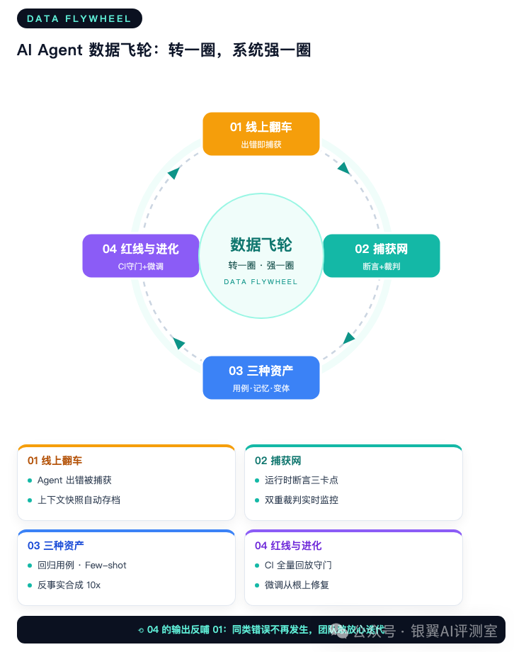
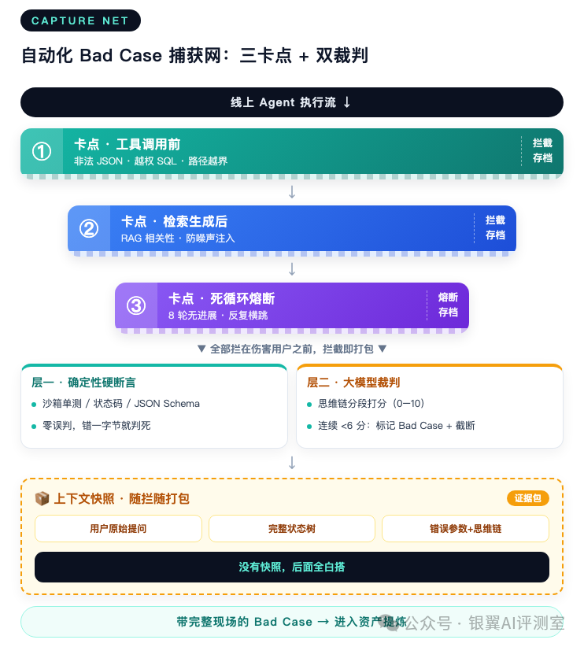
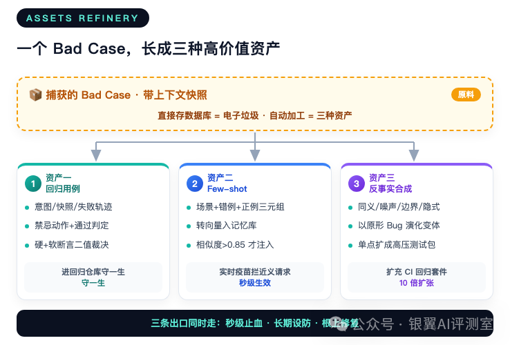
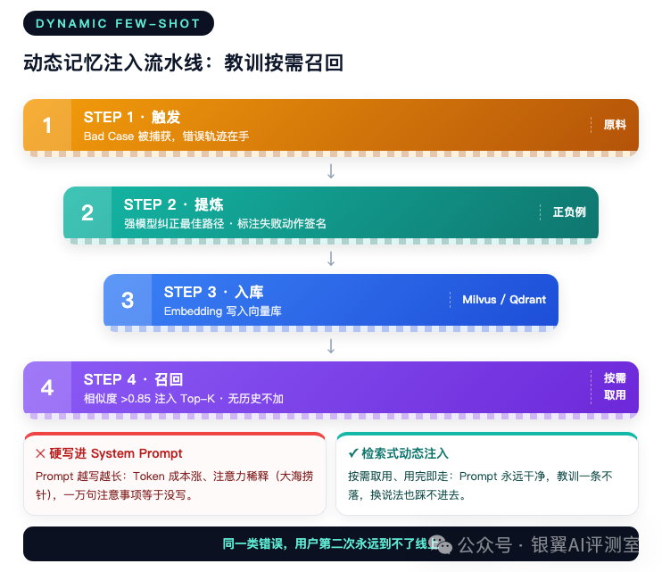
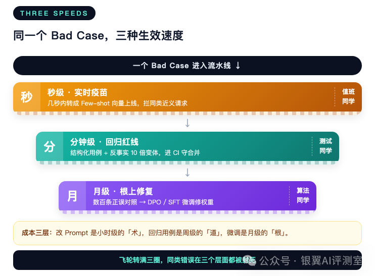
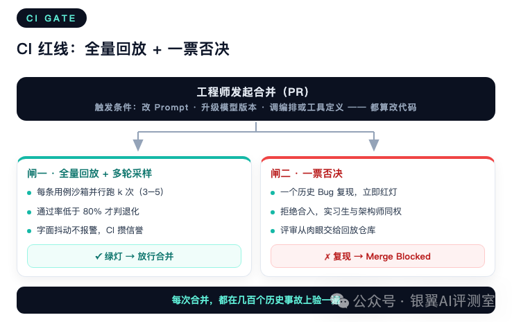

# AI Agent 数据飞轮：让每个 Bad Case 自动长成资产

作者：银翼AI评测室

发布时间：2026年10月25日 09:37

原文：https://mp.weixin.qq.com/s/LNuVNow63FTwls8RJZhM9Q

---

**📖 本篇目录**

- ① 被动响应模式：Agent 团队的质量困境
- ② BUG捕获网：别指望用户帮你点踩
- ③ 资产提炼：一个 Bad Case 自动生长为三种资产
- ④ 飞轮转起来：秒级、分钟级、月级三段节奏
- ⑤ CI 红线：把体检中心建进流水线
- ⑥ 文化重塑：从追责到转化
- ⑦ 结语：飞轮转满三圈之后

## 01被动响应模式：Agent 团队的质量困境

先还原一个典型的日常。用户在群里反馈 Agent 答错，工程师查日志定位到某一步 Prompt 的问题，临时改一版、顺手补几句限制条件就发版；结果第二天，一个完全没预料到的边界条件再次引发故障。

如此循环两三个月，系统 Prompt 会退化成「面条代码」：补丁摞补丁，没人看得懂，谁改谁崩。工程师在反复返工中消耗，出一次事故开一次追责会，团队开始不敢碰核心逻辑。

问题的根源在于，传统软件工程那套质量手段在 Agent 面前全部失灵。过去的 Bug 是确定性的：空指针、语法错误、SQL 越权，写个单测堵住，问题永久解决。Agent 不是。同一个 Prompt，底层模型一升级表现就可能完全不同；你微调了一个中间插件，可能在无意中打断三条多 Agent 协同链路。用户永远能用你想不到的自然语言击穿你的预期，而长链路还会放大错误：检索阶段把「iPhone 15」捞成「iPhone 15 Pro Max 配件」，规划阶段带着这个偏差去选工具，工具调用阶段就真的下了错单——第一步偏一点，第三步就是真金白银的灾难。

继续「人工客诉、人工看日志、人工改 Prompt」，团队的吞吐量永远追不上业务膨胀的速度。唯一的出路，是把「处理 Bug」本身变成一条工业流水线。我们的做法叫数据飞轮：线上错误自动捕获、自动提炼成三种资产、用资产守住代码合入的红线，最后让系统自己变聪明。

数据飞轮全景：线上翻车 → 捕获网 → 三种资产 → 红线与进化，转一圈，系统聪明一圈

这张图是全文的地图，后面四节按环节逐个拆开。

## 02BUG捕获获网：别指望用户帮你点踩

飞轮的第一环，是让每一个线上错误无所遁形。这里有个反直觉的数据：遇到 Agent 崩溃或答非所问时，只有不到 2% 的用户会投诉，绝大多数人直接默默流失。等用户点踩再行动，等于放走了 98% 的样本。所以必须在生产系统底层布下一张自动捕获网。

### 运行时断言拦截：三个关键卡点

传统代码里的 assert 语句，在 Agent 的执行流里同样要布，而且要布在三个最容易出事的位置：

| 卡点 | 位置 | 拦什么 |
| --- | --- | --- |
| 工具调用前 | Agent 准备调用工具的瞬间 | 非法 JSON 参数、越权 SQL（DROP TABLE、不带 WHERE 的 DELETE）、越界的文件路径 |
| 检索生成后 | RAG 捞完外部文档之后 | 捞回来的内容与问题是否相关，防止噪声注入污染幻觉底座 |
| 死循环熔断 | 整个会话过程中 | 同一任务超过阈值轮次（比如 8 轮）没有状态进展，或在两个工具之间反复横跳，立即熔断 |

三个卡点的共同哲学：在错误对用户造成实质伤害之前就地正法，而不是等用户投诉了再复盘。

拦截之后最关键的动作，是瞬间打包一份高保真上下文快照：用户的原始提问、触发拦截前一秒的完整状态树（短期记忆、历史工具返回值）、导致断言失败的错误参数。不能只返回一句「执行出错」——这份快照是后面提炼资产的生命之源，没有它，后面全部白搭。

### 双重裁判：确定性管对错，大模型管好坏

断言只能拦「硬错误」，大量 Bad Case 是软性的：逻辑跳跃、答非所问、隐性幻觉。所以捕获网配了双裁判：

第一层是确定性硬断言，管有标准答案的事。代码生成丢进隔离沙箱跑单元测试，返回码非零直接判死；API 调用查状态码，JSON 输出对 Schema，错一个字节都不行。零误判，但覆盖面窄。

第二层是大模型裁判，管没有标准对错的事。关键设计在「实时分段」：传统做法等 Agent 给出最终答案才打分，这时错误已经扩散到结局了。更好的做法是每完成一个子任务，就让裁判模型给当前这步的中间思维链打语义分——有没有逻辑跳跃、有没有偏离主线、有没有幻觉。评分连续低于安全线（比如满分 10 分低于 6 分），系统立刻标记「潜在 Bad Case」并把任务强行截断，避免后续步骤雪崩。

两层的分工口诀一句话：能跑测试的绝不叫裁判，裁判只管开放题。另外有个容易忽略的工程细节：裁判接口自己也会抖动，超时或解析失败时默认放行而不是拦截——错放一个 Bad Case 损失可控，把正常请求全卡死才是事故。

自动化 Bad Case 捕获网：三卡点拦截 + 上下文快照 + 双重裁判

两层裁判配合三个卡点，收获两样东西：错误在对用户造成伤害前被就地正法；每个被拦下的 Bad Case 都带着完整「犯罪现场」进入下一环，零信息丢失。

## 03资产提炼：一个 Bad Case 自动生长为三种资产

捕获回来的 Bad Case 如果只是存进数据库，那就是一堆电子垃圾。价值提炼这一环，是用自动化流水线把它加工成三种资产，各有各的用途。这也是整条飞轮里技术密度最高的环节，值得单独展开。

一个 Bad Case 长成三种资产：回归用例、Few-shot 记忆、反事实合成

### 资产一：自动提炼回归用例，绝不允许同一个错犯两次

线上日志噪声很大：时间戳、中间状态、无关环境变量。提炼的第一步是剥掉噪声，把事故压缩成一份可断言的「测试契约」，五个要素缺一不可：

- 用户原始意图：剔掉客套话和前导语之后的纯净 Query
- 环境快照：触发 Bug 时的初始状态（数据库数据、接口返回）
- 失败轨迹：导致崩溃的完整思维链和工具调用序列
- 禁忌动作：明确禁止再犯的动作，比如「禁止调用未校验参数的接口」
- 通过判定：硬断言（状态码、Schema）加软断言（裁判评分）组成的二值裁决

五要素里最值钱的是后两个：禁忌动作把「这个坑不能再踩」变成机器可执行的断言；通过判定的二值化让用例可以自动裁决，不允许「看起来比上次好」这种模糊判定进仓库。

这套提炼是全自动的，流水线分三步。第一步剥噪声：从原始遥测日志里去掉时间戳、中间状态变体和无关环境变量，只留用户原始 Query 和完整执行轨迹。第二步归因：把失败轨迹交给裁判模型做结构化分析，输出两个关键字段——根因分类（参数校验缺失、检索污染、规划死循环这类标签）和禁忌动作（比如「禁止调用未校验参数的接口」）。第三步组装：按固定结构生成用例，头部带来源和根因分类（入库后按根因聚类，能直接统计出当前系统的 Top 缺陷类型），断言区放三件套：禁忌动作清单、输出 Schema 校验、步骤数红线。红线取失败轨迹的步数加二——Agent 走得比当初出事时还绕，即使结果对了也判不合格，防止用例被「绕远路」的解法骗过。

人工只保留两个卡点：新根因类型的首次确认，和入库前的抽样质检。其余环节全部自动，一个 Bad Case 从被捕获到躺进回归仓库，通常只要几分钟。这份用例沉淀进公司的回归测试仓库，从此每次代码合并都要过它一遍。单个 Bug 的价值从「修一次」变成「守一生」。

### 资产二：动态 Few-shot 记忆库，几秒钟生效的实时疫苗

打补丁的老办法是把「注意不要再犯 XX 错误」硬写进系统 Prompt。问题是 Prompt 会越写越长，Token 成本涨，模型注意力还稀释——考卷里塞一万句注意事项，等于没写。

动态注入换了个思路，本质是给 Prompt 做检索增强（RAG for Prompts）：把每个 Bad Case 打包成「触发场景、错误做法示范、正确做法示范」的三元组——错误示范直接取自失败轨迹，并打上失败动作签名（比如「未校验参数即调用下单接口」这类可检索的错误模式）；正确示范由更强的模型按最佳实践重走一遍；两个示范一负一正，模型看一眼就知道边界在哪。三元组转成向量存进向量库，线上新请求到来时，系统算它与历史案例的余弦相似度，超过阈值（比如 0.85）才召回最相关的几条教训拼进本次上下文；没有相关历史时，Prompt 保持干净，一个多余的字都不加。用户换个说法踩到同一个坑，几秒钟内就会被「打疫苗」——同样的错误连第二次都到不了线上。

动态记忆注入流水线：触发 → 提炼 → 入库 → 按需召回

### 资产三：反事实合成，把单点事故扩成高压测试包

单个 Bad Case 只是冰山一角。「查北京到上海的机票」这条例子崩溃了，只把这一条存进测试集，防御力非常有限——用户有一万种说法能绕过去。反事实合成的思路，是利用大模型的语义泛化能力，以单个「原形 Bug」为蓝本，自动演化出多维度的「变体高压测试包」。

工程上的做法，是把大模型当成一个不知疲倦的测试设计师。给它一段固定的角色指令：你是一个 Agent 测试专家，这里有一个生产环境捕获的真实崩溃，附上原始失败 Query 和根因描述，请按指定维度演化出强对抗性的变体，以结构化格式输出，方便直接灌进测试仓库。变体维度通常固定五条：

| 变体维度 | 变形示例 | 验证重点 |
| --- | --- | --- |
| 同义与口语化 | 「帮我订一张京城飞魔都的票」 | 实体识别与语义对齐 |
| 噪声注入 | 「查下北京到上海的机票啊啊啊不小心按错了……」 | 抗干扰能力 |
| 边界突破 | 「查一下 2099 年 12 月 31 日的航班」 | 参数校验与异常捕获 |
| 隐式意图 | 「查下我老家到我大学所在地的航班」 | 隐式上下文解析与参数回填 |
| 多意图混杂 | 「查机票，顺便看看天气和酒店」 | 长链路规划与工具分发 |

一个孤立事故经过这轮扩展，通常能变成十个以上的变体用例，直接扩进 CI 回归套件。事故越刁钻，长出来的测试包越值钱——最刁钻的那批线上事故，往往贡献了防御覆盖面最大的测试子集。

三种资产不是三选一：同一个 Bad Case 进流水线后，三条出口同时走。Few-shot 记忆负责秒级止血，回归用例加变体负责长期设防，正误对照轨迹攒够了负责根上修复。下一节按生效速度把这条节奏拆开。

## 04飞轮转起来：秒级、分钟级、月级三段节奏

三种资产不是各转各的，它们按生效速度组成一条节奏分明的流水线。

同一个 Bad Case 的三种生效速度：秒级疫苗、分钟级回归、月级微调

第一阶段，秒级生效。Bad Case 被捕获后几秒内转成 Few-shot 向量上线，当「实时疫苗」拦住同类近义请求，止损最快。

第二阶段，分钟级沉淀。提炼成结构化回归用例，配合反事实合成扩充十倍变体，进入 CI 流水线，守住代码合并的红线。

第三阶段，月级演进。当「错误轨迹、正确轨迹」的对照样本积累到数百条，自动打包成 DPO 或 SFT 格式的训练数据集，对模型微调——从底层权重上把这类缺陷彻底修掉，这些样本就退休归档。

三段节奏对应三种成本：改 Prompt 是小时级的术，回归用例是周级的道，微调是月级的根。对应到人，值班同学盯疫苗上线，测试同学管回归仓库，算法同学吃微调数据——一个 Bad Case 顺着流水线流过三个团队，每一环都从中受益。飞轮转满三圈，同类错误在三个层面都被封死。

## 05CI 红线：把体检中心建进流水线

资产再多，如果没有强制的工程卡点，它们只会在仓库角落里积灰。飞轮的第三环，是把 CI/CD 改造成 AI 的体检中心。这里先要解决一个技术难题：大模型的输出是概率性的，同一用例今天过明天挂，如果每次提交都因为字面抖动随机报红，工程师很快会对 CI 失去信任，然后想办法绕过它。

还有个认知要先对齐：Agent 时代的「代码」远不止 Python 文件。Prompt 是代码，模型版本是代码，工具定义和编排逻辑也是代码——三条任何一条动了，都可能改变线上行为，所以红线的覆盖面必须是全部三类变更。

解法是多轮采样加容忍度阈值：每条历史 Bad Case 在 CI 里自动并行跑 k 次（通常 3 到 5 次），只有通过率低于阈值（比如低于 80%）才判退化，偶尔一次字面抖动不报警。CI 的信誉就是这么攒起来的。

然后是两条铁律。第一，防退化红线：任何人改了 Prompt、升级了底层模型、调整了编排逻辑，合并之前必须通过历史沉淀的全量 Bad Case 回放。第二，一票否决：只要有一个历史 Bug 复现，流水线立刻亮红灯，代码拒绝合入，实习生和架构师一视同仁。回放集积累到几百条后，单轮全量回放的成本仍然可控——多数用例沙箱并行跑三遍，一轮几十分钟，换来的是每次合并都在几百个历史事故上验一遍。

这套机制带来的隐性收益是「人治交给法治」。过去代码评审全凭老员工的经验和肉眼，隐蔽的边界条件难免漏掉，评审会上还得争论「这样改会不会出问题」。现在不用争了，看一眼 CI 绿灯就能放心合并，老员工的精力腾出来做更有价值的事。

CI 红线：全量 Bad Case 回放 + 一票否决

## 06文化重塑：从追责到转化

制度流水线只是骨架，最后决定飞轮转不转得动的，是团队愿不愿意往里喂料。这恰恰是最难的一环。

传统团队里，线上出重大 Bug 意味着追责会。工程师自然学会防御：多一事不如少一事，能瞒就瞒，出了事先想怎么撇清。可数据飞轮的前提恰恰是「错误要被充分暴露」，大家都不敢报错，捕获网就成了摆设。

我们做的转变，是把考核导向从「零故障」换成「错误转化率」：本月有多少线上事故被转化成了入库用例、变体和记忆条目。事故本身不扣分，转化率为零才扣分。指标一换，行为全变：

| 维度 | 追责文化 | 转化文化 |
| --- | --- | --- |
| 对待 Bug | 需要掩盖和惩罚的事故 | 喂养系统变聪明的养分 |
| 工程师行为 | 畏首畏尾，出事先撇清 | 主动探索边界，挖到新 Bad Case 算贡献 |
| 考核导向 | 零故障（虚假的平静） | 错误转化率（谁贡献了最有价值的回归用例） |

当团队意识到「抓到一个奇葩 Bad Case 提交进流水线，不仅公开表扬，还让自己的 AI 助手变强」时，行为就完全反转了：过去藏着的边缘问题被主动翻出来，边界测试从任务变成爱好。飞轮的转速，最终取决于喂料的手。

## 07结语：飞轮转满三圈之后

回头看这套体系，其实就四步：捕获网保证错误不漏，三种资产保证错误增值，CI 红线保证错误不重犯，文化转向保证错误不断供。它跑通之后，团队面对线上问题的姿态整个变了——用户投诉不再是灾难，而是系统进化的一次进货。

想动手的团队，建议按这个顺序起步：先把运行时断言和上下文快照搭起来（没有快照后面全是空谈），再立 CI 红线（有十几个回归用例就能跑），文化的事放在流程后面自然长。别一上来就追求微调和大而全，飞轮是一圈一圈转快的。
